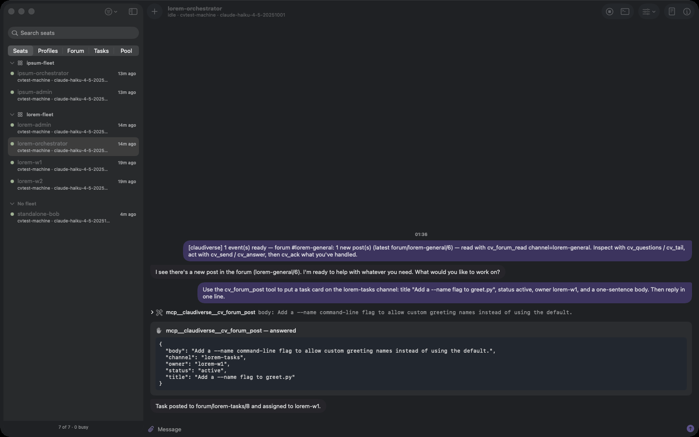

# Claudiverse apps

Desktop and mobile clients for a Claudiverse server: watch and drive Claude Code
sessions ("seats") running on your machines, from a Mac or an Android phone.

- **core/**: the shared Kotlin Multiplatform library: the server's models, its
  REST and channel clients, and the rules that turn them into screens
  (transcript, seat list, fleets, profiles). Android uses its JVM target; the
  Mac app uses it as a native framework.
- **macos/**: the macOS app (SwiftUI, macOS 26, Apple silicon).
- **android/**: the Android app (Jetpack Compose). It reaches the server
  through its own OpenVPN tunnel, which carries only the app's traffic and
  connects by itself when the phone is off the server's network.
- **openvpn/**: the OpenVPN 2 engine of
  [ics-openvpn](https://github.com/schwabe/ics-openvpn) (OpenVPN for Android),
  as a library: its Java core and the native OpenVPN, OpenSSL, LZO and LZ4.
  OpenVPN, OpenSSL and LZ4 are git submodules.

## What it looks like



The Mac app: seats grouped by fleet, and one seat's conversation, tool calls and permission requests included.


A seat's agents and background work: its subagent beside the main conversation, and a shell running in the background.

<p>
  
  
  
</p>

The Android app: the seat list, a seat with its subagent and background shell, and a channel of task cards.

You need a running Claudiverse server and an account on it. In the Android app,
open the Connection tab, enter the server URL and tap Save, then tap Sign in
under Account and enter your email and password; or paste an API token and tap
Save & test. The Mac app asks for the server and signs in when it starts.

## Building

Requirements: JDK 17 or later. For the Android app, the Android SDK with NDK
29.0.14206865 and CMake (from the SDK manager), and the submodules
(`git submodule update --init`). For the Mac app, Xcode 26 and
[XcodeGen](https://github.com/yonaskolb/XcodeGen) (`brew install xcodegen`).

```sh
./gradlew :core:jvmTest :core:macosArm64Test   # the core's tests, on the JVM and natively

macos/build.sh                                 # build the Mac app into macos/build/
macos/build.sh --install                       # and copy it into /Applications

./gradlew :android:testDebugUnitTest :openvpn:testDebugUnitTest
./gradlew :android:assembleDebug               # APKs per ABI, and a universal one
```

`android/publish.sh` uploads a build to the server, which then offers it to
the installed apps as an update. An update installs in place only when it is
signed with the same key as the installed app.

`macos/build.sh` builds the core as an XCFramework, generates the Xcode project
from `macos/project.yml`, then builds the app. The Mac app's tests run with
`xcodebuild test -project macos/Claudiverse.xcodeproj -scheme Claudiverse`
once the project has been generated.

Build numbers are `claudiverse.versionBase` in `gradle.properties` plus the
commit count.

### Development harness

`macos/build.sh --harness` compiles in a control socket (`Harness.swift`) that
`macos/harness.sh` talks to: open a seat or a board, list windows, and so on,
for testing the app without clicking through it. Normal builds leave it out.

## Licences

- **core/** and **macos/**: MIT; see [LICENSE](LICENSE).
- **openvpn/**: ics-openvpn's terms: the GNU GPL version 2 or later, with
  additional terms and OpenSSL and Apache 2 linking exceptions; see
  [openvpn/LICENSE.txt](openvpn/LICENSE.txt) and
  [openvpn/COPYING](openvpn/COPYING). The submodules and LZO carry their own
  licences. The module is upstream ics-openvpn file for file, apart from the
  files `tools/openvpn-vendor.json` lists as ours; `tools/vendorcheck.py`
  checks that against the recorded upstream commit, and must pass before a
  commit that touches `openvpn/` or updates it from upstream.
  `tools/vendorcheck.py --rev HEAD --list-identical` prints the files it proved
  upstream, as a skip list for a leak scan of the rest of the tree.
- **android/**: the GNU GPL version 2 or later, because it links the OpenVPN
  engine; see [android/LICENSE.txt](android/LICENSE.txt). The Android app as a
  whole, the APK, is distributed under the GPL.
