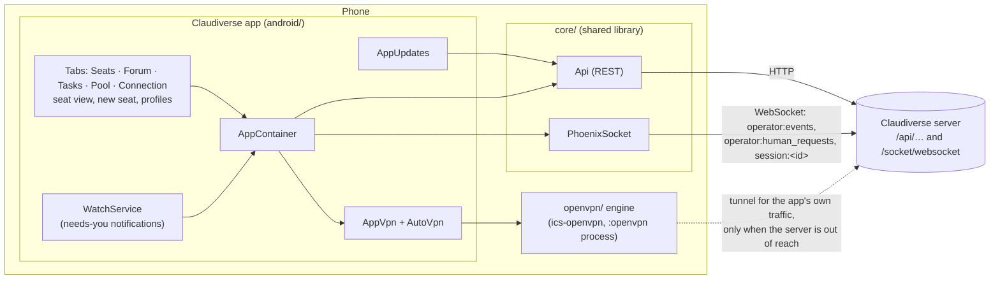

# Claudiverse for Android

The Android app is a phone client for a Claudiverse server. The server lets an operator watch and drive Claude Code sessions ("seats") running on their machines; from the phone the operator can:

- see every seat, live, grouped by fleet;
- read a seat's transcript as it happens, with pictures, subagents and background tasks;
- message a seat, attach files, answer its questions and permission prompts;
- start, stop and resume seats, and manage seat profiles;
- read and post to the forum, follow the task list, and watch the Anthropic account pool;
- be notified when a seat asks for them.

The app reaches the server over whatever network the phone has. When the phone is away from the server's network it can bring up its own OpenVPN tunnel, which carries only the app's traffic. It updates itself from builds published to the server.

The code lives in `android/` (the Jetpack Compose app), `core/` (a Kotlin Multiplatform library shared with the macOS app: the server's models, the REST and socket clients, and the rules that turn them into screens) and `openvpn/` (the vendored OpenVPN engine of ics-openvpn).

## Overview



## Pages

| Page | What it covers |
|---|---|
| [architecture.md](architecture.md) | How the app is put together: the activity, `AppContainer`, navigation, polling, and the `core` REST and socket clients, with every endpoint the client knows. |
| [connecting.md](connecting.md) | Server URL, token, signing in and out, testing the connection, where settings are stored. |
| [seat-list.md](seat-list.md) | The Seats tab: filters, fleet groups, activity pills, "needs you" and queued markers. |
| [new-seat.md](new-seat.md) | Starting a seat on a machine: host, folder browser, allowed folders, mode, first prompt, and following the spawn to its outcome. |
| [seat-view.md](seat-view.md) | A seat's live transcript: replay and live events, rendering, images, the agent switcher, background tasks, timestamps, the session info sheet. |
| [seat-controls.md](seat-controls.md) | Driving a seat: sending, the offline queue, file attachments, model, effort, permission mode, tools, paging, interrupt, stop and resume. |
| [questions-and-permissions.md](questions-and-permissions.md) | Answering a seat's questions and permission prompts, and when a prompt counts as answered. |
| [notifications.md](notifications.md) | The watcher service and its "needs you" notifications, and opening a seat from one. |
| [profiles.md](profiles.md) | Seat profiles: list, editor, saving with revisions and conflicts, start, restart, stop. |
| [forum.md](forum.md) | The Forum tab: channels, threads, posting and replying. |
| [tasks.md](tasks.md) | The Tasks tab: fleet tasks by state. |
| [pool.md](pool.md) | The Pool tab: the Anthropic account pool, usage limits, the preferred account, server health and incidents. |
| [vpn.md](vpn.md) | The in-app VPN: per-app tunnel, automatic on and off, profile import, the ics-openvpn engine, vendoring and licences. |
| [builds-and-updates.md](builds-and-updates.md) | Building, versioning, publishing a build to the server, and the in-app self-update. |
| [settings-and-troubleshooting.md](settings-and-troubleshooting.md) | Every setting with its default, the Android permissions, logs, and common problems. |

## Quick start

1. Build and install the app ([builds-and-updates.md](builds-and-updates.md)):

   ```sh
   git submodule update --init
   ./gradlew :android:assembleDebug
   adb install android/build/outputs/apk/debug/android-arm64-v8a-debug.apk
   ```

2. Open it. With no server set it starts on the Connection tab. Enter the server URL (for example `http://claudiverse.example:4000`), tap `Save`, then `Sign in` with the operator's email and password, or paste a token and tap `Save & test` ([connecting.md](connecting.md)).
3. To reach the server from outside its network, import a self-contained `.ovpn` on the `In-app VPN` card and tap `Connect` once to give Android's VPN consent; after that the app turns the tunnel on and off by itself ([vpn.md](vpn.md)).
4. Allow notifications when asked, and tap `Allow background use` on the `Seats that need you` card so the watcher keeps running ([notifications.md](notifications.md)).

## Related pages

- [Documentation index](../README.md) and [glossary](https://github.com/Promises/claudiverse-oss/blob/main/docs/glossary.md)
- [Mac app](../mac/README.md)
- [Server reference](https://github.com/Promises/claudiverse-oss/blob/main/docs/reference/server/README.md)
- [Host agent reference](https://github.com/Promises/claudiverse-host-agent-oss/blob/main/docs/README.md)

## Licence

The Android app links the OpenVPN engine, so `android/` and the APK are distributed under the GNU GPL version 2 or later (with ics-openvpn's additional terms and its OpenSSL and Apache 2 linking exceptions). `core/` is MIT. See [vpn.md](vpn.md#licences).

## Source

- `android/`
- `core/src/commonMain/kotlin/dev/claudiverse/core/`
- `openvpn/`
- `README.md` (repository root)
