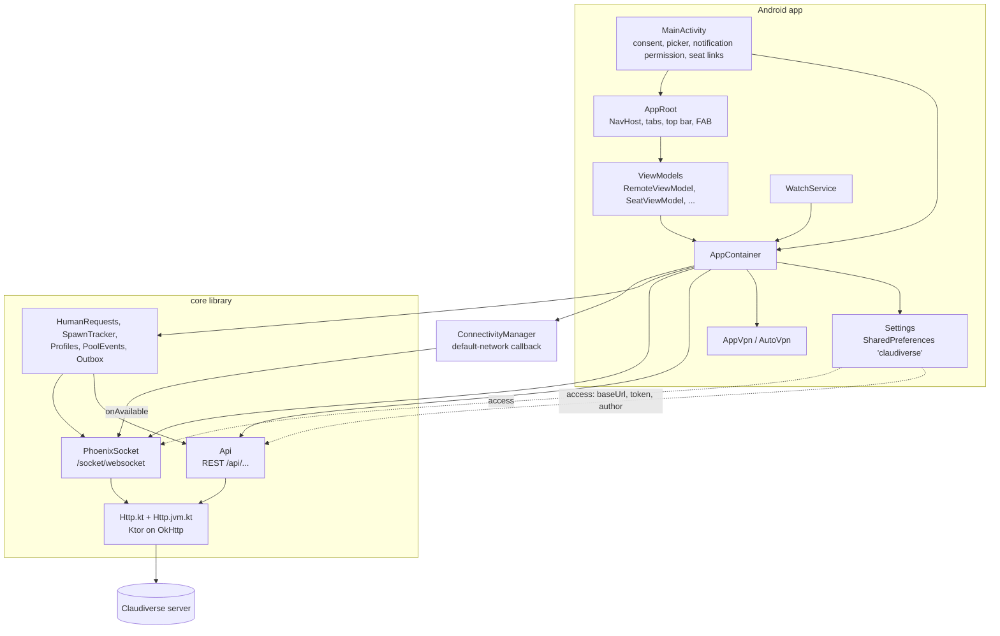

# Architecture

The Claudiverse Android app is a client for a Claudiverse server. The server lets an operator watch and drive Claude Code sessions ("seats") running on their machines; the app lists them, shows their transcripts live, answers them, starts and stops them, and reads the forum, task list and account pool. This page explains how the app is put together: one activity, one container of per-process singletons, one navigation graph, and the shared Kotlin library (`core`) that talks to the server.

## How it works

There is exactly one activity (`MainActivity`) and no custom `Application` class (the vendored OpenVPN engine owns that slot). Everything long-lived hangs off `AppContainer`, a lazily created, process-wide singleton built from the application context. Compose screens (`AppRoot` and the screens it hosts) get the container, read server data through `Api` (REST) and `PhoenixSocket` (live events), and keep their settings in `Settings`.

`Api` and `PhoenixSocket` are both constructed with a lambda that reads `settings.config.value.access` on every call. A URL or token saved on the Connection tab therefore applies to the next request without a restart. The socket is not reconnected by a settings change on its own; it picks up the new URL/token the next time it opens.

## MainActivity

`MainActivity` is a `ComponentActivity` declared `singleTop` in the manifest. It owns the things that need an Activity and hands the rest to Compose:

| Concern | How it works |
|---|---|
| VPN consent | `connect()` asks `app.vpn.consentIntent()`. If Android needs the user's consent it launches that intent for a result; `RESULT_OK` calls `app.vpn.connect()`, anything else shows the toast `VPN permission was not granted`. With no intent needed it connects directly. |
| File picker | `OpenDocument` with MIME filter `*/*` imports an `.ovpn` profile. The display name comes from `OpenableColumns.DISPLAY_NAME` (fallback `claudiverse`). Toasts: `Imported <name>` or `Import failed: <message>`. |
| Notification permission | On Android 13 (TIRAMISU) and later, `POST_NOTIFICATIONS` is requested when the watcher is turned on and the permission is not yet granted. Refusal toast: `Without notifications you will not hear when a seat needs you`. |
| Watcher lifecycle | A coroutine collects `settings.config` mapped to `notifyRequests && isComplete` (distinct). On true: ask for the notification permission, then `WatchService.start`. On false: `WatchService.stop`. So the watcher follows the setting even when it is changed in the app. |
| Startup work | Only when `savedInstanceState == null` (a fresh launch, not a rotation): `app.autoVpn.schedule()`, and `app.updates.check()` if the config is complete. |
| Opening a seat from a notification | `handleSeatLink` reads the `WatchService.EXTRA_SEAT_ID` (long, `-1` when absent) and `WatchService.EXTRA_SEAT_TITLE` (default `"Seat"`) extras from the launching intent (in `onCreate` and `onNewIntent`), pushes a `SeatLink(id, title)` into a `MutableStateFlow`, and removes the extra. `AppRoot` navigates to it and clears the flow. |

`AppRoot` navigates to `seat/<id>?title=<title>` only when the top of the back stack is not already that seat. The code comments explain why: `launchSingleTop` matches the route pattern, not the id, and from another seat's screen it once kept that seat's view model under the new title.

## AppContainer

One instance per process, created by `AppContainer.get(context)` (double-checked, synchronized). The `init` block sets `CoreLog.sink` first so that nothing below can log into the void.

| Member | What it is for |
|---|---|
| `scope` | `CoroutineScope(SupervisorJob() + Dispatchers.Default)` shared by the long-lived parts. |
| `settings` | `Settings`: server URL, token, forum author, auto-connect and notify flags, imported VPN profile UUID. See [connecting.md](connecting.md). |
| `vpn` | `AppVpn`: the app's own OpenVPN tunnel. See [vpn.md](vpn.md). |
| `api` | `Api { settings.config.value.access }`: the REST client. |
| `outbox` | `Outbox(PrefsOutboxStore(context), api, scope)`: messages typed for a seat that could not be delivered yet. |
| `socket` | `PhoenixSocket({ settings.config.value.access }, scope)`: the one live-events socket. |
| `humanRequests` | `HumanRequests(api, socket, scope)`: open requests from seats asking for the operator. Started and stopped only by `WatchService`; the seat list and seat view read its `open` map, which stays empty while the watcher is off. See [notifications.md](notifications.md). |
| `autoVpn` | `AutoVpn`: turns the tunnel on away from the server's network and off on it. Started in `init`. |
| `updates` | `AppUpdates(context, api, scope)`: checks the server for a newer build of this app. See [builds-and-updates.md](builds-and-updates.md). |
| `spawns` | `SpawnTracker(api, socket, scope)`: spawns and resumes started from the app, followed to their outcome; drives the snackbar in `AppRoot`. |
| `images` | `TranscriptImages(api)`: pictures in transcripts, cached by file. |
| `poolEvents` | `PoolEvents(socket, scope)`: live pool changes while the Pool tab is open. |
| `profiles` | `Profiles(api, socket, scope)`: seat profiles kept current from socket events. Reference-counted: `watchProfiles()` starts it for the first watcher and `unwatchProfiles()` stops it when the last leaves (the list and the editor each watch). |
| `seatsIncludeStopped` | `MutableStateFlow(false)`: the seat list's "Running" filter being off. Kept here because the list's view model outlives the screen and must read the current value on every poll. |

### Default-network callback

On API 24 (N) and later, `init` registers a `ConnectivityManager` default-network callback. Its `onAvailable` calls `socket.reconnectNow()`. The comment gives the reason: a returned network (Wi-Fi back, the tunnel up) should reconnect at once instead of waiting out the socket's backoff. `reconnectNow()` does nothing if a connection already exists or no channel is wanted.

## Navigation and tabs (AppRoot.kt)

`AppRoot(app, openSeat, vpnActions)` builds a `Scaffold` with a top bar, a bottom `NavigationBar`, a snackbar host and a floating action button around a `NavHost`.

### Tabs

| Route | Label | Icon |
|---|---|---|
| `seats` | Seats | AccountCircle |
| `forum` | Forum | Email |
| `tasks` | Tasks | List |
| `pool` | Pool | Info |
| `connection` | Connection | Lock |

### Routes

| Route | Screen | Notes |
|---|---|---|
| `seats` | `SeatsScreen` | `RemoteViewModel` polled every 10 000 ms: `api.seats(includeStopped)`. |
| `seat/{id}?title={title}` | `SeatScreen` | `id` is a Long; `title` is optional (nullable). `SeatViewModel(app, id)`. |
| `new-seat` | `NewSeatScreen` | Full screen: no top bar or bottom bar while open. |
| `profiles` | `ProfilesScreen` | Opened from the Profiles icon in the top bar on the `seats` route. |
| `profile/{id}` | `ProfileEditorScreen` | `id` Long; `-1` (`NEW_PROFILE`) is the empty form. After creating, navigates to `profile/<newId>` and pops the form. |
| `forum` | `ChannelsScreen` | `RemoteViewModel(pollMs = null)`: loaded once, refresh on demand. |
| `channel/{slug}` | `ChannelScreen` | Polled every 20 000 ms: `api.posts(slug)`. Posting uses `api.createPost`. |
| `thread/{id}` | `ThreadScreen` | `id` Long; polled every 20 000 ms: `api.thread(id)`. Reply uses the root's channel; if the root has no channel the error is `post #<id> has no channel`. |
| `tasks` | `TasksScreen` | `api.tasks(state, fleet = null, limit = 200)`. |
| `pool` | `PoolScreen` | Polled every 30 000 ms; see below. |
| `connection` | `ConnectionScreen` | Account, server, notify and update cards plus the VPN card. |

### Start destination

`start = if (config.isComplete) "seats" else "connection"`. A config is complete when both the server URL and the token are non-blank. The value is computed when `AppRoot` composes; it only decides where a fresh `NavHost` starts, so saving a complete config while on the Connection tab does not navigate away.

### Tab behaviour

- Selected tab: `tabFor(route)` maps detail routes to their tab so it stays lit: `seat/*`, `profiles`, `profile/*` belong to Seats; `channel/*` and `thread/*` belong to Forum; every other route is its own tab.
- Tapping another tab calls `navigateTab`: pop up to the graph's start destination with `saveState = true`, `launchSingleTop = true`, `restoreState = true`. A tab restores where it was left.
- Re-tapping the current tab goes back to that tab's top level: `popBackStack(tab.route, inclusive = false)`; if that returns false it falls back to `navigateTab`. A chat therefore returns to the seat list.
- The Connection tab shows a badge when `updateState is UpdateState.Available`.

### Top bar

- Title from `titleFor`: the `title` argument (default `Seat`) on a seat, `#<slug>` on a channel, `Thread #<id>`, `Profiles`, `New profile` or `Profile`, otherwise the tab label (fallback `Claudiverse`).
- On a seat route the whole title area is clickable and opens the session info (`seatInfo` state, reset on every route change).
- A back arrow (`Back`) appears when the route is not a tab root.
- On the `seats` route an icon button (`Profiles`) opens `profiles`.
- The `VpnPill` is always shown at the right; tapping it navigates to the Connection tab.

### Floating action button

On the `seats` route only: an extended FAB with text `New seat` that navigates to `new-seat`.

### Spawn snackbar

`AppRoot` collects `app.spawns.notice` and shows:

- `Pending`: `<op.doing> “<title>” on <host>…` (indefinite, dismissable).
- `Started`: `“<title>” <op.done> on <host>` with the action `View`.
- `Failed`: `“<title>” <op.notDone>: <error>` (dismissable).

Tapping `View` opens the new seat: by `sessionId` from the event, or, from an older server, by finding the newest seat with that title via `api.seats()`.

### Pool tab data

The pool screen's view model fetches `PoolView(health, pool, incidents)` in one poll: `api.health()` and `api.incidents()` are optional (failures become null); `api.pool()` must succeed. `poolEvents` supplies live changes and `makePreferred` calls `api.makePreferred(id)`.

## RemoteViewModel and polling (ui/Common.kt)

`Remote<T>(data, error, loading)` is the state of one fetched value. `RemoteViewModel<T>(pollMs: Long?, fetch)` loads it:

- It watches `state.subscriptionCount`. Only while something collects the state does it fetch, so a screen deeper in the back stack, or the app in the background, costs no requests.
- On becoming watched it loads immediately if there is no data yet or if polling is on; then, if `pollMs` is non-null, it repeats `delay(pollMs); load()` until it is no longer watched.
- A failed refresh keeps the last good data and sets `error` to `e.message` (or the exception class name). A successful load replaces the state with `Remote(data, null, false)`.
- `refresh()` forces a load.

`RemoteContent` is the usual frame: an `ErrorBanner` (message plus a `Retry` button) when there is an error, content when there is data, a spinner while loading with no data yet.

Poll intervals in the navigation graph: seats 10 s, channel and thread 20 s, pool 30 s, channel list none, tasks none (the screen supplies its own fetch).

## The core library as Android uses it

`core` is a Kotlin Multiplatform module shared with the macOS app. Android uses the JVM target.

### Http.kt and Http.jvm.kt

`platformHttpClient` is an `expect` function; on the JVM/Android it builds a Ktor `HttpClient(OkHttp)` with the OkHttp engine's `pingInterval(15, SECONDS)` (a WebSocket ping that fails the socket when no pong returns, a second line of defence under the Phoenix heartbeat). `createHttpClient()` installs `HttpTimeout` with `connectTimeoutMillis = 10_000` and `socketTimeoutMillis = 30_000`: a request that cannot connect in 10 s, or goes 30 s without a byte, fails instead of hanging the screen.

### Api (REST)

The REST client itself (URL building, authentication, JSON bodies, errors and `ApiException`, lenient parsing) is shared with the Mac app and described once, in [Core library: the REST client](../mac/core-library.md#the-rest-client-apikt). Two things matter on Android:

- A blank server URL or token fails with `ApiException("Set the server URL and token in Settings")`. On Android the screen is the Connection tab, not Settings.
- `download(path, sink, progress)` streams `<base><path>` with the bearer token in 64 KiB reads and reports bytes so far, for the self-update; a non-success status throws `ApiException("HTTP <status>: download failed", status)`.

### REST endpoints

Every endpoint in `Api.kt`. "Used by" names the Android screen or component; "not used" means no Android source calls it (the macOS app may). What each endpoint does and which token it needs is in the [Core library's endpoint table](../mac/core-library.md#endpoints).

| Method | Path | Function | Used by |
|---|---|---|---|
| POST | `/api/auth/login` | `signIn` | Connection tab, Sign in dialog |
| GET | `/api/me` | `me` | Connection tab (Account card, Save & test) |
| DELETE | `/api/auth/logout` | `signOut` | Connection tab, Sign out |
| GET | `/api/health` | `health` | Pool tab (optional part of the poll) |
| GET | `/api/sessions` (`status=all&limit=100` when stopped seats are included) | `seats` | Seats list; spawn snackbar `View` fallback |
| GET | `/api/sessions/{id}` | `seat` | Seat view; Outbox |
| POST | `/api/sessions/{id}/stop` | `stopSeat` | Seat view |
| POST | `/api/sessions/{id}/resume` | `resumeSeat` (via `SpawnTracker.resume`) | Seat view |
| POST | `/api/notify/send` | `send` | Seat view composer; Outbox |
| POST | `/api/sessions/{id}/permission_mode` | `setPermissionMode` | Seat view |
| GET | `/api/sessions/{id}/adopt_preview` (`host` query) | `adoptPreview` | not used |
| POST | `/api/sessions/{id}/adopt` | `adopt` | not used |
| POST | `/api/sessions/{id}/access` | `setAccess` | Seat view |
| POST | `/api/sessions/{id}/notify` | `setNotify` | Seat view |
| POST | `/api/sessions/{id}/files` (multipart `file`) | `uploadFile` | Seat view attachments |
| GET | `/api/human_requests?status=open` | `openHumanRequests` | `HumanRequests` (seat list, watcher) |
| POST | `/api/sessions/{id}/human_requests/resolve` | `resolveHumanRequests` | `HumanRequests` |
| GET | `/api/hosts` | `hosts` | New seat, Profile editor |
| GET | `/api/hosts/{host}/recent_dirs` | `recentDirs` | New seat |
| GET | `/api/hosts/{host}/ls?path=...` | `listDir` | New seat folder browser |
| POST | `/api/hosts/{host}/spawn` | `spawn` (via `SpawnTracker.spawn`) | New seat |
| POST | `/api/hosts/{host}/roots` | `addRoot` | not used |
| DELETE | `/api/hosts/{host}/roots` | `removeRoot` | not used |
| (composite) | `POST` then `DELETE` on `/api/hosts/{host}/roots` | `allowFolder` | not used |
| POST | `/api/hosts/{host}/token` | `hostToken` | not used |
| GET | `/api/fleets` | `fleets` | not used |
| GET | `/api/profiles` | `profiles` | Profiles store (Profiles screens) |
| POST | `/api/profiles` | `createProfile` | Profile editor |
| PATCH | `/api/profiles/{id}` | `updateProfile` | Profile editor |
| POST | `/api/profiles/{id}/rename` | `renameProfile` | not used |
| DELETE | `/api/profiles/{id}` | `deleteProfile` | Profile editor |
| POST | `/api/profiles/{id}/start` | `startProfile` | Profile screens |
| POST | `/api/profiles/{id}/restart` | `restartProfile` | Profile screens |
| POST | `/api/profiles/{id}/stop` | `stopProfile` | Profile screens |
| GET | `/api/tokens` | `tokens` | not used |
| DELETE | `/api/tokens/{id}` | `revokeToken` | not used |
| GET | `/api/app/builds/latest` | `latestBuild` (404 returns null) | App updates card |
| GET | `<server-relative path>` such as `/api/app/builds/1/apk` | `download` | App updates; transcript images |
| GET | `/api/forum/channels` | `channels` | Forum tab |
| GET | `/api/forum/channels/{channel}/posts` (`limit`, `before`) | `posts` | Channel screen |
| GET | `/api/forum/posts/{id}?thread=true` | `thread` | Thread screen |
| POST | `/api/forum/posts` | `createPost` | Channel and Thread screens |
| GET | `/api/tasks` (`state`, `fleet`, `limit`) | `tasks` | Tasks tab |
| GET | `/api/anthropic_auths` | `pool` | Pool tab |
| POST | `/api/anthropic_auths/{id}/preferred` | `makePreferred` | Pool tab |
| GET | `/api/incidents` | `incidents` | Pool tab |

Separately, `AutoVpn` probes `<base>/api/health` with its own OkHttp client (not through `Api`), see [vpn.md](vpn.md).

### PhoenixSocket

- URL: the server URL with `http` mapped to `ws` and `https` to `wss`, plus path `/socket/websocket`, query `token=<token>&vsn=2.0.0`. If the base cannot be parsed, is not http(s), or has no host, there is no URL and the socket does not open.
- Serializer: Phoenix V2, a JSON array per frame: `[join_ref, ref, topic, event, payload]`. A `phx_reply` is routed to the waiting request by `ref`; other frames go to the channel for the topic. Frames carry the join_ref of the join they belong to, and only the current join's frames are delivered (otherwise a rejoin or a draining old socket would deliver a broadcast twice).
- Opens when the first channel joins; closes when the last wanted channel leaves.
- Shared channels: `socket.channel(topic, params)` returns one `Channel` per topic (the server allows one join per topic per socket). Each call is a claim; `leave()` gives one back and only the last claim leaves the topic. A second `join()` on a joined channel re-sends the join so the new user gets the server's replay.
- `Channel.joined` / `Channel.error` state: join error `join timed out` after 10 s without a reply, else the reply's `response.reason` or `join refused`. On `phx_error`/`phx_close` a wanted channel rejoins after 2 s.
- `push(event, payload, timeoutMs = 10_000)` waits for the reply (null if none); `cast` does not wait.
- Heartbeat: every 20 s (`HEARTBEAT_MS`) a `phoenix`/`heartbeat` frame must be answered within 10 s (`HEARTBEAT_TIMEOUT_MS`), otherwise the connection is torn down as lost (`no heartbeat reply in <ms> ms`). `checkAlive()` does the same probe with a 5 s timeout (`PROBE_TIMEOUT_MS`), or reconnects now if there is no session; the seat view calls it on resume and after a send.
- Backoff: after a loss, while any channel is wanted, reconnect after `1000, 2000, 5000, 10000, 30000` ms (the last repeats); a successful open resets the attempt counter. `reconnectNow()` skips the wait and resets it.
- Log lines (through `CoreLog`): `socket open`, `socket lost (<why>)` where why is `closed ...`, `failed: <message>` or the heartbeat message.
- The socket client has no read timeout (a quiet channel is normal); connect timeout 10 s.

Topics the Android app joins:

| Topic | Params | Joined by | Events the app uses |
|---|---|---|---|
| `operator:events` | none | `SpawnTracker`, `Profiles`, `PoolEvents` (one shared channel) | spawn/profile/pool events, e.g. `pool`, `host_spawn` (see their pages) |
| `operator:human_requests` | none | `HumanRequests` | requests from seats asking for the operator |
| `session:<seatId>` | `{"role": "observer"}` | `SeatViewModel` (Seat view) | the seat's live transcript |

### Json.kt and CoreLog

`Json.kt` holds the lenient accessors described above (`str`, `text`, `long`, `int`, `bool`, `flag`, `obj`, `array`, `objects`, `strings`, `requireLong`, `requireStr`) plus a pretty printer for showing tool input and a `oneDecimal` formatter. Messages are Claude Code's own and change shape between versions; a field of the wrong type must not take the transcript down.

`CoreLog.sink` is where core's log lines go; it is a no-op until an app sets it. `AppContainer` points it at `Log.i("claudiverse", message)`.

`ClaudiverseClient` is the macOS app's equivalent wiring of the same parts; Android wires them itself in `AppContainer`. `Links.linkEnd` is a shared helper that finds where a URL in prose ends (used by the inline Markdown renderer).

## Theme (ui/Theme.kt)

`ClaudiverseTheme(dark = isSystemInDarkTheme())` replaces dynamic colour: the brand palette is used on every API level. The palette is "Claudiverse x Nord": Nord's Polar Night and Snow Storm neutrals, Frost as secondary, Aurora for status, and a violet primary shared with the web app (`#7C3AED` in the light scheme, `#A78BFA` in the dark scheme). `StatusColors` supplies pill colours: `good` (green), `busy` (yellow), `bad` (red), `muted`, `info`, `attention` (orange, for a seat asking for the operator) and `onStatus` (Nord0, dark text on every pill).

## Failure modes and troubleshooting

| Symptom | Meaning |
|---|---|
| `Set the server URL and token in Settings` | `Api` was called with a blank URL or token. Fill them on the Connection tab. |
| `Not a valid server URL: <text>` | The URL is not http/https or has no host. |
| `HTTP 401: ...` | The token is wrong or revoked. Sign in again. |
| `Server sent something that is not JSON` | A 2xx reply with a body that is not a JSON object (often a proxy or the wrong host). |
| A list shows a red banner with the last data still visible | A poll failed; `RemoteViewModel` keeps the last good data. Use `Retry`. |
| Live views stall after a network change | The socket reconnects on the next default-network `onAvailable`, on resume, or after backoff (up to 30 s). |
| Toast `VPN permission was not granted` | The operator dismissed Android's VPN consent dialog. |

## Related pages

- [Claudiverse for Android](README.md)
- [Connecting to a server](connecting.md)
- [Seat list (the Seats tab)](seat-list.md), [Seat view](seat-view.md), [New seat (spawning a seat)](new-seat.md)
- [Notifications: seats that need you](notifications.md), [In-app VPN](vpn.md), [Builds and updates](builds-and-updates.md)
- [Settings, permissions and troubleshooting](settings-and-troubleshooting.md)
- Server: [Server reference](https://github.com/Promises/claudiverse/blob/main/docs/reference/server/README.md)
- Mac: [Core library](../mac/core-library.md)

## Source

- `android/src/main/java/dev/claudiverse/app/MainActivity.kt`
- `android/src/main/java/dev/claudiverse/app/AppContainer.kt`
- `android/src/main/java/dev/claudiverse/app/Settings.kt`
- `android/src/main/java/dev/claudiverse/app/ui/AppRoot.kt`
- `android/src/main/java/dev/claudiverse/app/ui/Common.kt`
- `android/src/main/java/dev/claudiverse/app/ui/Theme.kt`
- `core/src/commonMain/kotlin/dev/claudiverse/core/Api.kt`
- `core/src/commonMain/kotlin/dev/claudiverse/core/PhoenixSocket.kt`
- `core/src/commonMain/kotlin/dev/claudiverse/core/Http.kt`
- `core/src/jvmMain/kotlin/dev/claudiverse/core/Http.jvm.kt`
- `core/src/commonMain/kotlin/dev/claudiverse/core/Json.kt`
- `core/src/commonMain/kotlin/dev/claudiverse/core/CoreLog.kt`
- `core/src/commonMain/kotlin/dev/claudiverse/core/ClaudiverseClient.kt`
- `core/src/commonMain/kotlin/dev/claudiverse/core/Links.kt`
