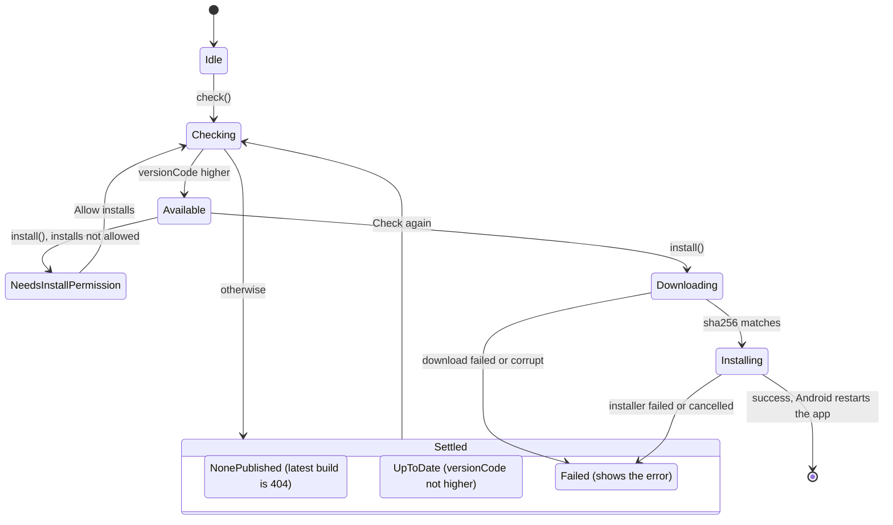

# Builds and updates

This page covers building the Android app from source, how its version number is derived, the prebuilt APKs on the GitHub releases, how an operator publishes a build to the Claudiverse server, and how the installed app finds that build and installs it on its own (the in-app self-update).

The point of the self-update is that the phone does not need a cable or an app store: the operator runs `android/publish.sh` on the build machine, and every installed app offers the new build on its Connection tab.

## Building

### Requirements

From the repository README ("Building"):

- JDK 17 or later.
- The Android SDK, with NDK `29.0.14206865` and CMake installed from the SDK manager. The NDK version is pinned as `android-ndk` in `gradle/libs.versions.toml`; the build uses it for the OpenVPN engine and to strip the engine's native libraries when packaging.
- The submodules: `git submodule update --init`.

### Commands

```sh
./gradlew :android:testDebugUnitTest :openvpn:testDebugUnitTest   # unit tests
./gradlew :android:assembleDebug                                  # APKs per ABI, and a universal one
```

### Modules and key versions

`settings.gradle.kts` includes three modules: `:core` (the shared Kotlin Multiplatform library, whose JVM target the Android app uses), `:android` (the app) and `:openvpn` (the OpenVPN engine the app runs its tunnel with).

| Setting | Value | Where |
|---|---|---|
| `applicationId` | `tech.henning.claudiverse` | `android/build.gradle.kts` |
| `namespace` (the code's package) | `dev.claudiverse.app` | `android/build.gradle.kts` |
| `compileSdk` | 36 | `android/build.gradle.kts` |
| `targetSdk` | 36 | `android/build.gradle.kts` |
| `minSdk` | 21 | `android/build.gradle.kts` |
| Java source/target | 17 | `android/build.gradle.kts` |
| Android Gradle plugin | 9.0.0 | `gradle/libs.versions.toml` |
| Kotlin | 2.2.10 | `gradle/libs.versions.toml` |
| Compose BOM | 2025.09.00 | `gradle/libs.versions.toml` |
| OkHttp | 4.10.0 | `gradle/libs.versions.toml` |

### ABI splits and output names

The app builds one APK per ABI plus a universal APK: `x86`, `x86_64`, `armeabi-v7a`, `arm64-v8a` (`isUniversalApk = true`). Outputs land under `android/build/outputs/apk/debug/`. The one the publish script uses is:

```
android/build/outputs/apk/debug/android-arm64-v8a-debug.apk
```

### Native library packaging

`packaging.jniLibs.useLegacyPackaging = true`. The OpenVPN engine runs `libovpnexec.so` as an executable, so the library has to be extracted to disk instead of being mapped from the APK.

### Release signing

A release build (`./gradlew :android:assembleRelease`) is signed with a key given by four Gradle properties. They belong in `~/.gradle/gradle.properties`, on the command line as `-P<name>=…`, or in the environment as `ORG_GRADLE_PROJECT_<name>` (as the release workflow passes its secrets), and never in the repository:

| Property | Used for |
|---|---|
| `keystoreFile` | the keystore path (`storeFile`) |
| `keystorePassword` | `storePassword` |
| `keystoreAlias` | `keyAlias` |
| `keystoreAliasPassword` | `keyPassword` |

The `release` signing config exists only when `keystoreFile` is set. Without it a release build is left **unsigned** (`android-<abi>-release-unsigned.apk`), which Android will not install as it is; it is never signed with a stand-in key, because an installed app refuses an update signed with a different key (see "Signing and in-place updates").

## Versioning

`android/build.gradle.kts` derives the version from git:

```
versionCode = claudiverse.versionBase + git commit count (git rev-list --count HEAD)
versionName = claudiverse.versionName if set, else "1.0.<versionCode>"
BuildConfig.GIT_COMMIT = git rev-parse --short=8 HEAD
```

- `claudiverse.versionName` is an optional Gradle property. The release workflow sets it to the tag without its `v` (tag `v1.2.0` gives `1.2.0`). It only names the build: what an installed app compares is the `versionCode`, which is the commit count in every build.

- `claudiverse.versionBase` is set in `gradle.properties` and is currently `2200`. Reading it is required: the build fails if the property is missing.
- The commit count is `0` and `GIT_COMMIT` is `"unknown"` when git is unavailable (outside a repository, or before the first commit).
- Why the base exists: `gradle.properties` says it keeps build numbers above those of the builds made before this repository (up to `1.0.2137`), so an installed app updates in place. A lower `versionCode` would never count as an update (see "The isUpdate rule").
- The app shows its installed version as `<versionName> (<GIT_COMMIT>)`, for example `1.0.2300 (a1b2c3d4)`.

## GitHub releases

`.github/workflows/release.yml` builds the apps when a tag starting with `v` is pushed, and publishes them as one GitHub Release. A tag with a hyphen (`v1.2.0-rc1`) makes a pre-release.

The Android job checks out the full history (the `versionCode` counts commits) and the submodules, installs JDK 17, the pinned NDK and CMake (the NDK is cached), and runs `./gradlew :android:assembleRelease -Pclaudiverse.versionName=<tag without v>`. The release gets:

| Asset | What it is |
|---|---|
| `claudiverse-android-<version>-universal.apk` | every ABI in one APK |
| `claudiverse-android-<version>-<abi>.apk` | one per ABI: `arm64-v8a` (most phones), `armeabi-v7a`, `x86_64`, `x86` |
| `SHA256SUMS` | the SHA-256 of every file in the release (`sha256sum -c SHA256SUMS`) |

### Signing on GitHub

The release key is read from four repository secrets, which the workflow turns into the Gradle properties above. The keystore is decoded into the runner's temporary directory and is never printed or uploaded.

| Secret | Gradle property |
|---|---|
| `ANDROID_KEYSTORE_BASE64` | the keystore file, base64-encoded (`base64 -i release.keystore`), written to `keystoreFile` |
| `ANDROID_KEYSTORE_PASSWORD` | `keystorePassword` |
| `ANDROID_KEY_ALIAS` | `keystoreAlias` |
| `ANDROID_KEY_PASSWORD` | `keystoreAliasPassword` |

With all four set, each APK is checked with `apksigner verify` before it is attached. If any is missing, the job warns and builds **unsigned** APKs, named `claudiverse-android-<version>-<abi>-unsigned.apk`, and the release notes say they cannot be installed as they are. A signed release installs over an earlier build only when that build was signed with the same key and has a lower `versionCode`.

### Releases and the in-app update feed

The two are separate:

- **A GitHub release** is for installing the app in the first place, or updating it by hand: download an APK and open it on the phone.
- **The in-app update feed** is your own server: `android/publish.sh` uploads a build, and every installed app offers it on its Connection tab (see "Self-update" below).

The workflow does not publish to the feed. A self-hosted server is usually not reachable from GitHub's runners, and publishing needs an `app` or `super` token; with one in the repository's secrets, anyone who could change the workflow could put a build on every phone that uses your server. To offer a release to the installed apps, run `android/publish.sh` on your own machine from the tagged commit. Both builds count commits the same way, so the release and the published build carry the same `versionCode`, and an app accepts either as an update when both are signed with the same key.

## Publishing a build

`android/publish.sh` builds the app and uploads it to the server. The server keeps only the newest build: publishing replaces the previous one. Installed apps are then offered it as an update (Connection, App updates).

```sh
CLAUDIVERSE_URL=http://claudiverse.example:4000 \
CLAUDIVERSE_APP_TOKEN=cv_xxxxxxxx \
NOTES="Fix the seat list refresh" \
android/publish.sh
```

### What the script does

1. `set -euo pipefail`; fails at once if `CLAUDIVERSE_URL` or `CLAUDIVERSE_APP_TOKEN` is unset.
   - Only an `app` or `super` token may publish. The server refuses a publish with any other token, so a seat's `api` token can never put a build on the phones.
2. Changes to the repository root (`cd "$(dirname "$0")/.."`).
3. Refuses a dirty working tree (`git status --porcelain` not empty): the build is labelled with HEAD's commit and count, and a dirty tree would publish code that no commit holds.
4. Runs `./gradlew :android:assembleDebug -q`. It is a plain build, not the test-only kind that `adb -Pandroid.injected.*` produces, which a phone refuses to install from a file.
5. Takes the arm64-v8a debug APK: `android/build/outputs/apk/debug/android-arm64-v8a-debug.apk`.
6. Finds `aapt2`: the SDK is `$ANDROID_HOME`, default `~/Library/Android/sdk`; it uses the highest version under `build-tools/` (sorted with `sort -V`).
7. Runs `aapt2 dump badging` on the APK and reads `versionCode` and `versionName` from it. If either is empty it exits with `publish: could not read the version from <apk>`.
8. Reads the commit (`git rev-parse --short=8 HEAD`) and the notes: `NOTES` if set, else the last commit's subject (`git log -1 --format=%s`).
9. Prints `publishing <name> (code <code>, <commit>), <bytes> bytes`.
10. Sends the upload with `curl -fsS`, with the header `Authorization: Bearer <CLAUDIVERSE_APP_TOKEN>`.

### The upload

`POST <CLAUDIVERSE_URL>/api/app/builds` (a trailing slash on the URL is removed), `multipart/form-data`:

| Field | Value |
|---|---|
| `apk` | the file, `@android-arm64-v8a-debug.apk` |
| `version_code` | integer read by aapt2 |
| `version_name` | string read by aapt2 |
| `commit` | 8-character short hash |
| `notes` | `NOTES` or the last commit subject (sent with `--form-string`, so a leading `@` or `<` in notes is not treated as a file) |

The script prints whatever the server answers and ends with a newline. Because `curl -f` is used, an HTTP error status makes the script exit non-zero.

## Self-update

### The server's build record

The app reads the newest build as an `AppBuild` (`core/.../Models.kt`):

| Field | JSON key | Notes |
|---|---|---|
| `id` | `id` | required string |
| `versionCode` | `version_code` | required, long |
| `versionName` | `version_name` | text |
| `commit` | `commit` | text |
| `sha256` | `sha256` | text, lower-cased on parse |
| `size` | `size` | bytes; 0 if absent |
| `url` | `url` | required, server-relative, for example `/api/app/builds/1/apk` |
| `notes` | `notes` | optional |
| `insertedAt` | `inserted_at` | optional; shown as "published ..." |

Example of a response the client can parse:

```json
{
  "id": "1",
  "version_code": 2300,
  "version_name": "1.0.2300",
  "commit": "a1b2c3d4",
  "sha256": "9f2c...e1",
  "size": 31457280,
  "url": "/api/app/builds/1/apk",
  "notes": "Fix the seat list refresh",
  "inserted_at": "2026-10-10T08:30:00Z"
}
```

### State machine

`AppUpdates` (in `android/.../update/AppUpdates.kt`) exposes a `StateFlow<UpdateState>`.



### The isUpdate rule

```kotlin
fun isUpdate(installedVersionCode: Long, build: AppBuild): Boolean = build.versionCode > installedVersionCode
```

Only a strictly higher `versionCode` is an update. The installed code is `BuildConfig.VERSION_CODE`. An equal or lower code gives `UpToDate`.

### Checking

`check()` does nothing if a check or install job is still running. Otherwise it sets `Checking` and calls `GET /api/app/builds/latest` through `Api.latestBuild()` (the same connection the app uses for everything else: LAN, a system VPN or its own tunnel). The result:

- HTTP 404: `NonePublished` (no build published).
- A build with a higher `version_code`: `Available`.
- A build that is not higher: `UpToDate`.
- Any other error: `Failed("Check failed: <message>")`.

Checks happen:

- **On a fresh launch** (`MainActivity.onCreate` with no saved instance state) when the connection config is complete (`app.settings.config.value.isComplete`). A rotation or recreation does not re-check.
- **When the operator taps a button** on the App updates card (Check for update, Check again).
- The "Allow installs" button also calls `check()` after opening the system settings page.

There is no periodic check.

### Installing

`install(build)` (the Update button) does nothing if a job is running. Then:

1. On Android 8 (O) and later it checks `packageManager.canRequestPackageInstalls()`. If false the state becomes `NeedsInstallPermission` and nothing is downloaded. The manifest declares `android.permission.REQUEST_INSTALL_PACKAGES` for this.
2. State `Downloading(build, 0)`. The APK is streamed with `Api.download(build.url, ...)` (with the app's bearer token) into `cacheDir/updates/claudiverse.apk`, and the byte count is reported as progress.
3. The file's SHA-256 is computed and compared with the build's `sha256`. On a mismatch the file is deleted and the state is `Failed("Download corrupt: sha256 <actual>, expected <expected>")`.
4. State `Installing(build)`, then a `PackageInstaller` session in `MODE_FULL_INSTALL` is created for this app's package (`setAppPackageName`), with the file size set. On Android 12 (S) and later `setRequireUserAction(USER_ACTION_NOT_REQUIRED)` is set, so where Android allows an app to update itself the confirmation prompt is skipped. The APK is written as `claudiverse.apk`, fsynced and the session committed with a mutable `PendingIntent` broadcast to `UpdateStatusReceiver`.
5. Any other exception (cancellation excepted) gives `Failed("Update failed: <message>")`.

### The installer's answer: UpdateStatusReceiver

`UpdateStatusReceiver` (not exported) handles the installer's status broadcast:

| Status | Action |
|---|---|
| `STATUS_PENDING_USER_ACTION` | Starts the confirmation activity the installer supplies (`Intent.EXTRA_INTENT`, with `FLAG_ACTIVITY_NEW_TASK`). If the extra is missing, it does nothing. |
| `STATUS_SUCCESS` | Logs `update installed`. Nothing else: Android restarts the app's process. |
| anything else | `AppContainer.get(context).updates.installerResult("Not installed: <message>")`, where the message is `EXTRA_STATUS_MESSAGE`, or `status <n>` if absent. The card shows it as `Failed`. |

### After the update: UpdatedReceiver

Installing an update stops the app, its VPN and its watcher. Without a restart they stayed down until the app was opened, so a self-update over the app's own tunnel cut the phone off. `UpdatedReceiver` is registered for `ACTION_MY_PACKAGE_REPLACED` (not exported) and, on that action:

1. Gets the `AppContainer` (which re-decides the VPN) and logs `updated to <version>: restarting VPN check and watcher`.
2. Calls `autoVpn.schedule()` to re-run the VPN check.
3. If `notifyRequests` is on and the config is complete, starts the watcher with `WatchService.start`. A failure is logged as `watcher not restarted: <message>` and not raised.

### The "App updates" card

`UpdateCard` in `ui/ConnectionScreen.kt` is shown on the Connection tab. It always shows the title `App updates` and `Installed: <versionName> (<commit>)`. Below that, by state:

| State | Shown |
|---|---|
| Idle | button `Check for update` |
| Checking | `Checking…` |
| UpToDate | `Up to date.` and button `Check again` |
| NonePublished | `The server has no build published.` and button `Check again` |
| Available | `Available: <versionName> (<commit>), <size in MB> MB`, plus `, published <relative time>` if `inserted_at` is present, plus the notes on a new line if present; button `Update` |
| Downloading | `Downloading <done> of <total> MB` and a progress bar (megabytes are integer divisions by 1,048,576) |
| Installing | `Installing <versionName>: confirm in Android's prompt. The app restarts when done.` |
| NeedsInstallPermission | `Allow this app to install updates, then tap Update again.` and button `Allow installs` (opens the system "install unknown apps" settings page for this package, then re-checks) |
| Failed | the error message in the error colour and button `Check again` |

### The badge

In `AppRoot.kt`, the Connection tab's bottom-bar icon shows a badge dot while the state is `Available`, so a waiting update is flagged where its card is.

### Signing and in-place updates

Android refuses an update that is not signed with the same key as the installed app. The README states this: an update installs in place only when it is signed with the same key as the installed app. `AppUpdates` also relies on it as part of integrity (the sha256 check plus Android's signature check). Debug builds are signed with the local debug key, so a debug build published by `publish.sh` updates an installed app in place only when that app was signed with the same key (in practice, builds from the same machine). The same holds between a debug build and a release build: either updates the other only when both carry the same key. A mismatch surfaces as `Not installed: <message>` from the installer.

### Tests

`android/src/test/java/dev/claudiverse/app/update/AppUpdatesTest.kt` has one test, `onlyAHigherVersionIsAnUpdate`: 2057 is an update to 2056; 2056 and 2055 are not. Run it with `./gradlew :android:testDebugUnitTest`.

## Failure modes and troubleshooting

| Message | Source | Meaning and what to do |
|---|---|---|
| `publish: the working tree has uncommitted changes; commit them first` | publish.sh | Commit or stash your changes, then publish again. |
| `publish: could not read the version from <apk>` | publish.sh | aapt2 output lacked `versionCode` or `versionName`. Check that the build produced the APK and that `ANDROID_HOME` points at an SDK with `build-tools`. |
| `set CLAUDIVERSE_URL` / `set CLAUDIVERSE_APP_TOKEN (an `app` or `super` token; only those may publish)` | publish.sh | Export the missing variable. A seat's `api` token will not work. |
| curl error after `publishing ...` (non-zero exit, HTTP error printed by `-fsS`) | publish.sh | The server refused the upload; check the URL and that the token is an `app` or `super` token. |
| `Check failed: <message>` | AppUpdates | The latest-build request failed (server unreachable, bad token, a non-404 HTTP error). Fix the connection on the Connection tab and tap `Check again`. |
| `The server has no build published.` | card, from a 404 | Nothing has been published yet; run `android/publish.sh`. |
| `Up to date.` when you expect an update | card | The published `version_code` is not above the installed one. Build from a commit with a higher commit count. |
| `Allow this app to install updates, then tap Update again.` | card | Turn on installs from this app in system settings via `Allow installs`, then tap `Update`. |
| `Download corrupt: sha256 <actual>, expected <expected>` | AppUpdates | The downloaded file does not match the server's checksum; the file is deleted. Tap `Check again` and update again; if it repeats, republish the build. |
| `Update failed: <message>` | AppUpdates | Download or installer-session error, for example `HTTP <code>: download failed` or a network error. Retry after checking the connection. |
| `Not installed: <message>` | UpdateStatusReceiver | The installer reported a failure or a cancel; the message is Android's own. A signature mismatch with the installed app is one cause (see "Signing and in-place updates"). With no message the text is `Not installed: status <n>`. |

## Related pages

- [Claudiverse for Android](README.md)
- [Architecture](architecture.md)
- [Connecting to a server](connecting.md)
- [Notifications: seats that need you](notifications.md) (the watcher restarted after an update)
- [In-app VPN](vpn.md) (the VPN check re-run after an update)
- [Settings, permissions and troubleshooting](settings-and-troubleshooting.md)
- Server: [App builds and seat files](https://github.com/Promises/claudiverse-oss/blob/main/docs/reference/server/app-builds-and-seat-files.md)
- Mac: [Building and installing](../mac/building-and-installing.md)

## Source

- `README.md` ("Building")
- `settings.gradle.kts`, `build.gradle.kts`, `gradle.properties`, `gradle/libs.versions.toml`
- `android/build.gradle.kts`
- `android/publish.sh`
- `.github/workflows/release.yml`
- `android/src/main/java/dev/claudiverse/app/update/AppUpdates.kt`
- `android/src/main/java/dev/claudiverse/app/update/UpdatedReceiver.kt`
- `android/src/main/java/dev/claudiverse/app/ui/ConnectionScreen.kt`
- `android/src/main/java/dev/claudiverse/app/ui/AppRoot.kt`
- `android/src/main/java/dev/claudiverse/app/MainActivity.kt`
- `android/src/main/AndroidManifest.xml`
- `core/src/commonMain/kotlin/dev/claudiverse/core/Models.kt`, `core/src/commonMain/kotlin/dev/claudiverse/core/Api.kt`
- `android/src/test/java/dev/claudiverse/app/update/AppUpdatesTest.kt`
