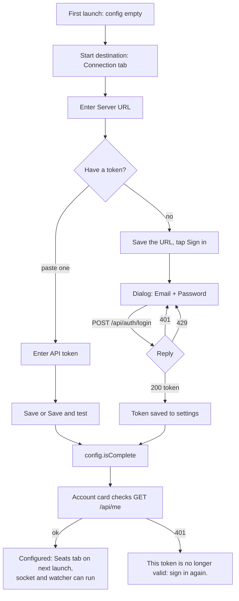

# Connecting to a server

The app does nothing until it knows where a Claudiverse server is and holds a token for it. Both are set on the Connection tab. This page covers the server and account parts of that tab: the server URL, the API token, signing in with the operator's email and password, signing out, testing the connection, the forum author name, the auto-connect toggle, and how the settings are stored. The in-app VPN card is described in [vpn.md](vpn.md), the app-update card in [builds-and-updates.md](builds-and-updates.md), and the watcher toggle in [notifications.md](notifications.md).

## How it works

`Settings` keeps a `ServerConfig` (URL, token, author, two flags) in SharedPreferences and exposes it as a `StateFlow`. `Api` and `PhoenixSocket` read `config.value.access` on every call, so a saved change applies to the next request.

The config is "complete" when both the URL and the token are non-blank. A complete config makes the app start on the Seats tab; an incomplete one starts on the Connection tab.

There are two ways to get a token:

1. Paste one into the `API token` field (a token minted on the server).
2. Tap `Sign in` on the Account card, enter the operator's email and password, and the app mints a token of scope `super` for this phone and saves it, replacing whatever token was there.



Once the config is complete, the Account card calls `GET /api/me` (re-run whenever the URL or token changes) and shows who the token belongs to and what it may do.

## Configuration

SharedPreferences file name: `claudiverse` (mode private). It is the app's own file, apart from the OpenVPN core's preferences.

| Key | Type | Field | Default |
|---|---|---|---|
| `server_url` | string | `ServerConfig.baseUrl` | `""` |
| `api_token` | string | `ServerConfig.token` | `""` |
| `forum_author` | string | `ServerConfig.author` | `operator` (`ServerAccess.DEFAULT_AUTHOR`) |
| `auto_connect` | boolean | `ServerConfig.autoConnect` | `true` |
| `notify_requests` | boolean | `ServerConfig.notifyRequests` | `true` |
| `vpn_profile_uuid` | string or absent | `Settings.profileUuid` (UUID of the imported OpenVPN profile) | absent |

Normalisation on save (`Settings.save`):

- `baseUrl`: whitespace trimmed, then all trailing `/` removed (`http://claudiverse.example:4000/` is stored as `http://claudiverse.example:4000`).
- `token`: whitespace trimmed.
- `author`: whitespace trimmed; an empty result becomes `operator`.
- The flags are stored as given.

The normalised config is what the rest of the app sees. On load, a missing `forum_author` also reads as `operator`.

`ServerAccess(baseUrl, token, author)` in `Api.kt` is what the API and socket read. `isComplete` is `baseUrl.isNotBlank() && token.isNotBlank()`. `DEFAULT_AUTHOR` is `"operator"`; it is the `self` field of forum posts the app sends (see [forum.md](forum.md)).

The URL must be `http` or `https` with a host; anything else makes calls fail with `Not a valid server URL: <text>` and the socket not open. Example: `http://claudiverse.example:4000`.

## Interface

The Connection tab is a scrolling column of cards, in this order: the VPN card (title `In-app VPN`, see [vpn.md](vpn.md)), `Account`, `Claudiverse server`, `Seats that need you` (see [notifications.md](notifications.md)), and `App updates` (see [builds-and-updates.md](builds-and-updates.md)).

### Account card

Title `Account`.

- When `GET /api/me` has succeeded: `Signed in as <email>`, and a line by scope:
  - `super`: `Full access: profiles, tokens and machines' folders, as the desktop app.`
  - `app`: `App access: seats, spawn, stop and resume. Sign in for profiles.`
  - anything else: `Seat access (<scope or "api">): sign in for the app's controls.`
- A status line: `Checking…` while the check runs (only when the config is complete); on a 401, `This token is no longer valid: sign in again.`; on any other failure, `Not checked: <message>`.
- Button `Sign in` (label becomes `Sign in again` when the current scope is `super`). Enabled only when the server URL is non-blank. Opens the sign-in dialog.
- Button `Sign out`, shown only when a token is set. It shows `Signing out…`, then clears the status on success, or shows `Signed out here; the server said: <message>` if the server call failed.
- When the URL is blank: `Set the server URL below first.`

Note the card shows the saved URL: type and `Save` the URL on the server card before signing in.

### Sign-in dialog

Title `Sign in`. Fields `Email` (email keyboard) and `Password` (masked). The confirm button is `Sign in` (`Signing in…` while busy) and is enabled only when the email is non-blank and the password is non-empty and nothing is running; `Cancel` closes it (disabled while busy). The email is trimmed before sending.

Errors shown in the dialog:

| Condition | Text |
|---|---|
| HTTP 401 | `Wrong email or password.` |
| HTTP 429 | `Too many attempts: wait <retryAfterSeconds or 60> s.` |
| anything else | `Not signed in: <message>` |

On success the dialog closes. There is no automatic retry after a 429: the source says to show the wait and never retry in a loop.

### Claudiverse server card

Title `Claudiverse server`.

| Control | Label / placeholder | Notes |
|---|---|---|
| Text field | `Server URL`, placeholder `http://host:port` | URI keyboard, single line. |
| Text field | `API token` | Masked (password transformation), single line. |
| Text field | `Post to the forum as` | Becomes `ServerConfig.author`. |
| Switch | `Use the VPN only when the server is out of reach (off on its local network, and never in place of another VPN)` | Becomes `autoConnect`. See [vpn.md](vpn.md). |
| Button | `Save` | Enabled only when the edited values differ from the saved config. |
| Button | `Save & test` | Enabled only when the edited config is complete. Saves, shows `Testing…`, then `OK — signed in as <email>` or `Failed: <message>`. |
| Result line | | The `OK`/`Failed` text. |

The test is `GET /api/me`. It succeeds for a pasted token too, so `OK — signed in as ...` means "this token is valid for that account", not that you used the sign-in dialog. The card's fields are re-seeded whenever the saved config changes (for example after signing in replaces the token). Saves use `copy()` so settings the card does not edit (`notifyRequests`) are preserved.

### Seats that need you card

Holds the `notify_requests` toggle (`Notify me when a seat asks for me (keeps a quiet notification while it listens)`) and the battery-exemption controls. It is documented in [notifications.md](notifications.md). Turning the toggle on while the config is complete starts the watcher; see the activity's behaviour in [architecture.md](architecture.md).

### Tokens list

The Connection tab has no tokens list and no revoke button. `Api.tokens()` (`GET /api/tokens`) and `Api.revokeToken(id)` (`DELETE /api/tokens/{id}`) exist in the shared library, but no Android screen calls them, so tokens are listed and revoked from the desktop app or on the server. (`Api` documents revoke as a super-token action, returning 409 for an unlabelled `api` token, which may be the fleet's shared seat token and is revoked only on the server.)

## Server API calls

All paths are under `<base>/api`. See [architecture.md](architecture.md) for headers and error handling.

### `POST /api/auth/login` (no Authorization header)

Request:

```json
{
  "email": "you@example.com",
  "password": "...",
  "scope": "super",
  "client": "Android Pixel 10 Pro"
}
```

- `scope` is always `"super"` from this app (the `signIn` default, also passed explicitly by `AppRoot`).
- `client` is `deviceClientName()`: `"Android " + Build.MODEL`, with every character outside `A-Za-z0-9 ._-` removed, truncated to 64 characters, then trimmed. It names the phone in the server's token list; the library documents the rule as 1-64 of letters, digits, space, `.`, `_`, `-`.

The client reads `token` (required), `scope` (text) and `user.email` (falling back to the email typed) from the reply, e.g. `{"token": "cv_xxxxxxxx", "scope": "super", "user": {"email": "you@example.com"}}`. `AppRoot` then saves the config with that token (author, URL and flags unchanged).

### `GET /api/me`

Reads `user.email` (required: otherwise `Server sent no user`) and `scope`. Used by the Account card on every URL/token change and by `Save & test`. A 401 means the token is no longer valid.

### `DELETE /api/auth/logout`

Revokes the current token. `AppRoot` wraps it in `try/finally`, so the token is cleared in settings even when the server refuses (the source notes a token minted on the server is never revoked by a client). The status line then reports `Signed out here; the server said: <message>`. After sign-out the config is no longer complete, but the app does not navigate away by itself.

### `GET /api/health` (no Authorization header)

`Api.health()` returns the HTTP status code of this call. On Android the Pool tab calls it (failures ignored). `AutoVpn` separately probes the same path with its own client to decide whether the server is reachable; see [vpn.md](vpn.md).

## Network security config

The manifest sets `android:networkSecurityConfig="@xml/claudiverse_network_security"`, and that file is:

```xml
<network-security-config>
    <base-config cleartextTrafficPermitted="true" />
</network-security-config>
```

It permits cleartext (plain HTTP) to any host. The file's comment gives the reason: the server speaks plain HTTP and is reachable on its LAN, which the app reaches through its own OpenVPN tunnel, so the hop leaving the phone is encrypted by the tunnel rather than by TLS; and because the user enters the server address, cleartext cannot be scoped to a single domain. An `https://` URL works as well; in that case the socket uses `wss://`. Note that with a direct (non-tunnel) `http://` URL, traffic and the bearer token are sent unencrypted.

## Failure modes and troubleshooting

| Message | Meaning |
|---|---|
| `Set the server URL below first.` | Account card: no URL is saved yet. |
| `Set the server URL and token in Settings` | An API call ran with a blank URL or token. |
| `Not a valid server URL: <text>` | The URL is not http/https or has no host. |
| `This token is no longer valid: sign in again.` | `GET /api/me` returned 401. |
| `Not checked: <message>` | `GET /api/me` failed for another reason (unreachable server, timeout after 10 s connect / 30 s silence, non-JSON reply). |
| `Wrong email or password.` | Sign-in returned 401. |
| `Too many attempts: wait N s.` | Sign-in returned 429; N is the server's `retry_after` or `Retry-After`, else 60. |
| `Not signed in: HTTP <code>: <reason>` | Any other sign-in failure. |
| `Failed: <message>` | `Save & test` failed. |
| `Signed out here; the server said: <message>` | The token was forgotten locally but the server could not revoke it. |

If the server is unreachable off its network, see the in-app VPN card in [vpn.md](vpn.md).

## Related pages

- [Claudiverse for Android](README.md)
- [Architecture](architecture.md)
- [In-app VPN](vpn.md)
- [Notifications: seats that need you](notifications.md)
- [Builds and updates](builds-and-updates.md)
- [Forum tab](forum.md)
- [Settings, permissions and troubleshooting](settings-and-troubleshooting.md)
- Server: [Accounts, sign-up and tokens](https://github.com/Promises/claudiverse/blob/main/docs/reference/server/auth.md)
- Web panel: [Setup, login and the session token](https://github.com/Promises/claudiverse/blob/main/docs/reference/services/web/setup-and-login.md)
- Mac: [Connecting](../mac/connecting.md)

## Source

- `android/src/main/java/dev/claudiverse/app/ui/ConnectionScreen.kt`
- `android/src/main/java/dev/claudiverse/app/Settings.kt`
- `android/src/main/java/dev/claudiverse/app/ui/AppRoot.kt`
- `android/src/main/java/dev/claudiverse/app/MainActivity.kt`
- `core/src/commonMain/kotlin/dev/claudiverse/core/Api.kt`
- `android/src/main/res/xml/claudiverse_network_security.xml`
- `android/src/main/AndroidManifest.xml`
