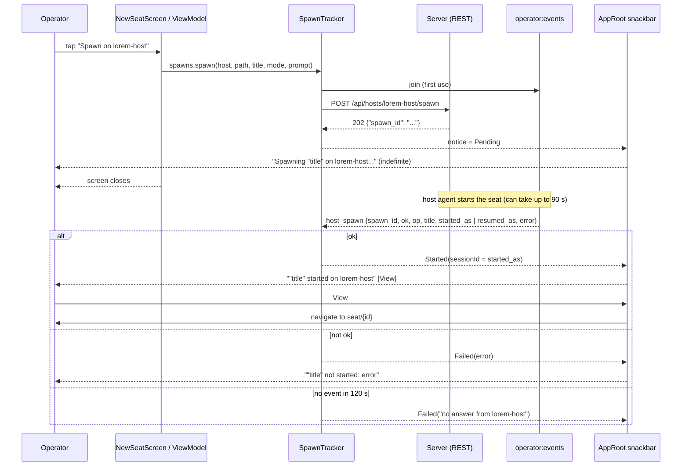

# New seat (spawning a seat)

New seat starts a Claude Code session on one of the operator's machines. The phone does not start anything itself: it asks the server, the server asks the machine's host agent, and the host agent starts the seat. The screen collects the five things a spawn needs (machine, folder, title, permission mode, optional first prompt), the server accepts the request immediately, and the outcome arrives later as an event that the app turns into a snackbar.

Open it with the **New seat** floating button on the Seats tab ([seat-list.md](seat-list.md)). It is a full-screen step: no top bar or bottom tabs while it is open (`route == "new-seat"`).

## How it works

1. On open, `NewSeatViewModel` calls `GET /api/hosts`. The first host that is online is picked automatically.
2. Picking a host stores its allowed folders, loads its recent folders (`GET /api/hosts/{host}/recent_dirs`), and lists the roots (`GET /api/hosts/{host}/ls?path=`). If none of the recent folders is inside an allowed folder, the screen starts on the Browse tab.
3. The title follows the folder's name until you type one yourself.
4. **Spawn on {host}** calls `POST /api/hosts/{host}/spawn`. The reply is `202` with a `spawn_id`; it only means accepted. The screen closes (`onAccepted = onClose`).
5. `SpawnTracker` shows a Pending snackbar and waits for a `host_spawn` event with that `spawn_id` on the `operator:events` topic. The event turns the snackbar into Started or Failed. If nothing arrives within `GIVE_UP_MS` (120 000 ms), it reports `no answer from {host}`.



### Folder rules

- **Allowed folders.** A machine only spawns in folders inside its allowed folders (`Host.roots`, read from `GET /api/hosts`; refreshed from the roots list `ls?path=` when you browse it). `NewSeatState.allowed(path)` is true when `rootOf(path, roots)` finds a root that equals the path or holds it by whole path segments (`/a/bc` is not inside `/a/b`).
- **Spawn path.** `NewSeatState.path` is the picked recent folder (only if allowed) on the Recent tab, or the folder you are currently in on the Browse tab (the roots list, path `""`, counts as none). `canSpawn` needs: not already spawning, a host, a path, and a non-blank title.
- **Default title.** `seatTitleFor(path)`: the last path segment, characters outside `A-Z a-z 0-9 . _ -` replaced by `-`, leading/trailing `-` and `.` trimmed, at most 64 characters. This is what the host agent accepts, so the default never fails validation.
- **Breadcrumbs.** `crumbs(path, roots)` starts at the deepest allowed folder holding the path (labelled with its full path); anything above a root would only be refused. With no root holding the path, every segment is a crumb. Tests: `CrumbsTest`.

### Resume goes through the same tracker

Resuming a stopped seat is not part of the New seat screen, but it shares the mechanism. `SpawnTracker.resume(seat)` calls `POST /api/sessions/{id}/resume`, which answers with a `spawn_id` (`Api.resumeSeat`), and tracks it with `SpawnOp.Resume` (snackbar words "Resuming" / "resumed" / "not resumed"). The `host_spawn` event for a resume carries `op: "resume"` and `resumed_as`. The Resume button lives in the seat view (`SeatViewModel.resume()`); the seat must be stopped and report a machine and a conversation (`Seat.canResume`, tested in `SeatLifecycleTest`). See [seat-controls.md](seat-controls.md).

## Configuration

| Item | Value | Where |
|---|---|---|
| Default permission mode | `auto` | `NewSeatState.mode` |
| Mode choices | `default`, `acceptEdits`, `plan`, `auto` | `MODES` in `NewSeatScreen.kt` |
| Default tab | Recent (falls back to Browse when no recent folder is allowed) | `NewSeatState.tab` |
| Give up on a spawn | `120_000` ms | `SpawnTracker.GIVE_UP_MS` |
| Early outcomes kept | 16 | `SpawnTracker.EARLY_KEPT` |
| Events topic | `operator:events`, event `host_spawn` | `SpawnTracker` |

`EARLY_KEPT`: an outcome that arrives before the `202` reply (or for a spawn this app did not start) is stored in a small map, oldest dropped past 16, and is matched if its `spawn_id` is tracked afterwards.

## Interface

### Screen

Header: close button (description "Close") and the title "New seat".

**Machine.** One card per host from `GET /api/hosts`, scrolling horizontally. Each card shows the host name and `online · {n} seat(s)` or `offline`. Offline hosts are shown but cannot be picked. While loading: a spinner. Empty list: `No machine has a host agent yet.` Failure: the error text in red (see below).

**Folder** (after a host is picked). Two tabs, **Recent** and **Browse**.

- Recent: each row shows the folder's last segment, its full path, a count `{n} seat(s)` when seats are running there, and its last use as relative time. A folder outside the allowed folders is dimmed, not selectable, and says `Not in {host}'s allowed folders`. With no recent folders: `No recent folders on {host}: seats report their folder once restarted on the new runtime. Use Browse.`
- Browse: breadcrumb row, an **Up** row (not shown at the roots list), subfolders with a chevron. At the roots list, rows are the allowed folders' full paths; inside a folder they are names joined onto the current path. `No subfolders` for an empty folder; for an empty roots list: `No allowed folders on {host}. Only the machine can add one: cv-host-agent add-root <folder>`. When the listing is truncated: `Only the first {n} folders are shown.`

The folder you are in is the folder a spawn uses; there is no separate confirm button.

**Details.** Text field "Title"; "Permission mode" chips; text field "First prompt (optional)" with placeholder "What should this seat start on?". The prompt is trimmed and sent only if not blank.

**Bottom bar.** The chosen path in monospace (or `Pick a folder`), any spawn error in red, and the button **Spawn on {host}** (shows `…` before a host is known; a spinner replaces the rocket icon while the request is in flight).

### Snackbars (`AppRoot`)

| Notice | Text | Behaviour |
|---|---|---|
| `Pending` | `Spawning “{title}” on {host}…` (or `Resuming ...`) | indefinite, dismiss action |
| `Started` | `“{title}” started on {host}` (or `resumed`) | action **View**, long duration |
| `Failed` | `“{title}” not started: {error}` (or `not resumed`) | dismiss action, long duration |

If the event carries a `title`, it replaces the one the app sent. **View** opens the new seat: it uses `sessionId` from the event (`started_as` for a spawn, `resumed_as` for a resume, taken only when greater than 0). If the event has none (an older server), the app calls `GET /api/sessions`, keeps seats whose `title` equals the notice title and navigates to the one with the highest `id`. If that finds nothing, nothing happens. Dismissing a Started or Failed snackbar clears the notice.

### Server calls

| Call | Purpose |
|---|---|
| `GET /api/hosts` | machines: `name`, `online`, `seats`, `roots`, `remote_roots`, `version`, `modes`, `runtimes`, `mcp` |
| `GET /api/hosts/{host}/recent_dirs` | recent folders: `path`, `last_used_at`, `seats_running` (a bare array or `{"dirs": [...]}`) |
| `GET /api/hosts/{host}/ls?path={path}` | `{"path", "parent", "dirs": [...], "truncated"}`; `path=` empty lists the allowed folders |
| `POST /api/hosts/{host}/spawn` | start a seat, reply `{"spawn_id": "..."}` (202) |
| `POST /api/sessions/{id}/resume` | resume, reply `{"spawn_id": "..."}` |
| channel `operator:events`, event `host_spawn` | the outcome |

Spawn request body (the `prompt` key is omitted when blank):

```json
{"path": "/srv/projects/lorem-app", "title": "lorem-app", "mode": "auto", "prompt": "Fix the failing tests"}
```

Outcome event payload keys the client reads: `spawn_id`, `ok`, `op`, `title`, `error`, `started_as`, `resumed_as`.

```json
{"spawn_id": "sp_xxxxxxxx", "ok": true, "op": "spawn", "title": "lorem-app", "started_as": 204031}
```

### Client API not surfaced in the Android UI

`Api` also has `addRoot` (`POST /api/hosts/{host}/roots`, body `{"path": ...}`), `removeRoot` (`DELETE /api/hosts/{host}/roots`), `allowFolder` (adds a folder only if no allowed folder already holds it, then removes allowed folders inside it; the parent is added before any child is removed) and `hostToken` (`POST /api/hosts/{host}/token`, returns `{name, token}`). These need a super token, and `addRoot` also needs the machine to allow remote roots (`remote_roots` / `Host.remoteRoots`). None of them is called from the Android app; the core `NewSeatSession` (used by other clients) is the same flow as `NewSeatViewModel`. In the Android New seat screen, folders can only be added on the machine itself (`cv-host-agent add-root <folder>`, as the empty-state text says). Behaviour is covered by `AllowFolderTest`.

## Failure modes and troubleshooting

Machine list:

- `This server can't spawn seats yet.`: `GET /api/hosts` answered 404.
- `Machines not loaded: {message}`: any other failure (network, auth).

Folder listing (shown in red above the folders):

- `Outside this machine's allowed folders` (403)
- `Folder not found` (404)
- `The machine did not answer (offline?)` (504)
- On 502 the machine's own message is shown (for example a macOS privacy prompt holding the folder), otherwise `The machine could not list this folder`
- `Not listed: {message}` for anything else

Spawn (shown above the Spawn button, the screen stays open):

- `Not spawned: {reason}` (400, the server's reason, e.g. an invalid title)
- `Not spawned: the folder is outside {host}'s allowed folders, or this app may not spawn` (403)
- `Not spawned: unknown machine or folder` (404)
- `Not spawned: {host} is rate-limited, try again in a few seconds` (429)
- `Not spawned: {host} did not answer (offline?)` (504)
- `Not spawned: {message}` otherwise

After acceptance, via snackbar:

- `“{title}” not started: {error}`: the host agent reported `ok: false` with that error; if it gave none, the text is `spawn failed` (`resume failed` for a resume).
- `... not started: no answer from {host}`: no `host_spawn` event within 120 s. The seat may still have started; check the Seats tab.
- If the socket was down when the event was sent, the outcome is lost and only the timeout reports it.

Resume errors (from the seat view, not this screen): `Not resumed: the seat is still running` (409), `Not resumed: the seat never reported its Claude session or folder` (422), plus the rate-limit and timeout messages as above.

## Related pages

[Claudiverse for Android](README.md), [Architecture](architecture.md), [Connecting to a server](connecting.md), [Seat list (the Seats tab)](seat-list.md), [Seat view](seat-view.md), [Seat controls](seat-controls.md), [Seat profiles](profiles.md), [Settings, permissions and troubleshooting](settings-and-troubleshooting.md)
- Server: [Profiles and the host channel](https://github.com/Promises/claudiverse/blob/main/docs/reference/server/profiles-and-hosts.md)
- Runners and tools: [cv-mcp: lifecycle tools](https://github.com/Promises/claudiverse/blob/main/docs/reference/runners/mcp-lifecycle.md)
- Host agent: [Roots and folder browsing](https://github.com/Promises/claudiverse/blob/main/docs/reference/host-agent/roots.md), [Starting seats](https://github.com/Promises/claudiverse/blob/main/docs/reference/host-agent/starting-seats.md)
- Mac: [New seat](../mac/new-seat.md), [Settings](../mac/settings.md)

## Source

- `android/src/main/java/dev/claudiverse/app/ui/NewSeatScreen.kt`
- `android/src/main/java/dev/claudiverse/app/spawn/NewSeatViewModel.kt`
- `android/src/main/java/dev/claudiverse/app/ui/AppRoot.kt` (snackbars, View action, New seat button)
- `core/src/commonMain/kotlin/dev/claudiverse/core/NewSeat.kt`, `Folders.kt`, `SpawnTracker.kt`, `Api.kt`, `Models.kt`
- `core/src/commonTest/kotlin/dev/claudiverse/core/AllowFolderTest.kt`, `CrumbsTest.kt`, `SeatLifecycleTest.kt`
