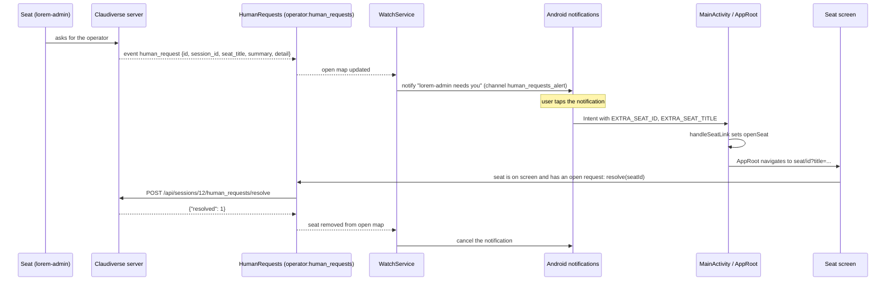

# Notifications: seats that need you

When a seat pages the operator, the Android app can raise a notification even while it is closed. A small foreground service, `WatchService`, keeps the app's connection alive and turns each open "needs you" request into a high-priority notification. Tapping it opens that seat, which resolves the request.

## How it works

`WatchService` collects `app.humanRequests.open`, the map of open requests by seat id kept by `HumanRequests` in `core` (see [questions-and-permissions.md](questions-and-permissions.md) for that class: channel `operator:human_requests`, a REST read on every join and every 120 s).

- For each open request it posts a notification, once per seat per change. The service remembers `(request id, updated_at)` per seat; an unchanged request does not alert again, an updated one does.
- When a seat's request disappears from the open map (resolved from any client), the service cancels that notification.
- If notifications are not allowed, requests are still tracked but nothing is posted. Removed requests are cancelled either way.

### Who starts and stops the service

`MainActivity` observes the settings and keeps the service in step with them: it collects `notifyRequests && isComplete` (a server URL and token are set), de-duplicated. When it becomes true the activity asks for the notification permission and starts the service; when false it stops it. This also reacts to the switch being toggled in the app.

`UpdatedReceiver` handles app updates. Installing an update stops the app and its watcher, so on `MY_PACKAGE_REPLACED` the receiver reschedules the VPN check and, if `notifyRequests` and `isComplete`, starts `WatchService` again. A failed restart is only logged (`watcher not restarted: ...`).

The service is `START_STICKY`. On Android 14 and later it starts with foreground service type `specialUse` (the manifest declares `android:foregroundServiceType="specialUse"` and the property `android.app.PROPERTY_SPECIAL_USE_FGS_SUBTYPE` with value `operator-requests`). It runs in the app's own process, so it shares the app's connection (including the in-app VPN).

### From a seat asking to the request resolved



## Configuration

| Item | Value |
| --- | --- |
| Setting | `notifyRequests`, boolean, default `true`; stored in shared preferences under key `notify_requests` |
| Service runs only if | `notifyRequests` is true and the server config is complete (URL and token set) |
| Permission | `POST_NOTIFICATIONS`, requested at runtime on Android 13+ (API 33) |
| Manifest permissions | `REQUEST_IGNORE_BATTERY_OPTIMIZATIONS` (for the battery exemption) |
| Foreground service type | `specialUse`, subtype `operator-requests` |
| Safety-net recheck | `HumanRequests` rereads every 120 000 ms |

Notification channels (created by `WatchService.createChannels`, on Android 8+):

| Channel id | Name | Importance | Description |
| --- | --- | --- | --- |
| `human_requests_alert` | `Seats that need you` | high | `A top-level seat asked for you` |
| `watching` | `Watching` | min | `Shown while the app listens for seats that need you` |

The channels `human_requests` and `human_requests_poke` are older ids and are deleted on creation. A channel's sound is fixed once Android creates it, which is why a new sound meant a new id.

Notification ids: the permanent one is `0x0c1a`; a request notification uses `0x1000 + (seatId % 0x0fffffff)`, so each seat has its own and a repeated request replaces it.

### Texts

Permanent notification (channel `watching`, priority min, ongoing): title `Watching for seats that need you`. Tapping it opens the app.

Request notification (channel `human_requests_alert`):

- Title: `<seat title> needs you`
- Text: the request `summary`; expanded, the summary and the `detail` (when present) separated by a blank line.
- High priority, default sound, category message, auto-cancel on tap.

## Interface

### Connection screen: "Seats that need you" card

- Switch row: `Notify me when a seat asks for me (keeps a quiet notification while it listens)`. Saving sets `notifyRequests`.
- When the server has no human-request endpoints: `This server does not offer seat requests yet.`
- With the switch on: if the app is exempt from battery optimisation, `Background: unrestricted, so the watcher keeps running.`; otherwise `Android may pause the watcher to save battery. Allow the app to run unrestricted:` and a button `Allow background use`, which opens the system `ACTION_REQUEST_IGNORE_BATTERY_OPTIMIZATIONS` dialog for the app's package. The state is rechecked when the screen resumes.

### Permission prompt

On Android 13 and later the activity requests `POST_NOTIFICATIONS` when the watcher turns on and the permission is not yet granted. If refused, a toast reads `Without notifications you will not hear when a seat needs you`. The service still runs and still tracks requests; it just posts nothing.

### Opening a seat from a notification

The notification's `PendingIntent` targets `MainActivity` (launch mode `singleTop`) with flags `FLAG_ACTIVITY_SINGLE_TOP | FLAG_ACTIVITY_CLEAR_TOP`, and extras `EXTRA_SEAT_ID` (`dev.claudiverse.app.SEAT_ID`) and `EXTRA_SEAT_TITLE` (`dev.claudiverse.app.SEAT_TITLE`). The request code is unique per seat so each notification keeps its own target. `MainActivity` handles the intent in `onCreate` and `onNewIntent`: it reads the id (ignored if missing), builds a `SeatLink(id, title)` (title falls back to `Seat`), publishes it in `openSeat`, and clears the id extra. `AppRoot` collects the link and navigates to `seat/<id>?title=<title>`. If the top entry already shows that seat it is reused; otherwise a new entry is pushed (reusing the route pattern from another seat's screen kept the wrong view model, so this is checked by id). Then the link is cleared.

### Badges in the app

In the seat list, a seat with an open request shows a `needs you` pill and its request `summary` (up to two lines). Seats that may page the operator also show a bell icon with the description `Can notify you`.

`WatchService` is the only caller of `HumanRequests.start()` (and `onDestroy` calls `stop()`). With the watcher off, the app does not follow `operator:human_requests` at all: the seat list shows no `needs you` pills and opening a seat does not resolve its request, because the open map stays empty.

### Per-seat paging switch

Whether a seat may page the operator at all is a seat setting, separate from the phone's notification switch. In the seat's controls the section `May page the operator` has chips `On`, `Off` and `Default`, and a `For` section picking how long On or Off holds. The app calls `POST /api/sessions/<id>/notify` with:

```json
{ "allow": true, "minutes": 60 }
```

`allow` is `true`, `false` or `null` (default); `minutes` (1 to 10080) is sent only when `allow` is not null and a duration is chosen; without it On or Off holds until changed. The server answers with `session`, parsed as the updated seat. This needs an app or super token. The line under the section reads `On until HH:mm: it may page you.`, `Off ...: it may not page you.` or `Default: it may / may not page you.`. This switch decides whether the seat can raise a request; the phone's setting decides whether a raised request becomes a notification.

## Failure modes and troubleshooting

| Symptom | Cause |
| --- | --- |
| No notifications, toast `Without notifications you will not hear when a seat needs you` | `POST_NOTIFICATIONS` refused; grant it in Android settings. |
| Notifications stop after a while | Android paused the app to save battery; use `Allow background use` on the connection screen. |
| No notification, no watcher, no `needs you` pills | `notifyRequests` is off or the server URL/token is empty. The pills in the seat list come from the same watcher, so they disappear with it. |
| `This server does not offer seat requests yet.` | The `GET /api/human_requests` read returned 404, so `supported` is false. |
| Notification does not reappear for the same request | By design: the service alerts only when the request id or `updated_at` changes. |
| Watcher missing after an update | `UpdatedReceiver` restarts it; if that failed the log says `watcher not restarted: <reason>`. Open the app to start it. |
| Tapped notification opens the app but not the seat | The id extra missing or negative is ignored by `handleSeatLink`. |
| Notification stays after answering in the terminal | It clears only when the server resolves the request (`human_request_resolved`) or the seat is opened in the app. |

## Related pages

- [Questions and permissions](questions-and-permissions.md)
- [Seat list (the Seats tab)](seat-list.md)
- [Seat controls](seat-controls.md)
- [Builds and updates](builds-and-updates.md)
- [In-app VPN](vpn.md)
- [Settings, permissions and troubleshooting](settings-and-troubleshooting.md)
- Server: [Human requests](https://github.com/Promises/claudiverse-oss/blob/main/docs/reference/server/human-requests.md)
- Runners and tools: [cv-mcp: seat, ping and question tools](https://github.com/Promises/claudiverse-oss/blob/main/docs/reference/runners/mcp-seats.md)
- Mac: [Notifications and the menu bar](../mac/notifications.md)

## Source

- `android/src/main/java/dev/claudiverse/app/watch/WatchService.kt`
- `android/src/main/java/dev/claudiverse/app/MainActivity.kt`
- `android/src/main/java/dev/claudiverse/app/Settings.kt`
- `android/src/main/java/dev/claudiverse/app/update/UpdatedReceiver.kt`
- `android/src/main/java/dev/claudiverse/app/ui/AppRoot.kt`
- `android/src/main/java/dev/claudiverse/app/ui/ConnectionScreen.kt`
- `android/src/main/java/dev/claudiverse/app/ui/SeatsScreen.kt`
- `android/src/main/java/dev/claudiverse/app/ui/SessionControls.kt`
- `android/src/main/AndroidManifest.xml`
- `core/src/commonMain/kotlin/dev/claudiverse/core/HumanRequests.kt`
- `core/src/commonMain/kotlin/dev/claudiverse/core/Api.kt`
