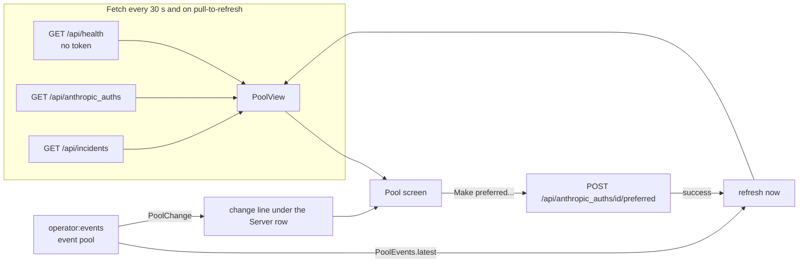

# Pool tab

The Pool tab shows the Anthropic account pool: the accounts the server hands out to pooled seats, how much of each account's usage limits is used, which account is preferred and which one seats use now, plus the server's health and its 5xx incident log. The operator can make an account the preferred one from here.

## How it works

The screen builds one `PoolView(health, pool, incidents)` per fetch, and also refreshes when the server pushes a pool change.



- Poll: every 30 000 ms while the screen is collected.
- `health` and `incidents` are best effort: if their call fails, the value is `null` and the screen still shows the pool. Only `pool` (`GET /api/anthropic_auths`) failing makes the whole fetch fail, with the error banner and "Retry".
- Live events: while the screen is shown, `PoolEvents.start()` joins the `operator:events` topic and collects the `pool` event; leaving the screen calls `stop()`. Each new event triggers an immediate refresh. The event carries no list; the app re-reads the pool. `PoolEvents.latest` holds the newest change since the app started and the screen shows it as a line under the Server row.
- Accounts are ordered by `priority` ascending, accounts with no priority last. The preferred account is the one with the lowest priority. The account in use is `current_id` from the server if present, otherwise the account whose `in_use` is true, otherwise none.

### Pool change line

A `PoolChange` has `change`, `by`, `at`, `current_id`, `preferred_id`. The line shown, followed by ` · <relative time>` when `at` is present:

| `change` | Text |
| --- | --- |
| `preferred` | `Preferred account changed` + ` to <label>` (when the id matches an account) + ` by <by>` |
| `upgrade` | `Seats moved back to <label>` (or `a better account`) |
| `degrade` | `Seats moved to <label>` (or `a fallback account`) |
| `cooling` | `An account cooled down after a rate limit` |
| anything else | `Pool changed (<change>)` |

## Configuration

| Item | Value |
| --- | --- |
| Poll interval | 30 000 ms |
| Events topic | `operator:events`, event `pool` |
| Assignment window | last 24 hours |
| Health call | unauthenticated (no bearer token) |

## Interface

Top of the screen, a row: `Server`, a health pill, an incidents pill.

- Health pill: `health 200` (good) for status 200, `health <code>` (bad) for any other status, `health unknown` (muted) when the call failed.
- Incidents pill: `<total> incidents`, good when 0, bad otherwise; absent when the incidents call failed.

Then, when present: the pool change line, and a red problem line from a failed "make preferred".

One card per account, in priority order:

- Label, then pills: `Preferred` (lowest priority), `In use`, a status pill (the `status` text with `_` shown as space; good when `available`, bad otherwise), and `token invalid` when `token_valid` is false.
- If the account is preferred but seats use another one: `Preferred, but seats use <label> now: the pool comes back here when this account recovers.`
- `Cooling down until <local time> (<relative time>)` when `cooldown_until` is set.
- The cooldown reason: `Reason: <text>` while cooling, `Last cooldown: <text>` when `cooldown_until` is empty (the reason outlives the cooldown).
- One bar per usage limit: the `kind` with `_` as space, then `<percent>%` (or an em dash when unknown) and ` · resets <relative time>` when `resets_at` is set. The progress bar is drawn only when the percent is known; its color is bad for severity `critical`, busy for `warning`, good otherwise.
- Footer: `Usage read <relative time> · priority <n or —>`, and a `Make preferred…` button on every account except the preferred one.

After the accounts, a card `Last assignment per seat, past 24 h (<n> seats)` listing `<account label>: <count>` (label `?` when unknown). It takes each seat's newest assignment record and counts those assigned within 24 hours. These are assignment records, not a live map: a seat stays on its last account until it asks again.

Last, if the incident log is not empty: `Latest incidents since <local time>` and the latest incident summaries in monospace, newest first (the list is reversed).

### Make preferred

Tapping `Make preferred…` opens a dialog:

- Title: `Make <label> the preferred account?`
- Text: `Pooled seats move to <label> on their next request. While it is cooling down or needs re-auth, the pool keeps using the next account and comes back to it when it recovers.`
- Buttons: `Make preferred` and `Cancel`.

Confirming calls the API; on success the screen refreshes and clears any earlier problem line. The server's reply (`PoolOrder`) is parsed but the screen ignores it and re-reads the pool instead.

### API calls

`GET /api/health` (no `Authorization` header): only the HTTP status code is used.

`GET /api/anthropic_auths`

```json
{
  "current_id": 1,
  "auths": [{
    "id": 1, "label": "account-a", "priority": 1, "status": "available",
    "cooldown_until": null, "cooldown_reason": null,
    "token_valid": true, "usage_checked_at": "2026-10-02T18:30:17Z",
    "in_use": true,
    "usage": {"limits": [{"kind": "five_hour", "percent": 42,
      "resets_at": "2026-10-02T21:00:00Z", "severity": "ok", "is_active": true}]}
  }],
  "seats": [{"title": "lorem-w1", "label": "account-a", "via": "...", "assigned_at": "2026-10-02T18:00:00Z"}]
}
```

`POST /api/anthropic_auths/<account id>/preferred` with an empty JSON object body. Reply: `{"auths": [...], "current_id": 1}` (same account shape). The client doc says it needs an app or super token because it moves the fleet's usage, and that a preferred account that is cooling down or needs re-auth is still skipped until it recovers.

`GET /api/incidents`

```json
{"total": 3, "since": "2026-10-01T00:00:00Z", "latest": [ ...objects... ]}
```

Each entry in `latest` is shown as its pretty-printed JSON text (the `Incident.summary`), so the line is whatever the server sent.

### Model fields

`AnthropicAccount`: `id`, `label`, `priority`, `status`, `cooldown_until`, `cooldown_reason`, `token_valid`, `usage_checked_at`, `usage.limits[]`, `in_use`.

`UsageLimit`: `kind`, `percent`, `resets_at`, `severity`, `is_active` (parsed; not displayed).

`SeatAssignment`: `title`, `label`, `via`, `assigned_at` (`via` is parsed; not displayed).

`Pool`: accounts, seats, `current_id`. `PoolOrder`: accounts and `current_id`. `Incidents`: `total`, `since`, `latest`. `PoolChange`: `change`, `by`, `at`, `current_id`, `preferred_id`.

## Failure modes and troubleshooting

- `<label> not made preferred: the server does not know this account, or cannot set a preferred account yet.`: the server answered 404 to the preferred call (unknown account id, or an older server without the endpoint).
- `<label> not made preferred: <message>`: any other failure, such as `HTTP 403: <reason>` when the token may not move the fleet's usage.
- `health <code>` in red: the server's health endpoint answered with a status other than 200.
- `health unknown`: the health call could not be made (server unreachable).
- Missing incidents pill: the incidents call failed; the rest still works.
- Error banner with "Retry": the account pool call failed (`Set the server URL and token in Settings`, `Not a valid server URL: <text>`, `HTTP <code>: <reason>`, or `Server sent something that is not JSON`). The last good pool stays shown beside the banner.
- No change line: no `pool` event has arrived since the app started; the 30 s poll still refreshes the data.
- `token invalid` pill: the server reports `token_valid` false for that account.

## Related pages

[Claudiverse for Android](README.md), [Architecture](architecture.md), [Connecting to a server](connecting.md), [Forum tab](forum.md), [Tasks tab](tasks.md), [Notifications: seats that need you](notifications.md), [Settings, permissions and troubleshooting](settings-and-troubleshooting.md)
- Server: [The Anthropic account pool](https://github.com/Promises/claudiverse-oss/blob/main/docs/reference/server/account-pool.md)
- Web panel: [Accounts page](https://github.com/Promises/claudiverse-oss/blob/main/docs/reference/services/web/accounts.md)
- Mac: [Account pool](../mac/account-pool.md)

## Source

- `android/src/main/java/dev/claudiverse/app/ui/PoolScreen.kt`
- `android/src/main/java/dev/claudiverse/app/ui/AppRoot.kt`
- `android/src/main/java/dev/claudiverse/app/AppContainer.kt`
- `core/src/commonMain/kotlin/dev/claudiverse/core/Fleets.kt`
- `core/src/commonMain/kotlin/dev/claudiverse/core/Api.kt`
- `core/src/commonMain/kotlin/dev/claudiverse/core/Models.kt`
