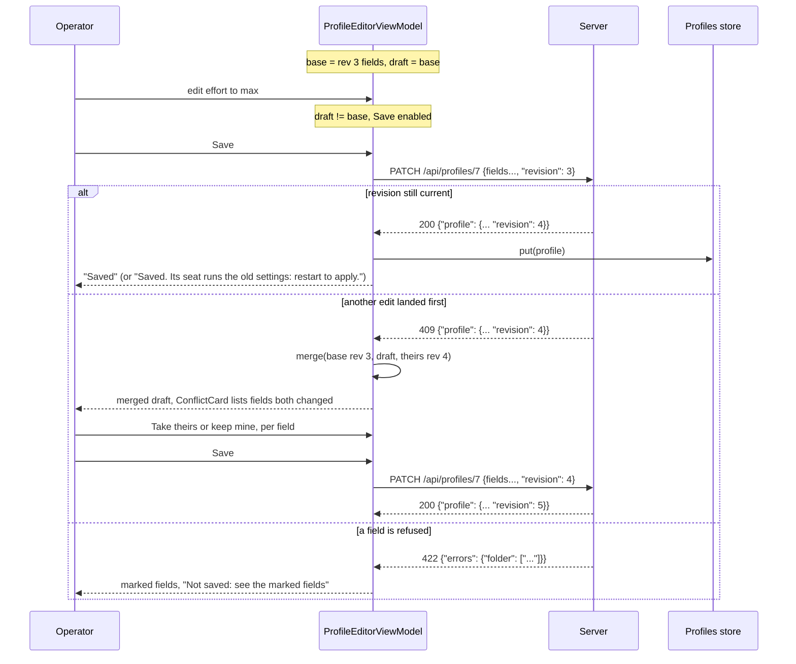
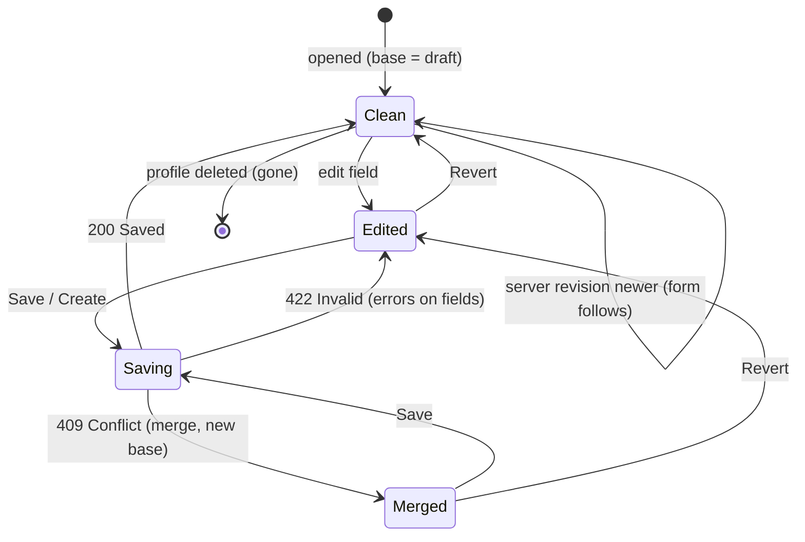

# Seat profiles

A profile is a seat the server starts for you on a machine: its folder, fleet, role, runtime, model, permission mode and MCP servers are stored on the server, and the machine's host agent starts the seat from them. The app lists the profiles, edits them, and starts, restarts, stops and deletes them. The point of a profile over the plain "New seat" spawn ([new-seat.md](new-seat.md)) is that the settings persist: the same seat can be started again with the same settings, an edit is versioned, and the server tracks whether the running seat is older than the latest edit.

Profiles are reached from the Seats tab: the top bar shows a **Profiles** action (the badge icon, content description `Profiles`) only while the route is `seats`. It opens the `profiles` route (list); a row opens `profile/{id}` (editor); **New profile** opens `profile/-1` (`NEW_PROFILE = -1`, the empty form). While any of these three routes is open the Seats tab stays highlighted, and the top bar title is `Profiles`, `Profile` or `New profile`.

## How it works

### What a profile is, as the client sees it

`Profile` (core `Profiles.kt`) is parsed from the server's JSON:

| Kotlin field | JSON key | Notes |
|---|---|---|
| `id` | `id` | required |
| `name` | `name` | required. It is the seat's title. Fixed for life in the app (see Naming) |
| `revision` | `revision` | defaults to `1` when absent. Used for optimistic saving |
| `fields` | the settings below, at the top level | `ProfileFields` |
| `lastStart` | `last_start` | `ProfileStart`, or null |
| `status` | `status` | defaults to `stopped` |
| `seat` | `seat` | the running seat's row id, or null |
| `restartNeeded` | `restart_needed` | the running seat started from an older revision |

`status` is one of `running`, `starting`, `unregistered` (its machine started the seat but it never registered, for example it sits at a prompt in tmux), `offline` (its machine is), `failed` (the last start), `stopped`. `isRunning` is `status == "running"`. `canStop` is `running` or `unregistered`: Stop applies, Start and Delete do not.

`ProfileFields` is what the editor changes (everything except the name). Defaults are used when the server omits a key, and when the app builds a new profile:

| Field | JSON key | Default | Editor control |
|---|---|---|---|
| `machine` | `machine` | (required) | **Machine** picker over the server's hosts |
| `folder` | `folder` | (required) | **Folder** text field plus a chip per allowed folder of the machine |
| `fleet` | `fleet` | null (none) | **Fleet** text field, placeholder `none`; blank becomes null |
| `role` | `role` | `member` | **Role** chips: `member`, `watcher`, `orchestrator` (`ProfileFields.ROLES`) |
| `canNotify` | `can_notify` | `false` | switch **May page the operator** |
| `runtime` | `runtime` | `stock+mod` | **Runtime** picker (the machine's runtimes) |
| `model` | `model` | null (Claude Code's default) | **Model** text field plus chips |
| `effort` | `effort` | null | **Effort** chips |
| `permissionMode` | `permission_mode` | `default` | **Permission mode** picker (the machine's modes) |
| `mcp` | `mcp` | empty list | **MCP servers** checkboxes |
| `pooled` | `pooled` | `true` | switch **Pooled login (proxy failover)** |
| `autostart` | `autostart` | `false` | switch **Start when its machine comes online** |
| `resume` | `resume` | `latest` | **Conversation** chips and optional id field |
| `debug` | `debug` | `false` | switch **Debug log** |

The code comment on `pooled` says it is a pooled login with the proxy's account failover, on by default, and never on the patched runtime, which fails over itself. The client does not enforce that last part; the server decides. `resume` is `latest`, `new`, or a conversation id. `ProfileFields.toJson()` sends every key (null is sent as JSON `null`, which clears an optional field).

`ProfileStart` (`last_start`): `at`, `outcome` (default `unknown`), `reason`, `seat` (read as a string), `requested_at` (falls back to `at` for servers that do not send it) and `stopped_at`. `outcome` is `starting`, `started`, `refused`, `failed` or `offline`. It describes the newest start and stays `started` after the seat stops.

### Live updates and the watch count

`Profiles` is a store (`AppContainer.profiles`) that stays current while something shows it:

- On `start()` it joins `operator:events` (the same topic the fleet list and spawn tracker use) and launches three jobs: collect events, refresh on every (re)join of the channel, and a loop that refreshes now and then every `RECHECK_MS = 60_000` ms.
- Refresh is `GET /api/profiles` (response key `profiles`). A failed refresh is only logged (`profiles not read: ...`); the list keeps what it had.
- Between refreshes the only event it reacts to is `profile`, with payload `{op, profile}`. For `op == "deleted"` the profile is removed by `profile.id`; for any other op the profile is parsed and upserted. A payload that does not parse is ignored.
- `upsert` replaces by id, keeps the list sorted by lowercased name, and never replaces a profile with an older `revision` (an event can arrive after the reply to a later edit).
- `put(profile)` upserts a profile the app just saved or started, so it shows at once.

The store runs only while a profiles screen exists. `AppContainer` counts watchers:

```kotlin
fun watchProfiles()   = synchronized(this) { if (profileWatchers++ == 0) profiles.start() }
fun unwatchProfiles() = synchronized(this) { if (--profileWatchers == 0) profiles.stop() }
```

`ProfilesViewModel` and `ProfileEditorViewModel` each call `watchProfiles()` in `init` and `unwatchProfiles()` in `onCleared()`. Going list to editor therefore keeps the store running (count 2), and it stops (`jobs` cancelled) only when both view models are gone. `start()` is idempotent while jobs exist.

### Editing, revisions and conflicts

The editor keeps `base` (the fields as last read or saved), `baseRevision`, and `draft` (what the form shows). `edited` is `draft != base`, or always true for a new profile.

- While an existing profile loads, the editor collects `app.profiles.all`. An unedited form (`draft == base`) follows the server whenever `p.revision > baseRevision`. An edited form keeps the operator's work and only refreshes `profile` (status, last start, seat). Editing a field clears that field's error.
- If the profile disappears from the store after having been seen, `gone` is set and the screen closes (`onClose`). This also happens after **Delete**.
- Save sends `PATCH /api/profiles/{id}` with all fields plus `"revision": baseRevision`. The server answers 200 with `{"profile": {...}}`, 409 with the current profile, or 422 with field errors. `Api.saving` turns the latter two into results instead of exceptions.
- On 409, `ProfileFields.merge(base, mine, theirs)` does a three-way merge per key: a field the operator changed keeps their value; any other field takes the server's. A key both sides changed to different values is a conflict: it keeps the operator's value and is listed. The editor adopts the server's profile as the new `base` and `baseRevision`, and shows either `Changed elsewhere too; both edits are in. Save again to keep them.` (no conflicts) or `Changed elsewhere too; review the marked fields, then save again.`. The operator then saves again with the new revision.



State of the editor form:



### Naming

The name is the seat's title, fixed for life as far as the app is concerned: `Api.createProfile` documents it as 1-64 of `A-Z a-z 0-9 . _ -`. The editor shows the name of an existing profile as plain text. The core library has `Api.renameProfile` (`POST /api/profiles/{id}/rename` with `{"name": ..., "revision": ...}`, with `ProfileRename.Renamed/Refused/Conflict/Invalid` and the helpers `renameRefusal` and `renameMoved`), but no Android screen calls it. See Failure modes for what its refusals mean.

### Start, restart, stop

The status card at the top of the editor holds the controls, chosen by status:

- `running` (and `isRunning`): **Open seat** (only if `seat` is set), **Restart**, **Stop**.
- `unregistered` (`canStop` but not running): only **Stop**, because the seat is up on its machine without a row.
- anything else: **Start**, disabled while `busy` or `status == "starting"`.

Each calls `ProfileEditorViewModel.control`: `POST /api/profiles/{id}/start`, `/restart` or `/stop`. Start and restart return `{"profile": {...}}` which is put in the store at once. The reply only means accepted (202); the outcome arrives as a `profile` event and in `lastStart`. After any control call the store refreshes. These need an app or super token; saves, creates and deletes need the super token.

**Open seat** calls `onOpenSeat(seat, name)`, which navigates to `seat/{seat}?title={name}` (the seat view, see [seat-view.md](seat-view.md)).

### Adopting an existing seat into a profile

Core has the full adopt flow (`Adopt.kt`, `Api.adoptPreview`, `Api.adopt`). It turns a seat someone started by hand into a profile's seat: the machine's host agent finds the Claude Code process (by Claude Code's own record, `~/.claude/sessions/<pid>.json`), stops exactly that process, and starts the same conversation from a profile under the agent.

**The Android app has no screen for it.** Searching `android/src` finds no use of `adoptPreview`, `adopt` or `AdoptPreview`; only the shared library and its tests implement it. The behaviour below is what the library does, for a client that offers it.

- `adoptBlockedReason(seat)` rules out, from the seat row alone: a stopped seat (`It is stopped: make a profile for it and press Start instead.`), a runner's worker (`A runner's worker: cv-runner starts and stops it.`), and a seat with `origin == "profile"` (`It already runs from a profile.`). Otherwise it returns null and the server is asked.
- `adoptHost(seat, thisMachine)` is the seat's recorded host, else the machine the app runs on.
- `GET /api/sessions/{id}/adopt_preview[?host=...]` returns `AdoptPreview`: `process` (`pid`, `proc_start`, `tmux`, `status` idle/busy, `version`, `matched_by` `session_id` or `tmux_title`, `session_id`), `suggested` (profile fields for a new profile), `existing_profile` (a stopped profile with the seat's title on its machine), `blocked` (reason string) and `folder` (the process folder, when blocked as outside the machine's allowed folders). `canAdopt` needs no block, a process, an existing or suggested profile, and an existing profile that is not `canStop`. A match by `tmux_title` means only the tmux name and folder matched, so a client should ask the operator to confirm.
- `POST /api/sessions/{id}/adopt` sends the profile fields plus `pid`, `proc_start`, optional `profile_id` (use that stopped profile), `force: true` (only when asked, to stop a busy seat anyway) and `host` (only when the row has none). The reply is 202 with `{"profile": {...}}`. Per the code comment: 409 means busy (mid-turn), a running profile, or a runner's seat; 422 field errors; 504 its machine is offline.

## Configuration

| Item | Value | Where |
|---|---|---|
| Profile recheck interval | `60_000` ms (`RECHECK_MS`) | `Profiles` |
| Topic | `operator:events` | `Fleets.TOPIC` |
| Event | `profile`, payload `{op, profile}`; `op == "deleted"` removes | `Profiles.apply` |
| New profile route id | `-1` (`NEW_PROFILE`) | `AppRoot.kt` |
| Name constraint (documented) | 1-64 of `A-Z a-z 0-9 . _ -` | `Api.createProfile` |
| Start rate limit (documented) | one start per 10 s per machine (429) | `Api.startProfile` |
| Model chips | `SessionChoices.models` (Opus 5.5, Opus 5, Sonnet 5.5, Sonnet 5, Fable 5.1, Fable 5, Mythos 5.1, Mythos 5, Haiku 4.5) | `SessionChoices` |
| Effort values | `low`, `medium`, `high`, `xhigh`, `max` | `ProfileFields.EFFORTS` |
| Default values | see the field table above | `ProfileFields` |

## Interface

### List screen (`profiles`)

- Pull to refresh calls `ProfilesViewModel.refresh()` (`GET /api/profiles`).
- Empty state: title `No profiles`, text `A profile is a seat the server starts on a machine: its folder, fleet, model and MCP servers.`
- Each row: a status dot (green running, busy colour starting, attention colour unregistered, red failed, muted otherwise), the name, a line `machine · fleet · role` (fleet omitted when none), a status label, and an auto-renew icon (description `Edited since its seat started: restart to apply`) when `restartNeeded`. Status labels: `machine offline` for offline, `started, not registered` for unregistered, `start <outcome>` plus `: <reason>` for failed (for example `start refused: outside_roots: ...`), else the raw status.
- The list is in name order (the store sorts case-insensitively). `profileGroups` in core groups by fleet (fleets by name, no-fleet last) with a running count, but this screen shows a flat list.
- Floating button **New profile**.

### Editor screen (`profile/{id}`)

From top to bottom, in a scrolling column:

1. **Status card** (existing profiles only): dot and status label, the last-start line, the restart notice, and the controls above. The last-start line reads `Last start: <outcome> <HH:mm:ss>` (or `d MMM HH:mm:ss` if not today), ` (took N s)` when the outcome is not `starting` and the request time is earlier than the outcome time, ` · stopped HH:mm:ss` when stopped, and ` — <reason>`. The notice reads `Edited since its seat started: restart to apply.`
2. **Conflict card** (after a 409 with fields both changed): `Changed elsewhere too`, with the text `Someone saved this profile after you opened it. Their changes are in and yours are kept; these fields both of you changed show yours.` Each conflicting field shows its label, `theirs: <value>`, and a **Take theirs** button.
3. **Seat** section: **Name** field (new profile only, placeholder `my-seat`; trimmed on send) or the name as text; **Machine** picker (`Choose…` when empty; offline hosts are suffixed ` (offline)`; hint `<machine> has no host agent` when the machine is not among the hosts); **Folder** (placeholder is a sample path) with the hint `The seat's folder must be inside one of <machine>'s allowed folders:` and one chip per root of the machine; **Fleet**; **Role**; **May page the operator**.
4. **Launch** section: **Runtime** (labels are the runtime name plus its version), **Model** (field plus **Default** chip plus one chip per known model), **Effort** (**Default** plus the five values), **Permission mode** (labels from `SessionChoices.modes`, else the raw id), **MCP servers**. Runtime, permission mode and MCP are limited to what the chosen machine's host agent lists (`Host.runtimes`, `Host.modes`, `Host.mcp`). If the machine lists none, the picker is read-only and a hint explains (`Choose a machine to see its <what>.` or `<machine>'s agent (<version>) lists no <what> yet; the profile keeps this one. Agent 0.7.0 lists them.`). A current value the machine lacks is kept and shown as `<value> (not on this machine)`. An MCP server in the profile but not in the catalog shows `<name>: not in this machine's catalog` with **Remove**. With no catalog: `Choose a machine first.` or `This machine's agent lists no MCP catalog yet.`
5. **Starting** section: **Conversation** chips `Continue the latest` (`latest`), `Start new` (`new`), `A chosen one` (an id, entered in **Conversation id**, placeholder `a Claude Code session id`); the three switches **Start when its machine comes online**, **Pooled login (proxy failover)**, **Debug log**.
6. **Delete profile…** (existing profiles only), opening a dialog `Delete <name>?` with `The server forgets its settings. Its seats' history stays.` and **Delete** / **Cancel**.

The bottom bar shows the notice line and the buttons:

- **Create** (new) or **Save** (existing): enabled when not busy, `edited`, machine and folder are non-blank, and for a new profile the name is non-blank. It clears focus first so the result line is visible.
- **Revert** (existing only): enabled when edited and not busy; resets the draft to `base` and clears conflicts, errors and the notice.

After **Create** succeeds, `onCreated(id)` navigates to `profile/{newId}` and pops the `profile/{id}` entry inclusive, so the empty form is replaced by the created profile. After **Save**, the notice is `Saved` or, when the returned profile has `restart_needed`, `Saved. Its seat runs the old settings: restart to apply.` Edits apply at the seat's next start.

### API calls

| Action | Call | Token |
|---|---|---|
| List | `GET /api/profiles` | any |
| Hosts for pickers | `GET /api/hosts` | (the editor calls `loadHosts()` once on open) |
| Create | `POST /api/profiles` body: all fields plus `name` | super |
| Save | `PATCH /api/profiles/{id}` body: all fields plus `revision` | super |
| Rename (library only) | `POST /api/profiles/{id}/rename` `{"name","revision"}` | super |
| Delete | `DELETE /api/profiles/{id}` (200..299 is success; 409 while a seat runs from it) | super |
| Start | `POST /api/profiles/{id}/start` | app or super |
| Restart | `POST /api/profiles/{id}/restart` | app or super |
| Stop | `POST /api/profiles/{id}/stop` | app or super |
| Adopt preview (library only) | `GET /api/sessions/{id}/adopt_preview` | app or super |
| Adopt (library only) | `POST /api/sessions/{id}/adopt` | app or super |

Save request body (fields as the app sends them):

```json
{
  "machine": "lorem-host",
  "folder": "/srv/work/lorem-api",
  "fleet": "lorem-fleet",
  "role": "orchestrator",
  "can_notify": true,
  "runtime": "stock+mod",
  "model": null,
  "effort": "high",
  "permission_mode": "default",
  "mcp": ["claudiverse"],
  "pooled": true,
  "autostart": false,
  "resume": "latest",
  "debug": false,
  "revision": 3
}
```

Live event on `operator:events`:

```json
{"op": "updated", "profile": {"id": 7, "name": "lorem-admin", "revision": 4, "status": "running", "seat": 204200}}
```

Only `op == "deleted"` is special-cased by the client; the event name is `profile`.

## Failure modes and troubleshooting

Editor messages come from `ProfileEditorViewModel.refusal`, prefixed `Not saved`, `Not deleted`, `Not started`, `Not restarted` or `Not stopped`:

- `<what>: this needs a signed-in token (Connection → Account → Sign in)`: HTTP 403. Create, save and delete need the super token; start, restart and stop accept an app token.
- `<what>: <message>`: HTTP 409. For a delete, a seat still runs from the profile (stop it first). For start, already running. The text after the first `: ` of the server message is shown.
- `<what>: the machine did not answer`: HTTP 504, the machine's host agent is offline or silent.
- `<what>: <message>`: anything else, including 429 (one start per 10 s per machine; wait and retry) and the machine's own refusals (HTTP 403, 400 or 404 with a code such as `outside_roots` or `not_allowed`, which also appears in `lastStart.reason` and the list row, e.g. `start refused: outside_roots: ...`).
- `Not saved: see the marked fields`: a 422. The messages sit under the offending fields (`name`, `machine`, `folder`, `fleet`, `runtime`, `model`, `permission_mode`, `mcp`, `resume` have inline error slots) and clear when you edit that field.
- `Changed elsewhere too ...`: a 409 conflict, see above. Fields only the other side changed are already merged into your draft.
- A profile that shows `started, not registered`: the machine started the seat but it did not register (for example it waits at a prompt in tmux); only Stop is offered.
- Empty list: either there are none, or `GET /api/profiles` failed (only logged as `profiles not read: <message>`); pull to refresh.
- Rename refusals (library, not shown in the app): `name_taken` (`That name is taken: a profile or a running seat already has it.`), `busy` (`The seat is mid-turn: rename it once it is idle.`), `claimed_task` (`The seat holds a task, which its runner tracks by name: rename it once the task is done.`). A rename of a running idle seat is a 202 and restarts the seat under the new name.

## Tests

- `core/src/commonTest/kotlin/dev/claudiverse/core/ProfilesTest.kt`: grouping by fleet; parsing every field; `requested_at` and `stopped_at`; unregistered seats being stoppable; `pooled` defaulting to true; field round trip through the server's names; three-way merge and conflicts; events add, replace and delete; an older revision never replacing a newer one; rename results; edits sending the revision and a 409 becoming a conflict; a 422 naming fields; a refused start carrying the machine's code; the empty delete reply; host menus.
- `core/src/commonTest/kotlin/dev/claudiverse/core/AdoptTest.kt`: preview with an existing stopped profile; blocked and running-profile cases; tmux-name matches and terminals without tmux; row rules for runners, profile seats and stopped seats; host fallback; the exact adopt and preview requests.

## Related pages

- [Claudiverse for Android](README.md)
- [Seat list (the Seats tab)](seat-list.md): where the Profiles action lives.
- [New seat (spawning a seat)](new-seat.md): the one-off spawn.
- [Seat view](seat-view.md): where Open seat goes.
- [Connecting to a server](connecting.md): signing in for the super token.
- [Architecture](architecture.md)
- Server: [Profiles and the host channel](https://github.com/Promises/claudiverse/blob/main/docs/reference/server/profiles-and-hosts.md)
- Host agent: [Starting seats](https://github.com/Promises/claudiverse/blob/main/docs/reference/host-agent/starting-seats.md)
- Mac: [Profiles](../mac/profiles.md)

## Source

- `android/src/main/java/dev/claudiverse/app/ui/ProfilesScreen.kt`
- `android/src/main/java/dev/claudiverse/app/profiles/ProfileViewModels.kt`
- `android/src/main/java/dev/claudiverse/app/ui/AppRoot.kt`
- `android/src/main/java/dev/claudiverse/app/AppContainer.kt`
- `core/src/commonMain/kotlin/dev/claudiverse/core/Profiles.kt`
- `core/src/commonMain/kotlin/dev/claudiverse/core/Adopt.kt`
- `core/src/commonMain/kotlin/dev/claudiverse/core/Api.kt`
- `core/src/commonMain/kotlin/dev/claudiverse/core/Models.kt`
- `core/src/commonTest/kotlin/dev/claudiverse/core/ProfilesTest.kt`
- `core/src/commonTest/kotlin/dev/claudiverse/core/AdoptTest.kt`
