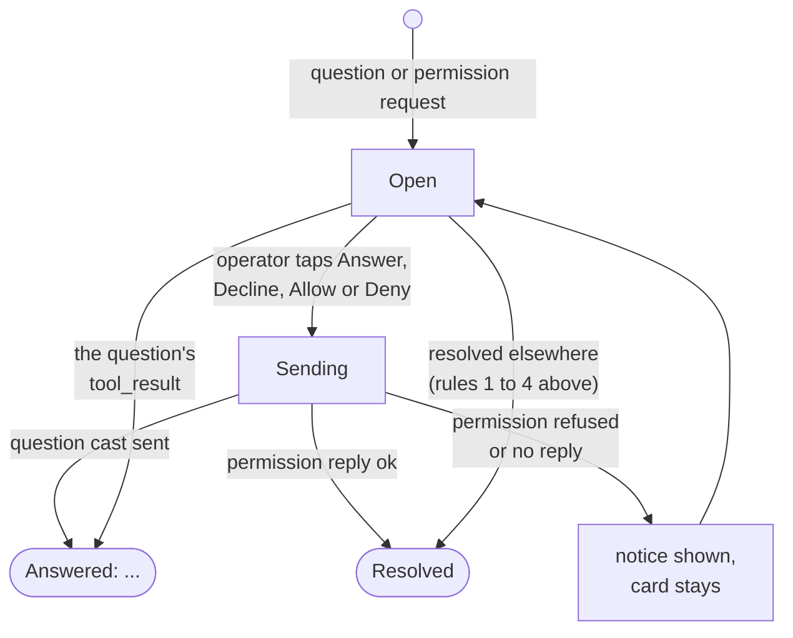

# Questions and permissions

A seat (a Claude Code session) sometimes stops and waits for the operator: it asks a question with Claude Code's `AskUserQuestion` tool, or it needs approval before a tool runs. The operator answers both from the Android app, in the seat's transcript. This page covers how the app recognises such a request in the transcript, how it answers one, and when it counts as answered.

Do not confuse this with the "needs you" request that appears in the seat list and in notifications (see [notifications.md](notifications.md)). That is a separate object, a `HumanRequest`, that a seat raises to page the operator. It is resolved by opening the seat, not by answering a question card. The two meet only on the seat screen: opening the seat resolves its `HumanRequest`, and the question or permission card in the transcript is how the operator actually gives the answer.

## How it works

The transcript is built by `TranscriptBuilder` in the shared `core` library. It is a pure function of the seat's mirrored messages, so a replay and a live stream produce the same transcript.

### Recognising a question

An assistant `tool_use` block named `AskUserQuestion` becomes a `TranscriptItem.Question`. From the tool input the builder reads `questions[]`, and for each one `header`, `question`, `options[]` (each with `label` and `description`) and `multiSelect`. The question is answered when a `tool_result` with the same `tool_use_id` exists. The result's text becomes `Question.answer`; while it is null the question is open.

### Recognising a permission request

Permission requests reach the transcript two ways.

- In the message stream: a `control_request` message whose `request.subtype` is `can_use_tool` becomes a `TranscriptItem.Permission` with the `request_id`, `tool_name`, a detail (`description`, else `title`) and the pretty-printed `input`.
- As live events on the seat channel: `permission_request` (kept by request id) and `permission_resolved` (adds the id to the resolved set). A live request that is not already in the transcript is appended with `TranscriptBuilder.permissionFromEvent`, which uses `display_name` in preference to `tool_name`. Requests carrying an `agent_id` belong to that agent's thread, not main's.

### When a permission counts as answered

A `Permission` is `pending` unless its request id is in the answered set. The builder adds an id to that set when any of these holds:

1. The operator answered it from this app (`resolveLocally`) or the server sent `permission_resolved` (both feed `resolvedPermissions`).
2. A `control_response` message names the id in `response.request_id`.
3. The request carries a `tool_use_id` and that tool call already has a `tool_result`: the tool ran, so it was allowed (or answered in the terminal).
4. A turn ended after the request was asked. A message of type `result` (patched runtime) or `turn_complete` (mod) marks the end of a turn, and every request asked before it is treated as answered, because the seat cannot finish a turn while it waits.

A request that arrives after the turn's end is a new turn's and stays pending. The test `aPermissionIsAnsweredOnceItsToolRanOrItsTurnEnded` pins all of these cases.

### Lifecycle



### Answering from the app

Both kinds of answer travel over the seat's Phoenix channel `session:<seatId>`, which the app joins as `{"role": "observer"}`. They are channel events, not REST calls. `SeatViewModel` (the Android app's view model) sends them. `SeatSession` in `core`, used by other clients, has the same `answer` and `decline`, but its `permission` casts `permission_response` without waiting for a reply and marks the request resolved at once.

| Action | Channel event | Payload | Mode |
| --- | --- | --- | --- |
| Answer a question | `answer` | `tool_use_id`, `response`, optional `answers` | cast (no reply awaited) |
| Decline a question | `decline` | `tool_use_id` | cast |
| Allow / deny a permission | `permission_response` | `request_id`, `decision` (`"allow"` or `"deny"`) | push, waits up to 10 s for the reply |

`answer` example, for two picked questions:

```json
{
  "tool_use_id": "toolu_01abc",
  "response": "Scope: Android only\nTarget: staging",
  "answers": { "Which scope?": "Android only", "Which target?": "staging" }
}
```

`response` is the text the seat sees. `composeAnswer` builds it: one line per question, `header: label` when there are several questions and the question has a header, otherwise just the label; multi-select labels are joined with `", "`. Questions with nothing picked are left out. `answers` comes from `answerMap`: question text mapped to the picked labels (joined with `", "`), omitted when empty. The server hands it to the seat as the question's own answers, so it does not need to split `response` by header.

A permission answer example:

```json
{ "request_id": "req_42", "decision": "allow" }
```

The permission push waits for the server's reply because the server can refuse an allow for a token without the app's powers, and that comes back on the reply rather than as an event. The reply is read as `status` (`"ok"` accepts) and `response.reason`. Only on `ok` does the app call `resolveLocally`, which marks the request answered before the seat confirms it. On a refusal or a missing reply the card stays open and a notice is shown.

## Configuration

There is nothing to configure for answering. Fixed values in the code:

| Value | Where | Meaning |
| --- | --- | --- |
| `session:<seatId>` with `{"role":"observer"}` | `SeatViewModel` | channel carrying `answer`, `decline`, `permission_response` |
| 10 s | `PhoenixSocket.Channel.push` default timeout | how long a permission answer waits for the server's reply |

## Interface

### Question card

Shown in the seat transcript as a card headed `Question`. For each question: the optional header, the question text, then the options as chips.

- Single select (`multiSelect` false): tapping a chip picks exactly that option.
- Multi select: tapping toggles the option in and out of the picked list.
- Picking an option that has a description shows the description under it.
- Free text: a text field with the placeholder `Or answer in your own words`. Any non-blank text replaces the picked choices: the app sends the text as `response` and no `answers` map.
- `Answer` is enabled only when the composed answer is not blank. Tapping it sends `answer` and shows the notice `Answer sent`.
- `Decline` sends `decline` and shows the notice `Question declined`.

Only an unanswered question has live controls. Once the tool result exists the card shows `Answered: <text>`; right after the operator acts, before the result arrives, it shows `Sent`. The chips are disabled in both cases.

### Permission card

A card headed `Permission: <tool name>`, with the detail line and a collapsible `input` block (the tool input, long text truncated at 4000 characters with a `Show all N characters` button). While pending it shows two buttons, `Allow` and `Deny`, and the card is tinted as an error container. When no longer pending it shows `Resolved` instead.

### Server and channel calls

| Call | Used for |
| --- | --- |
| channel `session:<seatId>`: `answer`, `decline`, `permission_response` | answering (above) |
| channel `session:<seatId>`: `permission_request`, `permission_resolved` events | live permission state |
| `GET /api/human_requests?status=open` | the open "needs you" requests (not the cards) |
| `POST /api/sessions/<id>/human_requests/resolve` | clears a seat's requests when the operator opens it; the server answers `{"resolved": n}` |
| channel `operator:human_requests`: `human_request`, `human_request_resolved` | live changes to those requests |

### Human requests (the seat-level "needs you")

`HumanRequests` in `core` keeps the open requests current for the phone's watcher and the app. It joins `operator:human_requests`, reads `GET /api/human_requests?status=open` on every successful (re)join, and rereads every 120 000 ms as a safety net so a request that arrived while the socket was down is still picked up.

A `HumanRequest` has `id`, `session_id`, `seat_title`, `summary`, optional `detail`, `inserted_at`, `updated_at`. There is one open request per seat: asking again updates it. The collection is keyed by seat id and exposed as `open` (a map) and `requests` (a list, newest change first, for Swift).

```json
{ "requests": [ { "id": 7, "session_id": 12, "seat_title": "lorem-admin",
    "summary": "Which scope should the migration cover?", "detail": null,
    "inserted_at": "2026-01-01T10:00:00Z", "updated_at": "2026-01-01T10:00:00Z" } ] }
```

Events on the topic:

- `human_request`: the payload is parsed as a `HumanRequest` and replaces the seat's entry.
- `human_request_resolved`: removes the entry of `session_id`; without one, removes entries whose `id` matches the payload `id`.

`supported` is a flag, true until a read fails with HTTP 404, meaning the server has no human-request endpoints. It turns true again on the next successful read. The connection screen shows `This server does not offer seat requests yet.` when it is false.

`resolve(seatId)` removes the seat's request locally at once and then calls `POST /api/sessions/<id>/human_requests/resolve`. The seat screen calls it whenever the seat is open on screen and has an open request: both the view model on Android and `SeatSession` in `core` combine the open requests with the screen being watched, so a request arriving while the seat is on screen is resolved immediately too. On Android the open requests are only followed while the notification watcher runs (`WatchService` is the only caller of `HumanRequests.start()`); with the watcher off the open map stays empty and nothing is resolved from the app. See [notifications.md](notifications.md).

## Failure modes and troubleshooting

| Message | Meaning |
| --- | --- |
| `Not connected — answer not sent` (or `Not connected — decline not sent`) | the channel could not send the cast; the socket is down. The question card still switches to `Sent` (it is marked on the tap, whatever the outcome) and loses its controls for as long as the screen keeps its state. Reconnect, leave the seat and open it again to get the controls back, or answer in the terminal. |
| `Not answered: no reply from the server (offline?). The prompt is still open.` | the `permission_response` push got no reply within 10 s. The card stays open; tap again. |
| `Not answered: <reason>` | the server replied with a non-ok status; `<reason>` is `response.reason`. |
| `Not answered: the server refused (<status>)` | a non-ok status with no reason. An allow is refused for a token without the app's powers. |
| Permission card stays pending after answering in the terminal | the app only learns of a terminal answer from a `control_response`, `permission_resolved`, a tool result for the request's `tool_use_id`, or a turn end; until one arrives it stays pending. |
| "needs you" pill remains | the seat's request is only cleared by opening the seat (or `human_request_resolved`); answering a card does not itself clear it. |

## Tests

- `core/src/commonTest/kotlin/dev/claudiverse/core/SessionRulesTest.kt`: `composeAnswer` and `answerMap` (single question answered with its label alone, structured answers keyed by question text, several questions one line each by header, nothing picked gives an empty answer) and `SessionChoices.isRunning` (model matches exactly).
- `core/src/commonTest/kotlin/dev/claudiverse/core/TranscriptBuilderTest.kt`: `aPermissionIsAnsweredOnceItsToolRanOrItsTurnEnded` covers the pending rules above, plus image, event and key-uniqueness cases.
- `core/src/commonTest/kotlin/dev/claudiverse/core/SupersededTest.kt`: not about questions; it tests `withoutSuperseded`, which hides stopped seat rows replaced by a resumed seat.

## Related pages

- [Notifications: seats that need you](notifications.md): how an open request becomes a notification and how tapping it opens the seat.
- [Seat view](seat-view.md): the transcript the cards appear in.
- [Seat controls](seat-controls.md): permission mode, the per-seat paging switch.
- [Seat list (the Seats tab)](seat-list.md): the "needs you" pill.
- [Architecture](architecture.md)
- Server: [Questions and permission relays](https://github.com/Promises/claudiverse-oss/blob/main/docs/reference/server/questions-and-permissions.md)
- Mod: [Questions and permission relay](https://github.com/Promises/claudiverse-oss/blob/main/docs/reference/services/mod/questions-and-permissions.md)
- Web panel: [Permissions and questions in the web panel](https://github.com/Promises/claudiverse-oss/blob/main/docs/reference/services/web/permissions-and-questions.md)
- Mac: [Questions and permissions](../mac/questions-and-permissions.md)

## Source

- `core/src/commonMain/kotlin/dev/claudiverse/core/Transcript.kt`
- `core/src/commonMain/kotlin/dev/claudiverse/core/SeatFeed.kt`
- `core/src/commonMain/kotlin/dev/claudiverse/core/SeatSession.kt`
- `core/src/commonMain/kotlin/dev/claudiverse/core/HumanRequests.kt`
- `core/src/commonMain/kotlin/dev/claudiverse/core/Models.kt` (`HumanRequest`)
- `core/src/commonMain/kotlin/dev/claudiverse/core/Api.kt` (`openHumanRequests`, `resolveHumanRequests`)
- `android/src/main/java/dev/claudiverse/app/ui/SeatScreen.kt`
- `android/src/main/java/dev/claudiverse/app/seat/SeatViewModel.kt`
