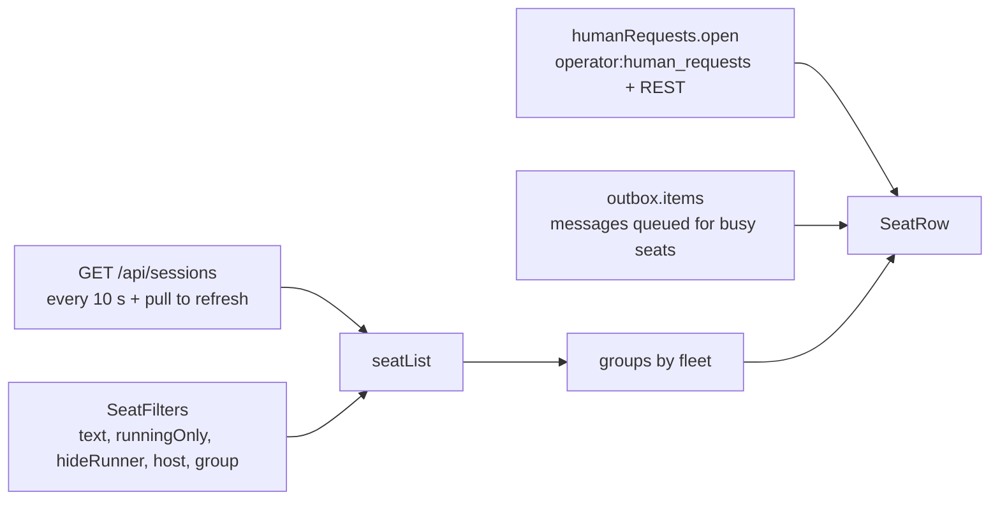

# Seat list (the Seats tab)

The Seats tab is the app's home screen once the server is configured. It lists the operator's seats (Claude Code sessions running on their machines), grouped by fleet, with a live activity pill per seat, a marker when a seat is asking for the operator, and a count of messages queued for it. Tapping a seat opens it (see [seat-view.md](seat-view.md)). The tab also holds the entry points to New seat and Profiles.

The app starts on `seats` when the server URL and token are set (`config.isComplete`), otherwise on the Connection tab.

## How it works

The screen is `SeatsScreen`, wired in `AppRoot`:

```kotlin
SeatsScreen(
    viewModel { RemoteViewModel(pollMs = 10_000) { app.api.seats(app.seatsIncludeStopped.value) } },
    app.seatsIncludeStopped, app.outbox.items, app.humanRequests.open,
) { seat -> nav.navigate("seat/${seat.id}?title=${Uri.encode(seat.label)}") }
```

Three data sources feed one list:

| Source | What it gives the list |
|---|---|
| `RemoteViewModel` polling `GET /api/sessions` | the seats |
| `app.humanRequests.open` (`Map<seatId, HumanRequest>`) | the "needs you" pill and request summary |
| `app.outbox.items` (`List<QueuedMessage>`) | the "N queued" pill (count per `seatId`) |



### Polling

`RemoteViewModel` loads when the screen is first collected and then every `pollMs` (10 000 ms) while something collects it. A screen in the back stack, or the app in the background, polls nothing. A failed refresh keeps the last good data and shows an error banner above it. Pull-to-refresh (`PullToRefreshBox`) and the banner's Retry button call `refresh()`.

The seat list itself is not live over the socket: it is refreshed by polling. Only the "needs you" markers are live (see below).

### Which seats are fetched

`app.seatsIncludeStopped` is a `MutableStateFlow<Boolean>` in `AppContainer`, default `false`. `Api.seats(includeStopped)` builds the request:

- `includeStopped = false`: `GET /api/sessions` with no query. The server's default is what the client gets (the code documents this as running seats).
- `includeStopped = true`: `GET /api/sessions?status=all&limit=100`.

The code comment says stopped rows make the list about four times larger, so they are fetched only when asked for.

The **Running** filter chip is the inverse of this flag: `runningOnly = !includeStopped`. Toggling the chip sets `includeStopped.value = runningOnly` and immediately calls `vm.refresh()`, so the list is re-fetched with the other query. The flag lives in `AppContainer`, so it survives leaving the tab; the chip default is on (running only).

### Filtering, ordering and grouping (`seatList` in core `SeatList.kt`)

`seatList(all, filters)` is a pure function, tested in `SeatListTest`. Steps:

1. **Superseded rows are dropped** (`withoutSuperseded`). A resumed seat registers as a new row and the old one stays stopped. A stopped row is removed when another row holds the same conversation (`conversationId`, else `claudeSessionId`) and has a higher `id`. Running rows, rows with no conversation and unrelated rows stay.
2. **Base filter.** With `runningOnly`, only `status == "running"`. With non-blank `text`, only seats whose `label` or `title` contains the text, case-insensitive.
3. **Machine filter.** If `host` is set, only seats whose `host` equals it.
4. **Runner filter.** With `hideRunner`, seats with `origin == "runner"` (`Seat.isRunner`) are removed from what is shown, and counted in `runnersHidden`.
5. **Order inside the list:** running seats first (`status != "running"` sorts last), then most recent `lastActivityAt` first (parsed with `parseServerTime`; unparseable counts as 0).
6. **Grouping** (when `groupByFleet`): by `Seat.fleet`, groups sorted by fleet name, the group with no fleet (`null`) last. With grouping off, one group with `fleet = null` holds everything.
7. **Counts:** `total` is the number of seats after step 1; `shown` after steps 2-4; `busy` is shown seats with `activity == "busy"`.

The fleet name comes straight from each seat's `fleet` field in the `/api/sessions` rows. The list does not read `GET /api/fleets`: the `Fleets` class in core (which does fetch `GET /api/fleets` on every join of `operator:events` and every 60 s, and applies live `runner` and `profile` events) is not used by this screen.

Example, as in `SeatListTest` (8 seats in 2 fleets, 3 of them workers): with the default filters 5 seats are shown and 3 worker seats hidden, and the groups come out as the two fleets in name order (say `ipsum-fleet`, then `lorem-fleet`), then the no-fleet group. Selecting a machine that only runs runner seats yields zero shown seats and `runnersHidden = 2`.

### Seat labels

`Seat.label` is what the list shows as the name: the `title` for a seat started from a profile (`profile_id` set or `origin == "profile"`), otherwise Claude Code's own `display_title` when present and not blank, otherwise `title`. The second line shows `title` too when it differs from the label.

### "Needs you" markers

`app.humanRequests` is the core `HumanRequests` class. It listens on the socket topic `operator:human_requests` for the events `human_request` (adds or replaces the request for its `session_id`) and `human_request_resolved` (removes it), re-reads `GET /api/human_requests?status=open` on every successful (re)join and every 120 s, and keeps the result as a map keyed by seat id. A `404` on that read sets `supported` to false (shown in the Connection tab's notification card).

In the Android app `humanRequests.start()` is called by `WatchService`, not by the Seats screen, so the markers are live while that service runs. A seat with an open request shows an orange `needs you` pill, and the request's `summary` (up to two lines) under the title line. Opening the seat resolves its request (`POST /api/sessions/{id}/human_requests/resolve`) and the marker disappears.

### Pending outbox messages

A message typed while a seat is busy is kept in the `Outbox` (persisted, drained every 4 s once the seat is idle). The row shows `N queued` (blue "info" pill) when the outbox holds messages for that seat id.

## Configuration

| Item | Value | Where |
|---|---|---|
| Poll interval | `10_000` ms | `AppRoot`, `RemoteViewModel(pollMs = 10_000)` |
| `seatsIncludeStopped` | `false` | `AppContainer` |
| Stopped-inclusive query | `status=all`, `limit=100` | `Api.seats` |
| Default filters (`SeatFilters`) | `runningOnly = true`, `hideRunner = true`, `host = null`, `groupByFleet = true`, `text = ""` | `SeatList.kt` |
| Human requests recheck | 120 000 ms | `HumanRequests` |
| Outbox drain poll | 4 000 ms | `Outbox` |

In the screen, `text`, `hideRunner`, `host`, `group`, the set of collapsed fleets and whether the filter chips are shown are `rememberSaveable` (they survive a trip into a seat and back); they are not persisted across app restarts. All fleets start expanded.

## Interface

Top bar: title "Seats"; actions: a **Profiles** icon button (opens `profiles`, see [profiles.md](profiles.md)) and the VPN pill (opens the Connection tab). Bottom navigation: Seats, Forum, Tasks, Pool, Connection. Re-tapping the Seats tab pops back to the list. The Seats tab stays lit on seat and profile screens.

A floating action button **New seat** (shown only on the `seats` route) opens the New seat screen ([new-seat.md](new-seat.md)).

Search field, placeholder "Filter", with a filter icon button (description "Show filters" / "Hide filters"). The icon carries a small badge while the chips are hidden and any chip differs from its default (the text itself does not count).

Filter chips (when shown), in order:

- **Running**: checked = running seats only (see above).
- **Hide runner**: checked = hide seats whose `origin` is `runner`. Icon is a robot when off.
- **All machines** (machine chip, only if at least one seat reports a host): a dropdown with "All machines" first, then each known host sorted by name. Each entry shows the visible count, or `N (+M runner)` when runners are hidden on that machine. Hosts with nothing visible are dimmed. Selecting a host changes the chip label to the host name.
- **Group by fleet**: checked = group headers.

Summary line under the chips: `{shown} of {total} · {busy} busy`, plus ` · {n} runner hidden` when `runnersHidden > 0`.

Fleet header (shown when grouping, except when the only group is the unnamed one): chevron, fleet name or `No fleet`, and `{n} seat(s) · {busy} busy`. Tapping collapses or expands the group (content descriptions "Collapse" / "Expand").

Seat row, left to right on the first line:

- Activity pill (`ActivityPill`): if `status` is not null and not `running`, the status text (grey, e.g. `stopped`); else `busy` (yellow) for `activity == "busy"`, `idle` (green) for `activity == "idle"`; `loading` (grey) when both status and activity are null; otherwise the activity or status text in grey, or `?`.
- `needs you` (orange) if a human request is open.
- `runner` (outlined) for worker seats (origin `runner`).
- `{n} queued` (blue) if the outbox holds messages for it.
- `⚙ {n}` (outlined) if `backgroundRunning > 0` (shells, monitors, subagents, workflows, as counted by the server).
- The name (`label`, ellipsized), followed by a bell icon (description "Can notify you") if `canNotify`.
- Relative time of `lastActivityAt`: `just now`, `{m}m ago`, `{h}h {m}m ago`, `{d}d {h}h ago`; empty if unparseable.

Second line: the request summary when a request is open. Last line: machine icon and host, then ` · ` and `title` (if different from label), `model`, `type`, joined with ` · `.

Scroll behaviour: the list stays at the top while you have not dragged it, because it re-sorts on each refresh and active seats rise; dragging unpins, returning to the top re-pins.

### Empty and error states

- Empty (`shown == 0`): robot icon and `No seats on {host or "any machine"}`, with ` — {n} runner seats hidden` appended when runners are hidden, and a **Show runner seats** button that turns Hide runner off.
- Before the first load: a spinner. After a failed fetch: a red banner with the error message and a **Retry** button; earlier data stays visible below it.

### Server calls

| Call | Used for |
|---|---|
| `GET /api/sessions` / `GET /api/sessions?status=all&limit=100` | the seat list; response `{"sessions": [ {...}, ... ]}` |
| `GET /api/human_requests?status=open` | open requests, response `{"requests": [...]}` |
| `POST /api/sessions/{id}/human_requests/resolve` | when the operator opens the seat |
| channel `operator:human_requests`, events `human_request`, `human_request_resolved` | live markers |

Fields the list reads from each session row: `id`, `title`, `display_title`, `status`, `activity`, `type`, `model`, `last_activity_at`, `host`, `fleet`, `origin`, `profile_id`, `background_running`, `can_notify`, `conversation_id`, `claude_session_id` (plus others used elsewhere).

```json
{"sessions": [
  {"id": 101, "title": "lorem-orchestrator", "status": "running", "activity": "busy",
   "host": "lorem-host", "fleet": "lorem-fleet", "origin": "manual",
   "last_activity_at": "2026-10-10T08:00:00Z", "background_running": 2, "can_notify": true}
]}
```

A human request row carries `id`, `session_id`, `seat_title`, `summary`, optional `detail`, `inserted_at`, `updated_at`.

## Failure modes and troubleshooting

- Banner `Set the server URL and token in Settings`: no server URL or token configured; go to the Connection tab.
- Banner `HTTP {code}: {reason}`: the server answered a non-2xx; the reason is the server's `error` field, its `errors` fields, or the first 200 characters of the body.
- Banner `Server sent something that is not JSON`: the reply was not JSON (often a proxy or captive page).
- Other messages are the network exception's message, for example when the server is out of reach and the app's VPN is not up (see [vpn.md](vpn.md)).
- A stopped seat is missing: the `Running` chip is on (default), or the seat was superseded by a newer row of the same conversation.
- A worker seat is missing: `Hide runner` is on; the summary line says how many are hidden.
- No `needs you` markers: `HumanRequests` is only started by the watch service; a server without human-request endpoints (404) disables them.
- A queued message never leaves: the outbox only drains while the app runs, and only when the seat is `running` and idle.

## Related pages

[Claudiverse for Android](README.md), [Architecture](architecture.md), [Connecting to a server](connecting.md), [New seat (spawning a seat)](new-seat.md), [Seat view](seat-view.md), [Questions and permissions](questions-and-permissions.md), [Notifications: seats that need you](notifications.md), [Seat profiles](profiles.md)
- Server: [Sessions and Rooms](https://github.com/Promises/claudiverse/blob/main/docs/reference/server/sessions-and-rooms.md)
- Web panel: [Dashboard](https://github.com/Promises/claudiverse/blob/main/docs/reference/services/web/dashboard.md)
- Mac: [Seat list](../mac/seat-list.md)

## Source

- `android/src/main/java/dev/claudiverse/app/ui/SeatsScreen.kt`
- `android/src/main/java/dev/claudiverse/app/ui/AppRoot.kt`
- `android/src/main/java/dev/claudiverse/app/ui/Common.kt` (`RemoteViewModel`, `RemoteContent`, `ErrorBanner`, `Pill`)
- `android/src/main/java/dev/claudiverse/app/AppContainer.kt`
- `core/src/commonMain/kotlin/dev/claudiverse/core/SeatList.kt`
- `core/src/commonMain/kotlin/dev/claudiverse/core/Models.kt`, `Api.kt`, `HumanRequests.kt`, `Outbox.kt`, `Fleets.kt`, `ServerTime.kt`
- `core/src/commonTest/kotlin/dev/claudiverse/core/SeatListTest.kt`, `FleetsTest.kt`, `SupersededTest.kt`
