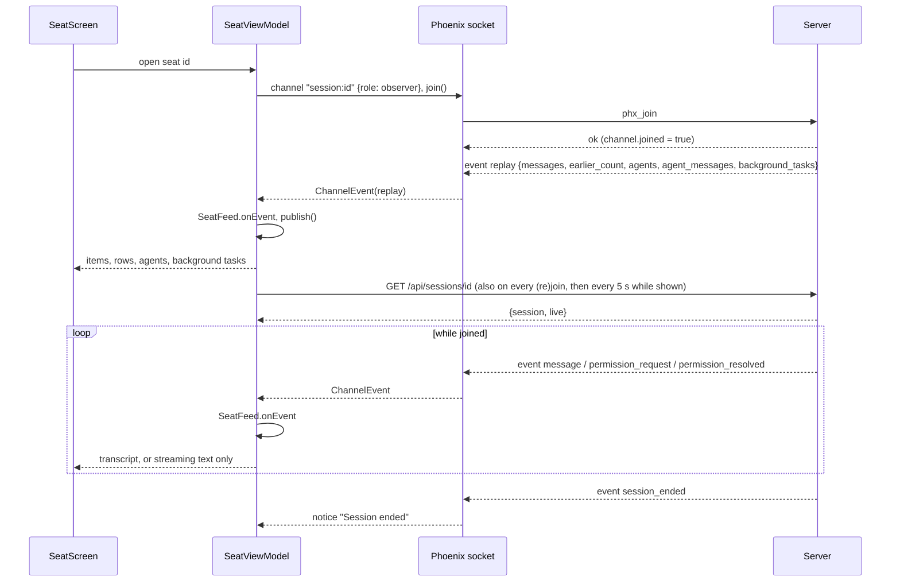

# Seat view

The seat screen is where an operator watches one seat (a Claude Code session running on one of their machines) as a chat: Claude's replies, the operator's messages, tool calls, thinking, questions and permission prompts, all updating live. This page covers the viewing side: how the transcript is loaded and kept live, and how it is drawn. Driving the seat (composer, queue, attachments, the settings sheet) is on [seat-controls.md](seat-controls.md); answering questions and permission prompts is on [questions-and-permissions.md](questions-and-permissions.md).

The screen is opened from the seat list (see [seat-list.md](seat-list.md)). Its state lives in `SeatViewModel` (Android) on top of `SeatFeed` and `TranscriptBuilder` (shared `core` library).

## How it works

### Opening a seat

When the view model for seat `id` is created it does three things at once:

1. Creates the channel `session:<id>` on the app's shared Phoenix socket with join params `{"role": "observer"}`, and joins it.
2. Fetches the seat with `GET /api/sessions/<id>`.
3. Starts polling that same endpoint every 5 seconds, but only while the screen is collecting the view model's state (so not while the app is in the background).

Joining makes the server answer with a `replay` event holding the seat's buffered history; after that the server pushes live events. A (re)join also restarts the seat fetch, because a rejoin means the network is back and an earlier request may have hung.



If the socket drops, the socket reconnects with backoff (1, 2, 5, 10, then 30 seconds, resetting when the screen comes back or the network returns) and rejoins every wanted channel; the server replays again. Every 20 seconds a heartbeat is sent and must be answered within 10 seconds, otherwise the link is declared dead and torn down. When the screen becomes visible again (`LifecycleResumeEffect`) the view model calls `checkAlive()`, which probes the socket (5 second timeout) or reconnects at once if there is none. After a successful send with status `delivered` it also calls `checkAlive()`, because the reply arrives over the socket.

A channel is shared per topic: two views of the same seat share one joined channel, and the topic is left only when the last user leaves. A second `join()` on an already-joined channel re-joins on purpose, since the server replays only in answer to a join.

### Channel events

| Event | What the feed does |
|---|---|
| `replay` | Clears all messages, agent rows and agents, then rebuilds from the payload. A rejoin replaces, never appends. |
| `message` | One transcript row (see below), or a stream event, a background-task list, or an agent's row. |
| `permission_request` | Stored as a live permission request, shown as a pending card until resolved. |
| `permission_resolved` | Marks the request id resolved. |
| `session_ended` | Not fed to the transcript; sets the notice "Session ended". |

The `replay` payload keys the client reads: `messages` (array of rows), `earlier_count` (number), `agent_messages` (array), `agents` (array), `background_tasks` (array). A replay without `background_tasks` (an older server) leaves no background tasks.

### From messages to entries

`SeatFeed` keeps the messages in a map keyed by their `uuid`, in arrival order. The same message can arrive twice (in the replay and again live when a join races a broadcast, or mirrored twice); a repeat replaces the earlier copy. A message without a `uuid` is keyed by `req:<request_id>` if it has one, else by its raw JSON, so a byte-identical operator prompt does not duplicate. Noise types are dropped: `stream_event`, `progress`, `set_in_progress_tool_use_ids`, `stream_request_start`. The feed keeps at most 2,000 messages (`MAX_MESSAGES`); the oldest drop first.

`TranscriptBuilder.build` is a pure function of the message list, so a replay and a live stream build the same transcript. It produces these items:

| Item | Built from |
|---|---|
| `UserText` | A `user` message with string or text-block content. `injected = true` when it comes from an `attachment` of type `queued_command` (text sent into the seat, for example from the composer). Pasted images ride in the same item. |
| `AssistantText` | An `assistant` message's `text` blocks (blank ones skipped). |
| `Thinking` | An `assistant` `thinking` block. |
| `ToolUse` | A `tool_use` block; its `tool_result` (matched by tool-use id) is attached later. Carries the name, a one-line summary, the pretty-printed input, the result text, an error flag and any result images. |
| `Question` | A `tool_use` named `AskUserQuestion`; answered once its `tool_result` exists. |
| `Permission` | A `control_request` with subtype `can_use_tool`, or a live `permission_request` event. Pending until resolved. |
| `Event` | A turn Claude Code made itself (a background task finishing, `promptSource` "system", or text starting with `<task-notification>`), an `isMeta` user note (label "Tool result"), or a queued command with a non-prompt mode. |
| `TurnEnd` | A `result` message: "Turn complete" or "Turn failed", then ` · <n.n> s` and ` · <n> steps` when present. |
| `Note` | "Context compacted" (`compact` or a `system` message of subtype `compact_boundary`). |

Other rules the builder applies:

- Tool results attach to their tool call by id, so a result that arrives later updates the earlier row. The summary is the first non-blank of `command`, `file_path`, `pattern`, `path`, `url`, `query`, `description`, `prompt`, `content`, cut at the first line and 200 characters.
- A permission request is treated as answered once the seat recorded a `control_response`, once its tool call has a result, or once the turn ended (`result` or `turn_complete`): this covers requests answered in the terminal.
- `[Image #N]` placeholders in a typed message are removed when the images themselves are present.
- Keys must be unique for the list: a collision gets a `#<n>` suffix.
- The effort shown in the info sheet and settings is the `effort` field of the latest `assistant` message.

### Streaming text

`message` events of type `stream_event` do not become rows. A `message_start` empties the streaming buffer and each `content_block_delta` with a `text_delta` appends its text. The buffer is shown as an italic line at the end of the list and cleared when the finished `assistant` message lands (or at `message_start` or a replay). Streaming never redraws the transcript, only that one line.

### Timestamps and dividers

Each row carries the time of its message (`timestamp`, ISO-8601 UTC, parsed to the second; fractions and a trailing `Z` are ignored). `Timeline.rows` inserts a time divider above an item when it comes more than 15 minutes (`GAP_MS`) after the previous timed item, or on a different calendar day in the device's time zone. An item whose message has no time borrows the last known time before it and gets no divider of its own.

Labels are Messenger-style and upper-cased (`Timeline.label`):

| Age | Example |
|---|---|
| Today | `13:41` |
| 1 to 6 days ago | `FRI AT 21:53` |
| Earlier this year | `21 SEP AT 09:12` |
| Earlier years | `3 OCT 2025 AT 13:41` |

Tapping a message bubble toggles a line under it with its exact label and a "Copy" button.

There is no clock-skew correction in the client: server timestamps are parsed as UTC and compared with the device's own clock (`Clock.System`) when labelled or when "ago" text is built (`relativeTime`: "just now", "5m ago", "2h 10m ago", "in 3d 1h"). A device clock that is wrong will shift those labels.

### Resumed seats

When a stopped seat is resumed, the server registers it as a new row and its replay starts with the conversation it continues. The `replay` payload's `earlier_count` says how many of the first `messages` came from the earlier rows. The feed remembers those, and the timeline draws a divider labelled `RESUMED` after the last of them (at the end if the resumed seat has said nothing yet). A seat that was never resumed has no such line.

On the seat list, the stopped row that a newer row continues is hidden (`withoutSuperseded`: a stopped row is dropped when another row with the same conversation id has a higher seat id, and running rows or rows with no conversation are always kept). That filter belongs to [seat-list.md](seat-list.md); the seat screen itself only shows the single seat you opened.

### Agents (the switcher)

A seat can have other agents besides its main conversation: forks, subagents and teammates. Their messages arrive on the same channel but are kept out of main's transcript. A message belongs to an agent when its `type` is one of `agent_started`, `agent_message`, `agent_turn_complete`, `agent_ended`, `agents`, or it has an `agent_id`.

| Message type | Effect |
|---|---|
| `agents` | A snapshot of the seat's agents; replaces the list (keeping each agent's known spawning tool call). |
| `agent_started` | Adds the agent, status `running` unless already known. |
| `agent_message` | Appends its `message` row to that agent's own thread; an unannounced agent is listed (type `agent`) until a snapshot names it. |
| `agent_turn_complete` | Status `idle` (ignored for an ended agent). |
| `agent_ended` | Status from the message, default `completed`. Ended statuses are `completed`, `failed`, `killed`. |

Statuses the model knows: `pending`, `running`, `waiting`, `idle`, `completed`, `failed`, `killed`. An agent is busy when `pending` or `running`. Its label is its description, else its name, else its type.

On screen, when the seat has any agents a horizontally scrolling chip row appears under the header: a chip "main" first, then one per agent. Each agent chip has a status dot (busy colour for running or pending, bad for failed or killed, muted for completed, good otherwise) and a badge with its type (`fork` for a fork). Tapping a chip switches the list to that agent's thread; tapping "main" returns. A tool call that spawned a subagent also shows a button "Open <type>'s thread" under it. The selection is saved across rotation. In an agent's thread, a user row (the agent's prompt) is shown as an event, labelled "prompt" or, for a fork's set-up, "fork started" ("Forked from main's conversation"). A line under the list says "<label>: its own thread. A message here goes to main; sending to an agent comes later." An empty agent thread reads "Nothing from this agent yet."; an empty main thread (once joined) reads "Nothing in the replay buffer yet."

### Background tasks

A `message` of type `background_tasks` carries the whole current list in `tasks`; each one replaces the last and is not a transcript row. Each task has `id`, `type` ("shell", "monitor", "subagent", "workflow", and others), `status`, and optionally `description`, `command`, `started_at`, `agent_type`, `name`, `server`, `tool`. Running means status `running` or `pending`. Subagents are filtered out of the bar because they already show as agents.

The bar sits under the agent switcher and is hidden when there is nothing to show. Folded it is one line such as "2 shells running", "1 monitor running, 1 ended" or "3 tasks running" (the noun is "shell", "monitor", "workflow" only if all shown tasks share that type, otherwise "task"). Tapping unfolds one row per task (running first): an icon by type, the label (description, else detail, else command, else type), how long it has run ("45 s", "12 min", "3 h 5 min", ticking each second while open), the status when not running, and the command in monospace with a copy button ("Copy command"). It is read-only; the seat cannot be told to stop a task from here.

## Rendering

- **Bubbles.** The operator's messages (and injected ones, labelled "injected") sit on the right, Claude's on the left, at most 88% of the row wide.
- **Markdown.** User and assistant text go through `Markdown.blocks` in `core`, then `MarkdownText` in the app. Recognised blocks: fenced code (``` or ~~~, with optional language), headings (levels 1 to 2 drawn as titleMedium, 3 and up as titleSmall, all bold), bullet lists (`-`, `*`, `+`), numbered lists (`1.` or `1)`), quotes (`>`), rules, GitHub tables, paragraphs. Nesting is two spaces or a tab per level. Inline: `**bold**`, `` `code` `` and http or https links. Anything else stays plain text. Code blocks scroll sideways; tables scroll sideways with column alignment from the delimiter row and have a "Copy table" button (tab-separated cells). Text is selectable.
- **Links.** A link ends at whitespace or one of `<>"'` and a backtick, then trailing `. , ; : ! ?` are removed, and a trailing `)` or `]` is removed unless the URL opened a matching bracket (`LinkEnd` rules in `Links.kt`). Links are tappable (`LinkAnnotation.Url`).
- **Thinking.** A dashed-edge, paler Claude-side bubble headed "Thinking" in secondary italic. Text is trimmed; if it is over 6 lines or 600 characters it shows a preview ending in "…" with "Show more" and "Show less".
- **Tool calls.** A collapsed row `▸ <Tool name>` plus the summary; `…` is appended to the name while there is no result yet and ` ✗` when the result is an error. Open it to see the input and the result (labelled "result" or "error"), each in monospace capped at 4,000 characters (results 6,000) with "Show all <n> characters". Pictures a tool returned show below the row.
- **Events and turn ends.** Events are collapsible rows with the event label and summary. Turn ends render as `— Turn complete · 3.2 s · 4 steps —`; notes as small outlined text.
- **Questions and permissions.** Drawn as cards inside the transcript; see [questions-and-permissions.md](questions-and-permissions.md).
- **Following the tail.** The list opens at the latest message and stays there as messages arrive, streamed text grows, or the keyboard shrinks the view. A finger drag stops following; reaching the bottom again resumes it. While not following, a "↓ Latest" button appears bottom right. Switching to another thread resets to its latest message.
- **Copy.** Tapping a bubble reveals "Copy", which copies the item's text as written (a reply's Markdown source; a tool call's name, summary, input and result).

### Header

The row above the list shows, left to right: the activity pill (the status when the seat is not running; otherwise "busy" or "idle"; "loading" before the first fetch), the live-view pill ("offline" when the socket is down, "joining" when not yet joined, "live" otherwise), "no sidecar" when the seat's sidecar is not connected, the running model name, and two icon buttons: "Session info" and "Session settings" (see [seat-controls.md](seat-controls.md)). On the right sits "Resume" for a stopped seat that can be resumed, or "Interrupt" while the seat is running (or its status is not yet known), and a "More" menu with "Stop seat…" when the seat can be stopped. Interrupt asks "Interrupt this seat?" ("Stops the turn in progress, as Esc does at the terminal."); it sends the `interrupt` channel event.

Two banners can appear: "Live view: <join error>" when the channel join fails (for example "join timed out" or the server's reason, "join refused" if none), and the load error message when the seat fetch fails.

### Images

Images appear in operator messages (pasted or attached in the terminal) and in tool results (a Read of a picture, a screenshot). An image is either a file in the server's store (`source.type` "url", a server-relative path such as `/api/files/<id>`, with optional `size`) or inline base64 (`source.type` "base64"; media type defaults to `image/png`).

`TranscriptImages` (one shared instance in `AppContainer`) loads them:

- URL images are downloaded with `GET <base>/api/files/<id>`-style paths through `Api.download` (bearer token, 64 KiB chunks); inline ones are decoded from base64. A source with neither throws "the image has neither a url nor data".
- Decoding first reads the bounds; a non-image throws "not an image". Large images are downsampled by powers of two until the long side would fall below 2,400 px.
- An LRU cache of 48 MiB holds decoded bitmaps, keyed by the url (a stored file never changes) or, for inline data, by length and hash.

Thumbnails (`ImageThumbs`) are laid out in a flow row under the message, at most 220 dp high and 260 dp wide, with a spinner while loading and, on failure, a broken-image icon with "Image not loaded: <reason>". Tapping a thumbnail opens `ImageViewer`, a full-screen dialog over all pictures in the current thread in transcript order: swipe between them, pinch or double-tap to zoom (1x to 6x, double-tap goes to 2.5x), drag to pan, tap the backdrop at fit zoom to close. The top bar shows "<n> of <total>" plus a caption for tool images (tool name and summary), a close button, and, on Android 10 and later, a "Save" button that stores a PNG in `Pictures/Claudiverse` and toasts "Saved to Pictures" or "Not saved" (it saves only an image already in the cache).

### Session info sheet

Tapping the title in the top bar (the whole title area) or the info icon opens a bottom sheet "Session info" ("Tap a value to copy it."). Rows, in order: Title, Seat, Working directory, Machine, Fleet, Started by, Can notify you (yes or no), Status (status and activity), Model, Effort, Permission mode, Started and Last activity (local time as `EEE HH:mm` plus the relative age), Live view (offline, live, joining), Sidecar (connected or not connected), Type (type and mode), Claude Code (client version), Claude session, Server session (the numeric seat id). A value the seat has not reported reads "not reported" (Effort reads "after its next reply"), and "—" while the seat has not loaded; if the load failed the sheet says "Couldn't load the seat's details: <error>", otherwise "Loading the seat's details…". Tapping a value copies it. "Title" is the seat's label (a profile's seat uses its profile title; others use Claude Code's own title when reported); "Seat" is the registered seat title.

## Configuration

| What | Value |
|---|---|
| Channel topic | `session:<seat id>`, join params `{"role": "observer"}` |
| Seat poll interval | 5,000 ms, only while the screen is observed |
| Max messages kept per thread | 2,000 |
| Time divider gap | 15 minutes, or a new day |
| Join timeout | 10 s (error "join timed out") |
| Rejoin after `phx_error` or `phx_close` | 2 s |
| Socket backoff | 1, 2, 5, 10, 30 s |
| Heartbeat | every 20 s, 10 s to answer |
| Image cache | 48 MiB LRU, long side decoded to at most about 2,400 px |
| Thinking preview | over 6 lines or 600 characters |
| Mono block limit | 4,000 characters (tool results 6,000) |

There are no user-facing settings for these.

## Interface

Server calls made by the seat screen for viewing:

- `GET /api/sessions/<id>` (every 5 s while shown, at open, after each (re)join, after stop and mode changes). Response parsed: `{"session": {...seat row...}, "live": {"status": "...", "idle": true, "sidecar_connected": true, "permission_mode": "default"}}`. `live` may be absent.
- Channel `session:<id>`: receives `replay`, `message`, `permission_request`, `permission_resolved`, `session_ended`. Sends `interrupt`, `answer`, `decline`, `permission_response` (see the other pages).
- `GET /api/files/<id>` (server-relative image urls, with the bearer token).
- `POST /api/sessions/<id>/human_requests/resolve`: opening a seat that has an open request for the operator marks it resolved (also when one arrives while the seat is on screen). This only happens while the notification watcher runs, since it is what follows the open requests; see [notifications.md](notifications.md).

## Failure modes and troubleshooting

| Symptom | Meaning |
|---|---|
| Pill "offline" | The socket is not connected. It reconnects by itself; coming back to the screen forces a check. |
| Pill "joining" | Socket up, channel not yet joined. |
| Banner "Live view: join timed out" | The server did not answer the join within 10 s. |
| Banner "Live view: join refused" (or a reason) | The server rejected the join. |
| Banner with a load error | `GET /api/sessions/<id>` failed; it is retried on the 5 s poll. |
| Pill "no sidecar" | The seat's sidecar is not connected, so nothing live arrives from it. |
| "Nothing in the replay buffer yet." | Joined, but the replay held no rows. |
| Notice "Session ended" | The server sent `session_ended`. |
| "Image not loaded: not an image" | The downloaded bytes could not be decoded. |
| "Image not loaded: HTTP <n>: download failed" | The file fetch returned a non-success status. |

## Related pages

- [Seat list (the Seats tab)](seat-list.md)
- [Seat controls](seat-controls.md)
- [Questions and permissions](questions-and-permissions.md)
- [Architecture](architecture.md)
- [Settings, permissions and troubleshooting](settings-and-troubleshooting.md)
- Server: [HTTP mirror, inbox long-poll and liveness](https://github.com/Promises/claudiverse/blob/main/docs/reference/server/mirror-inbox-liveness.md)
- Mod: [Agents capture and background tasks](https://github.com/Promises/claudiverse/blob/main/docs/reference/services/mod/agents-and-background.md), [Mirroring](https://github.com/Promises/claudiverse/blob/main/docs/reference/services/mod/mirroring.md)
- Web panel: [The seat view](https://github.com/Promises/claudiverse/blob/main/docs/reference/services/web/seat-view.md)
- Mac: [Agents and background tasks](../mac/agents-and-background-tasks.md), [Seat view](../mac/seat-view.md), [Transcript](../mac/transcript.md)

## Source

- `android/src/main/java/dev/claudiverse/app/seat/SeatViewModel.kt`
- `android/src/main/java/dev/claudiverse/app/seat/TranscriptImages.kt`
- `android/src/main/java/dev/claudiverse/app/ui/SeatScreen.kt`, `Images.kt`, `SessionInfo.kt`, `BackgroundTasks.kt`, `Common.kt`
- `core/src/commonMain/kotlin/dev/claudiverse/core/SeatFeed.kt`, `Transcript.kt`, `Timeline.kt`, `ServerTime.kt`, `Agents.kt`, `BackgroundTasks.kt`, `Markdown.kt`, `Links.kt`, `SeatList.kt`, `PhoenixSocket.kt`, `SeatSession.kt`
