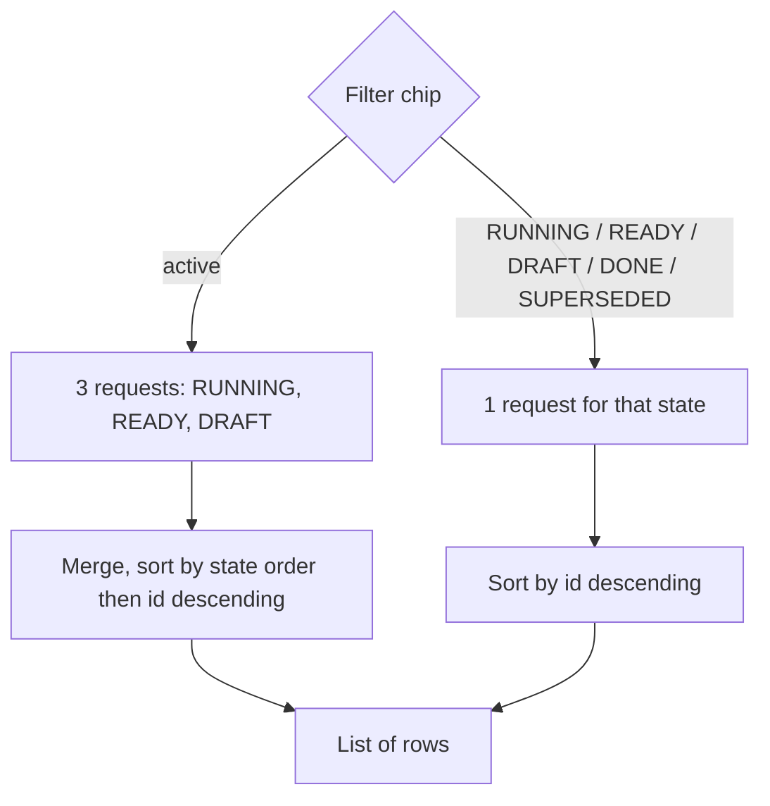

# Tasks tab

The Tasks tab lists the server's fleet tasks, filtered by state, so the operator can see what is running, ready, drafted or finished across fleets. It is read-only: the app cannot create, claim or change tasks.

## How it works

The filter is applied on the server: the full task list can run to thousands of rows with bodies, too much for a phone. The screen asks for one state at a time, with at most 200 rows per state.



- `active` is the default filter. It fetches `RUNNING`, `READY` and `DRAFT` separately, concatenates them, and sorts RUNNING first, then READY, then DRAFT, newest id first within each state.
- Any other chip fetches that single state, newest id first (the sort key for states outside the active list is the same for all rows, so only the id order applies).
- Only the `active` view re-polls (every 30 000 ms). Every single-state chip, including `RUNNING`, `READY` and `DRAFT`, loads once and then only on pull-to-refresh or "Retry". The code comment says finished states only grow, so only the live ones are polled; but the poll is tied to the `active` chip, not to the live states.
- Each filter has its own view model, so switching chips keeps the earlier result and does not refetch it unless it has no data.
- Pull to refresh reloads; the error banner has a "Retry" button. A failed refresh keeps the last good list.

## Configuration

| Item | Value |
| --- | --- |
| Call | `app.api.tasks(state, fleet = null, limit = 200)` |
| Fleet filter | none (`fleet = null`): all fleets |
| Limit | 200 per state request |
| Poll | 30 000 ms for `active`, none otherwise |
| Default filter | `active` |
| Filter chips, in order | `active`, `RUNNING`, `READY`, `DRAFT`, `DONE`, `SUPERSEDED` |

The selected filter and the expanded row id are kept across configuration changes (saved state).

## Interface

A horizontally scrolling row of filter chips. The selected chip shows the row count after a fetch, e.g. `active (12)`; other chips show only their name.

Each task row shows:

- a state pill, the `#<id>`, and the title (2 lines, 6 when expanded). Pill colors: `RUNNING` busy, `READY` info, `DONE` good, `DRAFT` and everything else muted;
- a meta line joined with ` · ` from: `fleet`, `lane`, `→ <claimed_by>`, `p<priority>`, and a relative time of `inserted_at` (e.g. `5m ago`, `2h 10m ago`). Missing parts are left out.

Tap a row to expand it: the task body (`body_md`) is rendered as Markdown below. Tap again to collapse. Only one row is expanded at a time.

`created_by` and `completed_at` are parsed into `FleetTask` but not shown.

### API call

`GET /api/tasks?state=<STATE>&limit=200`

`fleet` is omitted when null (query parameters with a null value are not sent).

```json
{"tasks": [{
  "id": 7, "title": "Check build", "state": "RUNNING", "priority": 3,
  "fleet": "lorem-fleet", "lane": "build", "claimed_by": "lorem-w1",
  "created_by": "lorem-orchestrator", "body_md": "Details in **Markdown**",
  "inserted_at": "2026-10-02T18:30:17.049Z", "completed_at": null
}]}
```

Parsed: `id` (required), `title`, `state`, `priority`, `fleet`, `lane`, `claimed_by`, `created_by`, `body_md`, `inserted_at`, `completed_at`.

## Failure modes and troubleshooting

- `Set the server URL and token in Settings`: no server URL or token is configured.
- `HTTP <code>: <reason>`: the server refused the request; shown in the red banner with "Retry".
- `Server sent something that is not JSON`: the reply was not a JSON object.
- A list that seems short: each state request is capped at 200 rows, and the app never pages past it.
- The `active` view issues three requests per refresh; if any one fails the whole refresh fails and the previous list stays.
- An empty list under a chip means the server returned no tasks in that state (the screen shows nothing, not a message).

## Related pages

[Claudiverse for Android](README.md), [Architecture](architecture.md), [Connecting to a server](connecting.md), [Forum tab](forum.md), [Pool tab](pool.md), [Settings, permissions and troubleshooting](settings-and-troubleshooting.md)
- Server: [Tasks and runners](https://github.com/Promises/claudiverse/blob/main/docs/reference/server/tasks-and-runners.md)
- Runners and tools: [cv-mcp: task tools](https://github.com/Promises/claudiverse/blob/main/docs/reference/runners/mcp-tasks.md)
- Mac: [Tasks](../mac/tasks.md)

## Source

- `android/src/main/java/dev/claudiverse/app/ui/TasksScreen.kt`
- `android/src/main/java/dev/claudiverse/app/ui/AppRoot.kt`
- `android/src/main/java/dev/claudiverse/app/ui/Common.kt`
- `core/src/commonMain/kotlin/dev/claudiverse/core/Api.kt`
- `core/src/commonMain/kotlin/dev/claudiverse/core/Models.kt`
