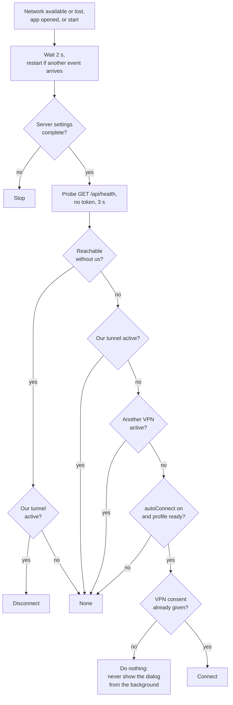

# In-app VPN

The Android app carries its own OpenVPN client. It opens a tunnel that carries only this app's traffic and uses it as a fallback: when the phone is away from the network the Claudiverse server lives on, the tunnel brings the server within reach; when the phone is on that network, or any other route already reaches the server, the tunnel stays off.

Nothing else on the phone goes through the tunnel. The profile is restricted to this package (a per-app VPN: `mAllowedAppsVpn` is exactly this package, `mAllowedAppsVpnAreDisallowed` is false, `mAllowAppVpnBypass` is false), so Android routes only the app's own sockets into it and the rest of the phone keeps its normal network.

## Why the server is plain HTTP

The server speaks plain HTTP and is reachable only on its LAN. The app reaches it through its own tunnel, so the hop that leaves the phone is encrypted by the tunnel rather than by TLS. Because the server address is typed in by the user, cleartext cannot be scoped to one domain, and `android/src/main/res/xml/claudiverse_network_security.xml` sets `cleartextTrafficPermitted="true"` in its `base-config`. If you put the server behind HTTPS instead, nothing in the app needs to change; the VPN is optional.

## How it works

Three layers:

1. `AppVpn` owns the profile and the tunnel: import, credentials, consent, connect, disconnect, and the live state.
2. `AutoVpn` decides, on every network change, whether to bring the tunnel up or down, using the pure function `decideVpn`.
3. The UI (`VpnCard`, `VpnPill`, the server card's switch) and `MainActivity` (consent dialog, file picker, toasts) let the operator do the same by hand.

### AppVpn

`AppVpn(context, settings)` is created once in `AppContainer` (`val vpn`). The OpenVPN engine ships in the app's own APK, so `AppVpn` calls engine classes directly (see "The engine" below). The engine's `OpenVPNService` itself runs in a separate process of the app, `:openvpn`, as the library manifest declares.

State, exposed as `status: StateFlow<VpnState>`:

| Field | Meaning |
|---|---|
| `level` | The engine's `ConnectionStatus`; starts at `LEVEL_NOTCONNECTED`. |
| `detail` | Text for the user: the engine's localized state text and its log message joined with " — ", blanks dropped. |
| `bytesIn`, `bytesOut` | Running byte counts from the engine's byte-count listener. |
| `connected` | `level == LEVEL_CONNECTED`. |
| `idle` | `level` is `LEVEL_NOTCONNECTED` or `LEVEL_AUTH_FAILED`. An auth failure counts as idle, so Connect is offered again. |

`AppVpn` registers a `VpnStatus.StateListener` and a `VpnStatus.ByteCountListener` in its `init` block and copies their callbacks into the `StateFlow`.

The profile, as shown to the UI, is `VpnProfileInfo`:

| Field | Meaning |
|---|---|
| `name` | The profile's name (`mName`), empty if none. |
| `needsCredentials` | `isUserPWAuth`: the profile asks for a username and password. |
| `hasCredentials` | A non-empty username and password are saved. |
| `problem` | The engine's `checkProfile` result as text, or `null` when it returns `no_error_found`. |

`profileInfo()` returns `null` when no profile is set. The profile is looked up by the UUID the app stores in its preferences under the key `vpn_profile_uuid` (`Settings.profileUuid`), through `ProfileManager.get`.

**Importing.** `importProfile(uri, displayName)`:

1. Opens the chosen document and parses it with `ConfigParser.parseConfig`, then `convertProfile()`. If the stream cannot be opened it fails with `cannot open <uri>`.
2. Names the profile from the file name with a trailing `.ovpn` removed; a blank name becomes `claudiverse`.
3. Calls `restrictToThisApp`, which sets the three per-app fields described above.
4. If there was an earlier profile and the new one is also a username/password profile with no username of its own, copies the earlier username and password across. Replacing a profile (a new remote, say) therefore keeps the saved login.
5. Removes the earlier profile, adds the new one, saves it and the profile list, and stores the new UUID in settings.

The file must be self-contained: certificates and keys inline as `<ca>`, `<cert>`, `<key>` blocks (and `<tls-auth>`/`<tls-crypt>` etc. likewise). Paths to files beside it cannot be followed through the system file picker. A minimal shape:

```
client
dev tun
proto udp
remote vpn.claudiverse.example 1194
auth-user-pass
<ca>
-----BEGIN CERTIFICATE-----
...
-----END CERTIFICATE-----
</ca>
<cert>
...
</cert>
<key>
...
</key>
```

**Credentials.** `setCredentials(username, password)` writes both onto the current profile and saves it; it does nothing when there is no profile.

**Consent.** `consentIntent()` returns `VpnService.prepare(context)`: an `Intent` for the system's VPN permission dialog, or `null` when the app is already allowed to start a VPN. `connect()` must be called only once this is `null`.

**Connect.** `connect()` returns `false` without a profile. Otherwise it calls `restrictToThisApp` again and saves the profile, then `VPNLaunchHelper.startOpenVpn(profile, context, "claudiverse app", true)`. The restriction is re-asserted on every start so that a profile saved by an older build, or edited by the engine, can never widen to the whole phone.

**Disconnect.** `disconnect()` calls `ProfileManager.setConntectedVpnProfileDisconnected` (the engine's own spelling), binds to `OpenVPNService` with the `START_SERVICE` action, asks it to `stopVPN(false)` through `IOpenVPNServiceInternal`, and unbinds.

**One VPN slot.** Android has a single system VPN slot. Connecting the app's tunnel replaces any other VPN that is up (the operator's own system VPN, for example). The card says so, and `AutoVpn` refuses to connect when another VPN is active.

### AutoVpn

`AutoVpn(context, settings, vpn, scope)` is created in `AppContainer` (`val autoVpn`) and started in its `init` block with `start()`.

**Triggers.** `start()` registers a `ConnectivityManager` network callback for networks that have the INTERNET capability and are VPNs or not (the request removes `NET_CAPABILITY_NOT_VPN`, so tunnels are included). `onAvailable` and `onLost` both call `schedule()`. `start()` also calls `schedule()` once, and `MainActivity.onCreate` calls `app.autoVpn.schedule()` whenever the activity is created fresh (not on a restore from saved state): "Re-check on every open".

**Settle delay.** `schedule()` cancels any pending evaluation and starts a new one that waits `SETTLE_MS` = 2000 ms, then runs `evaluate()`. Networks come and go in bursts (Wi-Fi drops, mobile takes over); the app decides once things settle.

**Evaluation.** `evaluate()`:

1. Does nothing when the server settings are not complete (`config.isComplete` false).
2. `ours` = the app's tunnel is not idle (it is connecting, connected, etc.).
3. `other` = `!ours` and some network known to the system has the VPN transport (`anyVpnNetwork()`).
4. `reachable` = the health probe (below), bound to the underlying network when `ours`.
5. `ready` = a profile exists, has no problem, and either needs no credentials or has them.
6. Calls `decideVpn(reachable, ours, other, config.autoConnect, ready)`, logs the result, and acts.

**The probe.** `probe(baseUrl, bypassTunnel)` is an OkHttp `GET <baseUrl without trailing slash>/api/health`, sent with no token. Connect and read timeouts are `PROBE_TIMEOUT_S` = 3 s, and the whole call is limited to 4 s. The answer is "reachable" when the HTTP status is successful; any exception counts as not reachable.

- While the app's tunnel is down, the probe uses the phone's normal network, so a system VPN counts as a route.
- While the app's tunnel is up, the probe would always succeed through the tunnel, so it is bound to the underlying network instead: the client's socket factory is the network's `socketFactory` and DNS resolves through that network (`getAllByName`). `underlyingNetwork()` picks a network that is not a VPN and has INTERNET, Wi-Fi or ethernet before anything else (mobile). If there is none, the probe returns false.

**Acting.** `Disconnect` calls `vpn.disconnect()`. `Connect` calls `vpn.connect()` only if `vpn.consentIntent()` is `null`; the consent dialog is never popped from the background. A failure is logged as `auto-vpn: connect failed: <message>`. `None` does nothing.

### The decision

`decideVpn(serverReachableWithoutUs, ourVpnActive, otherVpnActive, autoConnect, profileReady)` returns `VpnAction.Connect`, `VpnAction.Disconnect` or `VpnAction.None`. The rules are evaluated top to bottom:

| # | serverReachableWithoutUs | ourVpnActive | otherVpnActive | autoConnect | profileReady | Action |
|---|---|---|---|---|---|---|
| 1 | true | true | any | any | any | Disconnect |
| 2 | true | false | any | any | any | None |
| 3 | false | false | false | true | true | Connect |
| 4 | false | anything else | | | | None |

Row 4 covers: our tunnel already up and the server still unreachable (nothing changes), another VPN active (never replaced), auto-connect off, and the profile not ready. Note that `autoConnect` only gates connecting: the tunnel is turned off on a reachable network even with auto-connect off, if it happens to be up.



### Tests

`android/src/test/java/dev/claudiverse/app/vpn/AutoVpnTest.kt` pins the table through `decideVpn`:

- `onTheLocalNetworkOurTunnelGoesDown`: reachable and ours up gives Disconnect; reachable and ours down gives None.
- `awayWithNothingElseOurTunnelComesUp`: unreachable, nothing else, gives Connect.
- `anotherVpnIsNeverReplaced`: another VPN gives None whether the server is reachable or not.
- `staysOffWhenAutoConnectIsOffOrTheProfileIsNotReady`: either condition gives None.
- `awayWithOurTunnelUpNothingChanges`: unreachable with ours up gives None.

The network callback, the probe and the engine are not covered by unit tests.

## Configuration

| Item | Value |
|---|---|
| `autoConnect` (server settings) | Default `true`. Stored as boolean preference `auto_connect` in the `claudiverse` shared preferences. |
| Profile UUID | String preference `vpn_profile_uuid`, in the same preferences file. |
| Settle delay | `SETTLE_MS` = 2000 ms. |
| Probe timeout | `PROBE_TIMEOUT_S` = 3 s (connect and read); the call limit is 4 s. |
| Probe URL | `<server URL>/api/health`, no authorization. |
| Log tag | `claudiverse`. |
| Launch reason passed to the engine | `"claudiverse app"`. |

## Interface

### The "In-app VPN" card

`VpnCard` (in `ConnectionScreen.kt`) is shown on the connection screen. From top to bottom:

- Title **In-app VPN** and the `VpnPill`.
- Fixed explanation: "Only this app's traffic goes through the tunnel; the rest of the phone is untouched. Android has one VPN slot, so connecting replaces any other VPN that is up."
- The engine's `detail` text when it is not blank.
- While connected, a line "↓ <in>  ↑ <out>" with sizes formatted as `B`, `KB` or `MB`.
- With no profile: "No profile yet. Import a self-contained .ovpn (certificates inline)."
- With a profile: "Profile: <name>". If `problem` is set, an error banner shows it. If the profile needs credentials, the credentials form (below).
- Buttons: if there is a profile, **Connect** while the tunnel is idle (disabled while `problem` is set), or **Disconnect** otherwise. Always the import button, labelled **Import .ovpn** with no profile and **Replace profile** with one.

The credentials form (`CredentialsForm`) appears only for profiles that need a username and password:

- Text: "This profile uses a username and password (saved)." when saved, otherwise "This profile needs a username and password."
- Fields **VPN username** and **VPN password** (the password is masked).
- Button **Save credentials**, enabled only when both fields are non-blank. Pressing it saves them, clears the password field, and refreshes the profile info.

`VpnPill` maps the engine level to a pill:

| Level | Text | Colour |
|---|---|---|
| `LEVEL_CONNECTED` | VPN up | good (green) |
| `LEVEL_NOTCONNECTED` | VPN off | muted (grey) |
| `LEVEL_AUTH_FAILED` | auth failed | bad (red) |
| `LEVEL_NONETWORK` | no network | bad (red) |
| `LEVEL_WAITING_FOR_USER_INPUT` | needs input | bad (red) |
| `LEVEL_VPNPAUSED` | paused | busy (yellow) |
| anything else | connecting | busy (yellow) |

### The server card switch

On the **Claudiverse server** card, a switch sits beside the text "Use the VPN only when the server is out of reach (off on its local network, and never in place of another VPN)". It edits `autoConnect`, which is saved with the other server settings (**Save**, or **Save & test**). Default on.

### MainActivity flow

`MainActivity` owns what needs an Activity:

- **Import:** the **Import .ovpn** / **Replace profile** button launches the system document picker (`OpenDocument`, MIME `*/*`). The display name is read from the document; if it cannot be read, the name is `claudiverse`. On success a toast says "Imported <name>"; on failure "Import failed: <message>". The profile info is refreshed either way.
- **Connect:** the button calls `consentIntent()`. If an intent comes back, the consent dialog is launched; with result OK the app calls `connect()`, otherwise a toast says "VPN permission was not granted". If no intent is needed, `connect()` runs at once.
- **Disconnect:** calls `AppVpn.disconnect` directly.
- **Save credentials:** calls `setCredentials` and refreshes the profile info.

Manual Connect is the only path that shows the consent dialog. The first time, the operator should therefore press Connect once by hand so Android remembers the consent; after that auto-connect can start the tunnel in the background.

## The engine

The `openvpn/` module is [ics-openvpn](https://github.com/schwabe/ics-openvpn) (OpenVPN for Android) vendored as an Android library with namespace `de.blinkt.openvpn`. Only the OpenVPN 2 engine is built (the `openvpn3` build config flag is `false`), with OpenSSL, LZO and LZ4.

### How the app uses it

| Class | Use |
|---|---|
| `ConfigParser` | Parses an `.ovpn` file and `convertProfile()` into a `VpnProfile`. |
| `ProfileManager` | Stores profiles: `get` by UUID, `getInstance`, `addProfile`, `removeProfile`, `saveProfile`, `saveProfileList`, `setConntectedVpnProfileDisconnected`. |
| `VpnProfile` | The profile: `checkProfile`, `isUserPWAuth`, `mUsername`, `mPassword`, `mName`, `uuidString`, and the per-app fields. |
| `VPNLaunchHelper` | `startOpenVpn` starts the tunnel. |
| `VpnStatus` | State and byte-count listeners feeding `VpnState`. |
| `OpenVPNService` / `IOpenVPNServiceInternal` | Bound to stop the tunnel. |
| `ConnectionStatus` | The level enum shown by the pill. |

The library's manifest declares only the tunnel: the VPN service (`OpenVPNService`, in the separate `:openvpn` process), its status service and keep-alive job, and the permission and disconnect dialogs. `LaunchVPN` is not exported. The upstream AIDL API service, remote actions and boot receiver are not declared, so no other app can drive the VPN.

The engine provides the application class `ICSOpenVPNApplication`, so the app has no custom Application. `AppContainer` therefore hangs off the application context (`AppContainer.get(context)`) instead.

### Build facts

- `openvpn/build.gradle.kts` builds a library with `minSdk` 21, `compileSdk` 36, Java 17, AIDL and BuildConfig enabled, and an external native build through `openvpn/src/main/cpp/CMakeLists.txt`. CMake copies the `pie_openvpn` binaries into `openvpn/build/ovpnassets`, which is an assets source directory; a task rule makes `merge<Debug|Release>Assets` depend on the matching `externalNativeBuild` so the assets merge cannot run first and package none of them.
- NDK version: `29.0.14206865` (`android-ndk` in `gradle/libs.versions.toml`), used by both `openvpn/build.gradle.kts` and `android/build.gradle.kts`. The README requires the Android SDK with this NDK and CMake.
- Native sources are git submodules under `openvpn/src/main/cpp/`: `openvpn`, `openssl` and `lz4` (`.gitmodules`). Run `git submodule update --init` before building. LZO sits in the same directory.
- `android/build.gradle.kts` sets `useLegacyPackaging = true` for JNI libs: the engine runs `libovpnexec.so` as an executable, so it must be extracted to disk instead of being mapped from the APK. Its `ndkVersion` setting selects the NDK whose tools strip the engine's native libraries when the APK is packaged. The app builds per-ABI APKs for `x86`, `x86_64`, `armeabi-v7a`, `arm64-v8a` plus a universal one.
- Build and test commands (from the README): `./gradlew :android:testDebugUnitTest :openvpn:testDebugUnitTest` and `./gradlew :android:assembleDebug`.

### Vendoring and `tools/vendorcheck.py`

`openvpn/` is upstream ics-openvpn, file for file, except for the files that `tools/openvpn-vendor.json` lists as ours. The JSON records:

- `upstream`: `https://github.com/schwabe/ics-openvpn.git`
- `commit`: `06cae71ed3a49a9ff353b1efabd6f13b509aa04a`
- `map`: how paths in `openvpn/` map to upstream paths (for example `src/` maps to `main/src/`, `LICENSE.txt` to `doc/LICENSE.txt`, and a few files to upstream's `skeleton` directory).
- `ours_new` (files that do not exist upstream): `build.gradle.kts` (the library's build) and `COPYING` (the GPL version 2 text, OpenVPN's COPYRIGHT.GPL; upstream only refers to it).
- `ours_changed` (upstream files we modified):
  - `src/main/AndroidManifest.xml`: declares only the tunnel; no AIDL API service, remote actions or boot receiver; `LaunchVPN` not exported.
  - `src/main/cpp/CMakeLists.txt`: OpenVPN 2 with OpenSSL only (no OpenVPN 3, mbed TLS or SSL speed test); the pie assets are copied on every build.
  - `src/main/java/de/blinkt/openvpn/core/NativeUtils.java`: does not load `osslspeedtest`, which is not built.
  - `src/main/java/de/blinkt/openvpn/core/StatusListener.java`: logs to logcat in debug builds only (the library has no flavors).

`tools/vendorcheck.py` proves the module is upstream except for those files. The module is vendored, not scrubbed: its licence notices name upstream authors and must stay, so the repository's leak gate cannot pass on it. Instead, every file in `openvpn/` must be byte-identical to the upstream file at the recorded commit (line endings aside), or be listed as ours. Submodules are pinned by commit and not read. It also fails if a file listed as ours is missing or no longer differs, so the list stays true.

```
tools/vendorcheck.py                       # check what the next commit carries (the index)
tools/vendorcheck.py --rev HEAD            # check a commit instead
tools/vendorcheck.py --upstream <dir>      # read upstream from a local clone, not GitHub
tools/vendorcheck.py --self-test           # seed a changed and an unknown file; fail unless both are caught
```

Exit codes: 0 everything accounted for; 1 a file differs from upstream or is not upstream and is not listed, or a file listed as ours is missing or identical to upstream; 2 usage or setup error (for example the recorded commit cannot be fetched). The README says it must pass before any commit that touches `openvpn/` or updates it from upstream.

### Licences

- `openvpn/`: ics-openvpn's terms. `openvpn/LICENSE.txt` states the GNU GPL version 2 with additional terms about what constitutes a derivative work (using any part of the `de.blinkt.openvpn` class hierarchy creates a derivative work), plus special exceptions to link with OpenSSL and with Apache 2 licensed libraries; its notice allows redistribution under GPL version 2 or (at your option) any later version. The GPL v2 text is in `openvpn/COPYING`. The submodules and LZO carry their own licences.
- `android/`: GNU GPL version 2 or (at your option) any later version, with the additional terms and the OpenSSL and Apache 2 exceptions from `openvpn/LICENSE.txt`, because the app links the engine. See `android/LICENSE.txt`; the GPL v2 text is in `android/COPYING`. The APK as a whole is distributed under the GPL.
- `core/` and `macos/`: MIT (root `LICENSE`).

## Failure modes and troubleshooting

Logs: `adb logcat -s claudiverse`. Each evaluation logs one line:

```
auto-vpn: reachable=false ours=false other=false -> Connect
```

`reachable` is the probe result, `ours` whether the app's tunnel is not idle, `other` whether a different VPN network exists (only checked when `ours` is false), and the arrow shows the action. A failed start logs `auto-vpn: connect failed: <message>`. Nothing is logged when the server settings are incomplete, because `evaluate()` returns first.

| Symptom | Meaning and what to do |
|---|---|
| Pill "auth failed" | The server rejected the username/password (`LEVEL_AUTH_FAILED`). The tunnel is treated as idle, so Connect is available. Enter correct credentials in the card and press **Save credentials**, then Connect. |
| Card shows "No profile yet..." | No profile imported. Use **Import .ovpn**. Auto-connect also needs a profile (`ready` is false without one). |
| Red banner in the card; Connect disabled | The engine's `checkProfile` found a problem; the banner shows its message. Fix the `.ovpn` (a missing inline certificate or key is a typical cause) and use **Replace profile**. Auto-connect stays off while there is a problem. |
| "This profile needs a username and password." | Profile has `auth-user-pass` but no saved login. Auto-connect will not start until both are saved. |
| Toast "Import failed: ..." | The file could not be opened or parsed; the message comes from the exception. |
| Toast "VPN permission was not granted" | The system consent dialog was dismissed. Press Connect again and accept. |
| Auto-connect never fires; log says `-> Connect` but no tunnel | Consent was never granted: the background path skips the dialog when `consentIntent()` is non-null. Press Connect once manually. |
| Log says `other=true -> None` | Another VPN is up. The app will not replace it; the server is reached through that VPN if it can. Turn the other VPN off, or connect the in-app one by hand (which replaces it). |
| Log says `reachable=false ... -> None` with `ours=true` | The tunnel is up but the underlying network cannot reach the server: nothing changes. If the tunnel itself does not carry traffic, check the pill and the card's detail text. |
| `reachable=false` on the local network | The probe got no successful answer from `<server URL>/api/health` within 3 s: wrong server URL, server down, or the phone's route is blocked. With the tunnel up, a missing underlying network (neither Wi-Fi, ethernet nor mobile with INTERNET) also gives false. |
| Tunnel stays up on the local network | The probe, bound to the underlying network, still fails (for example Wi-Fi without access to the server). It disconnects only once a probe succeeds without the tunnel. |
| Tunnel not turned off when auto-connect is off | It is: the Disconnect rule ignores `autoConnect`. Auto-connect only controls Connect. |

If the app is changing nothing at all, remember that each decision waits 2 s after the last network event, and that opening the app triggers a fresh decision.

## Related pages

- [README.md](README.md)
- [architecture.md](architecture.md)
- [connecting.md](connecting.md)
- [notifications.md](notifications.md)
- [builds-and-updates.md](builds-and-updates.md)
- [settings-and-troubleshooting.md](settings-and-troubleshooting.md)

## Source

- `android/src/main/java/dev/claudiverse/app/vpn/AppVpn.kt`
- `android/src/main/java/dev/claudiverse/app/vpn/AutoVpn.kt`
- `android/src/test/java/dev/claudiverse/app/vpn/AutoVpnTest.kt`
- `android/src/main/java/dev/claudiverse/app/ui/ConnectionScreen.kt`
- `android/src/main/java/dev/claudiverse/app/MainActivity.kt`
- `android/src/main/java/dev/claudiverse/app/AppContainer.kt`
- `android/src/main/java/dev/claudiverse/app/Settings.kt`
- `android/src/main/res/xml/claudiverse_network_security.xml`
- `android/build.gradle.kts`
- `openvpn/build.gradle.kts`, `openvpn/src/main/AndroidManifest.xml`
- `tools/openvpn-vendor.json`, `tools/vendorcheck.py`
- `openvpn/LICENSE.txt`, `openvpn/COPYING`, `android/LICENSE.txt`, `android/COPYING`, `LICENSE`, `README.md`
