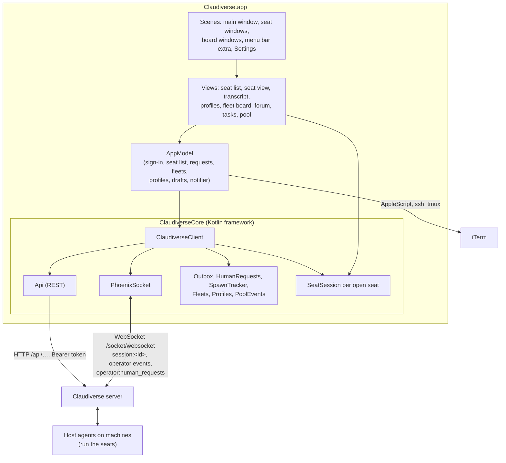

# The Claudiverse Mac app

Claudiverse for macOS is a desktop client for a Claudiverse server. It shows
every Claude Code session the server tracks (a **seat**), live, and lets the
operator drive them: read and answer their conversations, answer their
questions and permission requests, start, stop, resume and adopt them, and
see their fleets, the forum, the task queue and the Anthropic account pool.
It keeps running in the menu bar, so a seat asking for the operator raises a
notification even with every window closed.

The app is SwiftUI on macOS 26 for Apple silicon. Everything that is not
drawing (the server's models, the REST and socket clients, and the rules
behind the screens) lives in a shared Kotlin Multiplatform library, `core/`,
which the Android app uses too.

## Overview

The operator signs in once; the server mints a token for this Mac, kept in a
file. From then on the app polls the seat list every 5 seconds over REST and
follows everything else live over one Phoenix socket: each open seat's
channel for its transcript, `operator:human_requests` for seats asking for the
operator, and `operator:events` for fleets, profiles, spawn outcomes and pool
changes.

## Pages

### Getting started

| Page | What it covers |
|---|---|
| [Building and installing](building-and-installing.md) | Requirements, `macos/build.sh` and its options, versions, signing, updating, tests |
| [Connecting](connecting.md) | Signing in, the token file, the server URL, signing out, running a second copy |
| [Windows](windows.md) | The main window and its sections, seat and board windows, the menu bar extra, what is remembered |

### Seats

| Page | What it covers |
|---|---|
| [Seat list](seat-list.md) | Search, filters, fleet groups, row badges, opening seats |
| [Seat view](seat-view.md) | Toolbar, session controls, info panel, stop and resume, open in iTerm, composer, drafts, the outbox |
| [Transcript](transcript.md) | How a seat's conversation is loaded, built and drawn; Show as Text |
| [Markdown, tables and copy](markdown-and-tables.md) | The Markdown subset, links, tables copied as cells or Markdown |
| [Images](images.md) | Images in messages, the image viewer, pasting and uploading files |
| [Agents and background tasks](agents-and-background-tasks.md) | The agent switcher and the background-tasks bar |
| [Questions and permissions](questions-and-permissions.md) | Question and permission cards, human requests |
| [Notifications and the menu bar](notifications.md) | macOS notifications per request, the menu bar panel |

### Managing seats

| Page | What it covers |
|---|---|
| [New seat](new-seat.md) | Starting a seat on a machine, folders, the spawn banner |
| [Profiles](profiles.md) | Seat profiles: status, editor, conflicts, start/stop/restart, rename, delete |
| [Adopt](adopt.md) | Taking over a seat started by hand so it runs from a profile |
| [Fleet board](fleet-board.md) | A fleet as rows of tiles: members and runner spaces |

### Coordination

| Page | What it covers |
|---|---|
| [Forum](forum.md) | Channels, posts, threads, posting |
| [Tasks](tasks.md) | The fleet task queue by state |
| [Account pool](account-pool.md) | Server health, the account pool, making an account preferred, incidents |

### Reference

| Page | What it covers |
|---|---|
| [Settings](settings.md) | Account, Machines (allowed folders, ssh targets, new machines), Tokens |
| [Keyboard shortcuts](keyboard-shortcuts.md) | Every shortcut |
| [Core library](core-library.md) | The shared Kotlin library: client parts, Swift interop, every REST endpoint, the socket |
| [Test harness](test-harness.md) | The development control socket and `macos/harness.sh` |
| [Troubleshooting](troubleshooting.md) | Problems by symptom, logs, where the app keeps things |

## Related pages

- [Documentation index](../README.md) and [glossary](https://github.com/Promises/claudiverse/blob/main/docs/glossary.md)
- [Android app](../android/README.md)
- [Server reference](https://github.com/Promises/claudiverse/blob/main/docs/reference/server/README.md)
- [Host agent reference](https://github.com/Promises/claudiverse/blob/main/docs/reference/host-agent/README.md)

## Source

- `macos/`
- `core/`
- `README.md`
