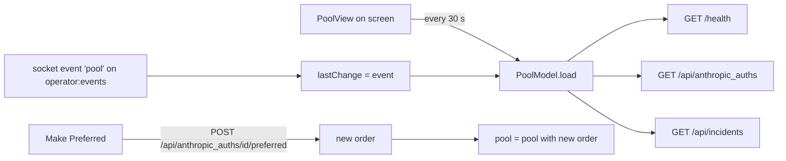

# Account pool

The Pool section of the main window shows three things: whether the server answers, the pool of Anthropic accounts that pooled seats are handed accounts from, and the server's incident log. For each account it shows its status, any cooldown, its usage limits and its place in the order. The operator can make any account the preferred one, the pool's first choice.

The pool itself lives on the server. The app reads it and shows it; the only change it can make is the preferred account. The page also follows live "pool" events, so a change made elsewhere (another operator, an automatic fallback, a recovery) shows up without waiting for the next refresh.

## How it works

`PoolModel` (one instance, `AppModel.pool`) holds `health`, `pool`, `incidents`, `error` and `lastChange`. `PoolSidebar` and `PoolView` both read it.



**Loading.** `PoolModel.load` makes three calls in turn: `health`, `pool`, `incidents`.

- A failed `health` call leaves `health` as nil, shown as "health unknown". A reply with any HTTP status counts as an answer: the status code is the value.
- A failed `pool` call sets `error` to `Pool not read: <message>`. A successful one clears `error`. A cancelled call changes nothing.
- A failed `incidents` call sets `incidents` to nil, so the incident pill and list disappear.

**Refresh while shown.** `PoolView` runs a task for as long as it is on screen: load, then wait 30 seconds, repeat. Switching to another section removes the view and ends the loop. Nothing is polled while the Pool section is not shown.

**Live changes.** When the app signs in it starts `client.poolEvents`, which joins the `operator:events` topic and keeps the newest "pool" event as `latest`. `AppModel` collects it: for each non-nil event it sets `pool.lastChange` and then calls `pool.load`. The event says what changed, not the new list, so the list is read again. This runs whether or not the Pool section is shown. Signing out stops `poolEvents`.

`lastChange` is the newest event since the app started. It is not stored and is empty after a restart.

**Order and preferred.** The server gives each account an optional integer `priority`. The core's `Pool` derives the rest:

- `ordered`: accounts sorted by `priority`, lowest first, accounts without a priority last.
- `preferredId`: the account with the lowest `priority`. If none has a priority, there is no preferred account.
- `inUseId`: the pool's `current_id` if the server sent one, otherwise the first account with `in_use == true`, otherwise nil.

The preferred account and the account in use can differ: a preferred account that is cooling down or needs re-auth is skipped until it recovers.

**Making an account preferred.** `Make Preferred…` in a card asks for confirmation, then `PoolModel.makePreferred` posts to the server. The server answers with every account in its new order and, when it says so, `current_id`. The app replaces the accounts and `currentId` in its pool at once (`Pool.withOrder`; the seat assignments are kept). If there was no pool loaded yet, it builds one from the answer with an empty seat list. The server moves pooled seats to the account on their next request; the client does not touch seats. A preferred account that is cooling down or needs re-auth is still skipped until it recovers.

## Configuration

No setting controls the Pool section. These constants are in the code.

| Item | Value |
| --- | --- |
| Refresh interval while the Pool section is shown | 30 s |
| Assignment summary window | the last 24 h (`24 * 3_600_000` ms) |
| Event topic and name | `operator:events`, event `pool` |
| Progress bar scale | 0 to 100, clamped at 100 |
| Bar colour | red for severity `critical`, orange for `warning`, green otherwise |
| Incident pill colour | green when `total` is 0, red otherwise |
| Health pill colour | green for 200, red for any other code, grey when unknown |

The Pool section is the fifth entry of the section picker at the top of the sidebar (`Seats`, `Profiles`, `Forum`, `Tasks`, `Pool`). It needs the same server URL and token as the rest of the app.

## Interface

### Sidebar

`PoolSidebar` has one section, `Accounts`. One row per account, in pool order:

- a dot: green when the status is `available`, red otherwise;
- the account label;
- a filled star (tooltip "Preferred") on the preferred account;
- on the right, `session N%` if the account has a usage limit of kind `session` with a percent.

### Page

`PoolView` is a scrolling page titled `Pool`, top to bottom:

1. **Server row.** The heading `Server`, a health pill (`health 200`, `health <code>`, or `health unknown`), and, once incidents are loaded, a pill `<total> incidents`.
2. **Last change line.** Shown once an event has arrived since the app started, in secondary text. See below.
3. **Error line**, in red, when `error` is set.
4. **One `AccountCard` per account**, in pool order.
5. **`AssignmentSummary`.**
6. **Latest incidents**, if there are any.

### AccountCard

The card's header shows the label in a larger weight, then pills and a button:

- `Preferred` pill on the preferred account.
- `In use` pill on the account the pool is handing out now (`inUseId`).
- A status pill with the server's `status` text, underscores replaced by spaces; green for `available`, red for anything else.
- `token invalid` pill (red) when `token_valid` is explicitly false. A missing value shows nothing.
- `Make Preferred…` button on every account that is not preferred. It opens a confirmation dialog titled `Make <label> the preferred account?` with a `Make Preferred` button and the message: "Pooled seats move to <label> on their next request. While it is cooling down or needs re-auth, the pool keeps using the next account and comes back to it when it recovers."

Below the header, when applicable:

- On the preferred account, if another account is in use: "Preferred, but seats use <other label> now: the pool comes back here when this account recovers." (orange)
- `Cooling down until <cooldown_until> (<relative time>)` when `cooldown_until` is set. The first time is the server's string, unchanged.
- The cooldown reason: `Reason: <reason>` while a cooldown is set, `Last cooldown: <reason>` when it is not. The code notes that the server keeps the reason after the cooldown ends, so it is history once the account is available.
- One block per usage limit, in the order the server sent them: the limit's `kind` with underscores replaced by spaces on the left; on the right `<percent>%` (or an em dash if there is no percent) followed by ` · resets <relative time>` when `resets_at` is set; and, when there is a percent, a progress bar.
- A footer: `Usage read <relative time> · priority <n>`, with an em dash when there is no priority. When `usage_checked_at` is missing, nothing follows the words `Usage read`.

Relative times are produced by the core's `relativeTime`: "just now", "5m ago", "2h 10m ago", "in 3d 1h". Times are parsed from the first 19 characters of the ISO string and read as UTC.

### AssignmentSummary

A box titled `Last assignment per seat, past 24 h (<n> seats)`, then one line per account label: `<label>: <count>`, sorted by label. It is built from the `seats` list of the pool answer, which holds assignment records (`title`, `label`, `via`, `assigned_at`). The app keeps the newest record per seat title and drops those older than 24 hours. Seats whose record has no label are counted under `?`.

The source comment is explicit: these are assignment records, not a live map. A seat stays on its last account until it asks again, so the counts say which account seats were last handed, not which account they are on this moment.

### Incident log

When the incident list is not empty the page shows the heading `Latest incidents`, with ` since <relative time>` appended when the server sent `since`. Below it is the `latest` list in reverse order (the last entry the server sent is shown first), each as one monospaced, selectable text line. The text is the incident's JSON object pretty-printed (`Incident.summary`); the client does not interpret its fields.

### Last change line

Built by `PoolView.describe(change, pool)`, followed by ` · <relative time of at>` when the event carried a usable `at`. Account names come from the currently loaded pool, by id.

| `change` | Text |
| --- | --- |
| `preferred` | `Preferred account changed` + ` to <label>` (if `preferred_id` is known) + ` by <by>` (if `by` is set) |
| `upgrade` | `Seats moved back to <label>` using `current_id`, or `Seats moved back to a better account` when the account is unknown |
| `degrade` | `Seats moved to <label>`, or `Seats moved to a fallback account` |
| `cooling` | `An account cooled down after a rate limit` |
| anything else | `The pool changed (<change>)` |

The core's description of the kinds: `preferred` means the operator chose an account and `by` is who; `upgrade` and `degrade` mean the best account changed (a recovery or a fallback); `cooling` means an account cooled after a rate limit. `by` is null for the automatic kinds.

### REST and socket

All paths are under `/api` on the server (for example `http://claudiverse.example:4000/api/anthropic_auths`) and carry `Authorization: Bearer <token>`, except `/health`, which is sent without a token.

**Health.** `GET /api/health`, signed out. The app uses only the HTTP status code.

**Pool.** `GET /api/anthropic_auths`

```json
{
  "auths": [
    {
      "id": 4, "label": "Main", "priority": 5, "status": "available",
      "cooldown_until": null, "cooldown_reason": null, "token_valid": true,
      "usage_checked_at": "2026-10-10T07:00:00Z", "in_use": false,
      "usage": { "limits": [
        { "kind": "session", "percent": 42, "resets_at": "2026-10-10T11:00:00Z",
          "severity": "ok", "is_active": true }
      ] }
    },
    {
      "id": 3, "label": "Personal", "priority": 10, "status": "cooling_down",
      "cooldown_until": "2026-10-10T08:30:00Z", "cooldown_reason": "rate limited",
      "token_valid": true, "usage_checked_at": "2026-10-10T07:00:00Z", "in_use": true,
      "usage": { "limits": [] }
    }
  ],
  "seats": [
    { "title": "lorem-w1", "label": "Main", "via": "pool", "assigned_at": "2026-10-10T06:55:00Z" }
  ],
  "current_id": 3
}
```

The values are illustrative; the field names are the ones the client reads. `id` is required (a missing one is an error); `label`, `status` and `kind` default to empty text; the rest are optional.

**Make preferred.** `POST /api/anthropic_auths/{id}/preferred` with an empty JSON object as body (`{}`). Per the client's doc comment, this needs an app or super token, because it moves the fleet's usage. Response:

```json
{ "auths": [ { "id": 3, "label": "Personal", "priority": 1, "status": "available" },
             { "id": 4, "label": "Main", "priority": 2, "status": "available" } ],
  "current_id": 3 }
```

Each entry has the same shape as in the pool list.

**Incidents.** `GET /api/incidents`

```json
{ "total": 2, "since": "2026-10-09T12:00:00Z",
  "latest": [ { "...": "any object" }, { "...": "any object" } ] }
```

`total` defaults to 0 when absent. Each `latest` entry is stored as its pretty-printed JSON.

**Live event.** Topic `operator:events` (the same topic as fleet events), event name `pool`, payload:

```json
{ "change": "preferred", "by": "you@example.com", "at": "2026-10-10T07:01:00Z",
  "current_id": 3, "preferred_id": 4 }
```

`change` defaults to `unknown` when missing; `by`, `at`, `current_id` and `preferred_id` may be null.

## Failure modes and troubleshooting

| Message | Where | Cause and action |
| --- | --- | --- |
| `Pool not read: <message>` | red line on the page | `GET /api/anthropic_auths` failed. The message is the client's error text, such as `HTTP 401: ...` for a bad token, or a connection error. Check the server and token in [Settings](settings.md). The page retries every 30 s. The old pool stays on screen. |
| `Set the server URL and token in Settings` | inside the `Pool not read:` line | No server URL or token is configured. |
| `Server sent something that is not JSON` | inside the `Pool not read:` line | The server answered with a success status but a body that is not a JSON object. Check that the URL points at the Claudiverse server. |
| `<label> not made preferred: the server does not know this account, or cannot set a preferred account yet (HTTP 404).` | red line | The POST returned 404: the account id is gone (for instance removed since the last read) or the server has no such call. The app does not tell the two apart. Wait for the next refresh and check the list. |
| `<label> not made preferred: <message>` | red line | Any other failure, with the client's error text. A token that is not an app or super token is the likely cause of a 403; the client does not translate it. |
| `health unknown` | grey pill | The health request failed (no connection). |
| `health <code>` in red | pill | The server answered `/health` with a code other than 200. |
| No incident pill and no incident list | page | The incidents call failed, or there is nothing to list. A total of 0 shows a green `0 incidents` pill. |
| The page is empty apart from the server row | page | No pool has loaded yet, usually with an error line above. |
| Last change line missing | page | No "pool" event has arrived since the app started. The line is never read from the server, only from the live event. |
| Order looks stale after a change by someone else | page | The event triggers a reload, but if the socket is down the list updates only on the 30 s refresh. |

An error from one action stays on screen until the next successful pool read or successful `Make Preferred`.

## Related pages

- [Fleet board](fleet-board.md): the other consumer of `operator:events`.
- [Seat list](seat-list.md)
- [Settings](settings.md): server URL and token.
- [Connecting](connecting.md)
- [Troubleshooting](troubleshooting.md)
- [Core library](core-library.md)
- Server: [The Anthropic account pool](https://github.com/Promises/claudiverse-oss/blob/main/docs/reference/server/account-pool.md)
- Web panel: [Accounts page](https://github.com/Promises/claudiverse-oss/blob/main/docs/reference/services/web/accounts.md)
- Android: [Pool tab](../android/pool.md)

## Source

- `macos/Claudiverse/TasksAndPool.swift`
- `macos/Claudiverse/AppModel.swift`
- `macos/Claudiverse/MainView.swift`
- `macos/ClaudiverseTests/PoolChangeTests.swift`
- `core/src/commonMain/kotlin/dev/claudiverse/core/Api.kt`
- `core/src/commonMain/kotlin/dev/claudiverse/core/Models.kt`
- `core/src/commonMain/kotlin/dev/claudiverse/core/Fleets.kt`
- `core/src/commonMain/kotlin/dev/claudiverse/core/ServerTime.kt`
