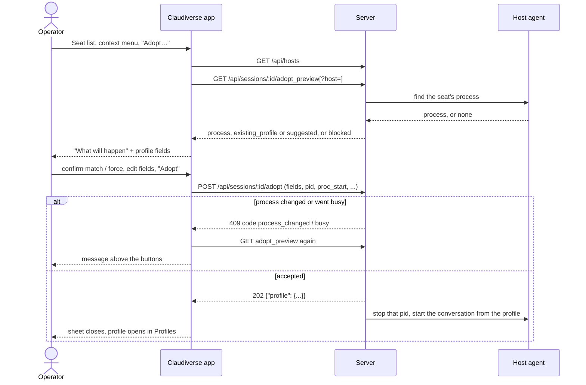

# Adopt

Adopt takes over a seat that someone started by hand in a terminal. The seat's machine stops exactly the Claude Code process that runs it and starts the same conversation again from a [profile](profiles.md), under the machine's host agent. From then on the app can stop, start and restart the seat, because it now runs from a profile.

The app does not guess what will happen. It asks the server first (the process found, and either a stopped profile of the seat's name or suggested fields for a new one), says it in plain sentences, and lets the operator edit the profile before confirming.

## How it works

1. The operator picks "Adopt…" on a running seat. The sheet loads the machine list and asks the server for a preview of what adopting would do.
2. The server's answer is one of: a blocked reason, no process at all, or a process plus a profile to start it from. The sheet shows that under "What will happen".
3. If the process was matched only by tmux session name and folder, the operator must confirm it is the right one. If the process is mid-turn, the operator must tick a box to stop it anyway.
4. The operator can adjust the profile fields, then presses "Adopt". The app sends the profile fields together with the process's `pid` and `proc_start`, so the machine stops that exact process and no other.
5. The server answers 202 with the profile. The app stores it, closes the sheet and opens the profile in the Profiles section. The start outcome arrives as for any profile start (see [Profiles](profiles.md)).

What the machine's host agent does is described in the core library: it finds the process by Claude Code's own record of it, `~/.claude/sessions/<pid>.json`, stops exactly that process, and starts the same conversation from the profile under the agent (in tmux).



### The preview

`GET /api/sessions/:id/adopt_preview` returns:

- **process**, if one was found: `pid`, `proc_start`, `tmux`, `status`, `version`, `matched_by`, `session_id`.
  - `matched_by` is `session_id` when the process record's conversation is the seat's. It is `tmux_title` when only the tmux session name and folder match. The app then shows a toggle the operator must tick (see below). When the app looks on a machine because the seat's row has none (see [Seats with no machine](#seats-with-no-machine)), the server matches by conversation id only.
  - `tmux` is null for a process in a plain terminal tab. That tab gets its shell back when the process is stopped.
  - `status` is `idle` or `busy` (mid-turn). Any other value or none is read as `unknown`, which counts as not busy.
- **existing_profile**: a stopped profile with the seat's title on its machine. If present, the seat is adopted into it, using its current fields.
- **suggested**: profile fields for a new profile named after the seat. Used when there is no existing profile.
- **blocked**: a reason the seat cannot be adopted (the core comments list: no host agent or one too old, a worker seat, no process or several, a transcript the profile's runtime cannot read). The text is the server's and is shown as is.
- **folder**: the folder of the seat's process, sent when blocked because it is outside the machine's allowed folders.

The app treats the seat as adoptable only when `blocked` is null, a process was found, there is an existing or suggested profile, and the existing profile (if any) is not running.

## Configuration

Adopt has no settings and no persisted keys. The constants in the code:

| Item | Value |
| --- | --- |
| Sheet size | min 520 wide, ideal 620, max 720; min 320 high, ideal 680, max 900 |
| Wait before asking again after "Allow" a folder | 2 seconds |
| Draft before the preview arrives | `ProfileDraft.new(machine: "")`, then replaced by the existing profile's fields or the suggested fields |
| `force` | off; sent only when ticked |
| Auth | App or super token (per `Api.kt`) |

### Seats with no machine

A seat started by hand may not report its machine. The sheet then looks for the seat on this Mac: it loads the machine list and takes the host whose name matches this Mac's host name, compared case-insensitively. If one matches, that name is sent as `host` (query on the preview, body field on adopt) and the sheet says "Its machine isn't recorded, so this Mac (`<name>`) was looked on." If none matches, nothing is asked of the server and the sheet shows the blocked text "Its machine is not known, and this Mac (`<host name, lowercased>`) has no agent." with the line "Its machine isn't recorded, and this Mac has no agent to look on." above it.

## Interface

### Where it is offered

- **Seat list**: right-click (context menu) on a seat, below a divider: "Adopt…". Opens the sheet for that seat. See [Seat list](seat-list.md).
- **Seat view**: an "Adopt…" button in the seat's detail form, next to "Stop seat…". See [Seat view](seat-view.md). Its hover help is the blocked reason, or "Run it from a profile under its machine's agent, so it can be stopped, started and restarted from here" when enabled. Below the button the blocked reason is also shown as small text, except for a seat that already runs from a profile.
- The test harness has an `adopt {seat}` command that opens the sheet (see [Test harness](test-harness.md)).

"Adopt…" is disabled when `adoptBlockedReason` returns a reason. It looks only at the seat's row, in this order:

| Condition | Reason |
| --- | --- |
| status is not `running` | "It is stopped: make a profile for it and press Start instead." |
| origin is `runner` | "A runner's worker: cv-runner starts and stops it." |
| origin is `profile` | "It already runs from a profile." |
| otherwise | none (enabled; the server is asked) |

The context menu item has no help text; the reason shows only in the seat view. A missing machine does not disable it.

### The sheet

While loading: a progress line "Asking `<host or this Mac>` for the seat's process…".

**What will happen** section, depending on the preview:

- Blocked: the server's reason with a "nosign" icon. If the target machine is known and the folder (the preview's `folder`, else the seat's working directory) is outside the machine's allowed folders, an "Allow a folder" control (the same one as in [New seat](new-seat.md) and the profile editor) is shown. When the machine accepts the folder, the sheet waits 2 seconds and asks again.
- Process found:
  - A line such as "Claude Code 2.1.286, process 87920 on lorem-mac, in tmux session lorem-admin; idle." The place is "in tmux session `<name>`" (the part of `tmux` before the first `:`) or "in a terminal tab (not tmux)". The status is "mid-turn" or "idle". The version part is left out if unknown; the host reads "its machine" if unknown.
  - If matched by tmux name, a toggle: "Matched by its tmux session's name and folder, not by its conversation: this is the right process". Must be ticked.
  - If mid-turn, a toggle: "It is mid-turn: stop it anyway (the turn is lost)". This is `force`.
  - What stopping does: for a plain terminal, "That process is stopped and its conversation continues in tmux under the machine's agent. The terminal tab gets its shell back: don't resume this conversation there again, or two processes will write to it." For a tmux process, the first sentence only.
  - With an existing profile: if it is running, "Profile `<name>` is running already: stop it first." (adopt is not possible). Otherwise "It is started from the existing profile `<name>` (revision `<n>`), with the settings below."
  - Without one: "A new profile named `<seat title>` is made with the settings below." and a warning, "Check the permission mode below: a seat doesn't report its own, so it is suggested as `<mode label>`." (falls back to `default`).
  - If the draft's runtime differs from the existing or suggested runtime: "It runs on `<runtime>` now and will start on `<runtime>`."
- Preview has no process and no reason: "No Claude Code process for this seat was found on `<host or its machine>`."

**Profile fields** appear only when adoption is possible. They are the same form as the profile editor ([Profiles](profiles.md)): sections Seat, Launch and Starting. Differences here: the name is a fixed, read-only row (the existing profile's name, else the seat's title), and the machine is a fixed, read-only row (the seat stays on its own machine). Everything else is editable: folder (with the "Allowed" menu), fleet, role, "May page the operator", runtime, model, effort, permission mode, MCP servers, conversation choice, autostart, pooled login, debug log. Field errors from the server are shown under the matching field.

**Buttons** (bottom bar, with the failure text to their left, up to 3 lines, selectable):

| Control | Behaviour |
| --- | --- |
| "Cancel" | Closes the sheet (Escape). |
| "Adopt" (shows "Adopting…" while running) | Default action (Return). Enabled only when the preview can be adopted, a process was found, no adopt is running, the tmux-name match is confirmed if needed, and "stop it anyway" is ticked if the process is mid-turn. |

### REST

`GET /api/hosts` (machine list, errors ignored), then:

```
GET /api/sessions/1201/adopt_preview?host=lorem-mac     (host only when the row has none)
```

```json
{
  "process": {"pid": 87920, "proc_start": "Wed Oct  7 10:07:17 2026",
              "tmux": "lorem-admin:@199.%199", "status": "idle", "version": "2.1.286",
              "matched_by": "session_id", "session_id": "d7dba841-a246-4186-9c74-da1d8534d610"},
  "blocked": null,
  "suggested": null,
  "existing_profile": {"id": 10, "name": "lorem-admin", "revision": 1, "machine": "lorem-mac",
                       "folder": "/home/me/project", "status": "stopped", "runtime": "patched"}
}
```

`pid` and `proc_start` are required in a process; the preview is rejected otherwise. If `existing_profile` cannot be parsed, it is treated as absent.

```
POST /api/sessions/1201/adopt
```

The body is the profile fields plus the process identity. Fields come from `ProfileFields.toJson()`: `machine`, `folder`, `fleet`, `role`, `can_notify`, `runtime`, `model`, `effort`, `permission_mode`, `mcp`, `pooled`, `autostart`, `resume`, `debug`. Added by adopt:

| Key | Sent |
| --- | --- |
| `pid` | always |
| `proc_start` | always |
| `profile_id` | only with an existing profile |
| `force` | only when `true` |
| `host` | only when the seat's row had no machine |

The name is not in the body. The reply is `{"profile": {...}}` (HTTP 202); a reply without `profile` fails with "Server sent no profile".

## Failure modes and troubleshooting

Errors from the preview:

| Cause | Shown (in the failure area) |
| --- | --- |
| HTTP 404 | "This server cannot adopt seats yet." The server lacks the endpoint. |
| Any other error | "Not asked: `<message>`" |

A cancelled request shows nothing. A failed machine-list call is ignored (the list stays empty).

Errors from "Adopt". All are logged; field errors in the response are shown under their fields.

| Cause | Shown | What happens |
| --- | --- | --- |
| `code` `process_changed` (409) | "The process changed since this was shown (it restarted or ended). Asked again:" | The preview is reloaded. Check the new process and confirm again. |
| `code` `busy` (409) | "It went mid-turn meanwhile. Stop it anyway, or wait and try again." | The preview is reloaded; tick "stop it anyway" or retry later. |
| Response with field errors (422) | "Not adopted: see the fields marked below." | Fix the marked fields. |
| Anything else, such as 409 for a running profile or a worker seat, or 504 when the machine is offline | "Not adopted: `<message>`" | The message is the server's text, prefixed by `HTTP <status>: ` when the server gave a reason. Bring the machine online, stop the running profile, and so on. |

Other cases:

- "Adopt" stays disabled: the process is mid-turn and the toggle is off, the tmux-name match is not confirmed, the profile of that name is running, or no process was found. The text in "What will happen" says which.
- The seat list item is greyed out: see the reason table above, or open the seat view to read it.
- A failed start after a 202 is a profile start failure, not an adopt one: see [Profiles](profiles.md) and [Troubleshooting](troubleshooting.md). Note that the old process is already stopped by then.

## Related pages

- [Profiles](profiles.md)
- [Seat list](seat-list.md)
- [Seat view](seat-view.md)
- [New seat](new-seat.md)
- [Test harness](test-harness.md)
- [Troubleshooting](troubleshooting.md)
- Server: [Profiles and the host channel](https://github.com/Promises/claudiverse-oss/blob/main/docs/reference/server/profiles-and-hosts.md)
- Host agent: [Adopting a hand-started seat](https://github.com/Promises/claudiverse-host-agent-oss/blob/main/docs/reference/adopt.md)

## Source

- `macos/Claudiverse/AdoptSheet.swift`
- `macos/Claudiverse/SeatsSidebar.swift`
- `macos/Claudiverse/SessionViews.swift`
- `macos/Claudiverse/ProfilesView.swift`
- `macos/Claudiverse/AllowFolder.swift`
- `core/src/commonMain/kotlin/dev/claudiverse/core/Adopt.kt`
- `core/src/commonMain/kotlin/dev/claudiverse/core/Api.kt`
- `core/src/commonMain/kotlin/dev/claudiverse/core/Profiles.kt`
- `core/src/commonTest/kotlin/dev/claudiverse/core/AdoptTest.kt`
