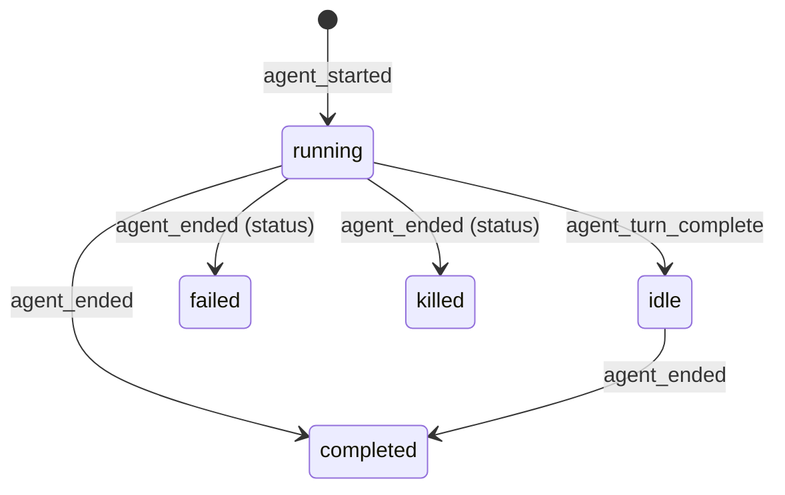

# Agents and background tasks

A Claude Code session does more than talk in one thread. It can fork itself, start subagents (Explore, general-purpose, ...), work with teammates, and run shells, monitors and workflows in the background. The seat view shows these in two strips above the transcript: the **agent switcher**, which lists the seat's agents and swaps the transcript to one agent's thread, and the **background tasks bar**, which counts what runs in the background and lists it with elapsed times.

Both strips are driven by data the seat sends apart from main's conversation, so an agent's rows never mix into main's transcript and a background task is never a transcript row. Each strip appears only when there is something to show.

## How it works

### Agents

`SeatFeed` (core) keeps three things apart from main's messages: each agent's rows (by agent id, in arrival order), the seat's agents (by id, in the order they started), and the background list. A message belongs to an agent when its `type` is one of `agent_started`, `agent_message`, `agent_turn_complete`, `agent_ended`, `agents`, or when it carries an `agent_id` (a permission request from an agent, say). Anything else is main's.

| Message `type` | Effect |
| --- | --- |
| `agent_started` | Adds or updates the agent from the message fields. Status stays what it was if the agent is already known, else `running`. |
| `agent_message` | The agent's row is in the message's `message` object. Noise rows are dropped. The row is stored under the agent (keyed by its `uuid`). A row from an agent nothing announced (its start scrolled out of the replay) adds a placeholder agent of type `agent`, status `running`, until a snapshot names it. |
| `agent_turn_complete` | Sets the status to `idle`, unless the agent has ended. |
| `agent_ended` | Sets the status to the message's `status`, else `completed`. |
| `agents` | A snapshot: replaces the list. A tool-use id or parent id the snapshot lacks is kept from what was known. |
| any other row with an `agent_id` | Stored in that agent's thread as is. |

Each thread keeps at most as many rows as main (`maxMessages`); the oldest are dropped first.

The `replay` event (sent on join and rejoin) clears all agent state and rebuilds it: agent rows in `messages` are routed to their agents, then `agent_messages` (the agents' own replay buffer) is applied, then the `agents` snapshot, which names agents whose start has scrolled out.

A `SeatAgent` carries these fields (JSON names as the client reads them): `agent_id`, `agent_type` (default `agent`), `description`, `name`, `fork`, `background`, `status` (default `running`), `tool_use_id`, `parent_agent_id`.

Status values: `pending`, `running`, `waiting` (a teammate waiting for a message), `idle`, `completed`, `failed`, `killed`. The set that counts as ended is `completed`, `failed`, `killed`. `pending` and `running` count as busy ("working now").

An agent's label is its `description`; if that is blank, its `name`; if that is blank or absent, its `type`.



The diagram shows the transitions the client applies itself (a repeated `agent_started` for a known agent does not change its status). `pending`, `waiting` and any other status arrive from the server in a snapshot or an `agent_started`/`agent_ended` message and are shown as given.

### An agent's thread

When an agent is selected, the transcript shows `agentThreads[id]`, built from that agent's rows the same way as main's. One difference: in an agent's thread a user row is not the operator's. `TranscriptBuilder.agentItems` turns each text-only user row into an event row (image-carrying rows stay bubbles):

- A row starting with `<fork-boilerplate>` becomes an event labelled "fork started" with the summary "Forked from main's conversation".
- Any other becomes an event labelled "prompt". Its summary is the `<summary>` tag content if present, else the first non-empty line that does not start with `<`, else the first line. The full text opens in the disclosure.

Agent threads show no streaming text and no effort stamp. Show as Text in the toolbar uses the selected thread's items and its label as title.

### Selecting an agent

Selection is local state of the seat view (`agentId`), nil for main. The transcript view is rebuilt for each thread (`.id(agent?.id ?? "main")`), so each thread starts fresh rather than keeping a scroll position across switches. If the selected id disappears from the agent list, the view falls back to main.

### The composer while an agent is selected

The composer does not change. A caption appears above the queued list and composer:

> `<label>: its own thread. A message here goes to main; sending to an agent comes later.`

Exactly: the composer calls the same `session.send` (or `sendFiles`) as for main. No agent id is passed, so the message goes to the seat's main conversation, not to the selected agent. Sending to an agent is not implemented. Drafts, the queue for busy seats and the notice bar behave as in [Seat view](seat-view.md).

### Background tasks

The seat sends the whole list each time. Two paths carry it:

- A `message` event with `type` `background_tasks` and a `tasks` array replaces the list. It returns a transcript change (so the view redraws) but is never a transcript row.
- A `replay` event carries `background_tasks`. A replay without it (an older server) leaves the list empty.

A `BackgroundTask` reads: `id`, `type` (default `task`), `status` (default `running`), `description`, `command`, `started_at` (a server time, parsed to ms), `agent_type`, `name`, `server`, `tool`. It counts as running when its status is `running` or `pending`.

The list follows Claude Code's own task list (format v1, claudiverse-seat 0.10.0). A task is in the list from when it starts until main's turn ends after it finished, or until it is stopped. `started_at` is null for a task first seen at a turn end.

The bar lists `BackgroundTask.shown(tasks)`: every task except type `subagent`. Subagents are in the list the server sends, but the agent switcher already shows them.

A task's label is its `description` (non-blank), else its detail, else its `command`, else its `type`. The detail is the `agent_type`, else the `name` (a workflow's), else `server · tool` (an MCP monitor).

Elapsed time (`elapsedLabel`): under 60 seconds "45 s"; under an hour "12 min"; otherwise hours, plus minutes when not zero: "3 h 5 min", "2 h".

## Configuration

| Setting | Default | Notes |
| --- | --- | --- |
| `AppModel.backgroundBarsOpen` | `false` | Whether a background bar starts unfolded. In memory only, not a UserDefaults key and not in Settings. The harness `unfold` command sets it. It is read when a bar is created; a bar already on screen keeps its own fold state. |
| `maxMessages` (core) | per `SeatFeed` | Cap on rows kept per thread. |
| Bar redraw interval | 1 s | Elapsed times tick through a `TimelineView` while the bar is unfolded. |

The agent switcher has no settings.

## Interface

### Agent switcher

A horizontal, scrollable strip (accessibility label "Agents") that appears when the seat has at least one agent. First chip is "main"; after it one chip per agent in start order. The selected chip has a violet capsule behind it.

Each chip shows:

- A 7-point dot.
- A badge in the accent colour: "fork" for a fork, else the agent's type.
- The label, one line, truncated at the tail, at most 260 points wide.

Hovering a chip shows `<type> · <status>`, with ` · background` appended for a background agent.

Dot colours (`AgentSwitcher.color`):

| State | Colour |
| --- | --- |
| main | green (good) |
| `pending`, `running` | orange (attention) |
| `waiting`, `idle`, and any other unlisted status | green (good) |
| `completed` | secondary grey |
| `failed`, `killed` | red (bad) |

Note that a `waiting` or `idle` agent shares green with main; only the hover text tells them apart.

Clicking a chip selects it. A chip for main sets the selection back to nil.

### Open thread link

Under an Agent tool call in the transcript that spawned a subagent, a link-style button "Open `<type>`'s thread" (arrow icon) selects that agent. The link needs the agent's `tool_use_id` to match the tool call and the seat view to supply the open action. The seat view maps every agent except the selected one by tool-use id, so a thread does not link to itself (a fork's thread starts with the call that spawned it).

### Background tasks bar

Shown above the transcript (below the switcher) when `shown(tasks)` is not empty.

- Folded: a chevron, a gear icon, and a summary: counts per type in first-seen order, singular for one and `s` appended otherwise, and " running" appended when any task is running. Examples from the code: "2 shells running", "1 shell, 1 monitor running".
- Click the header to unfold. Each task gets one line: an icon (shell: terminal, monitor: waveform, workflow: flowchart, other: gear), the label, and on the right the elapsed time (monospaced digits) for a running task. A running task with no `started_at` shows its status text instead; a task that is not running shows its status.
- When the command differs from the label it appears under the label in monospace, one line, middle-truncated, selectable; its help text is the full command.
- Context menu on a task with a command: "Copy Command".

### Seat list count

The seat row shows a gear icon with a number when `background_running` (from the seat list; 0 when absent) is above zero. Its help text is "N running in the background (shells, monitors, workflows, subagents)". Unlike the bar, this count includes subagents. See [Seat list](seat-list.md).

### Wire summary

No REST endpoints are specific to these strips. Everything arrives on the seat's socket channel (see [Transcript](transcript.md)):

```json
{"type":"agent_started","agent_id":"a1","agent_type":"Explore","description":"Find where tiles are laid out","tool_use_id":"toolu_1"}
{"type":"agent_message","agent_id":"a1","message":{"uuid":"...","type":"assistant","message":{}}}
{"type":"agent_ended","agent_id":"a1","status":"completed"}
{"type":"background_tasks","tasks":[{"id":"b3q8nagfw","type":"shell","status":"running","command":"sleep 40 && echo slept","started_at":"2026-10-09T14:11:25.585Z"}]}
```

The shapes are those the core tests parse (`AgentsFeedTest`, `BackgroundTasksTest`).

### Previewing with the test harness

The harness (see [Test harness](test-harness.md)) has commands for these strips:

- `agents`: opens an "Agents preview" window with the switcher showing sample agents of different statuses and an "Open Explore's thread" link.
- `seatagents`: joins a seat in the background (the first call replies `joining`), then reports what its replay held: agents (id, type, label, status, fork, thread item count), background tasks (id, type, status, label, command, elapsed), `backgroundRunning`, and optional `find` matches in main's items. `close: true` leaves the seat.
- `unfold`: sets `backgroundBarsOpen` (true unless `open` is given), so bars open unfolded from then on.

## Failure modes and troubleshooting

The strips show no error messages of their own. Symptoms:

- **No background bar though the seat list shows a count.** The count includes subagents; the bar does not. A seat whose only background work is subagents shows its agents in the switcher and no bar.
- **No background bar on an older server or seat.** A replay without `background_tasks` leaves the list empty, and the list needs claudiverse-seat 0.10.0 (format v1).
- **A task shows its status instead of a time.** The seat did not see it start (`started_at` null), or it is no longer running.
- **A placeholder chip of type "agent".** Rows arrived for an agent whose start scrolled out of the replay. A later `agents` snapshot names it.
- **An agent's thread is empty.** It has no rows in the replay buffer yet; the thread fills as `agent_message` rows arrive.
- **A message sent while viewing an agent goes to main.** By design; see above.
- **Elapsed time looks wrong.** It is the client clock minus the server's `started_at`; a skewed clock shifts it.

## Related pages

- [Seat view](seat-view.md)
- [Transcript](transcript.md)
- [Seat list](seat-list.md)
- [Test harness](test-harness.md)
- [Core library](core-library.md)
- Mod: [Agents capture and background tasks](https://github.com/Promises/claudiverse/blob/main/docs/reference/services/mod/agents-and-background.md)
- Android: [Seat view](../android/seat-view.md)

## Source

- `macos/Claudiverse/SeatDetailView.swift`
- `macos/Claudiverse/TranscriptView.swift`
- `macos/Claudiverse/AppModel.swift`
- `macos/Claudiverse/SeatsSidebar.swift`
- `macos/Claudiverse/Harness.swift`
- `core/src/commonMain/kotlin/dev/claudiverse/core/Agents.kt`
- `core/src/commonMain/kotlin/dev/claudiverse/core/BackgroundTasks.kt`
- `core/src/commonMain/kotlin/dev/claudiverse/core/SeatFeed.kt`
- `core/src/commonMain/kotlin/dev/claudiverse/core/SeatSession.kt`
- `core/src/commonMain/kotlin/dev/claudiverse/core/Transcript.kt`
