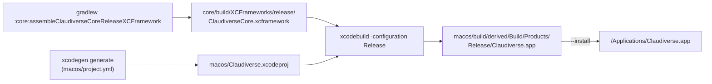

# Building and installing

The Mac app comes as a prebuilt download on the repository's
[Releases](https://github.com/Promises/claudiverse-apps/releases) page, or is
built from source on the Mac that runs it. There is no App Store build and no
in-app updater: to update, download the next release, or pull the repository
and build again. `macos/build.sh` does the whole build in one command and,
with `--install`, replaces the copy in `/Applications`.

## Installing a release

1. Download `Claudiverse-macOS-<version>.zip` from a release.
2. Unzip it and move `Claudiverse.app` to `/Applications`.
3. Open it. A release that is not notarized (its notes say so) is refused
   the first time: right-click (or Control-click) the app in Finder, choose
   **Open**, then **Open** again; or run
   `xattr -dr com.apple.quarantine /Applications/Claudiverse.app`.

The app's data stays where a source build keeps it, so moving between a
release and a source build keeps you signed in.

### How a release is built

Pushing a tag `v<version>` (say `v1.2.0`) runs `.github/workflows/release.yml`.
Its `mac` job, on a GitHub-hosted macOS runner, installs XcodeGen and a JDK
and runs `macos/release.sh <version> <dir>`, which:

1. runs `build.sh` with `CLAUDIVERSE_VERSION=<version>`, so the app's
   version is the tag's;
2. signs and notarizes the app when the signing secrets are set (below);
3. zips it with `ditto` as `Claudiverse-macOS-<version>.zip`, and, when the
   app is not notarized, writes the note on opening it, which the release
   job adds to the release notes.

The release job then publishes the Mac zip, the Android APK and a
`SHA256SUMS` together; a tag with a `-` (`v1.2.0-rc1`) makes a pre-release.

| Repository secret | Used for |
|---|---|
| `MACOS_CERT_P12_BASE64` | A Developer ID Application certificate with its key, exported as `.p12`, base64-encoded. |
| `MACOS_CERT_PASSWORD` | That `.p12`'s password. |
| `APPLE_TEAM_ID` | The certificate's team. |
| `APPLE_ID`, `APPLE_APP_PASSWORD` | Notarization: an Apple ID and an app-specific password for it. |

Without the first three, the app keeps `build.sh`'s ad hoc signature. With
them it is signed with the hardened runtime and
`macos/Claudiverse.entitlements` (Apple events, for opening iTerm); with the
last two as well it is notarized and stapled, and opens without the extra
step.

## How it works



`build.sh` runs three steps:

1. **The core.** `gradlew :core:assembleClaudiverseCoreReleaseXCFramework`
   builds the shared Kotlin library as a static XCFramework for Apple
   silicon (`macosArm64`). See [Core library](core-library.md).
2. **The Xcode project.** `xcodegen generate --spec macos/project.yml`
   writes `macos/Claudiverse.xcodeproj`. The project file and the generated
   `Info.plist` are not kept in git (`.gitignore`); `project.yml` is the
   source of truth.
3. **The app.** `xcodebuild` builds the `Claudiverse` scheme in the Release
   configuration into `macos/build/derived`, and prints the path of the
   built app.

With `--install` it then:

1. asks a running copy to quit (`osascript … tell application id
   "dev.claudiverse.desktop" to quit`, with a 5 second timeout), because
   replacing a running app's bundle leaves it half-updated;
2. stops a copy that did not quit in time (`pkill -f
   '/Claudiverse.app/Contents/MacOS/Claudiverse'`);
3. deletes `/Applications/Claudiverse.app` and copies the new build there.

The app's data is outside the bundle, so it survives a reinstall: the token
file and pasted images in `~/Library/Application Support/Claudiverse/`, and
the preferences (server URL, drafts, outbox, board layouts, ssh targets) in
`UserDefaults`. You stay signed in.

### Versions

`build.sh` computes the version from git:

| Setting | Value | Example |
|---|---|---|
| Build number (`CURRENT_PROJECT_VERSION`, `CFBundleVersion`) | `claudiverse.versionBase` in `gradle.properties` plus `git rev-list --count HEAD` | 2200 + 3 = `2203` |
| Version (`MARKETING_VERSION`, `CFBundleShortVersionString`) | `1.0.<build number>`, or `CLAUDIVERSE_VERSION` when set (a release sets it to its tag's version) | `1.0.2203` |
| `GIT_COMMIT` | `git rev-parse --short HEAD` | `95e0a3c` |

The Android app uses the same base and count, so a Mac build and an Android
build of one commit carry the same number. Outside a git checkout the count
is 0 and the commit `unknown`. `build.sh` prints the version and commit
(`== app (1.0.2203, 95e0a3c)`); `GIT_COMMIT` is passed to `xcodebuild` as a
build setting, but nothing in `project.yml` puts it into the app.

### Signing and sandbox

The app is built to run on the Mac that built it:

| Setting | Value | Consequence |
|---|---|---|
| `CODE_SIGN_IDENTITY` | `-` (ad hoc) | No Apple team. macOS treats each rebuild as a new app for permissions tied to the signature: it asks again to let Claudiverse control iTerm after an update ([Seat view](seat-view.md)), and a keychain item would ask for the password after each rebuild, which is why the token is in a file ([Connecting](connecting.md)). |
| `ENABLE_APP_SANDBOX` | `NO` | The app reads files you paste or attach anywhere, runs `tmux` and AppleScript, and writes `~/Library/Sounds`. |
| `ENABLE_HARDENED_RUNTIME` | `NO` | |
| `NSAppTransportSecurity` › `NSAllowsArbitraryLoads` | `true` | Plain `http` to the server, which is expected on the LAN or behind a VPN. |
| `NSAppleEventsUsageDescription` | "Claudiverse opens a seat's terminal session in iTerm." | The text macOS shows when asking for iTerm control. |
| `ARCHS` | `arm64` | Apple silicon only: the core framework has no Intel slice. |
| Deployment target | macOS 26.0 | |
| `SWIFT_VERSION` | `5.0`, strict concurrency `minimal` | The core's Kotlin types are not `Sendable`. |
| `OTHER_LDFLAGS` | `-lc++` | Kotlin/Native's static framework needs the C++ runtime. |

### The app icon

The icon's source is `macos/Icon/AppIcon.svg`. `macos/make-icon.sh` renders
it with QuickLook (`qlmanage`) at 1024 px and scales it with `sips` into
every size macOS asks for (16 to 512 points, at 1x and 2x) in
`macos/Claudiverse/Assets.xcassets/AppIcon.appiconset`. The PNGs are in git,
so a build does not need it; run it only after changing the SVG.

## Configuration

### Requirements

- A Mac with Apple silicon, macOS 26 and Xcode 26.
- [XcodeGen](https://github.com/yonaskolb/XcodeGen): `brew install xcodegen`.
- JDK 17 or later, for Gradle and the Kotlin core.

### `build.sh` options

| Option | Effect |
|---|---|
| (none) | Build into `macos/build/`. |
| `--install` | Also quit the running copy and replace `/Applications/Claudiverse.app`. |
| `--harness` | Compile in the development control socket (`CLAUDIVERSE_HARNESS`); see [Test harness](test-harness.md). Combine with `--install` to install that build. |

Any other argument fails with `unknown option: <arg>` and exit code 2.

### Identifiers

| What | Value |
|---|---|
| Bundle id | `dev.claudiverse.desktop` |
| Test bundle id | `dev.claudiverse.desktop.tests` |
| Core framework bundle id | `dev.claudiverse.core` |
| Unified-log subsystem | `dev.claudiverse.desktop`, category `app` |

A copy built under another bundle id `dev.claudiverse.desktop.<name>` keeps
its own folder in Application Support (`Claudiverse <name>`) and can run
beside the normal app; see [Connecting](connecting.md). `build.sh` has no
option for that: change `PRODUCT_BUNDLE_IDENTIFIER` in `macos/project.yml`.

## Interface

```sh
macos/build.sh                      # build into macos/build/
macos/build.sh --install            # build and replace /Applications/Claudiverse.app
macos/build.sh --harness --install  # the same, with the test harness compiled in
```

Updating an installed app:

```sh
git pull
macos/build.sh --install
```

### Tests

The core's tests run on the JVM and natively:

```sh
./gradlew :core:jvmTest :core:macosArm64Test
```

The app's own tests (`macos/ClaudiverseTests`, hosted in the app so they reach
its types with `@testable import Claudiverse`) run once the project has been
generated, for example by a first `build.sh`:

```sh
xcodebuild test -project macos/Claudiverse.xcodeproj -scheme Claudiverse
```

| Test file | Covers |
|---|---|
| `AllowFolderTests.swift` | each breadcrumb segment selects its level; "inside an allowed folder" is by whole segments |
| `BackgroundTasksTests.swift` | the folded bar's summary counts by kind |
| `BoardLayoutTests.swift` | fleet board layout: removing and moving tiles, new rows, clamped widths, no duplicates, the legacy layout |
| `ComposerTests.swift` | Return sends, Shift/Option-Return add a line; what a paste attaches (image as PNG, Finder files, text stays text) |
| `DraftsTests.swift` | drafts per seat survive a restart; a send clears only its seat; missing attachments are dropped |
| `MarkdownSelectionTests.swift` | which blocks share one selectable text; table copy as cells and as Markdown |
| `PoolChangeTests.swift` | the wording of live pool changes |
| `ProfileDraftTests.swift` | a new profile is pooled; a patched-runtime profile saves and shows unpooled |
| `ProfileStatusTests.swift` | the last-start line: duration, stop time, refusal reason |
| `RenameProfileTests.swift` | the server's rule for a valid name |

## Failure modes and troubleshooting

- **`xcodegen: command not found`.** Install XcodeGen (`brew install
  xcodegen`).
- **The Gradle step fails.** Check the JDK (`java -version`, 17 or later).
- **`xcodebuild` cannot find `ClaudiverseCore`.** The XCFramework is built in
  step 1 at `core/build/XCFrameworks/release/ClaudiverseCore.xcframework`;
  run `build.sh` rather than `xcodebuild` alone after a clean.
- **`xcodebuild test` says the project does not exist.** Generate it first
  (run `build.sh` once, or `xcodegen generate --spec macos/project.yml
  --project macos`).
- **`--install` left the old app running.** The quit is asked with a 5 s
  timeout and then forced with `pkill`; if the app still runs, quit it by
  hand and run `build.sh --install` again.
- **iTerm control is refused after an update.** The ad hoc signature changed;
  allow Claudiverse again in System Settings › Privacy & Security ›
  Automation.

## Related pages

- [Test harness](test-harness.md)
- [Core library](core-library.md)
- [Connecting](connecting.md)
- [Troubleshooting](troubleshooting.md)
- Android: [Builds and updates](../android/builds-and-updates.md)

## Source

- `macos/build.sh`
- `macos/release.sh`
- `macos/Claudiverse.entitlements`
- `.github/workflows/release.yml`
- `macos/project.yml`
- `macos/make-icon.sh`
- `gradle.properties`
- `core/build.gradle.kts`
- `.gitignore`
- `macos/ClaudiverseTests/`
- `README.md`
