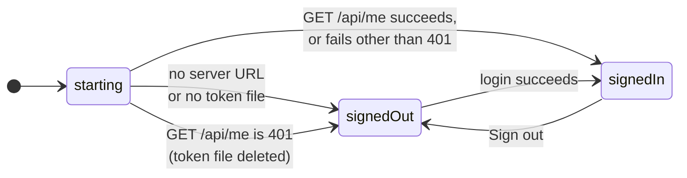

# Connecting

The Mac app talks to one Claudiverse server. The operator signs in once with
the server's address, their email and their password; the server mints a
**super token** for this Mac, and the app keeps that token in a file and uses
it for every REST call and for the live socket. Nothing else is configured:
there is no separate token field and no settings file.

## How it works



**At launch** the app is in the `starting` phase and shows a spinner. It reads
the token file off the main thread. With no saved server URL or no token, it
shows the sign-in screen. With both, it calls `GET /api/me`:

- success: the email from the reply is shown in Settings › Account, and the
  app starts;
- HTTP 401: the token is no longer valid, so the app deletes the token file
  and shows the sign-in screen;
- any other failure (the server is asleep, the Mac is off the network): the
  token may well be fine, so the app starts anyway and logs
  `token not checked: …`. Calls fail until the server is reachable; the
  socket keeps reconnecting by itself.

**Signing in** normalises the typed server address (see below), saves it,
then calls `POST /api/auth/login` with scope `super` and a client name made
from this Mac's name. The reply's token is written to the token file and the
app starts.

**Starting** (signed in) does, in order:

1. reconnects the Phoenix socket at once (no backoff wait);
2. starts the long-lived watchers in core: open human requests, fleets,
   profiles and pool events;
3. removes stale pasted-image files from the drafts folder;
4. asks macOS for notification permission (only the first time does macOS
   show a prompt);
5. starts the seat-list poll: `GET /api/sessions` every 5 seconds.

**Signing out** (Settings › Account › **Sign out**) calls
`DELETE /api/auth/logout`, which revokes this Mac's token on the server. If
that call fails (the server is unreachable), the app logs
`sign-out not confirmed: …` and signs out locally anyway. It then stops every
watcher, closes every loaded seat, deletes the token file and returns to the
sign-in screen. A token that cannot be revoked from the server this way is
still listed under Settings › Tokens; see [Settings](settings.md).

### Server address

What is typed in **Server** is normalised before use:

- surrounding whitespace and trailing slashes are removed;
- `http://` is added when there is no `://`.

So `claudiverse.example:4000/` becomes `http://claudiverse.example:4000`. Core
then accepts only `http` and `https` URLs with a host name; anything else fails
with `Not a valid server URL: …`. Every REST call goes to
`<server>/api/<path>`, and the socket to
`ws(s)://<server>/socket/websocket?token=<token>&vsn=2.0.0`.

The app allows plain `http` to any host (`NSAllowsArbitraryLoads` in its
`Info.plist`): the server is expected to be on the LAN or behind a VPN.

### Client name

The token is minted with a client name, which is how this Mac appears in the
server's token list. It is the Mac's name (System Settings › General ›
Sharing) with apostrophes dropped, every character that is not an ASCII
letter, digit, space, `.`, `_` or `-` replaced by `-`, trimmed, and cut to 64
characters; `Mac` if nothing is left. "Sam's MacBook Pro" becomes
`Sams MacBook Pro`. The sign-in screen and Settings › Account both show it.

### Where the token is kept

The token is in a plain file only the operator's account can read:

```
~/Library/Application Support/Claudiverse/token     mode 0600
~/Library/Application Support/Claudiverse/          mode 0700
```

The file is created with mode 0600 before the token is written, so it is
never readable by others. The keychain is not used on purpose: the app is
signed ad hoc (no Apple team), and macOS ties a keychain item such an app
creates to that exact build, so every rebuild would ask for the password. A
token file never prompts, and the operator's own scripts can read it.

### Running a second copy

The app's folder in Application Support depends on its bundle id. The normal
build is `tech.henning.claudiverse` and uses `Claudiverse`. A copy built under
another bundle id `tech.henning.claudiverse.<name>` uses `Claudiverse <name>`,
so it has its own token, pasted images and harness socket, and can run beside
the normal app signed in to another server. (`build.sh` always builds
`tech.henning.claudiverse`; a copy needs the bundle id changed in
`macos/project.yml`.) The server URL, the outbox and other preferences are in
`UserDefaults`, which macOS also keeps per bundle id.

### Timeouts and the live socket

A REST call that cannot connect in 10 s, or goes 30 s without a byte, fails.
The socket has its own client with the same 10 s connect timeout and no read
timeout (a quiet channel is normal). Instead it sends a heartbeat every 20 s
and drops the connection when no reply comes in 10 s; it then reconnects with
backoff (1, 2, 5, 10, then every 30 s) and rejoins every channel. The socket
is open only while some channel wants to be joined. See
[Core library](core-library.md).

## Configuration

| What | Where | Default |
|---|---|---|
| Server URL | `UserDefaults` key `serverURL`, set by signing in | empty |
| Token | `~/Library/Application Support/Claudiverse/token` | none |
| Token scope requested | `super` (hard-coded) | |
| Seat-list poll | every 5 s while signed in | |
| REST connect / idle timeout | 10 s / 30 s | |
| Socket heartbeat / reply timeout | 20 s / 10 s | |

## Interface

### Sign-in screen

Shown in the main window when signed out. Fields: **Server** (placeholder
`http://server:4010`, pre-filled with the last server), **Email**,
**Password**. **Sign in** (Return) is enabled when all three are filled. Under
it: `This Mac appears in the server's token list as "<client name>".`

### Settings › Account

**Server**, **Signed in as**, **This Mac** (the client name), a note when
macOS has notifications off for the app, and **Sign out**. See
[Settings](settings.md).

### Endpoints

`POST /api/auth/login` (no token):

```json
{"email": "you@example.com", "password": "…", "scope": "super", "client": "Sams MacBook Pro"}
```

The app reads `token`, `scope` and `user.email` from the reply:

```json
{"token": "…", "scope": "super", "user": {"email": "you@example.com"}}
```

`GET /api/me` (Bearer token): the app reads `user.email` and `scope`. A reply
without `user.email` fails with `Server sent no user`.

`DELETE /api/auth/logout` (Bearer token): revokes the calling token.

Every signed-in call sends `Authorization: Bearer <token>`.

## Failure modes and troubleshooting

Sign-in errors, as the sign-in screen shows them:

| Message | Cause |
|---|---|
| `Wrong email or password.` | HTTP 401. |
| `Too many attempts. Try again in N s.` | HTTP 429 with a `retry_after` field or a `Retry-After` header. Nothing retries by itself: wait, then sign in again. |
| `Too many attempts. Wait a minute and try again.` | HTTP 429 without a wait time. |
| `The server refused the request: …` | HTTP 400, with the server's reason. |
| `Could not sign in: …` | Anything else: connection refused, timeout, `Not a valid server URL: …`, a reply that is not JSON. |

Other cases:

- **Back on the sign-in screen after a launch.** The server answered 401 to
  `GET /api/me`: the token was revoked (from another client's Settings ›
  Tokens, or on the server). Sign in again.
- **Signed in, but nothing loads and the menu bar says `offline`.** The token
  was not checked because the server was unreachable at launch. Check that
  the server is up and reachable from this Mac (LAN or VPN). The seat list
  shows the error of its latest poll.
- **`Set the server URL and token in Settings`.** Core's error for a call
  made with no server URL or token, which the app's own flow does not
  normally reach. Sign out and in again.

## Related pages

- [Windows](windows.md): what the app shows once signed in.
- [Settings](settings.md): the Account and Tokens tabs.
- [Core library](core-library.md): the REST client and the socket.
- [Troubleshooting](troubleshooting.md).
- Server: [Accounts, sign-up and tokens](https://github.com/Promises/claudiverse/blob/main/docs/reference/server/auth.md)
- Web panel: [Setup, login and the session token](https://github.com/Promises/claudiverse/blob/main/docs/reference/services/web/setup-and-login.md)
- Android: [Connecting to a server](../android/connecting.md)

## Source

- `macos/Claudiverse/SignInView.swift`
- `macos/Claudiverse/AppModel.swift`
- `macos/Claudiverse/TokenStore.swift`
- `macos/Claudiverse/SettingsView.swift`
- `macos/project.yml`
- `core/src/commonMain/kotlin/dev/claudiverse/core/Api.kt`
- `core/src/commonMain/kotlin/dev/claudiverse/core/Http.kt`
- `core/src/commonMain/kotlin/dev/claudiverse/core/PhoenixSocket.kt`
