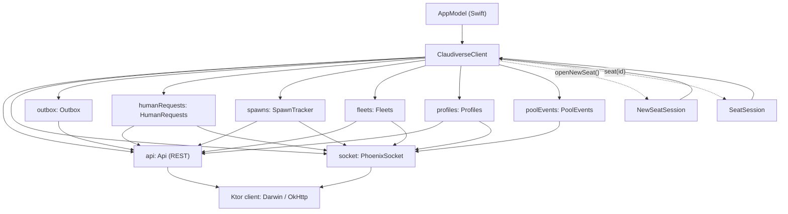

# Core library

The `core/` module is a Kotlin Multiplatform library. It holds everything the Claudiverse server's clients share: the REST client, the Phoenix socket client, the models the server sends, and the rules that turn them into screens (transcript, timeline, seat list, fleet grouping, profile editing). The Android app uses its JVM target. The Mac app uses a native framework built from the same sources, so a rule fixed in `core/` is fixed on both.

The Mac app is a thin SwiftUI layer on top. Views never call the server directly. They hold a `ClaudiverseClient`, read its state flows, and call its suspend functions. This page is for an engineer who will change the app and needs to know what the library does, how it is built, and how Swift talks to it. The screens themselves are documented on their own pages (see Related pages).

## How it works

### Targets and packaging

`core/build.gradle.kts` applies the Kotlin Multiplatform, Kotlin serialization and SKIE plugins, and declares two targets.

| Target | Used by | Ktor engine |
| --- | --- | --- |
| `jvm` (JVM 17) | Android app, `jvmTest` | OkHttp (`ktor-client-okhttp`) |
| `macosArm64` | Mac app | Darwin, which is URLSession (`ktor-client-darwin`) |

There is no Intel Mac target. `macos/project.yml` sets `ARCHS: arm64` for the same reason: an Intel slice would have no Swift module to build against.

The `macosArm64` target produces one XCFramework named `ClaudiverseCore` (framework `baseName` `ClaudiverseCore`, `isStatic = true`, bundle id `dev.claudiverse.core`). Build it with:

```sh
./gradlew :core:assembleClaudiverseCoreReleaseXCFramework
```

`macos/build.sh` runs this task first, then generates the Xcode project, then builds the app. The output is `core/build/XCFrameworks/release/ClaudiverseCore.xcframework`, which `macos/project.yml` links with `embed: false`, because a static framework has nothing to embed. A static Kotlin/Native framework needs the C++ runtime, so the app target sets `OTHER_LDFLAGS: ["-lc++"]`.

The engine is chosen by an `expect`/`actual` pair, `platformHttpClient`: `core/src/macosMain/.../Http.macos.kt` returns `HttpClient(Darwin, block)`, and `core/src/jvmMain/.../Http.jvm.kt` returns `HttpClient(OkHttp)` and adds an OkHttp WebSocket ping every 15 s as a second line under the Phoenix heartbeat. The macOS engine has no such extra ping.

Dependencies and versions (`core/build.gradle.kts`, `gradle/libs.versions.toml`):

| Source set | Dependency | Version |
| --- | --- | --- |
| commonMain, `api` | kotlinx-coroutines-core | 1.10.2 |
| commonMain, `api` | kotlinx-serialization-json | 1.9.0 |
| commonMain, `api` | kotlinx-datetime | 0.7.1 |
| commonMain, `api` | kotlinx-io-core | 0.8.0 |
| commonMain | ktor-client-core, ktor-client-websockets | 3.3.3 |
| commonMain | atomicfu | 0.29.0 |
| jvmMain | ktor-client-okhttp | 3.3.3 |
| macosMain | ktor-client-darwin | 3.3.3 |
| commonTest | kotlin-test, kotlinx-coroutines-test, ktor-client-mock | Kotlin 2.2.10, 1.10.2, 3.3.3 |
| plugin | SKIE (`co.touchlab.skie`) | 0.10.15 |

Kotlin is 2.2.10. kotlinx-io carries the streaming upload and download. atomicfu supplies locks that work in common code, because the socket is used from the UI thread and from its own coroutines.

### The client and its parts

`ClaudiverseClient(access: () -> ServerAccess, outboxStore: OutboxStore)` wires the long-lived parts once. The Mac app creates exactly one, in `AppModel.init()`. The `access` lambda is read on every call, so a changed server URL or token applies to the next request. After such a change call `client.socket.reconnectNow()`, because an open socket still holds the old URL and token.

`ServerAccess` is `(baseUrl, token, author = "operator")`. `author` is the name forum posts go out under. `isComplete` is true when both URL and token are non-blank.

All parts share one `CoroutineScope(SupervisorJob() + Dispatchers.Default)`.



| Part | What it is |
| --- | --- |
| `api` | The REST client (`Api.kt`), described below. |
| `socket` | The Phoenix socket (`PhoenixSocket.kt`). `socket.connected` is a `StateFlow<Boolean>`. |
| `outbox` | Messages typed while their seat was busy, saved through `OutboxStore` (the Mac app keeps them in `UserDefaults` under the key `outbox`) and delivered when the seat goes idle. It polls every 4 s while it holds messages. |
| `humanRequests` | Open requests from seats asking for the operator. Live on `operator:human_requests`, re-read on every join and every 120 s. `requests` is a list for Swift; `open` is the same data as a map by seat id. |
| `spawns` | Tracks a spawn or resume request: the REST call only means accepted (202), and the outcome arrives as a `host_spawn` event. A request with no outcome after 120 s is reported as failed. |
| `fleets` | Fleets with their runners and members. Live on `operator:events`, re-read on every join and every 60 s. |
| `profiles` | Seat profiles. Live on `operator:events`, re-read on every join and every 60 s. |
| `poolEvents` | The newest account-pool change since the app started (`latest`). The event names what changed; the list itself is refetched through `api.pool()`. |

Two factory methods create per-screen objects that share the client's scope:

- `openNewSeat()` returns a `NewSeatSession` (the New seat screen's state and actions). Call `close()` when the screen goes.
- `seat(seatId)` returns a `SeatSession`: one seat's live transcript and actions. It joins `session:<id>` as an observer, polls the seat every 5 s while `setWatched(true)`, and answers the seat's human request when the screen shows it. Call `close()` when the screen goes for good; this leaves the channel and cancels the session's scope.

`client.close()` stops `humanRequests`, `fleets`, `profiles` and `poolEvents` and cancels the scope, which ends the socket and all polling. The Mac app never calls it; the client lives as long as the process.

`start()` and `stop()` on the four feed objects are idempotent (`start()` does nothing if already started). The Mac app calls `start()` on all four in `AppModel.begin()`, after sign-in.

### How Swift calls it

Getting Kotlin into Swift is shaped by four mechanisms.

**Exceptions reach Swift only if declared.** Every public suspend function on `Api` (and the ones that can throw on the other classes) is annotated `@Throws(Exception::class)`. Without it, an exception thrown from a Kotlin suspend function ends the whole Mac app. Suspend functions that only rethrow cancellation use `@Throws(CancellationException::class)`. When writing a new suspend function that can fail, add the annotation.

**Errors come back as `NSError`.** The original Kotlin exception sits in `userInfo["KotlinException"]`. `AppModel.swift` unwraps it:

```swift
extension Error {
    var apiException: ApiException? { (self as NSError).userInfo["KotlinException"] as? ApiException }
    var httpStatus: Int? { apiException?.httpStatus.map { Int(truncating: $0) } }
    var message: String { apiException?.message ?? localizedDescription }
}
```

`error.message` is therefore the server's own words when there are some, and `error.apiException?.retryAfterSeconds`, `.fieldErrors` and `.code` give the structured parts.

**Flows are async sequences.** SKIE turns a Kotlin `StateFlow` into something Swift consumes with `for await`. `AppModel.begin()` runs one `Task` per flow:

```swift
for await list in client.humanRequests.requests { ... }
for await notice in client.spawns.notice { ... }
for await connected in client.socket.connected { ... connected.boolValue }
for await items in client.outbox.items { ... }
for await all in client.fleets.all { ... }
for await all in client.profiles.all { ... }
for await change in client.poolEvents.latest { ... }
```

Kotlin `Boolean` and `Long` arrive boxed (`connected.boolValue`, `Int(truncating:)`). `humanRequests.requests` exists as a list because a Kotlin `Map<Long, ...>` crossing into Swift crashed the app on a failed key cast; keep Swift-facing flows to lists and plain values.

**Sealed types are switched with `onEnum(of:)`.** SKIE generates it for sealed interfaces such as `ProfileSave`, `ProfileRename`, `SpawnNotice`, `MdBlock`, `TimelineRow` and `TranscriptItem`:

```swift
switch onEnum(of: try await model.client.api.renameProfile(id: ..., revision: ..., name: name)) { ... }
```

The SKIE config in `core/build.gradle.kts` also turns on two interop features: Kotlin default arguments are usable from Swift (otherwise every parameter must be passed), and top-level Kotlin functions become global Swift functions (`parseServerTime(...)` instead of `ServerTimeKt.parseServerTime(...)`).

**Swift 5 mode.** `macos/project.yml` sets `SWIFT_VERSION: "5.0"` and `SWIFT_STRICT_CONCURRENCY: minimal`. The core's Kotlin types are not `Sendable`, and Swift 6's checks would have to be silenced type by type. Do not raise the language mode without a plan for that.

`AppModel.swift` also defines `AccessBox` (a lock-guarded `ServerAccess` that the `access` lambda reads) and `DefaultsOutboxStore` (the `OutboxStore` implementation over `UserDefaults`).

### The REST client (`Api.kt`)

`Api` is created with `access: () -> ServerAccess` and its own Ktor client from `createHttpClient()`. Every call is cancellable: cancelling the coroutine abandons the request.

**URL building.** The URL is `<baseUrl>/api/<segments>?<query>`. Each path segment is encoded whole (`encodeSlash = true`), so a host name or channel name containing `/` cannot add a path level. Null query values are dropped. If the base URL is blank, or a signed-in call has a blank token, the call fails before any request with `Set the server URL and token in Settings`. A base URL that is not `http`/`https` with a host fails with `Not a valid server URL: <text>`.

**Auth.** Signed-in calls send `Authorization: Bearer <token>`. `signIn` and `health` send no token.

**Bodies.** Requests with a body send JSON (`application/json`). A `post` without a body sends `{}`. `uploadFile` sends multipart form data with one `file` part, streamed from the `Upload`'s source (no copy held in memory). `removeRoot` sends its path in the body of a DELETE.

**Replies.** `call` parses the body as JSON. For a 2xx reply that is not a JSON object it throws `Server sent something that is not JSON`. For a non-2xx reply it throws an `ApiException`.

**Errors.** `ApiException` extends `IOException` and carries:

| Field | Source |
| --- | --- |
| `message` | `HTTP <code>: <reason>`. The reason is the reply's `error` field; else the 422 field errors joined as `field msg, msg; field2 msg`; else the first 200 characters of the body; else the HTTP status text. |
| `httpStatus` | The status code. Null for errors raised inside the client (missing field, bad URL). |
| `retryAfterSeconds` | The reply's `retry_after` field; else the `Retry-After` header, if it is a number. |
| `fieldErrors` | A 422's `errors`: `{field: [message, ...]}`. A non-array value becomes a one-item list of its JSON text. |
| `code` | The reply's `code` field: a host agent's refusal code (`outside_roots`, `not_allowed`, `stale`, ...) relayed by the server. |

Internally the exception also keeps the parsed reply (`body`) so profile saves can read the current profile out of a 409.

Some calls turn expected failures into results instead of throwing: `createProfile` and `updateProfile` return `ProfileSave` (`Saved`, `Conflict` on 409 with the current profile, `Invalid` on 422 with field errors); `renameProfile` returns `ProfileRename` (`Renamed`, `Conflict` on 409 code `stale`, `Refused` on any other 409 with a code, `Invalid` on 422); `latestBuild` returns null on 404.

**List endpoints.** `hosts`, `recentDirs`, `fleets` and `profiles` accept either a bare JSON array or an object holding the array under a key (`hosts`, `dirs`, `fleets`, `profiles`). Elements that are not objects are skipped.

**Timeouts** (`Http.kt`). The shared client installs `HttpTimeout` with a 10 s connect timeout and a 30 s socket (no-byte) timeout, so a request fails instead of hanging a screen. The socket's own client (`PhoenixSocket`) installs `WebSockets` and a 10 s connect timeout only, with no read timeout: a quiet channel is normal, and the heartbeat detects a dead link.

#### Endpoints

Paths are relative to `<baseUrl>`. `{id}` and `{host}` stand for one encoded path segment. "Scope" repeats what the function's KDoc says; where it says nothing, the cell is empty (the server decides).

| Method | Path | Kotlin function | Purpose | Scope |
| --- | --- | --- | --- | --- |
| POST | `/api/auth/login` | `signIn` | Sign in with email and password; mint a token named by `client` (1-64 of letters, digits, space `.` `_` `-`). Sends no token. | |
| GET | `/api/me` | `me` | Who the current token belongs to. A 401 means sign in again. | |
| DELETE | `/api/auth/logout` | `signOut` | Revoke the current token. | |
| GET | `/api/health` | `health` | Returns the HTTP status code; sends no token and does not throw on a non-2xx status. | |
| GET | `/api/sessions` | `seats` | Running seats; with `includeStopped`, adds `?status=all&limit=100`. | |
| GET | `/api/sessions/{id}` | `seat` | One seat and its live state (`session`, `live`). | |
| POST | `/api/sessions/{id}/stop` | `stopSeat` | Close the seat's terminal session on its machine; synchronous, up to about 10 s. | app or super |
| POST | `/api/sessions/{id}/resume` | `resumeSeat` | Start a stopped seat again; returns `spawn_id`, outcome arrives as a `host_spawn` event (op `resume`). | |
| POST | `/api/notify/send` | `send` | Hand a seat a message (`session_id`, `content`, optional `force`). Replies `status` (`busy` while mid-turn unless forced). | |
| POST | `/api/sessions/{id}/permission_mode` | `setPermissionMode` | Set a seat's permission mode (`mode`). Errors: 409 refused, 503 not connected, 504 no answer. | app or super |
| GET | `/api/sessions/{id}/adopt_preview` | `adoptPreview` | What adopting would do; optional `?host=`. | app or super |
| POST | `/api/sessions/{id}/adopt` | `adopt` | Adopt a hand-started seat into a profile; returns `profile`. 202 accepted; 409 busy, running profile or worker seat; 422 field errors; 504 machine offline. | app or super |
| POST | `/api/sessions/{id}/access` | `setAccess` | Set the seat's claudiverse tools to `basic` or `full` (`level`; null resets to default). | app or super (403 for a seat's) |
| POST | `/api/sessions/{id}/notify` | `setNotify` | Operator's paging switch (`allow`, optional `minutes` 1-10080; null `allow` clears). | app or super |
| POST | `/api/sessions/{id}/files` | `uploadFile` | Upload a file (multipart `file`) for a seat to fetch; returns `file_id`, `name`, `size`, `url`. | app or super |
| GET | `/api/human_requests?status=open` | `openHumanRequests` | Open requests from seats asking for the operator. | |
| POST | `/api/sessions/{id}/human_requests/resolve` | `resolveHumanRequests` | Resolve every open request from this seat; returns `resolved` count. | app or super |
| GET | `/api/hosts` | `hosts` | Machines with a host agent: online, running seats, allowed folders. | |
| GET | `/api/hosts/{host}/recent_dirs` | `recentDirs` | Recent folders on a machine. | |
| GET | `/api/hosts/{host}/ls?path=` | `listDir` | Subfolders of `path`; empty path lists the allowed folders. 403 outside them, 504 offline. | |
| POST | `/api/hosts/{host}/spawn` | `spawn` | Ask the host agent to spawn a seat (`path`, `title`, `mode`, optional `prompt`); returns `spawn_id`; accepted only (202). | app or super |
| POST | `/api/hosts/{host}/roots` | `addRoot` | Add an allowed folder; returns the roots after. 403 `not_allowed` unless the machine allows remote roots, 404 folder missing, 504 offline. | super |
| DELETE | `/api/hosts/{host}/roots` | `removeRoot` | Remove an allowed folder (path in the DELETE body); returns the roots after. | super |
| (composite) | `roots` calls above | `allowFolder` | Allow a folder without duplicates: adds nothing if an allowed folder already holds it, removes allowed folders inside it after adding. | super |
| POST | `/api/hosts/{host}/token` | `hostToken` | Mint a host token for a new machine's host agent config; returns `name` and `token`. | super |
| GET | `/api/fleets` | `fleets` | Every fleet with its slots (runner spaces in the UI) and running seats. | |
| GET | `/api/profiles` | `profiles` | Every profile with its derived status. | any token |
| POST | `/api/profiles` | `createProfile` | Create a profile (`name` plus fields). | super |
| PATCH | `/api/profiles/{id}` | `updateProfile` | Save an edit (`revision` plus fields). | super |
| POST | `/api/profiles/{id}/rename` | `renameProfile` | Rename a profile and its seat (`name`, `revision`); 202 means a running idle seat is restarting. | super |
| DELETE | `/api/profiles/{id}` | `deleteProfile` | Delete a profile; 409 while a seat runs from it. | super |
| POST | `/api/profiles/{id}/start` | `startProfile` | Start the profile's seat; 202 accepted. 409 already running, 504 offline, 429 one start per 10 s per machine. | app or super |
| POST | `/api/profiles/{id}/restart` | `restartProfile` | Stop and start again so an edit applies. | app or super |
| POST | `/api/profiles/{id}/stop` | `stopProfile` | Stop the profile's seat. | app or super |
| GET | `/api/tokens` | `tokens` | Every token on the server, without values. | super |
| DELETE | `/api/tokens/{id}` | `revokeToken` | Revoke a token. 409 for an unlabelled `api` token. | super |
| GET | `/api/app/builds/latest` | `latestBuild` | Newest published Android build; null on 404. | |
| GET | `<baseUrl><path>` | `download` | Stream a server-relative path (for example `/api/app/builds/1/apk`) into a sink, reporting bytes. Used for the Android update; error text is `HTTP <code>: download failed`. | |
| GET | `/api/forum/channels` | `channels` | List forum channels. | |
| GET | `/api/forum/channels/{channel}/posts` | `posts` | Newest posts, replies included; `?limit=` (default 50) and optional `before=`. | |
| GET | `/api/forum/posts/{id}?thread=true` | `thread` | One post and its replies. | |
| POST | `/api/forum/posts` | `createPost` | Create a post (`channel`, `self` = the access `author`, `body`, optional `parent_id`, `title`). | |
| GET | `/api/tasks` | `tasks` | Tasks; `?limit=` (default 100), optional `state`, `fleet`. | |
| GET | `/api/anthropic_auths` | `pool` | The account pool: `auths`, `seats`, `current_id`. | |
| POST | `/api/anthropic_auths/{id}/preferred` | `makePreferred` | Make an account the pool's first choice; returns the new `auths` order and `current_id`. | app or super |
| GET | `/api/incidents` | `incidents` | Incident count (`total`), `since`, and the `latest` entries as pretty JSON. | |

Example, sending a message with `force`:

```http
POST http://claudiverse.example:4000/api/notify/send
Authorization: Bearer <token>
Content-Type: application/json

{"session_id":42,"content":"Run the tests again","force":true}
```

```json
{"status":"delivered"}
```

`send` reads `status` and, for the notice, `hint` or else `error`.

### The Phoenix socket (`PhoenixSocket.kt`)

`PhoenixSocket` speaks Phoenix serializer V2: each frame is a JSON array `[join_ref, ref, topic, event, payload]`. The URL is `ws://` or `wss://` (from `http`/`https`) plus `<base>/socket/websocket?token=<token>&vsn=2.0.0`. If the base URL is unusable, the socket does not open.

**Lifecycle.** The socket opens when the first channel calls `join()` and closes when the last wanted channel leaves (`closeIfUnused`). While any channel is wanted, a lost connection reconnects with backoff and rejoins every wanted channel. `connected` flips true when the handshake finishes and false when the connection is lost or closed.

**Shared channel claims.** The server allows one join per topic per socket, so `socket.channel(topic, params)` returns the same `Channel` object for a topic and counts a claim (`users`) for each call. `Channel.leave()` gives one claim back, and only the last leave sends `phx_leave` and drops the channel. This is what lets a seat shown twice (a board tile being moved, a seat window beside the main view) survive one view closing. Every `channel()` call must be matched by a `leave()` to release it.

**Joining and rejoin replays.** A channel exposes `events` (a `SharedFlow<ChannelEvent>` with a 256-event buffer), `joined` and `error` (`StateFlow`s). A second `join()` on an already wanted channel sends the join again on purpose: the server replays a topic only in answer to a join, and the new user's view needs the replay. A join that gets no reply in 10 s sets `error` to `join timed out`; a refusal sets it to the server's `reason` or `join refused`. When the socket is lost, every channel is marked not joined; on reconnect, wanted channels are joined again and the server replays. On `phx_error` or `phx_close` for a wanted channel, the channel re-sends its join after 2 s. Server pushes carry the `join_ref` of the join they belong to; a frame whose `join_ref` is not the current join is ignored, so a replaced join cannot deliver a broadcast twice.

**Heartbeat and liveness.** Every 20 s the socket sends a `phoenix`/`heartbeat` and waits 10 s for the reply. No reply means the link is dead: the socket logs `socket lost (no heartbeat reply in 10000 ms)`, cancels the connection, and the reconnect path takes over. `checkAlive()` runs the same probe immediately with a 5 s timeout, and calls `reconnectNow()` instead if there is no live session. The Mac app's seat code calls it after a send and when a seat screen comes back.

**Backoff.** After a loss, the reconnect waits `1, 2, 5, 10, 30` seconds for attempts 1 to 5 and stays at 30 s after that. A successful open resets the counter. `reconnectNow()` cancels the wait and resets the counter; it does nothing if a connection already exists or no channel is wanted. `AppModel.begin()` calls it right after sign-in.

**Outgoing frame queue.** All frames go through an unbounded `Channel<String>` that a writer coroutine drains into the WebSocket. Ktor's own outgoing channel is not a buffer: a frame offered while the previous one is still being written is dropped, which once lost the second of two joins sent back to back. `send` returns false when there is no open connection, so `push` returns null and `cast` returns false.

**Pushing.** `Channel.push(event, payload, timeoutMs = 10_000)` sends and waits for the `phx_reply` payload, returning null on timeout. `Channel.cast(event, payload)` sends without waiting, for events the server never replies to. `SeatSession` uses `cast` for `answer`, `decline` and `interrupt`, and shows `Not connected — <event> not sent` when `cast` returns false.

**Topics and events the core subscribes to.**

| Topic | Joined by | Events read |
| --- | --- | --- |
| `session:<id>` (params `{"role":"observer"}`) | `SeatSession` | `replay` (a rejoin replaces the whole transcript: `messages`, `agent_messages`, `agents`, `background_tasks`, `earlier_count`), `message` (includes `stream_event`, `background_tasks` and agent rows), `permission_request`, `permission_resolved`, `session_ended` (shows the notice `Session ended`). |
| `operator:human_requests` | `HumanRequests` | `human_request` (adds or replaces the seat's request), `human_request_resolved` (removes by `session_id`, else by `id`). |
| `operator:events` | `Fleets`, `Profiles`, `PoolEvents`, `SpawnTracker` | `runner` (a fleet runner's heartbeat; status `stopped` removes the slot), `profile` (`{op, profile}`; `deleted` carries only id and name), `pool` (`change`, `by`, `at`, `current_id`, `preferred_id`; changes are `preferred`, `upgrade`, `degrade`, `cooling`), `host_spawn` (`spawn_id`, `ok`, `op`, `title`, `error`, `started_as` or `resumed_as`). |

All four `operator:events` users share one `Channel`. `SpawnTracker` claims it when the client is built; the others claim it in `start()`. Each feed also re-reads its REST list on every successful join, so nothing missed while disconnected is lost.

### Lenient JSON (`Json.kt`)

The server's messages are Claude Code's own and change shape between versions, so reads must not crash on an unexpected type. The helpers follow the semantics the app had on `org.json`:

- A missing key and an explicit `null` both read as absent.
- A scalar reads as text whatever its JSON type (`str`): numbers and booleans become their text; an object or array becomes its JSON text.
- A wrong type reads as absent, not as an exception (`long`, `int`, `obj`, `array`). `long` also accepts a float and truncates it.
- `flag` is true only for `true` or the text `"true"` (any case); `bool` is null when absent.
- `text` is `str` with absent as `""`. `strings()` and `objects()` on a missing array give an empty list, and `objects()` skips non-objects.
- A field a row cannot exist without uses `requireLong` or `requireStr`, which throw `ApiException` (`Server sent a <key> that is missing or not a number`, `Server sent no <key>`) rather than inventing a value.
- `pretty()` renders indented JSON (two spaces), used to show a tool's input. `oneDecimal` formats one decimal place without `String.format`, which common Kotlin lacks.

### Logging and time

`CoreLog.sink` is a `(String) -> Unit` that defaults to dropping lines. Core code logs through the internal `CoreLog.info`. `AppModel.init()` points the sink at the unified log:

```swift
let log = Logger(subsystem: Bundle.main.bundleIdentifier ?? "tech.henning.claudiverse", category: "app")
CoreLog.shared.sink = { line in log.info("\(line, privacy: .public)") }
```

Lines are public, so read them in Console.app or `log stream --predicate 'subsystem == "tech.henning.claudiverse"'`. Lines include `socket open`, `socket lost (...)`, `host_spawn <id>: ok=... op=... row=... error=...`, `human requests not read: ...`, `fleets not read: ...` and `seat <id> not loaded: ...`.

`ServerTime.kt` has two public functions. `parseServerTime(iso)` reads an ISO-8601 UTC string, with or without a trailing `Z` or fraction, using only the first 19 characters (`2026-10-02T18:30:17`), and returns epoch milliseconds, or null for null, a string shorter than 19 characters, or an unparsable one. `relativeTime(iso, now)` returns an empty string for no time and otherwise:

| Age | Result |
| --- | --- |
| more than 60 s in the future | `in ` plus the span, for example `in 3d 1h` |
| within 60 s either side | `just now` |
| under 1 hour | `5m ago` |
| under 1 day | `2h 10m ago` |
| 1 day or more | `2d 4h ago` |

## Configuration

Nothing in `core/` reads a settings file. The app passes in everything through the constructor.

| Setting | Where it comes from | Default |
| --- | --- | --- |
| Server URL and token | `access` lambda; the Mac app's `AccessBox` | none; the client refuses requests with `Set the server URL and token in Settings` |
| Author for forum posts | `ServerAccess.author` | `operator` |
| Outbox storage | `OutboxStore` implementation; Mac: `UserDefaults` key `outbox` | none |
| Log sink | `CoreLog.sink` | drops lines |

Constants in the code:

| Constant | Value | Where |
| --- | --- | --- |
| HTTP connect timeout / socket timeout | 10 s / 30 s | `Http.kt` |
| WebSocket connect timeout | 10 s, no read timeout | `PhoenixSocket.kt` |
| Heartbeat interval / timeout | 20 s / 10 s | `PhoenixSocket.kt` |
| `checkAlive` probe timeout | 5 s | `PhoenixSocket.kt` |
| Reconnect backoff | 1, 2, 5, 10, 30 s | `PhoenixSocket.kt` |
| Join reply timeout, push timeout | 10 s, 10 s | `PhoenixSocket.kt` |
| Rejoin after `phx_error`/`phx_close` | 2 s | `PhoenixSocket.kt` |
| Human requests recheck | 120 s | `HumanRequests.kt` |
| Fleets / profiles recheck | 60 s | `Fleets.kt`, `Profiles.kt` |
| Seat poll while watched | 5 s | `SeatSession.kt` |
| Outbox poll | 4 s | `Outbox.kt` |
| Spawn give-up | 120 s | `SpawnTracker.kt` |
| `seats(includeStopped = true)` limit | 100 | `Api.kt` |

## Interface

The library has no UI. Its interface is the Swift-visible API described above: `ClaudiverseClient`, `Api`, the feed objects and the two session objects. The Mac app's wiring is in `macos/Claudiverse/AppModel.swift` (`init()` creates the client and sets the log sink; `begin()` starts the feeds and the `for await` tasks). The screens are documented on the pages linked below.

### Tests

Run the core's tests with:

```sh
./gradlew :core:jvmTest :core:macosArm64Test
```

`commonTest` runs on both targets; `jvmTest` only on the JVM. Network tests use Ktor's `MockEngine`; the socket is not tested against a real server.

| File | Covers |
| --- | --- |
| `ApiTest.kt` | Sign-in body and no bearer, rate-limit `retry_after`, bearer on signed-in calls, URL validation, segment encoding, bare-array vs object lists, error text, 404 build, DELETE body, token list, pool order, access and notify calls. |
| `ChannelClaimsTest.kt` | Shared channel claims: one leave of two users keeps the channel; extra leaves do not borrow from a later claim. |
| `OutboxTest.kt` | Stored queue format round trip, unreadable rows, send-on-idle once, nothing sent to a stopped seat. |
| `ProfilesTest.kt` | Profile reading, grouping, field round trip, merge and conflict rules, events, rename, edit conflicts, refused create/start, empty delete reply. |
| `FleetsTest.kt` | Fleet reading and runner event application. |
| `AdoptTest.kt` | Adopt preview rules and the adopt request body. |
| `AllowFolderTest.kt` | `allowFolder` merging parents and children; whole-segment containment. |
| `CrumbsTest.kt` | Folder breadcrumbs under allowed folders. |
| `TitleForTest.kt` | Seat title derived from a folder name. |
| `SeatFeedTest.kt` | Replay replaces transcript, streaming text, live permissions, effort, resumed line, message cap. |
| `AgentsFeedTest.kt` | Agent threads, turn end, snapshots, replay of agents. |
| `BackgroundTasksTest.kt` | Background-task lists replace each other; seat list counts. |
| `TranscriptBuilderTest.kt` | Transcript rows from messages: tool results, images, permissions, copy as text, key uniqueness. |
| `TimelineTest.kt` | Dividers, time labels, resumed line. |
| `SeatListTest.kt` | Seat list grouping, runners, machine menu, titles. |
| `SeatLifecycleTest.kt` | When a seat can resume or stop. |
| `SupersededTest.kt` | Hiding stopped rows whose conversation runs on. |
| `SessionRulesTest.kt` | Answer formats for questions; running-model matching. |
| `FileMessageTest.kt` | The message that tells a seat about uploaded files. |
| `LinkEndTest.kt` | Where a bare link ends in text. |
| `MarkdownTest.kt` | Markdown blocks and GitHub tables. |
| `jvmTest/AgentCaptureTest.kt` | A recorded fork and subagent each get their own thread (JVM only). |

## Failure modes and troubleshooting

| Message | Cause and action |
| --- | --- |
| `Set the server URL and token in Settings` | `access()` returned a blank URL, or a blank token on a signed-in call. Sign in or fix the server in Settings. |
| `Not a valid server URL: <text>` | The base URL is not `http`/`https` with a host. |
| `HTTP <code>: <reason>` | The server refused. The reason is the server's `error` text, the 422 field errors, or the start of the body. Check `httpStatus`, `code` and `fieldErrors`. |
| `HTTP 401: ...` from `me()` | The token is no longer valid; sign in again. |
| `HTTP 429: ...` with `retryAfterSeconds` | Sign-in rate limit (or one profile start per 10 s per machine). Wait; do not retry in a loop. |
| `Server sent something that is not JSON` | A 2xx reply with an empty or non-object body on a call that expects an object. |
| `Server sent no user`, `Server sent no session`, `Server sent no profile`, `Server sent no post`, `Server sent no <key>` | The reply lacked a field the client requires. Likely a server and client version mismatch. |
| `Server sent a <key> that is missing or not a number` | A row without a numeric id; the read fails rather than inventing one. |
| Log `socket lost (failed: ...)` or `(closed ...)` | The connection dropped or never opened. The socket retries on the backoff schedule. |
| Log `socket lost (no heartbeat reply in 10000 ms)` | The link died silently. The socket reconnects and rejoins. |
| Channel `error` = `join timed out` | No reply to the join in 10 s. |
| Channel `error` = the server's reason, or `join refused` | The server refused the join. |
| `Not connected — <event> not sent` | `answer`, `decline` or `interrupt` was cast with no open socket. |
| Log `human requests not read: ...` | The REST read failed. A 404 sets `humanRequests.supported` to false (the server has no such endpoints). |
| Spawn notice failed after 120 s | The host agent never reported a `host_spawn` outcome. |
| App ends when calling a Kotlin function | A suspend function threw without `@Throws`. Add the annotation. |

Mac app remains disconnected after changing the server or token: call `client.socket.reconnectNow()`, since the open socket was built from the old URL and token.

## Related pages

- [Connecting](connecting.md): sign-in, server URL, token, and what the app does at startup.
- [Seat list](seat-list.md) and [Seat view](seat-view.md): where `Api.seats` and `SeatSession` surface.
- [Transcript](transcript.md): the rows `SeatFeed` builds from `session:<id>` events.
- [Questions and permissions](questions-and-permissions.md): `answer`, `decline` and `permission_*`.
- [Notifications](notifications.md): what is done with `humanRequests`.
- [Profiles](profiles.md), [New seat](new-seat.md), [Adopt](adopt.md): profile, spawn and adopt calls.
- [Fleet board](fleet-board.md), [Forum](forum.md), [Tasks](tasks.md), [Account pool](account-pool.md): the remaining REST endpoints.
- [Building and installing](building-and-installing.md): building the app that links the framework.
- [Troubleshooting](troubleshooting.md)
- Server: [Server reference](https://github.com/Promises/claudiverse/blob/main/docs/reference/server/README.md)
- Android: [Architecture](../android/architecture.md)

## Source

- `core/build.gradle.kts`
- `gradle/libs.versions.toml`
- `settings.gradle.kts`
- `core/src/commonMain/kotlin/dev/claudiverse/core/ClaudiverseClient.kt`
- `Api.kt`
- `PhoenixSocket.kt`
- `Http.kt`
- `Json.kt`
- `CoreLog.kt`
- `ServerTime.kt`
- `HumanRequests.kt`
- `SpawnTracker.kt`
- `Fleets.kt`
- `Profiles.kt`
- `SeatSession.kt`
- `SeatFeed.kt`
- `Outbox.kt`
- `core/src/macosMain/kotlin/dev/claudiverse/core/Http.macos.kt`
- `core/src/jvmMain/kotlin/dev/claudiverse/core/Http.jvm.kt`
- `core/src/commonTest`
- `core/src/jvmTest`
- `macos/project.yml`
- `macos/build.sh`
- `macos/Claudiverse/AppModel.swift`
