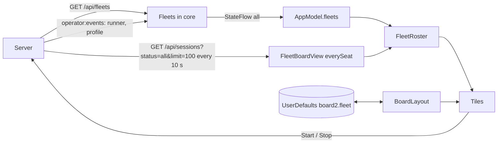

# Fleet board

The fleet board lays one fleet out as rows of tiles. A tile is either a member seat (with its live transcript and a message box) or a runner space (a slot of the fleet). The operator arranges rows, row heights, tile widths and gaps freely. The arrangement is kept per fleet on this Mac.

The board shows in the main window's detail, opened from the fleet's header in the seat list, or in a window of its own. The same fleet can be open in both; an edit in one shows in the other.

## How it works

### What the client calls a fleet

A fleet is a name (for example `lorem-fleet`) that the server lists with three things, read by the core into `Fleet`:

- **members**: declared members, each one a profile with this fleet (`FleetMember`: `id` of the profile, `name`, `role` (default `member`), `machine`, `status` (default `stopped`), and `seat`, the running seat's row id or null). The profile name is the seat title.
- **seats**: the fleet's running seats (`FleetSeat`: `id`, `title`, `origin`, `host`). `origin` is `manual` for members and `runner` for workers.
- **runners**: the fleet's slots (`FleetRunner`), live from the runner's heartbeat. A slot is named like `lorem-w1`; the app shows it as a runner space. Its `status` is `idle`, `busy`, `halted` or `missing` (no heartbeat for 75 s, per the model's comment; the 75 s is applied by the server, not by the client). In a live event it can also be `stopped`, when the runner closed cleanly. `seat` (a seat title) and `task` are set only while busy. Other fields: `host`, `channel`, `lane`, `task_source`, `model`, `since` (when the slot entered its status), `last_seen`. A runner whose JSON has neither `status` nor `state` reads as `missing`.

### Keeping fleets current

`Fleets` (core, `Fleets.kt`) is started with the client and feeds `AppModel.fleets`.



- On every (re)join of the `operator:events` topic and every `RECHECK_MS` (60 000 ms), the client reads `GET /api/fleets`. A failed read is logged ("fleets not read: ...") and the previous list stays.
- Between reads, a `runner` event replaces that slot in its fleet (the fleet is added if new), and a runner with status `stopped` removes the slot. A fleet that only exists because of a stopped runner is not created.
- A `profile` event (`op`, `profile`) replaces that member, moves it to its new fleet, or removes it when the profile is deleted or has no fleet. A fleet left with no members, seats or runners is dropped.

### FleetRoster

`FleetRoster` (in `macos/Claudiverse/FleetBoard.swift`) combines `AppModel.fleets` with a seat list. The board uses every seat, stopped ones too, because slots known only from old titles are learnt from stopped worker seats. It falls back to the main seat list until the first fetch returns.

- Where a title has several seat rows (a resumed seat registers a new row under the same title), the newest (highest id) wins.
- **Members** (`memberTitles`): the declared members' names, plus every other seat that is not a worker: not `origin == "runner"`, title not matching a runner title, and either `fleet` equal to this fleet or its title among the live fleet's non-runner seats. Each title once, sorted.
- **Slots**: the live runners' slots (sorted), then slots known only from titles. A worker's title looks like `ipsum-w7-t30450` (slot, then task); the slot is the part before `-t<digits>`, matched with `^(.+-w\d+)-t\d+$`. Titles count when the seat's fleet is this fleet or the title starts with `<fleet>-w`. These have no heartbeat yet.

### Tiles

| Tile | When | Shows |
|---|---|---|
| `SeatTile` | A member with a seat row, or a busy runner whose `seat` title is in the seat list | Header (status dot, seat label, caption, host, model), live transcript, message box |
| `MemberTile` | A declared member with no seat row to show | Profile status, role and machine, Start/Stop, Edit Profile |
| `RunnerSpaceTile` | A live runner space that is not busy in a known seat | Slot, status, host, lane or channel, model, since |
| `EmptyTile` | A tile on the board with nothing to show | Title and an explanation |

Tile choice for a member tile: if the title is a declared member and its `seat` id is in the seat list, a `SeatTile` (caption is the member's role); if declared without a findable seat, a `MemberTile`; if not declared but a member seat exists, a `SeatTile` without caption; otherwise an `EmptyTile`.

For a runner tile: if the slot has a heartbeat and is `busy` and the seat titled in `seat` is known, a `SeatTile` with caption `slot · task N · lane` (`lane`, else `channel`; parts left out when absent), for example `lorem-w1 · task 30450 · lorem-tasks`; otherwise a `RunnerSpaceTile`. A slot with no heartbeat is an `EmptyTile`.

**SeatTile.** The dot is `attention` colored when the seat needs the operator (a question or permission request, with an exclamation bubble whose help text is the request summary); muted when the seat's status is not `running`; otherwise busy-colored when its activity is `busy` and good-colored when not. The tile opens its own `SeatModel` when it appears, watches the seat only while the app is active (scene phase), and closes it when the tile goes away. The transcript and composer are the same ones as in the seat view; see [Transcript](transcript.md) and [Seat view](seat-view.md). Its ellipsis menu: "Open in New Window", "Show in Seats", "Remove from Board".

**MemberTile.** The dot color and the status text come from the profile status; `offline` reads "machine offline", `unregistered` reads "started, never registered", others show the status word as is. Buttons: "Start" (disabled while working or while the status is `starting` or `running`), or "Stop" instead when the status is `unregistered`, and "Edit Profile", which switches the main window to the Profiles section with that profile selected. Start calls `POST /api/profiles/<id>/start` and puts the returned profile into the profile store; Stop calls `POST /api/profiles/<id>/stop`. See [Profiles](profiles.md).

**RunnerSpaceTile.** Label text: "Idle", "Halted", "Missing: no heartbeat", "Busy" (plus " in <seat title>" when `seat` is set), or the capitalized status otherwise. A missing runner has a red label and a thicker (2 pt) red dashed border. The detail line joins host, lane (else channel), model and "since <relative time>".

**EmptyTile.** For a member: "Not in the seat list now (stopped? Turn Running only off to see stopped seats)." For a runner slot: "No heartbeat yet: its runner is not on the new cv-runner, or has not started."

Member, runner and empty tiles have an "x" button ("Remove from Board") in the header.

### Layout

`BoardLayout` is a list of rows. Each row has a height; each cell in a row holds a tile and a relative width (1 is normal). A tile identifies as `m:<seat title>` or `r:<slot>`, and a tile can be on the board once. Tiles refer to titles and slots, not ids, so a resumed seat keeps its place.

- Rows: height 140 to 1000 pt. Presets: small 220, medium 360, large 560.
- Widths: 0.25 to 6; a tile's width is its share of the row's width left after the gaps. Values outside are clamped.
- Gaps: between tiles (`columnGap`, default 12) and between rows (`rowGap`, default 12).
- Taking a tile off the board removes a row it leaves empty (except through the explicit "New Row", which can leave an empty row until a tile is dropped on it).
- The first board for a fleet starts empty. "Add" appends to the last row (new row of the given height if the board is empty); members are added with the large height and runner spaces with the small height when the board is empty.

Persistence: JSON in `UserDefaults` under `board2.<fleet>`, written on every change. On first load for a fleet, if there is no `board2.<fleet>` value, a legacy value under `board.<fleet>` (a flat list of tiles, a column count and one height) is read once into rows of that many columns. Two windows on the same fleet watch `UserDefaults` and adopt a saved layout that differs from theirs.

## Configuration

| What | Value |
|---|---|
| Layout key | `board2.<fleet>` (JSON `BoardLayout`); legacy `board.<fleet>`, read only |
| Fleets recheck | `RECHECK_MS` = 60 000 ms, plus on each rejoin of `operator:events` |
| Seat list refresh in the board | every 10 s, `GET /api/sessions?status=all&limit=100` |
| Row height | 140 to 1000; small 220, medium 360, large 560 |
| Tile width | 0.25 to 6; menu: Narrow 0.5, Normal 1, Wide 2 |
| Gap choices | 0, 4, 8, 12, 20, 32 pt; default 12 for both |
| "Place all" | members in large rows of two, then runner spaces in small rows of four; already placed tiles stay |
| Own-window default size | 1280 x 900, minimum 640 x 480 |

The layout lives only in this Mac's `UserDefaults`; it is not sent to the server.

## Interface

**Opening.** In the seat list, a fleet group's header has a button with the fleet name and a grid icon ("Open the <fleet> board" as help); its context menu has "Open Board" and "Open Board in New Window". Right-clicking a seat that has a fleet also offers "Open the <fleet> Board". `AppModel.openBoard(fleet)` clears the selected seat and sets `boardFleet`; the main window's detail (Seats section) shows the board. Selecting a seat again closes the board. In the board's toolbar, "Open in New Window" opens a window with id `board` for that fleet (hidden when the board is already in its own window).

**Header.** The title is "Fleet <fleet>". The subtitle reads "N members · B of S runner spaces busy", with " · no heartbeat yet" appended while the fleet has no live runner.

**Empty board.** "Nothing on the board" with the text "Add the fleet's members and runner spaces from the toolbar, or place them all at once: members large, runner spaces small." and a "Place all" button (disabled when there is nothing to place).

**Toolbar.**
- "Add" menu (accessibility label "Add to Board"): section "Members" (each title; the seat label when the seat is known; disabled once placed), section "Runner spaces" (`<slot> (<status>)`, or `(no heartbeat)`), then "New Row", "Place all" and "Clear the board".
- "Gaps" menu: "Between tiles: N pt" and "Between rows: N pt", each with the six choices.

**Rows and tiles.**
- Drag the gap between two tiles to move width from one to the other (help: "Drag to change the widths").
- Drag the strip below a row to change its height (help: "Drag to change this row's height (N pt)").
- The ellipsis at the right end of that strip (help: "Row height and order"): "Small (220)", "Medium (360)", "Large (560)", "Move Row Up", "Move Row Down", "Remove Row".
- A tile's context menu: Width: "Narrow", "Normal", "Wide"; Row: "Move to Row Above", "Move to Row Below", "Own Row" (disabled when the row has one tile); "Remove from Board". Moving up or down appends the tile to the end of that row, or makes a new row (same height) past either end. "Own Row" puts the tile in a new row just below, with the same height.
- Drag a tile (by its drag payload, the tile id) onto another tile to move it just before that tile, in any row. Drop it on a row's empty space to move it to the end of that row. An empty row shows "Empty row: drop a tile here, or remove it from the row's menu."

**REST and socket.**
- `GET /api/fleets` (key `fleets`, or a bare array): 

```json
{"fleets": [{"fleet": "lorem-fleet",
  "members": [{"id": 12, "name": "lorem-admin", "role": "orchestrator", "machine": "lorem-mac", "status": "running", "seat": 1201}],
  "seats": [{"id": 1201, "title": "lorem-admin", "origin": "manual", "host": "lorem-mac"}],
  "runners": [{"slot": "lorem-w1", "fleet": "lorem-fleet", "status": "busy", "host": "linux-box", "lane": "lorem-tasks",
    "seat": "lorem-w1-t30450", "task": 30450, "since": "2026-10-05T06:40:00.000Z"}]}]}
```

  Members, seats and runners that cannot be read are skipped; `members` may be absent.
- Socket topic `operator:events`, events `runner` (a `FleetRunner` payload) and `profile`.
- `GET /api/sessions` with `status=all` and `limit=100` for the board's seat list.
- `POST /api/profiles/<id>/start` and `POST /api/profiles/<id>/stop` for the member tile.

## Failure modes and troubleshooting

| Symptom | Cause | What to do |
|---|---|---|
| "Not started: <message>" or "Not stopped: <message>" in a member tile | The server refused or the request failed | Read the message; check the profile in [Profiles](profiles.md). |
| "Not in the seat list now (stopped? Turn Running only off to see stopped seats)." | A placed member is not in the seat list the board has | Start the seat, or remove the tile. |
| "No heartbeat yet: its runner is not on the new cv-runner, or has not started." | A slot known only from old runner titles | Start the runner or remove the tile. |
| Subtitle "no heartbeat yet" | No live runner in the fleet's data | Check that cv-runner is running and that you are connected ([Connecting](connecting.md)). |
| Runner tile "Missing: no heartbeat" | The server saw no heartbeat for the slot | Check the runner on its machine. |
| Fleet list does not change | Reads failing (logged as "fleets not read") or the socket is down | Wait for the next recheck (60 s) or reconnect. |
| Tile shows a member you did not expect | Any seat that is not a worker, with this fleet appears as a member | Remove it with "Remove from Board". |

## Related pages

- [Seat list](seat-list.md)
- [Seat view](seat-view.md)
- [Transcript](transcript.md)
- [Profiles](profiles.md)
- [Windows](windows.md)
- [Tasks](tasks.md)
- Server: [Tasks and runners](https://github.com/Promises/claudiverse/blob/main/docs/reference/server/tasks-and-runners.md)
- Runners and tools: [cv-runner: slots](https://github.com/Promises/claudiverse/blob/main/docs/reference/runners/runner.md), [cv-runner: claiming and reaping](https://github.com/Promises/claudiverse/blob/main/docs/reference/runners/runner-claim-and-reap.md)

## Source

- `macos/Claudiverse/FleetBoard.swift`
- `macos/Claudiverse/AppModel.swift`
- `macos/Claudiverse/SeatsSidebar.swift`
- `macos/Claudiverse/MainView.swift`
- `macos/Claudiverse/ClaudiverseApp.swift`
- `core/src/commonMain/kotlin/dev/claudiverse/core/Fleets.kt`
- `core/src/commonMain/kotlin/dev/claudiverse/core/Models.kt`
- `core/src/commonMain/kotlin/dev/claudiverse/core/Api.kt`
- `macos/ClaudiverseTests/BoardLayoutTests.swift`
- `core/src/commonTest/kotlin/dev/claudiverse/core/FleetsTest.kt`
