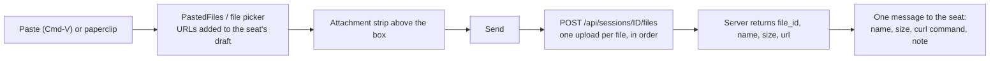

# Images

Images appear in a seat's conversation in two places: a picture the operator pasted into the seat's terminal, and a picture a tool returned (a Read of a PNG, a screenshot). The transcript shows each as a thumbnail, and a click opens an image viewer over the window. In the other direction, the operator can paste or attach images and files in the message box. The app uploads them to the server, and the seat gets a message telling it how to fetch each one.

The seat usually runs on another machine, so a local file path would mean nothing to it. The upload and fetch step is how a file crosses from the Mac to the seat.

## How it works

### Images in the transcript

The core library reads image blocks from a seat's transcript:

- A user message may carry image blocks next to its text. They become `TranscriptItem.UserText.images`. A terminal paste is text with an `[Image #3]` placeholder followed by the image; once an image shows, the placeholders are removed from the text, and the text and images share one bubble.
- A tool result may carry image blocks in its `content` array. They become `TranscriptItem.ToolUse.images`. A result image the core cannot read stays as the text `[image]` in the result.

Each image is a `TranscriptImage` with:

| Field | Meaning |
|---|---|
| `mediaType` | `source.media_type`, for example `image/png`. Defaults to `image/png` when the block has none. |
| `url` | Set when the block's source type is `url`: a server-relative path to a file in the server's store, such as `/api/files/<id>`. |
| `base64` | Set when the source type is `base64`: the image inline. |
| `size` | Bytes, read from the block's `size` when the source is a `url`. |

A block with any other source type, or an empty `url` or `data`, is dropped.

`TranscriptImageView` shows one image as a thumbnail:

- A stored image (`url` set) is fetched with `GET <server base URL><url>` and the header `Authorization: Bearer <token>`, with the app's token (a `super` token). A response outside 200 to 299 fails with the text `HTTP <status>`.
- An inline image is decoded from base64.
- The thumbnail is at most 360 points wide and 260 points tall, and never larger than the image itself. Corners are rounded.
- While the image loads, a small progress indicator shows.

`TranscriptImages` caches the result. It holds two `NSCache` instances, one of decoded `NSImage` objects and one of the raw bytes, both keyed by the image's cache key. The cache key is the image's `url` when it has one (a stored file never changes), otherwise the item's key plus its position, `<item key>#<index>`. Every new message redraws the visible rows, and the cache stops a stored image from being fetched again each time. The code sets no size limit and no eviction rule of its own; `NSCache` frees entries under memory pressure. Copy, Save and Open work from the cached bytes, so only an image already shown can be copied, saved or opened.

Tool-result thumbnails sit in a horizontally scrolling row under the tool's disclosure row. Pasted-image thumbnails sit above the message text in the bubble.

### The image viewer

`ImageViewer.swift` defines one viewer per window. `.imageViewer()` on a window's root view creates an `ImageViewerModel` and draws the viewer as an overlay above everything in the window. A transcript opens it through the `showImage` environment action, which it sets for its own view tree. Where no transcript supplies the action, a click on a thumbnail opens the image in Preview instead.

When opened, the viewer gets every image in the transcript, oldest first: pasted images and tool-result images. Each has a caption: `You` for a pasted image or `<tool name> · <tool summary>` for a tool result, followed by ` · ` and the time when the entry has one, for example `You · 21:53`.

The viewer is a dark backdrop (black at 90% opacity) with the image fitted to the space. It is never scaled past twice its own size. A header shows the caption, with `· <n> of <total>` appended when there is more than one image, and these buttons:

| Control | Help text | Action |
|---|---|---|
| Copy icon | `Copy Image` | Puts the image on the general pasteboard. |
| Download icon | `Save to Downloads` | Writes a copy to the Downloads folder and reveals it in Finder. |
| Open icon | `Open in Preview` | Writes a temporary file and opens it with the default app. |
| X icon | `Close (Esc)` | Closes the viewer. |

Left and right arrow buttons at the window edges step to the previous or next image; the keys ← and → do the same. An arrow is hidden and disabled at either end of the list.

Zoom: double-click the image to toggle between fitted size and 2.5 times; pinch zooms between 1 and 8 times. Scrolling pans, and only while zoomed in. A single click on the image does nothing. A click on the backdrop, or Esc, closes the viewer.

If the image cannot be loaded, the viewer shows `Image not loaded: <reason>` in place of the picture.

Saved files are named from the cache key: every character that is not a letter, digit or `-` becomes `_`, leading and trailing `_` are trimmed, and the extension comes from the media type (`png` if unknown). A stored image keyed by `/api/files/X9z2` is saved as `api_files_X9z2.png`. Open in Preview writes to a `Claudiverse-images` folder in the system temporary directory under the same naming.

### Sending images and files



**Paste.** `ComposerField` overrides paste. `PastedFiles.read` checks the pasteboard in this order:

1. File URLs on the pasteboard (files copied in Finder) are attached as themselves.
2. Otherwise, if the pasteboard holds no text and has an image (a screenshot, "Copy Image" in a browser), the image is converted to PNG and written to a file. A PNG on the pasteboard is used as is; other formats go through TIFF to PNG.
3. Otherwise the paste is plain text. Copied text that also carries a picture of itself, as spreadsheet cells do, stays text.

Paste stays enabled for a pasteboard holding only an image, which a plain-text view would refuse.

A pasted image is written to `Pasted/` inside the app's support folder (`~/Library/Application Support/Claudiverse/Pasted`; a build with a bundle id `dev.claudiverse.desktop.<suffix>` uses `Claudiverse <suffix>` instead of `Claudiverse`, except the `.tests` id). It is not in the temporary folder, because a draft can keep the image across days and restarts. The file name is `Pasted image <yyyy-MM-dd> at <HH.mm.ss> <4 characters>.png`; the random suffix keeps two pastes in one second apart.

**Paperclip.** The paperclip button opens a file picker that allows any file and several at once. It is disabled while an upload runs.

**Draft and strip.** Attachments belong to the seat's draft, stored in `UserDefaults` under the key `drafts` as file paths, with the typed text. They survive switching seats, closing a window and quitting. At launch, attachments whose file no longer exists are dropped. The attachment strip shows each file above the box: a 32-point thumbnail (the image itself, or the file's icon), the file name (truncated in the middle, at most 180 points wide) and an X button with the help text `Remove`.

**Stale pastes.** When the app signs in and starts running, `Drafts.removeStalePastes` deletes files in the `Pasted` folder that no draft refers to and that were last modified more than 7 days ago. Pasted files in a draft are never removed.

**Send.** The send button is enabled when there is text or at least one attachment. With no attachments the text goes as an ordinary message. With attachments, `SeatSession.sendFiles(files, note)` runs with the typed text as the note, and the draft is cleared. Each file is uploaded in order, one after another, with its content type taken from the file extension. If any upload fails, nothing is sent. Once all uploads succeed, one message goes through `send`, so it queues while the seat is busy.

**Message to the seat.** For one file:

```
The operator sent you a file: shot.png (2048 bytes). Fetch it with:
curl -fsS -H "Authorization: Bearer $CLAUDIVERSE_TOKEN" "$CLAUDIVERSE_URL/api/files/1" -o shot.png

look at this
```

For several, the lead line is `The operator sent you 2 files:`, each entry is numbered (`1. `, `2. `), entries are separated by a blank line, and the note comes last after a blank line. The note is trimmed and left out when blank. The `-o` name is the file name with every character outside `A-Za-z0-9._-` replaced by `_` (`file` if empty). The seat's environment is expected to provide `CLAUDIVERSE_TOKEN` and `CLAUDIVERSE_URL`.

## Configuration

| Item | Value |
|---|---|
| Thumbnail limit | 360 x 260 points |
| Viewer backdrop | black at 90% opacity |
| Viewer fit | up to 2x the image's own size |
| Double-click zoom | 2.5x, toggles back to 1x |
| Pinch zoom range | 1x to 8x |
| Draft store | `UserDefaults` key `drafts` |
| Pasted folder | `Pasted` in the app support folder |
| Stale paste age | 7 days |
| Downloads copy | Downloads folder |

## Interface

**Transcript thumbnail.** Click opens the viewer. The context menu has `Open`, `Open in Preview`, `Copy Image` and `Save to Downloads`. The help text is `Click to view`.

**Message box.** Paperclip button (help text `Attach files (or paste them)`), the text field, and the send button. Placeholder text is `Message`, or `Message (queued until the seat is idle)` when the seat is busy or has queued messages. While sending or uploading, a progress indicator replaces the send button.

**Upload request.**

```
POST /api/sessions/<seatId>/files
Content-Type: multipart/form-data

part "file": filename="shot.png", Content-Type: image/png
```

The reply the client reads:

```json
{ "file_id": "1", "name": "shot.png", "size": 2048, "url": "/api/files/1" }
```

`file_id` and `url` are required. `name` falls back to the uploaded file's name and `size` to 0. The client sends the app's token (a `super` token, see [Connecting](connecting.md)) as for any other call.

**Stored image fetch.** `GET <base URL>/api/files/<id>` with `Authorization: Bearer <token>`.

## Failure modes and troubleshooting

| Text | Cause | What to do |
|---|---|---|
| `Image not loaded: not an image` | The bytes (or the inline base64) do not decode as an image. | Open the file elsewhere; check what the seat wrote. |
| `Image not loaded: HTTP <status>` | The server refused or lacked the stored file. | Check the token and that the server still has the file. |
| `Image not loaded: <system error>` | Network failure, or a bad URL. | Check the server address in the connection settings. |
| `File not sent: <reason>` / `Files not sent: <reason>` | An upload failed, so no message was sent. The draft is cleared on send, so the attachments are no longer in it. | Attach the files again. |
| `File not sent: this server cannot take files yet` | The upload endpoint returned 404. | The server is older than the upload feature; update it. |

Other cases: Copy, Save and Open do nothing for an image that has not finished loading. A pasteboard with both text and an image pastes the text. An attachment whose file was deleted before launch is dropped silently.

## Related pages

- [Transcript](transcript.md)
- [Seat view](seat-view.md)
- [Windows](windows.md)
- [Settings](settings.md)
- Server: [App builds and seat files](https://github.com/Promises/claudiverse-oss/blob/main/docs/reference/server/app-builds-and-seat-files.md)
- Android: [Seat controls](../android/seat-controls.md)

## Source

- `macos/Claudiverse/ImageViewer.swift`
- `macos/Claudiverse/TranscriptView.swift`
- `macos/Claudiverse/ComposerField.swift`
- `macos/Claudiverse/Drafts.swift`
- `macos/Claudiverse/SeatDetailView.swift`
- `core/src/commonMain/kotlin/dev/claudiverse/core/Transcript.kt`
- `core/src/commonMain/kotlin/dev/claudiverse/core/Models.kt`
- `core/src/commonMain/kotlin/dev/claudiverse/core/Api.kt`
- `core/src/commonMain/kotlin/dev/claudiverse/core/SeatSession.kt`
