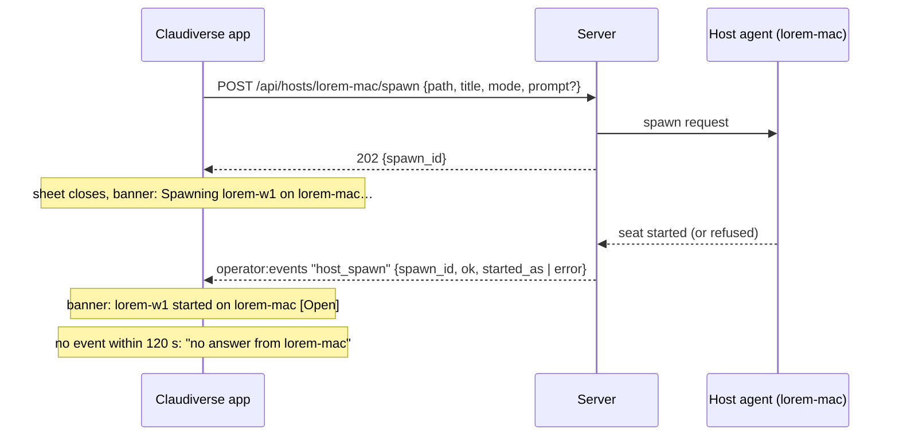

# New seat

"New seat" is the sheet that starts a Claude Code seat on a machine. The app does not start anything itself: it asks the machine's host agent, through the server, to spawn the seat. The sheet collects what the agent needs (a machine, a folder, a title, a permission mode and an optional first prompt) and checks what it can before asking.

The sheet closes as soon as the server accepts the request. The result (started or failed) arrives later and is shown in a banner at the bottom of the main window.

Open it with the toolbar button "New seat" (help text: "Start a seat on a machine (⌘N)") or with ⌘N.

## How it works

**Machine.** The sheet calls `GET /api/hosts` and lists every machine that has a host agent. The first online machine is picked. An offline machine is listed as `<name> (offline) · <n> seats` and cannot be selected. Picking a machine loads its recent folders (`GET /api/hosts/<host>/recent_dirs`) and lists its allowed folders. If a reload finds the picked machine offline, the pick moves to the first online machine.

**Folder.** Two tabs: Recent and Browse.

- Recent lists the folders past seats on that machine worked in, newest first, with the time of last use and, when any seat is still running there, "`<n>` running". A folder outside the machine's allowed folders is shown dimmed with "Outside this machine's allowed folders" and cannot be picked. The first allowed recent folder is preselected. If the machine has no allowed recent folder, the sheet opens on Browse.
- Browse starts at the list of the machine's allowed folders ("Allowed folders" in the breadcrumb bar). Selecting one lists its subfolders (`GET /api/hosts/<host>/ls?path=…`). The breadcrumbs start at the allowed folder that holds the current folder (labelled with its full path), then one crumb per segment. Nothing above a root is offered, because the agent would refuse it. When roots are nested, the deepest root that holds the path is the base. "Up" goes to the listing's parent; it is hidden on the roots list. The folder you are in is the folder the seat starts in.

The folder under the list is summarised as "Starts in `<path>`", or "Pick a folder inside the machine's allowed folders." when none is chosen.

**Title.** The title follows the folder: it is the folder's last path segment, with every character outside `[A-Za-z0-9._-]` replaced by `-`, leading and trailing `-` and `.` trimmed, cut to 64 characters (`seatTitleFor`). `~/.config` gives `config`. Typing in the field stops this: the title no longer follows the folder, even if cleared.

**Permission mode.** A picker with `SessionChoices.modes`, default Auto:

| Label | Value sent |
|---|---|
| Default | `default` |
| Accept edits | `acceptEdits` |
| Plan | `plan` |
| Auto | `auto` (selected initially) |

**First prompt.** Optional, 2 to 6 lines. Surrounding whitespace is trimmed and a blank prompt is not sent.

**Start seat.** The button is enabled when no spawn is running, a machine is picked, the folder is valid and the title is not blank. It calls `POST /api/hosts/<host>/spawn`. The server answers 202 with a `spawn_id`; that only means the request was accepted. The sheet then closes.

**Outcome.** `SpawnTracker` (in `ClaudiverseClient.spawns`) joins the `operator:events` topic on the first spawn or resume and waits for a `host_spawn` event whose `spawn_id` matches. Starting a seat can take up to 90 s (the API comment); the tracker gives up after `GIVE_UP_MS` (120 000 ms) and reports `no answer from <host>`. An outcome that arrives before its 202 is matched when the 202 arrives; the tracker keeps the latest 16 such early outcomes.



(The server-to-agent legs are inferred from the client's descriptions; the client sees only the 202 and the event.)

The same tracker serves resuming a stopped seat (`POST /api/sessions/<id>/resume`, event `op` "resume"). One notice is held at a time; a new spawn or resume replaces it.

## Configuration

The sheet stores nothing in UserDefaults. Defaults and constants:

| Item | Value |
|---|---|
| Sheet size | 640 x 640 |
| Permission mode | `auto` |
| Title | the folder name, until edited |
| First tab | Recent, or Browse when no recent folder is allowed |
| `GIVE_UP_MS` | 120 000 |
| Early outcomes kept | 16 |
| Socket topic | `operator:events` |

Server-side switches the client depends on:

- The machine's allowed folders (`roots` in `GET /api/hosts`). With none, the sheet says: "This machine allows no folders yet. Add one in Settings › Machines, or in the machine's own agent config."
- `allow_remote_roots` in the machine's host agent config (`remote_roots` in the hosts reply, `Host.remoteRoots`). Without it the app cannot add allowed folders on that machine.
- Spawning needs an app or super token (API comment).

### Allowing a folder

The New seat sheet itself has no control to add a folder. It points to Settings › Machines, which accepts an absolute path. A second control, `AllowFolderView`, is used by the adopt sheet (see [Adopt](adopt.md)) and works like this:

- It shows the seat's folder as a breadcrumb of path segments. Selecting a segment selects that level (the whole path at first). The button reads "Allow `<chosen path>`" and "Allowing…" while it runs.
- The whole disk is not offered: there is no crumb for `/`. When the choice is two segments or fewer, it warns "That allows seats almost anywhere in your home folder."
- If the machine lacks `allow_remote_roots`, it says: `<host> doesn't accept folders from the app yet: set "allow_remote_roots": true in its host agent's config.`
- `Api.allowFolder` does nothing if an allowed folder already holds the path (by whole segments: `/a/bc` is not inside `/a/b`). Otherwise it calls `addRoot`, then `removeRoot` for each allowed folder inside the new one. The parent is added first, so no folder is ever uncovered.

## Interface

Controls, top to bottom:

| Control | Notes |
|---|---|
| Machine picker | `<name> · <n> seats`; offline ones disabled |
| Folder: Recent / Browse | segmented control |
| Browse: "Allowed folders" link, crumbs, "Up", subfolder rows | "No subfolders." / "No allowed folders." when empty; "More folders than shown." when the listing is truncated |
| Title | text field |
| Permission mode | picker |
| First prompt (optional) | multi-line field |
| Cancel | Escape |
| Start seat | Return; spinner while spawning |

Other messages: "No machine has a host agent yet.", "No recent folders on this machine."

Endpoints:

| Call | Method and path |
|---|---|
| `hosts()` | `GET /api/hosts` |
| `recentDirs(host)` | `GET /api/hosts/<host>/recent_dirs` |
| `listDir(host, path)` | `GET /api/hosts/<host>/ls?path=<path>` (empty path lists the roots) |
| `spawn(...)` | `POST /api/hosts/<host>/spawn` |
| `addRoot` | `POST /api/hosts/<host>/roots` `{"path": …}` |
| `removeRoot` | `DELETE /api/hosts/<host>/roots` `{"path": …}` |
| `resumeSeat(id)` | `POST /api/sessions/<id>/resume` |

Fields the client reads: a host has `name`, `online`, `seats`, `roots`, `remote_roots`. A recent folder has `path`, `last_used_at`, `seats_running`. A listing has `path`, `parent`, `dirs`, `truncated`. `addRoot` and `removeRoot` answer with `roots`.

```
POST /api/hosts/lorem-mac/spawn
{"path": "/home/me/projects/lorem-app", "title": "lorem-app", "mode": "auto", "prompt": "Run the tests."}

202
{"spawn_id": "..."}
```

`prompt` is left out when blank. The event:

```
topic operator:events, event host_spawn
{"spawn_id": "...", "ok": true, "op": "spawn", "title": "lorem-app", "started_as": 42}
{"spawn_id": "...", "ok": false, "error": "..."}
```

For a resume the row id is `resumed_as`. A row id of 0 or less is ignored.

### The banner

`SpawnBanner` is a capsule at the bottom of the main window. States, with `SpawnOp` wording:

| State | Spawn | Resume |
|---|---|---|
| Pending | `Spawning <title> on <host>…` (spinner) | `Resuming <title> on <host>…` |
| Started | `<title> started on <host>` | `<title> resumed on <host>` |
| Failed | `<title> not started on <host>: <error>` | `<title> not resumed on <host>: <error>` |

On Started, an "Open" button selects the seat and dismisses the banner. It uses the event's row id, else a running seat with the same title; with neither, there is no button. The x button dismisses the banner. A title in the event replaces the one you typed. A failure without an error text says `spawn failed` or `resume failed`.

## Failure modes and troubleshooting

Sheet messages, verbatim:

| Message | Cause |
|---|---|
| This server can't spawn seats yet. | `GET /api/hosts` returned 404: the server is too old. |
| Machines not loaded: `<message>` | Any other failure loading machines. |
| Outside this machine's allowed folders | Listing returned 403. |
| Folder not found | Listing returned 404. |
| The machine did not answer (offline?) | Listing returned 504. |
| Not listed: `<message>` | Other listing failure. |
| Not spawned: `<reason>` | 400. `<reason>` is the server's text after the first ": " (the part after `HTTP 400: `). |
| Not spawned: the folder is outside `<host>`'s allowed folders, or this client may not spawn | 403. Allow the folder, or use a token that may spawn. |
| Not spawned: unknown machine or folder | 404. |
| Not spawned: `<host>` is rate-limited, try again in a few seconds | 429. |
| Not spawned: `<host>` did not answer (offline?) | 504. |
| Not spawned: `<message>` | Any other status. |

The host agent's refusal codes (`outside_roots`, `not_allowed`, ...) are relayed by the server and kept in `ApiException.code`. The New seat sheet does not read `code`: it words errors by HTTP status only. Folder allowing does the same: 403 "Not allowed: `<host>`'s agent doesn't accept folders from the app ("allow_remote_roots" is off in its config).", 404 "Not allowed: `<chosen>` doesn't exist on `<host>`.", 504 "Not allowed: `<host>` is offline.", else "Not allowed: `<message>`". In Settings › Machines the texts are "`<host>` refused: it does not allow folders to be added remotely.", "No such folder on `<host>`.", "`<host>` did not answer (offline?).", "The path must be absolute." (400), else "Not added: `<message>`".

After the sheet closes, failures appear in the banner with the host agent's own `error` text. `no answer from <host>` means no `host_spawn` event came in 120 s: check that the machine is online and the app's socket is connected (see [Connecting](connecting.md)). The seat may still start late; the banner will not update after the timeout.

Machine unavailable: the machine is offline (listed but disabled). If every machine is offline, nothing is picked and the Start seat button stays disabled.

## Related pages

- [Adopt](adopt.md)
- [Seat list](seat-list.md)
- [Profiles](profiles.md)
- [Connecting](connecting.md)
- [Settings](settings.md)
- [Keyboard shortcuts](keyboard-shortcuts.md)
- Server: [Profiles and the host channel](https://github.com/Promises/claudiverse-oss/blob/main/docs/reference/server/profiles-and-hosts.md)
- Runners and tools: [cv-mcp: lifecycle tools](https://github.com/Promises/claudiverse-oss/blob/main/docs/reference/runners/mcp-lifecycle.md)
- Host agent: [Roots and folder browsing](https://github.com/Promises/claudiverse-host-agent-oss/blob/main/docs/reference/roots.md), [Starting seats](https://github.com/Promises/claudiverse-host-agent-oss/blob/main/docs/reference/starting-seats.md)
- Android: [New seat (spawning a seat)](../android/new-seat.md)

## Source

- `macos/Claudiverse/NewSeatView.swift`
- `macos/Claudiverse/AllowFolder.swift`
- `macos/Claudiverse/MainView.swift`
- `macos/Claudiverse/MachinesSettings.swift`
- `core/src/commonMain/kotlin/dev/claudiverse/core/NewSeat.kt`
- `core/src/commonMain/kotlin/dev/claudiverse/core/SpawnTracker.kt`
- `core/src/commonMain/kotlin/dev/claudiverse/core/Folders.kt`
- `core/src/commonMain/kotlin/dev/claudiverse/core/Api.kt`
- `core/src/commonMain/kotlin/dev/claudiverse/core/Models.kt`
