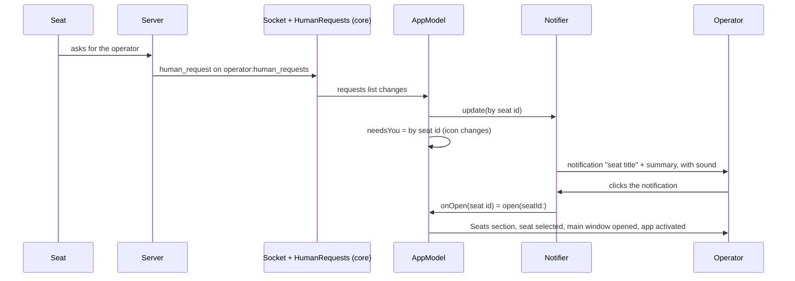

# Notifications and the menu bar

A seat can ask for the operator: it stops and wants a person. The Mac app tells the operator in three places, and two of them work with the main window closed: a macOS notification, a menu bar icon with a panel listing the seats that are asking, and a number on the Dock icon.

The app keeps running with all windows closed, because the menu bar extra stays. That is what lets a request reach the operator when no Claudiverse window is open.

## How it works

### Where requests come from

The core class `HumanRequests` keeps the open requests. It joins the socket channel `operator:human_requests` and reads `GET /api/human_requests?status=open` on every successful (re)join and every 120 000 ms (`RECHECK_MS`), so a request that arrived while the socket was down is still found. There is at most one open request per top-level seat; a seat that asks again updates its request.

A `HumanRequest` has these fields (read from the JSON as shown):

| Field | JSON key | Notes |
|---|---|---|
| `id` | `id` | required |
| `sessionId` | `session_id` | the seat's id, required |
| `seatTitle` | `seat_title` | |
| `summary` | `summary` | |
| `detail` | `detail` | optional |
| `insertedAt` | `inserted_at` | optional, ISO timestamp |
| `updatedAt` | `updated_at` | optional, ISO timestamp |

`AppModel` collects `humanRequests.requests` (a list, newest change first; a Kotlin map keyed by `Long` crashed Swift) and turns it into a dictionary keyed by seat id. It hands that dictionary to `Notifier.update` and stores it as `needsYou`. The menu bar icon, the seat list rows and the board read `needsYou`.

How requests are answered and resolved, and what the REST and socket calls look like, is in [Questions and permissions](questions-and-permissions.md). In short: opening the seat while it is watched resolves its request, and a resolved request leaves `needsYou`.

### From a seat's request to the seat



### Notifier

`Notifier` is the delegate of `UNUserNotificationCenter`. `AppModel` is created with one, and wires `onOpen` to `AppModel.open(seatId:)`.

**Permission.** When the operator is signed in (`begin()` in `AppModel`), the app calls `Notifier.requestPermission()`. It asks for `.alert`, `.sound` and `.badge`, then reads the notification settings. `allowed` is true only when the authorization status is `.authorized` and the alert setting is `.enabled`. `allowed` is nil until this is known. The result is also logged ("notifications: granted=... authorization=... alerts=...").

**Once per request.** `Notifier` remembers, per seat id, a stamp `"<request id>@<updatedAt>"` (an empty string when `updatedAt` is missing). A seat whose stamp is unchanged is skipped. So the operator is told again when:

- the seat's request is a new one (a different `id`), or
- the same request changed (a new `updatedAt`, which is what asking again does).

A seat is "already told" once its stamp is stored, whether or not a notification was posted. The first call to `update` after the app starts only records the stamps and posts nothing; its comment says this is because requests open at launch "were seen elsewhere".

**Resolved removes the notification.** A seat that is no longer in the open set loses its stamp, and its delivered notification (identifier `seat-<seat id>`) is removed from Notification Center. The notification identifier is per seat, so a repeated request replaces the earlier banner instead of stacking.

**Content.**

| Part | Value |
|---|---|
| Title | the request's `seatTitle` |
| Body | the request's `summary` |
| Sound | "Claudiverse Poke.caf" |
| `userInfo` | `seat` = the seat id |

The sound is the app's own `poke.caf` from the bundle. `Notifier.installSound()` copies it to `~/Library/Sounds/Claudiverse Poke.caf` at start (when missing or different), because Notification Center looks sounds up in the system and user sound folders, not in the app bundle. If the copy fails, the app logs "notification sound not installed" and the default sound plays.

The repository does not contain `poke.caf`, and `macos/project.yml` adds no `Sounds` folder, so a build from this repository has no sound to copy: `installSound()` returns without doing anything, and macOS plays its default sound for a sound name it cannot find. Add the file to the app target to get the poke.

**Clicking.** A click calls `AppModel.open(seatId:)`: the section becomes Seats, the seat is selected, the main window is opened (`openMainWindow`) and the app is activated. The request is then resolved by the seat view as described in the sibling page, once the seat is watched.

**While the app is frontmost.** The delegate's `willPresent` returns `[.banner, .sound]`, so the notification is shown and plays even when Claudiverse is in front. The comment gives the reason: the seat that asked may not be the one on screen.

**Dock badge.** After each update, the Dock tile badge is the number of open requests, or empty when there are none.

**`recheck` and System Settings.** `Notifier.recheck()` reads the settings again, since the operator may have changed them in System Settings. `Notifier.openSettings()` opens `x-apple.systempreferences:com.apple.Notifications-Settings.extension?id=tech.henning.claudiverse`, System Settings › Notifications at this app.

### The menu bar extra

`ClaudiverseApp` declares a `MenuBarExtra` with the `.window` style next to the main window. Its icon is an SF Symbol:

| State | Symbol |
|---|---|
| `needsYou` is empty | `sparkles` |
| at least one seat is asking | `exclamationmark.bubble.fill` |

### Per-seat paging switch

Whether a seat may page the operator at all is a per-seat setting (the bell in the seat list, the switch in the seat view). This page does not cover it; see [Seat view](seat-view.md) and [Seat list](seat-list.md).

## Configuration

| Item | Value | Where |
|---|---|---|
| Socket channel | `operator:human_requests` | `HumanRequests.TOPIC` |
| Recheck interval | 120 000 ms | `HumanRequests.RECHECK_MS` |
| Permissions asked | alert, sound, badge | `Notifier.requestPermission` |
| Notification identifier | `seat-<seat id>` | `Notifier` |
| Sound | `~/Library/Sounds/Claudiverse Poke.caf`, from the bundle's `poke.caf` | `Notifier.installSound` |
| Menu bar panel width | 340 points | `MenuBarView` |
| Summary lines in the panel | 3 | `MenuBarView` |

There are no UserDefaults keys for notifications. The switch lives in macOS: System Settings › Notifications › Claudiverse.

## Interface

### Menu bar panel

From top to bottom:

- Header: "Claudiverse", and on the right a dot with a word. The dot is `Theme.good` and "live" when the socket is connected, `Theme.muted` and "offline" when not (`model.socketConnected`).
- The notifications-off note, when it applies (see below).
- The list, by sign-in state:
  - signed in, no requests: "No seat is asking for you."
  - signed in, requests: one row per seat, sorted by `updatedAt` descending (a missing `updatedAt` sorts last). A row shows the seat title in semibold, the relative time on the right (from `updatedAt`, else `insertedAt`) and the summary below, at most 3 lines. A click on the row calls `AppModel.open(seatId:)`.
  - signed out: "Not signed in."
  - starting: a small progress spinner.
- Buttons: "Open Claudiverse" opens the main window and activates the app; "Quit" terminates the app.

### Notifications-off note

`NotificationsOffNote` shows only when `Notifier.allowed == false` (not while it is nil). It is a `bell.slash` icon, the text

> Notifications are off for Claudiverse: seats asking for you will not alert you.

and a button "Open Notification Settings", which calls `Notifier.openSettings()`. When it appears, it calls `recheck()`. It is shown in the menu bar panel and in Settings › Account (below "This Mac").

### Endpoints and events

| Use | Call |
|---|---|
| Read open requests | `GET /api/human_requests?status=open`, reading `requests` |
| Resolve a seat's requests | `POST /api/sessions/<seat id>/human_requests/resolve` |
| Live | socket channel `operator:human_requests`, events `human_request` and `human_request_resolved` |

Example of one entry in `requests`:

```json
{
  "id": 41,
  "session_id": 7,
  "seat_title": "lorem-w1",
  "summary": "Needs a decision on the migration order",
  "detail": null,
  "inserted_at": "2026-01-01T10:00:00Z",
  "updated_at": "2026-01-01T10:05:00Z"
}
```

The test harness can post a notification without a seat: the `notify` command takes `title` and `body` (defaults "Claudiverse harness" and "A test notification from the harness.") and uses the same sound. See [Test harness](test-harness.md).

## Failure modes and troubleshooting

| Symptom | Cause | What to do |
|---|---|---|
| Panel and Settings show "Notifications are off for Claudiverse: seats asking for you will not alert you." | macOS notifications for the app are not authorized, or alerts are not enabled. | Press "Open Notification Settings" and allow notifications with alerts. The note re-reads the setting when it appears. |
| No sound, or the default sound | `poke.caf` is not in the bundle (it is not in the repository) or the copy to `~/Library/Sounds` failed (log: "notification sound not installed"). | Check the log; make sure `~/Library/Sounds` is writable. |
| A seat is asking but there is no notification | The request was already open at launch (the first update only records), or the stamp is unchanged, or alerts are off. | Open the panel: the request is listed regardless. |
| Request in the list never appears at all, log has "human requests not read" | The REST read failed; a 404 means the server has no human-request endpoints. | See [Questions and permissions](questions-and-permissions.md). |
| Panel says "offline" | The socket is not connected. Requests are still found by the REST read every 2 minutes and on rejoin. | See [Connecting](connecting.md). |
| Panel says "Not signed in." | The operator is signed out; requests are not watched. | Sign in. |

## Related pages

- [Questions and permissions](questions-and-permissions.md)
- [Seat view](seat-view.md)
- [Seat list](seat-list.md)
- [Settings](settings.md)
- [Windows](windows.md)
- [Test harness](test-harness.md)
- Server: [Human requests](https://github.com/Promises/claudiverse/blob/main/docs/reference/server/human-requests.md)
- Runners and tools: [cv-mcp: seat, ping and question tools](https://github.com/Promises/claudiverse/blob/main/docs/reference/runners/mcp-seats.md)
- Android: [Notifications: seats that need you](../android/notifications.md)

## Source

- `macos/Claudiverse/Notifier.swift`
- `macos/Claudiverse/MenuBarView.swift`
- `macos/Claudiverse/AppModel.swift`
- `macos/Claudiverse/ClaudiverseApp.swift`
- `macos/Claudiverse/SettingsView.swift`
- `macos/Claudiverse/Harness.swift`
- `core/src/commonMain/kotlin/dev/claudiverse/core/HumanRequests.kt`
- `core/src/commonMain/kotlin/dev/claudiverse/core/Models.kt`
- `core/src/commonMain/kotlin/dev/claudiverse/core/Api.kt`
