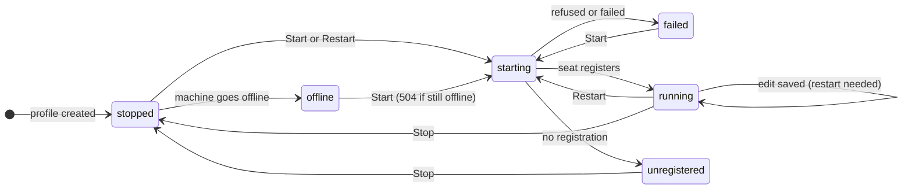

# Profiles

A profile is one server-side record per managed seat. It holds everything the machine's host agent needs to start that seat: the machine, the folder, the fleet, the role, the runtime, the model, the permission mode, the MCP servers and which conversation to continue. The Profiles section of the main window lists the profiles, shows a status derived by the server for each, and lets the operator edit a profile and start, stop, restart, rename or delete it.

A profile is not a seat. The seat is the running Claude Code session; the profile is the recipe it is started from, and it outlives the seat. Editing a profile changes the next start, never a seat that is already running.

## How it works

The app reads all profiles with `GET /api/profiles` each time it joins (or rejoins) the `operator:events` socket topic and every 60 seconds (`RECHECK_MS = 60_000`). Between those reads, each live `profile` event on that topic changes the list. The list is kept in name order, case-insensitive. An event never replaces a profile with an older `revision` than the one the app has, because an event can arrive after the reply to a later edit.

The `status` of a profile is derived by the server from the profile's last start and the seat started from it. The client only reads it. These are the values it knows:

| Status | Meaning (as the client documents it) | Dot colour |
| --- | --- | --- |
| `running` | A seat started from the profile is up and registered. | good (green theme colour) |
| `starting` | A start was asked for and has no outcome yet. | busy |
| `unregistered` | The machine started the seat but it never registered with the server, for example it sits at a prompt in tmux. | attention |
| `offline` | The profile's machine is offline. | muted |
| `failed` | The last start was refused, failed or found the machine offline. | bad |
| `stopped` | None of the above. A profile without a `status` reads as `stopped`. | muted |

Any status the app does not know gets the muted colour and is shown as its own name.



The diagram shows the transitions the client's buttons and documentation imply. The server decides the status; it can differ from the diagram, for example `offline` can follow any state while the machine is away.

`restart_needed` is a separate flag, not a status: it is true when the running seat started from an older `revision` than the profile now has. The row shows a circular arrow and the editor says "Edited since its seat started: restart to apply."

The last start (`last_start`) is a fact about that start and stays "started" after the seat stops. Its `outcome` is `starting`, `started`, `refused`, `failed` or `offline`.

### Saving and conflicts

Every profile has a `revision`. An edit sends the revision the editor read. If another client saved in between, the server answers 409 with the current profile, and the app merges (`ProfileFields.merge`, a three-way merge):

- A field only the operator changed (relative to what the editor read) keeps the operator's value.
- A field only the other save changed takes the server's value.
- A field both changed, to different values, keeps the operator's value and is named as a conflict.

After a conflict the editor adopts the server's revision, shows the merged draft and does not save by itself. With no conflicting fields the notice reads "Someone saved this profile after you opened it. Their changes are merged in and yours are kept: save again." With conflicting fields a "Changed elsewhere too" section lists each one with the other save's value and a "Take Theirs" button. Press Save again when satisfied.

If the profile is changed elsewhere while the editor has no edits and no conflicts, the editor silently shows the new version.

### Rename

The name (the seat's title and tmux session) is fixed at creation, but "Rename…" changes it through `POST /api/profiles/{id}/rename`. The server moves the seat's past seats, watch lists, queued pings, watchers, forum subscriptions, handoffs, handoff versions and open tasks to the new name. A running, idle seat is stopped and started again under the new name on the same conversation; the server answers 202 in that case, and the sheet says it takes about ten seconds. What names the old name elsewhere (scripts, scheduled jobs, prompts, memories, messages sent to it) is not followed.

## Configuration

There are no settings for this section. The app persists one related key:

| UserDefaults key | Default | Meaning |
| --- | --- | --- |
| `section` | `Seats` | Which section the main window shows (`Seats`, `Profiles`, `Forum`, `Tasks`, `Pool`). |

Profile defaults for a new profile (`ProfileDraft.new`, the server's defaults):

| Field | Default |
| --- | --- |
| Machine | the first online machine, else the first machine |
| Folder | empty |
| Fleet | none |
| Role | `member` |
| May page the operator (`can_notify`) | off |
| Runtime | `stock+mod` |
| Model, Effort | unset (Claude Code's default) |
| Permission mode | `default` |
| MCP servers | none |
| Pooled login | on (never on for the `patched` runtime) |
| Start when its machine comes online (`autostart`) | off |
| Conversation (`resume`) | `latest` |
| Debug log | off |

Fixed lists: roles are `member`, `watcher`, `orchestrator`; efforts are `low`, `medium`, `high`, `xhigh`, `max`.

## Interface

### Sidebar

Choose "Profiles" in the segmented Section picker at the top of the main window's sidebar.

- Profiles are grouped by fleet. Fleets are in name order (case-insensitive); profiles with no fleet come last under "No fleet". Inside a group the name order is kept.
- Each group header has a chevron (help "Hide" / "Show") that folds the group, the fleet name, and a count: "N running" when open, the number of profiles when folded. Folding is not persisted.
- A row shows a status dot, the profile name, and "machine · role" beneath it. A profile that needs a restart also shows the circular arrow (help: "Edited since its seat started: restart to apply").
- Right-click a row: "Rename…", or "Rename and Restart…" when the profile is running.
- With no profiles the list shows "No profiles": "A profile is a seat the server starts on a machine: its folder, fleet, model and MCP servers."
- "New profile" at the bottom opens an empty editor.

### Editor

The detail pane is a form. The title is the profile name (or "New profile") and the subtitle is "revision N". Toolbar: "Revert" (existing profiles; enabled when there are unsaved edits), and "Create" or "Save" (⌘S). "Save" is enabled only with edits; "Create" needs a name and a machine. Both are disabled while a call runs.

**Status block** (existing profiles): the dot and status label, then the buttons.

| Label shown | Status |
| --- | --- |
| `running`, `starting`, `stopped`, other | the status name |
| `machine offline` | `offline` |
| `started, but never registered` | `unregistered` |
| `start <outcome>` or `start <outcome>: <reason>` | `failed`, from the last start; just `failed` with no last start |

Buttons: "Rename…" (or "Rename and Restart…" when running); "Open Seat" when the profile has a seat; when running, "Restart" and "Stop"; when `unregistered`, "Stop"; otherwise "Start" (disabled while `starting`). For `unregistered` a note reads "Its machine started the seat, but it never registered with the server (it may be waiting at a prompt in its terminal). Open its terminal, or stop it." Under it, a line summarises the last start, for example `Last start: started 16:04:16 (took 7 s)`, with ` — <reason>` for a refusal and ` · stopped <time>` when a stop ended it. The duration shows when the server sent `requested_at` and the start is not still `starting`. Times earlier than today include the date.

**Seat section**

| Control | Meaning |
| --- | --- |
| Name | New profiles only: the seat's title and tmux session. "Letters, digits, . _ -; it cannot be changed later." (the Rename action can change it). Shown read-only for existing profiles. |
| Machine | A picker of the machines from `GET /api/hosts`; offline ones read "name (offline)", a machine with no agent "name (no agent)". |
| Folder | The seat's working folder. The "Allowed" menu lists the machine's allowed folders and fills the field; the folder must be inside one. |
| Fleet | Free text, with a "Fleets" menu of existing fleets and "None". |
| Role | `Member`, `Watcher`, `Orchestrator`. |
| May page the operator | `can_notify`. |

**Launch section**

| Control | Meaning |
| --- | --- |
| Runtime | Choose from the machine's runtimes, shown as "name (version)". |
| Model | Free text, with a "Models" menu of known models (a 1M-context model is written with a `[1m]` suffix) and "Claude Code's default". |
| Effort | "Claude Code's default" or one of the efforts above. |
| Permission mode | Choose from the machine's modes. |
| MCP servers | One toggle per server in the machine's catalog. |

Runtime, permission mode and MCP servers come from the machine, not from the app. If the machine's host agent lists none, the field is read-only and a hint says "<machine>'s agent (<version>) lists no <runtimes|permission modes> yet; the profile keeps this one. Agent 0.7.0 lists them." (or "Choose a machine to see its …" with no machine). For MCP servers the hints are "Choose a machine first." and "This machine's agent lists no MCP catalog yet.". A value the machine lacks is kept and shown as "<value> (not on this machine)"; an MCP server not in the catalog shows "<name>: not in this machine's catalog" with a "Remove" button.

**Starting section**

| Control | Meaning |
| --- | --- |
| Conversation | "Continue the latest" (`latest`), "Start new" (`new`), or "Continue a chosen one": a "Conversation id" field takes a Claude Code session id (`resume` holds the id). |
| Start when its machine comes online | `autostart`. |
| Pooled login (proxy failover) | `pooled`. For the `patched` runtime it is forced off and disabled, with "Off: the patched runtime does its own pool failover." |
| Debug log | `debug`. |

Text fields are trimmed; empty Fleet, Model and Effort are sent as null.

**Delete**: "Delete Profile…" is disabled while a seat is up (help "Stop its seat first") and asks "Delete <name>?" with the message "The server forgets its settings. Its seats' history stays." Deleting clears the selection and refreshes the list.

### Rename sheet

Title "Rename <name>". Field "New name" (1-64 letters, digits, dots, dashes or underscores; the button is enabled only for a valid, different name). For a running profile the sheet warns that the seat stops and starts again under the new name on the same conversation in about ten seconds, and that a seat mid-turn can't be renamed. The button reads "Rename" or "Rename and Restart". On success: "Renamed to <name>." or "Renamed. Its seat is restarting as <name> on the same conversation.", plus "Moved to the new name: 3 past seats, 1 handoff." (non-zero counts, handoff versions left out when handoffs are counted) and the "Not followed" note.

### Endpoints and events

| Call | Request |
| --- | --- |
| List | `GET /api/profiles` |
| Create | `POST /api/profiles` with the fields and `name` |
| Save | `PATCH /api/profiles/{id}` with the fields and `revision` |
| Rename | `POST /api/profiles/{id}/rename` with `name`, `revision` |
| Delete | `DELETE /api/profiles/{id}` |
| Start / Restart | `POST /api/profiles/{id}/start`, `.../restart` (reply: `{profile}`) |
| Stop | `POST /api/profiles/{id}/stop` |
| Machines | `GET /api/hosts` (each: `name`, `online`, `seats`, `roots`, `remote_roots`, `version`, `modes`, `runtimes` as `{name, version}`, `mcp`) |

Create, save, rename and delete need a super token; list needs any token; start, restart and stop accept an app or super token. Field names sent: `machine`, `folder`, `fleet`, `role`, `can_notify`, `runtime`, `model`, `effort`, `permission_mode`, `mcp` (array), `pooled`, `autostart`, `resume`, `debug`.

```json
PATCH /api/profiles/7
{"machine":"lorem-mac","folder":"/home/me/project","fleet":"lorem-fleet","role":"member",
 "can_notify":false,"runtime":"stock+mod","model":null,"effort":"high",
 "permission_mode":"default","mcp":["claudiverse"],"pooled":true,"autostart":false,
 "resume":"latest","debug":false,"revision":3}
```

A reply is `{"profile": {id, name, revision, status, seat, restart_needed, last_start: {at, outcome, reason, seat, requested_at, stopped_at}, ...fields}}`. A rename reply also has `moved`, a map of counts by kind.

Start, restart and stop are accepted (202) before they finish: the outcome arrives as a `profile` event and in `last_start`. The app puts the reply's profile into the list at once.

The `profile` event on `operator:events` has the form `{op, profile}`; with `op` `deleted` only the profile's id is used and the profile is removed.

## Failure modes and troubleshooting

| Message | Cause and action |
| --- | --- |
| "Machines not read: …" | `GET /api/hosts` failed. The machine, runtime, mode and MCP choices stay empty; reopen the profile. |
| "Not saved: see the fields marked below." | The server answered 422; its messages (`errors: {field: [message]}`) appear in red under the fields `name`, `machine`, `folder`, `fleet`, `runtime`, `model`, `effort`, `permission_mode`, `mcp`, `resume`. Fix and save. |
| "Not saved yet: see below." / "Someone saved this profile after you opened it. Their changes are merged in and yours are kept: save again." | 409 conflict; see Saving and conflicts. |
| "Not saved: <error>" | Any other failure. |
| "Saved. Its seat runs the old settings until you restart it." | The seat is up; press Restart to apply. |
| "Not started: <error>" / "Not stopped: <error>" | Start or restart failed (HTTP status text shows, for example `HTTP 403: outside_roots: …`). 409 means already running, 504 machine offline, 429 one start per 10 s per machine; 403/400/404 carry the machine's refusal (such as `outside_roots`). A refusal also appears as `start refused: …` on a failed profile. |
| "Not deleted: <error>" | 409 while a seat runs from the profile; stop it first. |
| "That name is taken: a profile or a running seat already has it." | Rename refused (`name_taken`). |
| "The seat is mid-turn: rename it once it is idle." | Rename refused (`busy`). |
| "The seat holds a task, which its runner tracks by name: rename it once the task is done." | Rename refused (`claimed_task`). |
| "The profile was changed meanwhile. Look at it again, then rename." | Rename got a 409 `stale`. |
| "Not renamed: its machine is offline." | 504. |
| "Not renamed: this server can't rename profiles yet (it needs an update)." | 404: an older server without the rename endpoint. |
| "This profile is gone." | The rename sheet's profile was deleted meanwhile. |

A profile stuck in `unregistered` means the machine started the seat but it never registered; open its terminal (for example the tmux session) to see a prompt waiting, or stop it.

## Related pages

- [New seat](new-seat.md)
- [Adopt](adopt.md)
- [Seat list](seat-list.md)
- [Fleet board](fleet-board.md)
- [Connecting](connecting.md)
- [Core library](core-library.md)
- Server: [Profiles and the host channel](https://github.com/Promises/claudiverse/blob/main/docs/reference/server/profiles-and-hosts.md)
- Host agent: [Starting seats](https://github.com/Promises/claudiverse/blob/main/docs/reference/host-agent/starting-seats.md)
- Android: [Seat profiles](../android/profiles.md)

## Source

- `macos/Claudiverse/ProfilesView.swift`
- `core/src/commonMain/kotlin/dev/claudiverse/core/Profiles.kt`
- `core/src/commonMain/kotlin/dev/claudiverse/core/Api.kt`
- `core/src/commonMain/kotlin/dev/claudiverse/core/Models.kt`
