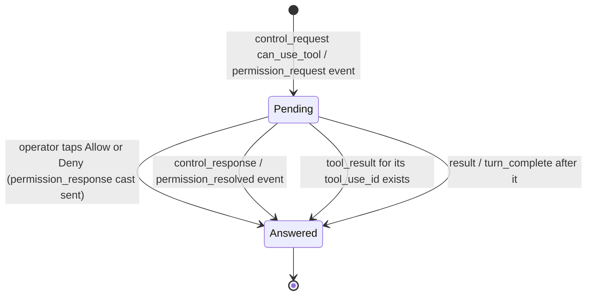

# Questions and permissions

A seat sometimes stops and waits for a person: Claude Code asks a multiple-choice question (the AskUserQuestion tool), or a tool call needs permission before it runs. The Mac app shows both as cards in the seat's transcript and lets the operator answer from there. A third mechanism, the human request, tells the operator from outside the seat that some seat is waiting: it puts the seat's row, the board tile and the menu bar icon into an attention state until the operator opens the seat.

The three are separate. Questions and permission requests are rows in a seat's transcript, answered over the seat's own socket channel. Human requests are server records, one per waiting seat, read over REST and a separate channel.

## How it works

### Questions

The core's `TranscriptBuilder` turns an assistant `tool_use` block named `AskUserQuestion` into a `TranscriptItem.Question` (instead of an ordinary tool row). It reads `input.questions` and builds one `QuestionSpec` per entry:

| Field | Read from |
|---|---|
| `header` | `header` (optional) |
| `question` | `question` |
| `options` | each option's `label` and optional `description` |
| `multiSelect` | `multiSelect` |

The item keeps the `tool_use` id (`toolUseId`) and an `answer`: the text of the matching `tool_result`, or null while none exists. A question counts as answered once its tool result exists. The result can come from this app, from another client or from the terminal.

A card for an unanswered question has live controls. Each question lists its options as toggles. A single-select question holds one choice: picking another replaces it. A multi-select question toggles each option on and off, and keeps the choices in the order they were picked. The text field "Or answer in your own words" takes free text.

What "Answer" sends depends on what the operator filled in:

- Free text typed (after trimming): the text is the answer, and no structured map is sent.
- Otherwise the picked options: `composeAnswer` gives one line per question, `header: label` when there is more than one question and the question has a header, else just the label. Several labels of one multi-select question are joined with ", ". Questions with nothing picked are left out. `answerMap` gives the same choices as a map from each question's text to its picked labels (", " between several). The server passes this map to the seat as is, so it does not have to split the text by header (headers can be missing or repeated).

The "Answer" button is disabled while the composed text is empty. "Decline" refuses the question without answering it.

Both go to the seat as a cast on its `session:<id>` channel (see Interface). If the cast is sent, the card shows "Sent" until the transcript has the tool result, then "Answered: <the result text>". If the socket is down nothing is sent and the card stays live.

### Permission requests

A permission request is a `control_request` message with `request.subtype` `can_use_tool` (in the replay), or a live `permission_request` event on the seat channel. Either becomes a `TranscriptItem.Permission` with the tool name, a detail line (`description`, else `title`), the tool input pretty-printed, and a `pending` flag. A live event is added only if the transcript does not already hold a request with that id. A live event's tool name prefers `display_name` over `tool_name`.

A request is no longer pending when any of these holds:

1. The seat recorded an answer: a `control_response` message for that request id, or a live `permission_resolved` event.
2. The operator answered it from this app (`resolveLocally`, applied immediately, before the seat confirms).
3. Its tool call has a result: the request carries a `tool_use_id` and a `tool_result` with that id exists.
4. Its turn ended: a `result` message (patched runtime) or a `turn_complete` message (mod) arrives after it. The seat cannot finish a turn while it waits, so an open request before a turn end was answered somewhere else, in the terminal for example. A request that arrives after the turn end belongs to the new turn and stays pending.

Rules 3 and 4 are what keep old requests from showing live Allow and Deny buttons after the question was settled in the terminal.

A permission request from an agent (fork, subagent, teammate) shows in that agent's thread, not in main's.



### Human requests

`HumanRequests` (in the core) keeps the open requests from seats asking for the operator. The app starts it when sign-in completes and stops it on sign-out. It stays current three ways:

- The socket channel `operator:human_requests`. A `human_request` event adds or replaces the seat's entry. A `human_request_resolved` event removes the seat's entry (by `session_id`, else by request `id`).
- A REST read, `GET /api/human_requests?status=open`, on every successful (re)join of that channel.
- The same read every `RECHECK_MS` (120 000 ms, two minutes), as a safety net: a request that arrived while the socket was down is still picked up.

A seat has at most one open request. Asking again updates it. The core publishes the requests both as a map by seat id and as a list, newest change first (`updatedAt`, else `insertedAt`); the Mac app reads the list, because a Kotlin map keyed by `Long` crashed the app on a failed key cast in Swift.

If the read answers 404, `supported` turns false: the server has no human-request endpoints.

The request is cleared when the operator looks at the seat. `SeatSession` combines "this seat has an open request" with "this seat is watched". When both become true it calls `HumanRequests.resolve(seatId)`, which removes the entry locally at once and then sends `POST /api/sessions/<id>/human_requests/resolve`. A failure of that call is only logged. Because the check combines both conditions, a request that arrives while the seat is already on screen is cleared too.

A seat counts as watched only while its screen shows and the app is active: the seat window, the Seats detail and a Fleet Board tile each call `setWatched(on: phase == .active)` when they appear and when the scene phase changes, and `setWatched(on: false)` when they go. A minimized window, a window behind another app, or a hidden one does not clear the request, so the request and its notification stay.

Answering a question or a permission does not itself resolve the human request. Opening the seat does.

## Configuration

| Item | Value | Where |
|---|---|---|
| Human requests recheck interval | 120 000 ms | `HumanRequests.RECHECK_MS` |
| Human requests channel | `operator:human_requests` | `HumanRequests.TOPIC` |
| Seat status poll while watched | 5 000 ms | `SeatSession.POLL_MS` |
| Attention colour | `Theme.attention` (`0xD08770`) | `macos/Claudiverse/Theme.swift` |

There are no UserDefaults keys for these features. Whether a request also produces a system notification is covered in [Notifications](notifications.md).

## Interface

### Question card

Titled "Question". Per question: the header (if any) in the accent colour, the question text, then one button per option (a circle, or a filled check circle when chosen; the option's description below its label). Below the questions, for an unanswered card:

- Text field "Or answer in your own words" (multi-line).
- Button "Answer" (prominent). Disabled until there is a choice or text.
- Button "Decline".

Once sent or answered, the options are disabled, the field and buttons disappear, and one line shows "Sent" or "Answered: <text>" (at most three lines).

### Permission card

Pending: a raised-hand icon in the attention colour, the title "<tool> wants permission", the detail line, the tool input in a code block, and two buttons: "Allow" (prominent) and "Deny". Answered: a grey icon, the title "<tool> — answered", detail and input, no buttons. There is no "always allow" variant: the only decisions the code sends are `allow` and `deny`.

### Seat row, board tile, menu bar

- Sidebar `SeatRow`: when the seat has a human request, the status dot is `Theme.attention`, the label is semibold, and the second line shows the request's `summary` (up to two lines, attention colour) in place of "<machine> · <model>".
- Fleet Board tile: an `exclamationmark.bubble.fill` icon in the attention colour in the tile header; hovering it shows the summary. The tile's dot is also `Theme.attention`.
- Menu bar: the icon is `sparkles` when nothing is open and `exclamationmark.bubble.fill` when at least one seat is asking. The popover lists "No seat is asking for you." when empty, else one button per request (newest first): the seat title, the time since the request was updated, and the summary (up to three lines). Clicking one opens that seat (main window forward, Seats section selected).

Notifications for requests are posted from the same list; see [Notifications](notifications.md).

### Socket (seat channel `session:<id>`, joined as observer)

The app casts these events; each payload is a JSON object:

| Action | Event | Payload | Notice shown |
|---|---|---|---|
| Answer | `answer` | `tool_use_id`, `response`, optional `answers` | "Answer sent" |
| Decline | `decline` | `tool_use_id` | "Question declined" |
| Allow / Deny | `permission_response` | `request_id`, `decision` (`allow` or `deny`) | none |

Example answer to a two-question call with picked choices:

```json
{
  "tool_use_id": "toolu_01",
  "response": "Scope: Mac only\nOrder: tests first",
  "answers": { "Which platforms?": "Mac only", "What order?": "tests first" }
}
```

An answer typed in the operator's own words sends only `tool_use_id` and `response`.

Events the app receives on that channel for permissions: `permission_request` (payload with `request_id`, `tool_name` or `display_name`, `description` or `title`, `input`, optional `agent_id`) and `permission_resolved` (`request_id`).

### REST

| Call | Request | Response read |
|---|---|---|
| `Api.openHumanRequests` | `GET /api/human_requests?status=open` | `requests[]`, each with `id`, `session_id`, `seat_title`, `summary`, `detail`, `inserted_at`, `updated_at` |
| `Api.resolveHumanRequests(seatId)` | `POST /api/sessions/<seatId>/human_requests/resolve`, app or super token | `resolved` (count, 0 if absent) |

### Socket (channel `operator:human_requests`)

Events `human_request` (payload as one request above) and `human_request_resolved` (`session_id`, or `id`).

## Failure modes and troubleshooting

| Message or symptom | Cause | What to do |
|---|---|---|
| "Not connected — answer not sent" | The socket was down when Answer was pressed. The card stays live. | Wait for the connection (the menu bar popover shows "live" or "offline"), then press Answer again. |
| "Not connected — decline not sent" | Same, for Decline. | Same. |
| "Not connected — permission_response not sent" | Same, for Allow or Deny. The card stays pending. | Same. |
| Card says "Sent" and never changes to "Answered" | The cast went out, but no `tool_result` has reached the transcript. | Check that the seat is still running; open the terminal if needed. The card has no retry. |
| A permission card is "answered" though you did nothing | Its tool ran, or its turn ended: it was answered in the terminal or elsewhere. | None. |
| Seat row stays highlighted while its window is open | The seat is only counted as watched while the app is active and the window is in front. | Bring the app to the front. |
| No attention state ever appears, and the log has "human requests not read" | The read failed. A 404 sets `supported` to false: the server has no human-request endpoints. | Update the server; other errors retry on the next rejoin or after two minutes. |

## Related pages

- [Seat view](seat-view.md)
- [Transcript](transcript.md)
- [Notifications](notifications.md)
- [Fleet board](fleet-board.md)
- [Connecting](connecting.md)
- Server: [Questions and permission relays](https://github.com/Promises/claudiverse/blob/main/docs/reference/server/questions-and-permissions.md)
- Mod: [Questions and permission relay](https://github.com/Promises/claudiverse/blob/main/docs/reference/services/mod/questions-and-permissions.md)
- Web panel: [Permissions and questions in the web panel](https://github.com/Promises/claudiverse/blob/main/docs/reference/services/web/permissions-and-questions.md)
- Android: [Questions and permissions](../android/questions-and-permissions.md)

## Source

- `macos/Claudiverse/TranscriptView.swift`
- `macos/Claudiverse/SeatDetailView.swift`
- `macos/Claudiverse/SeatsSidebar.swift`
- `macos/Claudiverse/MenuBarView.swift`
- `macos/Claudiverse/ClaudiverseApp.swift`
- `macos/Claudiverse/AppModel.swift`
- `macos/Claudiverse/FleetBoard.swift`
- `core/src/commonMain/kotlin/dev/claudiverse/core/Transcript.kt`
- `core/src/commonMain/kotlin/dev/claudiverse/core/SeatFeed.kt`
- `core/src/commonMain/kotlin/dev/claudiverse/core/SeatSession.kt`
- `core/src/commonMain/kotlin/dev/claudiverse/core/HumanRequests.kt`
- `core/src/commonMain/kotlin/dev/claudiverse/core/Api.kt`
- `core/src/commonMain/kotlin/dev/claudiverse/core/Models.kt`
