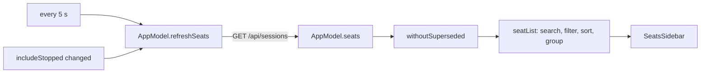

# Seat list

The seat list is the sidebar of the main window's Seats section. It lists the Claude Code sessions (seats) the server tracks, searched, filtered and grouped by fleet. Selecting a row shows that seat in the detail pane; double-clicking opens it in a window of its own.

The searching, filtering, ordering and grouping are not in the Swift code. They are one function in the shared core, `seatList(all, f)`, which the Android app uses too. The Swift view only holds the filter state and draws the result.

## How it works



**Data.** After sign-in, `AppModel` starts a loop that calls `refreshSeats()` and then sleeps 5 seconds, for as long as the app is signed in. `refreshSeats()` calls `Api.seats(includeStopped:)`, which is `GET /api/sessions`. Turning the "Running only" filter off sets `includeStopped`, which triggers a refresh at once instead of waiting for the next tick. A successful call replaces the whole list and clears the error. A failed call keeps the previous list and sets `seatsError` to the error's message. A cancelled call is ignored. Signing out empties the list and clears the selection.

With `includeStopped` off the request has no query, so the server returns its default (running seats). With it on, the request is `status=all&limit=100`: every status, running first, then the most recently active stopped seats, at most 100 rows. The core's comment says stopped rows make the list about four times larger, which is why they are only fetched on request.

**Pipeline.** Each redraw runs `seatList` over the fetched seats with the current filters:

1. `withoutSuperseded` drops stopped rows whose conversation a newer row continues. A resumed seat registers as a new row and the old one stays stopped, so both would show the same conversation. A row is kept if it is running, has no conversation, or has the highest id among the rows with its conversation. The conversation is `conversation_id`, else `claude_session_id`.
2. A seat passes the base filter if (when "Running only" is on) its status is `running`, and (when the search text is not blank) the text occurs, ignoring case, in its label or its title.
3. The machine filter keeps seats whose `host` equals the chosen machine.
4. The runner filter drops seats whose `origin` is `runner` (workers cv-runner started).
5. The rest is sorted: running seats first, then by `last_activity_at`, newest first. Seats with no parseable time sort last among their status class.
6. With "Group by fleet" on, seats are grouped by `fleet`. Named fleets come in name order, the group of seats with no fleet comes last. Empty groups are dropped. With it off there is one group with no header.

The label shown on a row is the `title` for a seat started from a profile (`profile_id` set or `origin` equal to `profile`), otherwise the `display_title` if it is not blank, otherwise the `title`. Search matches that label and the raw `title`, so a seat is found by either name.

**Selection.** Clicking a row sets `AppModel.selectedSeat` to the seat id. The id is stored in UserDefaults under `selectedSeat` and restored at the next launch. Selecting a seat closes an open fleet board. Signing out clears the selection.

## Configuration

| Item | Value | Persisted |
| --- | --- | --- |
| Refresh interval | 5 seconds | No (constant) |
| Stopped seats | `status=all&limit=100` when "Running only" is off | No. Resets to running only at launch |
| "Hide runner seats" | on | No. Resets at launch |
| "Group by fleet" | on | No. Resets at launch |
| Machine | All machines | No. Resets at launch |
| Folded fleet groups | none folded | No. Resets at launch |
| Search text | empty | No |
| Selected seat | none | Yes, UserDefaults key `selectedSeat` |

Only the selected seat survives a relaunch. All filters live in view or model state and start from their defaults every time.

## Interface

### Search

The field in the sidebar has the prompt "Search seats". It matches a seat's label or title, case-insensitive substring. It does not match host, fleet or model. It applies together with the filters.

### Filters menu

A toolbar menu titled "Filters" with these items:

- "Running only": on by default. Off fetches stopped seats too.
- "Hide runner seats": on by default. Hides seats whose origin is `runner`.
- "Group by fleet": on by default. Off gives one flat list with no group headers.
- "Machine": a picker, shown only when at least one seat reports a host. The first entry is "All machines", then each known host in name order, each as `name (N)`. N is the number of seats that machine would show with the other filters applied, runner filter included. Hosts are collected from all non-superseded seats, so a machine stays in the picker even when its count is 0.

The core also computes how many worker seats each machine hides (`hiddenRunners`), but the picker does not show it. The footer shows the total for the selected machine.

The menu icon is `line.3.horizontal.decrease.circle`, and the filled `…circle.fill` variant when any filter differs from its default: "Running only" off, "Hide runner seats" off, a machine chosen, or "Group by fleet" off.

### Group header

Shown only with "Group by fleet" on.

- A chevron button folds the group (`chevron.down` open, `chevron.right` folded). Its help text is "Hide" or "Show"; its accessibility label is "Hide <fleet>" or "Show <fleet>" ("no fleet" for the unnamed group).
- A named fleet is a button with a grid icon and the fleet name. It opens the fleet's board in the detail pane (help: "Open the <fleet> board"). It is drawn in the accent colour while that board is open, secondary otherwise. Its context menu has "Open Board" and "Open Board in New Window".
- The group of seats with no fleet is titled "No fleet" and has no board.
- "N busy" appears on the right when the group has seats whose `activity` is `busy`.

See [Fleet board](fleet-board.md).

### Row

- Status dot (8 pt), first match wins:
  - attention colour: the seat has an open request asking for the operator;
  - muted: status is not `running`;
  - busy colour: running and `activity` is `busy`;
  - good colour: any other running seat.
- Label, one line, semibold while the seat has an open request. A bell icon follows it when the seat `can_notify` (it may page the operator).
- Second line: while an open request exists, its summary in the attention colour, up to two lines. Otherwise `host · model`, whichever of the two exist.
- Right column: relative time of `last_activity_at` ("just now", "5m ago", "2h 10m ago", "3d 1h ago", "in 3d 1h" for a time more than a minute ahead; empty when there is no time). Under it "N queued" in the busy colour when the outbox holds N messages for this seat, and a gear icon with a count when `background_running` is above 0. Its help text is "N running in the background (shells, monitors, workflows, subagents)".

See [Questions and permissions](questions-and-permissions.md) for the open requests and [Notifications](notifications.md) for paging.

### Footer

A line under the list: `N of M · B busy`, plus ` · R runners hidden` when the runner filter hides any. M is the number of seats after superseded rows are removed. N is the number shown. B counts shown seats whose `activity` is `busy`. R counts worker seats on the selected machine that match the search and "Running only".

### Opening a seat

- Single click: shows the seat in the detail pane.
- Double-click or Return: opens the seat in a new window (window id `seat`). See [Windows](windows.md).
- Row context menu: "Open in New Window"; "Open the <fleet> Board" when the seat has a fleet; then "Adopt…", disabled when `adoptBlockedReason` gives a reason (stopped, runner, or already run from a profile). See [Adopt](adopt.md).

### Request and response

`GET /api/sessions` (with `?status=all&limit=100` when stopped seats are included). The client reads the `sessions` array. Field names as `Seat.from` reads them (only `id` is required; `title` and `status` are read as text):

```json
{
  "sessions": [
    {
      "id": 204030,
      "title": "lorem-w1",
      "display_title": "Fix the parser",
      "status": "running",
      "activity": "busy",
      "type": "sidecar",
      "model": "claude-opus",
      "last_activity_at": "2026-10-10T08:15:02.120Z",
      "host": "lorem-mac",
      "fleet": "lorem-fleet",
      "origin": "runner",
      "profile_id": null,
      "background_running": 2,
      "can_notify": false,
      "working_directory": "/home/me/project",
      "inserted_at": "2026-10-10T07:00:00Z",
      "mode": "default",
      "claude_session_id": "a5839ebf",
      "conversation_id": null,
      "client_version": "2.0.0",
      "access": "basic",
      "access_explicit": false,
      "notify_grant": null,
      "notify_until": null
    }
  ]
}
```

The list view uses `id`, `title`, `display_title`, `status`, `activity`, `model`, `last_activity_at`, `host`, `fleet`, `origin`, `profile_id`, `background_running`, `can_notify`, `claude_session_id` and `conversation_id`. The rest belongs to other screens.

## Failure modes and troubleshooting

- A row at the top of the list with a warning triangle and red text: `refreshSeats` failed and shows the error's message. The list below is the last good one. The next 5-second tick retries; the row disappears after one succeeds. Check the server address and sign-in in [Connecting](connecting.md).
- A seat you expect is missing:
  - It is stopped and "Running only" is on.
  - It is a worker seat and "Hide runner seats" is on (the footer says "N runners hidden").
  - A machine is chosen in "Machine".
  - The search text excludes it. Search only looks at label and title.
  - It is a stopped row superseded by a newer row of the same conversation.
  - It is stopped and older than the 100 most recent stopped rows the server returns.
- A fleet group is empty or missing: its seats are filtered out, or the group is folded (chevron).
- Filters are back to defaults after relaunch: expected, only the selected seat is remembered.
- "Adopt…" is greyed out: the seat is stopped, a runner's worker, or already runs from a profile.

## Related pages

- [Seat view](seat-view.md)
- [Fleet board](fleet-board.md)
- [Adopt](adopt.md)
- [Windows](windows.md)
- [Questions and permissions](questions-and-permissions.md)
- [Notifications](notifications.md)
- Server: [Sessions and Rooms](https://github.com/Promises/claudiverse-oss/blob/main/docs/reference/server/sessions-and-rooms.md)
- Web panel: [Dashboard](https://github.com/Promises/claudiverse-oss/blob/main/docs/reference/services/web/dashboard.md)
- Android: [Seat list (the Seats tab)](../android/seat-list.md)

## Source

- `macos/Claudiverse/SeatsSidebar.swift`
- `macos/Claudiverse/AppModel.swift`
- `macos/Claudiverse/Theme.swift`
- `core/src/commonMain/kotlin/dev/claudiverse/core/SeatList.kt`
- `core/src/commonMain/kotlin/dev/claudiverse/core/Models.kt`
- `core/src/commonMain/kotlin/dev/claudiverse/core/Api.kt`
- `core/src/commonMain/kotlin/dev/claudiverse/core/ServerTime.kt`
- `core/src/commonMain/kotlin/dev/claudiverse/core/Adopt.kt`
