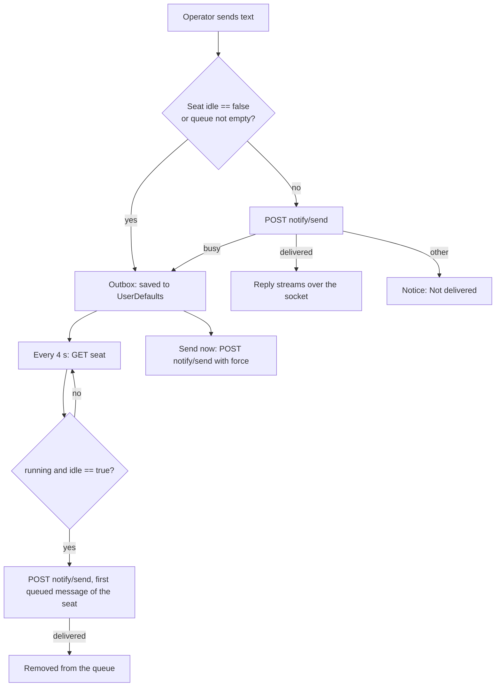

# Seat view

The seat view shows one seat: its transcript, a toolbar to control it, an info panel, and a box to message it. It appears in two places. In the main window it is the detail of the selected seat in the sidebar. A seat can also open in a window of its own (a "Seat" window, one per seat, opened by double-clicking the seat in the list; opening it again brings that window forward). Both use the same view, `SeatDetailView`.

Everything on the screen comes from one `SeatSession` in the core library. It joins the seat's socket channel as an observer, keeps the replay plus every later message, polls the seat's status, and carries out the operator's commands. This page covers the header, toolbar, controls, info panel, composer, drafts and the queue for busy seats. The transcript itself, images, agents and background tasks, and question and permission cards have their own pages (see Related pages).

## How it works

**One model per screen.** `SeatModel` wraps a `SeatSession` and publishes its `SeatState`. A busy seat emits a state for every streamed fragment. When only the streaming text changed, the model redraws at most every 0.15 seconds (`streamInterval`) and always draws the last one. Any other change draws at once.

**Watched or not.** The seat's status (`GET /api/sessions/:id`) is polled every 5 seconds (`POLL_MS = 5_000`), and the seat's request for the operator is answered, only while the screen is "watched". The view sets watched on appearing if the app is the active app (`scenePhase == .active`), follows the scene phase afterwards, and sets it off when it disappears. A minimized window, a covered window, or another front app is not watched: the polling stops, and the seat's request and its notification stay open. When a watched seat has an open human request, the session resolves it (opening the seat is what answers it). Becoming watched also checks that the socket is alive. A (re)join of the channel triggers an immediate fetch.

**Main window cache.** The main window's view is created with `keepLoaded = true` and gets its model from `AppModel.recentSeat(_:)`. Seats the main window has shown stay loaded and live, so switching back needs no fresh history. The list is newest first. A seat is kept if the total stays under 12 (`keptSeatLimit`) and either it is among the 4 newest (`recentStoppedLimit`, counting by position, stopped or not) or its status is `running`. Others are closed (channel left). So: running seats stay up to 12 in all; a stopped seat survives only while it is among the 4 most recent. A seat window owns its model and closes it on disappear. Signing out closes the cache.

**Sending.** `SeatSession.send(text)` ignores blank text. If the seat reports `idle == false`, or this seat already has queued messages, the text goes to the outbox with the notice "Seat busy — queued, sends when it goes idle". Otherwise it posts to `/api/notify/send`. A `busy` answer from the server also enqueues it. Any other non-delivered answer shows "Not delivered: ..." with the server's hint or status. `/model ...` and `/effort ...` from the controls menu are sent this way, so they queue like any message.

### The outbox

The server rejects a send to a busy seat instead of queueing it, so the queue lives in the app (`Outbox` in the core). It is saved through `OutboxStore` after every change (on the Mac, `DefaultsOutboxStore`, UserDefaults key `outbox`), so it survives quitting. Delivery needs the app running: a drainer loop runs every 4 seconds (`POLL_MS = 4_000`) while the queue is not empty, and it starts at launch when a saved queue is non-empty.

Each pass takes the oldest queued message of every seat and, for each seat, fetches the seat. It delivers only if the seat's status is `running` and its live `idle` is exactly `true`. One message per seat per pass: a delivered message makes the seat busy again, so the next waits for the next idle. A seat that has ended never goes idle, so its queue stays where it is until the operator removes the messages. Errors are logged and retried on the next pass. Rows that cannot be read from the saved JSON are dropped, not the whole queue.

The stored form is a JSON array of `{id, seat, text, at}` (`at` in epoch milliseconds), the same as the Android app's.

### Drafts

`Drafts` holds what the operator typed or attached per seat and has not sent. It is shared by every view of the seat (main window, seat window, board tile), and stays when switching seats, closing a window, or quitting. Empty drafts are not stored. A send clears that seat's draft only.

It is saved as JSON on each change under UserDefaults key `drafts`: a dictionary keyed by seat id, each `{text, attachments}`, attachments as file paths. At load, attachments whose file no longer exists are dropped (a deleted file, an unmounted volume), and a draft left empty is discarded.

Pasted images are written to `Pasted/` inside the app's support folder (`~/Library/Application Support/Claudiverse/Pasted`; a build with a bundle id `tech.henning.claudiverse.<name>` uses `Claudiverse <name>` instead of `Claudiverse`). It is not the temporary folder, because a draft can outlive a restart. At sign-in (`begin`), `removeStalePastes(olderThan: 7)` deletes files in that folder that no draft refers to and whose modification date is more than 7 days old. A file a draft still holds is never removed.

### Stop, resume, interrupt

- Interrupt casts the channel event `interrupt` with an empty payload. If the socket is not connected the notice is "Not connected — interrupt not sent", otherwise "Interrupt sent".
- Stop calls `POST /api/sessions/:id/stop` and waits for the reply (the client comment says up to about 10 seconds). The seat's status turns stopped as its sidecar disconnects. The seat is then fetched again.
- Resume calls `POST /api/sessions/:id/resume`. A reply only means accepted; the outcome follows as a spawn notice (the same tracker as starting a seat, see [New seat](new-seat.md)). The response must carry `spawn_id`.

## Configuration

| Name | Value | Where |
|---|---|---|
| Status poll while watched | 5 s | `SeatSession.POLL_MS` |
| Outbox drain interval | 4 s | `Outbox.POLL_MS` |
| Streaming redraw limit | 0.15 s | `SeatModel.streamInterval` |
| Seats kept in the main window | 12 in all; a stopped one only while among the 4 newest | `AppModel.keptSeatLimit`, `recentStoppedLimit` |
| Stale pasted image age | 7 days | `Drafts.removeStalePastes(olderThan:)` |
| Composer max height | 10 lines, then scrolls | `ComposerField.maxLines` |
| Paging "For" default | 60 minutes | `SessionInfoView.pagingMinutes` |

Persisted UserDefaults keys used on this screen:

| Key | Holds |
|---|---|
| `drafts` | Per-seat drafts (JSON) |
| `outbox` | The queue of messages waiting for idle (JSON) |
| `ssh.<machine>` | The ssh target for a machine, set in Settings › Machines (`<machine>` is the machine name the host agent reports) |

The default window of a seat window is 760 by 820 (minimum 520 by 420).

## Interface

### Header

The window title is the seat's label, or `Seat <id>` until the seat has loaded. The label is the title for a profile's seat; otherwise Claude Code's own display title when one was reported, else the title.

The subtitle is the following parts joined with " · ", in this order:

1. Status. For a `running` seat: `busy` if the live state says `idle == false`, else the seat's reported activity, else `running`. For any other seat, its status (for example `stopped`).
2. The machine name, if reported.
3. The model the seat reports, if any.
4. `effort <level>`, if the seat's latest reply carried an effort.
5. `offline` if the socket is not connected; otherwise `joining…` if the channel is not yet joined.
6. The join error, or else the load error, if either exists.

Above the transcript, in order: the agent switcher and the background tasks bar (when the seat has agents or background tasks; see [Agents and background tasks](agents-and-background-tasks.md)), the transcript ([Transcript](transcript.md)), the queued list, a notice bar, and the composer. When an agent's thread is selected, a caption reads "<label>: its own thread. A message here goes to main; sending to an agent comes later."

The notice bar shows the last thing the app or server said about an action ("Interrupt sent", "Not delivered: ...", and so on) with an x button that dismisses it. A `session_ended` event on the channel sets the notice "Session ended".

### Toolbar

Left to right:

- **Resume** (play icon), shown when the seat can be resumed: its status is not `running`, it has a machine, and it has a conversation id (`conversationId`, else `claudeSessionId`). Disabled while a stop or resume request is in flight.
- **Interrupt** (stop-circle icon, help "Interrupt the current turn"), shown instead of Resume in every other case.
- **Open terminal** (terminal icon, help "Attach to the seat's tmux session in iTerm"), shown only when the seat's status is `running` and it has a machine.
- **Session** menu (sliders icon, help "Model, effort and permission mode"), described below.
- **Show as Text** (document icon, help "The conversation as one text, to select and copy across messages"). Opens a sheet with the shown thread (main or the selected agent) as one document, with **Copy All** and **Done** buttons.
- **Info** (info icon). Toggles the info panel, an inspector on the right (width 260 to 420, ideal 300).

### Session menu

Three sections. Each header shows what the seat reports now.

- **Model: <model>** (or `unknown`). The current models, each as a menu item. For models with a 1M-context build, the item is a submenu with **Standard** (sends `/model <id>`) and **1M context** (sends `/model <id>[1m]`). Then an **Older models** submenu, then the aliases **Default** and **Opus plan** (`/model default`, `/model opusplan`). The list is `SessionChoices` in the core: Opus 5.5, Opus 5, Sonnet 5.5, Sonnet 5, Fable 5.1, Fable 5, Mythos 5.1, Mythos 5, Haiku 4.5; older: Opus 4.8, 4.7, 4.6, 4.5, 4.1 and Sonnet 4.6, 4.5, 4.
- **Effort: <level>** (or `unknown until the next reply`). Levels `low`, `medium`, `high`, `xhigh`, `max`, `auto`; picking one sends `/effort <level>`.
- **Permission mode: <mode>** (or `not reported`). Choices **Default**, **Accept edits**, **Plan**, **Auto** (ids `default`, `acceptEdits`, `plan`, `auto`). `bypassPermissions` and `dontAsk` are left out on purpose, so a mis-click cannot turn off permission checks. This one does not send a message: it posts `POST /api/sessions/:id/permission_mode` with `{"mode": "<id>"}`.

A checkmark marks the item the seat reports running. The marks show what the seat reports, not what was last picked, so a change made in the seat's own terminal shows too. A model matches when the reported id equals the item's id or starts with the id plus `-2` (a dated id), so Opus 5 and Opus 5.5 stay apart. The mode mark is the live `permission_mode`.

Model and effort changes are slash commands sent as messages, so they queue while the seat is busy (notice "Seat busy — queued, sends when it goes idle"). The mode change does not queue. After it, the app waits 2.5 seconds and fetches the seat again, because the seat reports its mode within about 2 seconds.

### Info panel

Rows are copyable: each shows its value (a dash when absent, selectable text, at most 3 lines) and a copy button (help "Copy").

- **Seat**: Title, Display title, Id, Status (status and activity), Machine, Fleet, Started by (the seat's `origin`), Type (type and, if present, its connection `mode`, which is how it connects, not its permission mode), Folder (working directory).
- **Tools** and **May page the operator**: see below.
- **Claude**: Model, Effort, Permission mode, Session id, Conversation, Client version.
- **Time**: Started and Last activity, each as local time and a relative time.
- **Adopt…** (disabled with a reason in its help text when adoption is blocked; see [Adopt](adopt.md)) and, only when the seat can be stopped (running, with a machine), **Stop seat…**.

**Stop seat…** opens a confirmation dialog titled "Stop <label>?" with a button "Stop on <machine>" and the message "Its terminal session closes on its machine. A stopped seat can be resumed." Confirming calls `stop()`. The button is disabled while a request is in flight. While stopping, the notice reads "Stopping on <machine>…", then "Stopped on <machine>" or an error (see below).

**Tools.** A segmented picker: **Basic**, **Full**, **Default**. The header adds "(default)" when the seat has an access level that the operator did not set. A line below explains the level: "Reporting and the shared tools." for basic, "The orchestrator's full tool set." for full, and "This server does not report a seat's tools." otherwise. Choosing a level posts `POST /api/sessions/:id/access` with `{"level": "basic"|"full"}`; choosing Default sends `{"level": null}`. On success the notice reads "Access set to Basic. The seat applies it within a minute." (or "Access back to its default: <name>. ..."), and the seat row is replaced with the one in the reply (`session`).

**May page the operator.** The operator's switch for whether the seat may page the operator (notify), separate from tools. A segmented picker **On**, **Off**, **Default**, a picker **For** with **1 hour**, **4 hours**, **1 day**, **Until changed** (default 1 hour; changing it while a switch is in force re-sends the switch with the new length), and a line **Now**: "yes" or "no", then " (the seat's default)" when unset, ", until <time>" when timed, or ", until you change it". The header adds "(default)" when no switch is set. The call is `POST /api/sessions/:id/notify` with `{"allow": true|false|null, "minutes": n}`; `minutes` is sent only when `allow` is not null and a length is chosen (the client comment gives 1 to 10080). Notices: "It may page you until the time shown." or "... until you change it.", "Paging back to the seat's default: it may page you." / "may not page you."

### Open terminal

The button runs `TerminalOpener`. It attaches to the seat's tmux session, named after the seat's title, using the exact-name form `tmux attach -t '=<title>'`.

- If the seat's machine is this Mac (its name equals the Mac's host name, or one is a prefix of the other followed by a dot), the app first checks that a tmux session of that name exists (`tmux has-session`, looking for tmux at `/opt/homebrew/bin/tmux`, `/usr/local/bin/tmux`, `/usr/bin/tmux`) and runs the attach command.
- Otherwise it needs an ssh target for the machine, set in Settings › Machines (stored as `ssh.<machine>`). It runs `ssh -t '<target>' 'exec $SHELL -lc '<attach>''`: a login shell on the remote side, because a non-interactive ssh command often has no tmux on its PATH.

The command is typed into a new iTerm window (default profile) with AppleScript. The first time, macOS asks to let Claudiverse control iTerm; it asks again after an update, since the app is signed without a team. The call runs off the main thread, because macOS holds the script until the dialog is answered. Failures show in an alert titled "Open terminal" (see below).

### Composer

The message box at the bottom. Its placeholder is "Message", or "Message (queued until the seat is idle)" when the seat is busy or already has queued messages.

| Key | Action |
|---|---|
| Return (or keypad Enter) | Send |
| Shift-Return, Option-Return | New line |
| Other Return combinations (with Command or Control) | Passed to the text view as is |

While an input method is composing text, Return confirms the composition and does not send. The field is a custom text view, because a plain TextField takes Command-V and Shift-Return itself and drops pasted images and the new line. It grows with its text up to 10 lines, then scrolls.

The paperclip (help "Attach files (or paste them)") opens a file picker for any files, several at once. It is disabled while an upload runs. Pasting (Command-V) attaches instead of typing when the pasteboard holds files copied in Finder, or an image with no text (a screenshot, "Copy Image" in a browser), which is written as a PNG named `Pasted image <yyyy-MM-dd> at <HH.mm.ss> <4 chars>.png` in the pasted-images folder. Copied text that also carries a picture of itself, such as spreadsheet cells, stays text. Attachments show as a strip above the box with a thumbnail, the file name, and a remove button (help "Remove"). They are part of the draft.

The send button (arrow icon) is enabled when there is text or an attachment, and becomes a progress spinner while sending or uploading. Sending with attachments uploads each file in order (`POST /api/sessions/:id/files`, multipart field `file`; the reply must have `file_id` and `url`, and may have `name` and `size`). Then one message goes through the normal send path, so it queues if the seat is busy. The message tells the seat to fetch each file with `curl` using its own token (`$CLAUDIVERSE_TOKEN`, `$CLAUDIVERSE_URL`), followed by the operator's text. If any upload fails, nothing is sent and the notice reads "File not sent: <why>" or "Files not sent: <why>"; a 404 gives "this server cannot take files yet". The draft is cleared when the send is started, not when it finishes.

### Queued list

Shown between the transcript and the composer when this seat has queued messages (tinted background). Each line has a clock icon, the message text (two lines at most), a **Send now** button (help "Deliver mid-turn, as if typed while Claude works") and a trash button, which removes the message from the queue.

Send now calls `POST /api/notify/send` with `force: true`, delivering busy or not; the seat takes the message into its own queue. On success the message leaves the queue and the notice reads "Sent now — the seat takes it mid-turn". A server that does not support `force` answers `busy`: "Not sent: this server cannot force a send yet — still queued".

### REST and socket

All paths are under `/api`. The calls need an app or super token where the client says so.

| Call | Use |
|---|---|
| `GET /api/sessions/:id` | Seat and live state. Reply: `session` (required) and `live` with `status`, `idle`, `sidecar_connected`, `permission_mode` |
| `POST /api/notify/send` | Body `{"session_id": 12, "content": "...", "force": true}` (`force` only when forcing). Reply `status` (`delivered` or `busy`), `hint` or `error` |
| `POST /api/sessions/:id/stop` | Stop on its machine |
| `POST /api/sessions/:id/resume` | Reply `spawn_id` |
| `POST /api/sessions/:id/permission_mode` | Body `{"mode": "plan"}`; reply `mode` |
| `POST /api/sessions/:id/access` | Body `{"level": "full"}` or `null`; reply `session` |
| `POST /api/sessions/:id/notify` | Body `{"allow": true, "minutes": 60}`; reply `session` |
| `POST /api/sessions/:id/files` | Multipart upload |

The socket topic is `session:<id>`, joined with `{"role": "observer"}`. The view casts `interrupt`, `answer`, `decline` and `permission_response` on it, and reads the transcript events (see [Transcript](transcript.md)).

## Failure modes and troubleshooting

Terminal alert ("Open terminal"):

- "This seat has not reported its machine." The server has no machine for the seat. Wait until it reports one.
- "Set how to reach <machine> over ssh in Settings › Machines." The seat runs on another machine and no ssh target is set. Fill it in under Settings › Machines (see [Settings](settings.md)).
- "No tmux session "<title>" on this Mac: the seat was started in a terminal of its own." The seat's machine is this Mac but there is no tmux session with the seat's title (or tmux is not at one of the three paths above). Use the terminal the seat was started in.
- "iTerm did not open: <why>". AppleScript failed. Check iTerm is installed and that Claudiverse is allowed to control it in System Settings › Privacy & Security › Automation.

Notices (the bar above the composer):

- "Not connected — interrupt not sent" (the same form for other socket events): the socket is down. The subtitle shows `offline`.
- "Not delivered: <hint or status>" or "Not delivered: <error>": the server did not take the message.
- Stop: 403 "Not stopped: its folder is outside <machine>'s allowed folders, or this app may not stop seats"; 404 "Not stopped: no seat by this title runs on <machine> (renamed since it started?)"; 422 "Not stopped: the seat never reported its machine"; 504 "Not stopped: <machine> did not answer (offline?)"; otherwise "Not stopped: <message>".
- Resume: 400 "Not resumed: <message>"; 409 "Not resumed: the seat is still running"; 422 "Not resumed: the seat never reported its Claude session or folder"; 429 "Not resumed: <machine> is rate-limited, try again in a few seconds"; 504 "Not resumed: <machine> did not answer (offline?)"; otherwise "Not resumed: <message>".
- Permission mode: 409 "The seat refused: <message>"; 503 "Mode not changed: the seat is not connected"; 504 "This seat cannot change mode yet: it needs a restart on a build with the mode hook"; success "Mode set to <mode>".
- Tools: 403 "Access not changed: only the app's own sign-in may change it"; 404 "Access not changed: this server does not know this seat, or cannot set access yet".
- Paging: 403 "Paging not changed: only the app's own sign-in may change it"; 404 "Paging not changed: this server does not know this seat, or cannot switch paging yet".
- Send now: "Not sent: <hint or status> — still queued", "Not sent: <error> — still queued".

A queued message that never leaves: the app must be running, the seat must be `running` and report `idle`, and delivery is one message per seat every 4 seconds at most. A seat that ended does not drain; delete its queued messages with the trash button. A seat whose `idle` is unknown (null) is not drained either, but a message sent to it directly is tried at once.

A stale or missing draft attachment: if its file is gone when the app starts, the attachment is dropped silently.

## Related pages

- [Transcript](transcript.md)
- [Images](images.md)
- [Agents and background tasks](agents-and-background-tasks.md)
- [Questions and permissions](questions-and-permissions.md)
- [Windows](windows.md)
- [Seat list](seat-list.md)
- [Adopt](adopt.md)
- [New seat](new-seat.md)
- [Settings](settings.md)
- [Notifications](notifications.md)
- Server: [Tool levels and paging](https://github.com/Promises/claudiverse-oss/blob/main/docs/reference/server/access-and-notify.md), [HTTP mirror, inbox long-poll and liveness](https://github.com/Promises/claudiverse-oss/blob/main/docs/reference/server/mirror-inbox-liveness.md), [Sessions and Rooms](https://github.com/Promises/claudiverse-oss/blob/main/docs/reference/server/sessions-and-rooms.md)
- Mod: [The inbox: remote input and inbox commands](https://github.com/Promises/claudiverse-oss/blob/main/docs/reference/services/mod/inbox.md)
- Web panel: [The seat view](https://github.com/Promises/claudiverse-oss/blob/main/docs/reference/services/web/seat-view.md)
- Runners and tools: [cvctl: the orchestrator CLI](https://github.com/Promises/claudiverse-oss/blob/main/docs/reference/runners/cvctl.md), [cv-mcp: the claudiverse MCP server (overview)](https://github.com/Promises/claudiverse-oss/blob/main/docs/reference/runners/mcp.md), [cv-mcp: seat, ping and question tools](https://github.com/Promises/claudiverse-oss/blob/main/docs/reference/runners/mcp-seats.md)
- Host agent: [Seat control](https://github.com/Promises/claudiverse-host-agent-oss/blob/main/docs/reference/seat-control.md)
- Android: [Seat controls](../android/seat-controls.md), [Seat view](../android/seat-view.md)

## Source

- `macos/Claudiverse/SeatDetailView.swift`
- `macos/Claudiverse/SessionViews.swift`
- `macos/Claudiverse/ComposerField.swift`
- `macos/Claudiverse/Drafts.swift`
- `macos/Claudiverse/TerminalOpener.swift`
- `macos/Claudiverse/AppModel.swift`
- `macos/Claudiverse/ClaudiverseApp.swift`
- `core/src/commonMain/kotlin/dev/claudiverse/core/SeatSession.kt`
- `core/src/commonMain/kotlin/dev/claudiverse/core/Outbox.kt`
- `core/src/commonMain/kotlin/dev/claudiverse/core/SessionChoices.kt`
- `core/src/commonMain/kotlin/dev/claudiverse/core/Api.kt`
- `core/src/commonMain/kotlin/dev/claudiverse/core/Models.kt`
