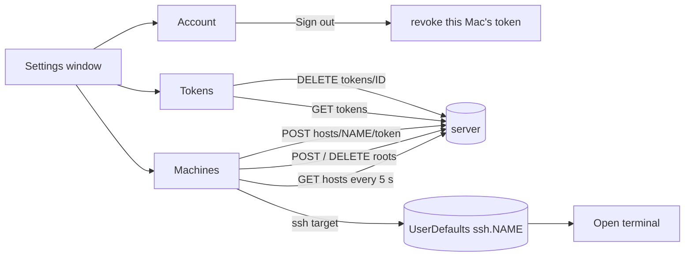

# Settings

The Settings window is the app's one place for account, machine and token
administration. It is a standard SwiftUI `Settings` scene, so it opens from
the menu **Claudiverse › Settings…** (⌘,). The window is a fixed 640 x 520
points with three tabs: **Account**, **Machines** and **Tokens**.

Account is open to any signed-in operator. Machines and Tokens need a super
token for most of what they do; the app does not check this itself, it shows
what the server answers (see the failure section).

## How it works

Each tab is independent and talks to the server through the shared core
client (`Api.kt`). Nothing in the window is written to the server except by
an explicit button: **Sign out**, **Add**, the folder remove confirmation,
**Create token** and **Revoke**.



### Machines

A machine is shown when it has a host agent and the server lists it in
`GET /api/hosts`. For each one the tab shows its allowed folders (`roots`).
Seats can only be started in those folders.

- **Removing** a folder is always allowed: it can only narrow what the
  machine accepts. The app asks first, then sends `DELETE
  /api/hosts/<machine>/roots`. Seats that already run are not touched.
- **Adding** a folder is the machine's decision. Its host agent accepts a
  remote add only when its own config says `"allow_remote_roots": true`; the
  server reports that as `remote_roots`. Where it is `false`, the add field is
  not shown, and a note says how to enable it.
- The app adds through `allowFolder`, which avoids redundant entries. The
  path is first normalised (trailing `/` removed, except for `/`). If an
  allowed folder already holds it (the same folder or a parent, compared by
  whole path segments), nothing is sent. Otherwise it sends `POST
  /api/hosts/<machine>/roots`, and then removes any allowed folder that now
  lies inside the new one. Removal happens after the add, so no path is ever
  uncovered in between.
- After an add or remove the app waits 2 seconds and re-reads the list. The
  agent re-joins with its new roots within a second or two, and is briefly
  missing from the list in between.
- While the tab is shown it re-reads `GET /api/hosts` every 5 seconds.

### The ssh target and Open terminal

**Open terminal** (see [Seat view](seat-view.md)) attaches to a seat's tmux
session in iTerm. For a seat on this Mac it runs the attach locally. For a
seat on another machine it needs to know how this Mac reaches that machine
over ssh, which the server does not know. That is the per-machine `ssh`
field on the Machines tab.

- Stored in `UserDefaults.standard` under the key `ssh.<machine>`, where
  `<machine>` is the host name exactly as the server lists it (for example
  `ssh.linux-box`). One key per machine, on this Mac only.
- Default: no value. The field is empty, and **Open terminal** for a seat on
  that machine fails with `Set how to reach linux-box over ssh in Settings ›
  Machines.`
- Every keystroke is saved (whitespace trimmed at both ends). An empty value
  is stored as an empty string and read back as "not set".
- The field is shown for every machine except this Mac. A machine is "this
  Mac" when its name, lowercased, equals this Mac's host name, or one is the
  other plus a `.` and a suffix (so `lorem-mac` and `lorem-mac.local` match).
- `TerminalOpener` builds, for a seat titled `lorem-w1` on a machine with
  target `you@linux-box`, a command of this shape (each inner command is
  single-quoted as one shell word):

  ```
  ssh -t 'you@linux-box' 'exec $SHELL -lc <tmux attach -t =lorem-w1, quoted>'
  ```

  In effect: ssh with a terminal, a login shell there (a non-interactive ssh
  command gets a minimal `PATH`, often without tmux), and `tmux attach -t
  =lorem-w1`. The `=` makes tmux match that exact session name, not one that
  merely starts with it. The command is typed into a new iTerm window.
- On this Mac the command is plain `tmux attach -t '=lorem-w1'`, and only
  after `tmux has-session` finds the session. tmux is looked for at
  `/opt/homebrew/bin/tmux`, `/usr/local/bin/tmux`, `/usr/bin/tmux`, in that
  order.

### Adding a machine

**Add a machine…** opens a sheet that mints a host token for a machine that
is not listed yet. You give the machine's hostname; the server returns a
token; the app shows it once. The server never returns it again, so copy it
into that machine's host agent config before pressing **Done**. Until the
agent connects with it, the machine does not appear in the list.

## Configuration

| Setting | Where | Default |
| --- | --- | --- |
| `ssh.<machine>` | `UserDefaults`, set in Machines | not set |
| Machines refresh | fixed in code | every 5 seconds while the tab is shown |
| Wait after add or remove | fixed in code | 2 seconds, then re-read |
| `allow_remote_roots` | the machine's host agent config, not the app | `false` (the client reads a missing `remote_roots` as false) |
| Window size | fixed in code | 640 x 520 |

## Interface

### Account

A grouped form with four rows and one button.

| Row | Content |
| --- | --- |
| **Server** | The server URL, or `—` when empty. |
| **Signed in as** | The operator's email, or `—` when unknown. |
| **This Mac** | The client name this Mac registered with: the Mac's name from System Settings with `'` and `’` removed, every character outside ASCII letters, digits, space, `.`, `_`, `-` replaced by `-`, trimmed, at most 64 characters, or `Mac` when empty. `Sam's MacBook Pro` becomes `Sams MacBook Pro`. |

If macOS has notifications switched off for the app, a note appears under
the rows (the same note as at the top of the menu bar window): a bell-slash
icon, **Notifications are off for Claudiverse: seats asking for you will not
alert you.** and a button **Open Notification Settings**. See
[Notifications](notifications.md).

**Sign out** (red, shown only while signed in) is disabled while it runs. It
revokes this Mac's token on the server, stops the live subscriptions, deletes
the stored token and returns to the sign-in screen. If the
server cannot confirm the revoke, the app signs out locally anyway and logs
the reason. Details are in [Connecting](connecting.md).

### Machines

Top to bottom:

- An error line in red when the list cannot be read (below).
- One section per machine. Header: a dot (green online, grey offline), the
  machine name, and on the right a caption joined with ` · `, such as
  `online · 2 seats · agent 0.7.0` (`online` or `offline`, then
  `<n> seats`, then `agent <version>` only when the agent reports one).
- Under the header, one row per allowed folder: a folder icon, the path
  (selectable), and a minus button (tooltip **Remove**). The minus button is
  disabled while a change is in flight. Pressing it asks:
  **Remove `<path>` from `<machine>`?** with the message **New seats can no
  longer start there. Seats already running are not touched.** and the
  button **Remove**.
- With no folders: **No allowed folders: seats cannot be started here.**
- If the machine allows remote roots: a text field **Absolute path on
  `<machine>`** (Return adds), a **Choose…** button only when the machine is
  this Mac (a folder panel whose button reads **Allow**), and **Add**.
  **Add** is disabled while a change is in flight and until the text starts
  with `/`.
- Otherwise: **Folders can be added from here only once this machine allows
  it: set "allow_remote_roots": true in its host agent's config. Removing is
  always possible.**
- For machines other than this Mac, a text field `ssh` with the placeholder
  **user@address, for Open terminal from this Mac**.
- A per-machine error line in red.

At the bottom: **Add a machine…** on the left, **Refresh** (arrow icon) on
the right. While the first load runs and nothing is listed, a spinner shows.

**Add a machine** sheet (480 points wide):

1. Title **Add a machine**, the hint **Its hostname, as the machine reports
   it (e.g. laptop.local).**, a field **Hostname**, buttons **Cancel** and
   **Create token**. **Create token** is disabled while the request runs and
   while the name is blank; Return in the field also creates.
2. After success: **The host token for `<name>`. Put it in that machine's
   host agent config now: it is shown only this once.** The token appears in
   a monospace box (selectable, at most two lines), with a **Copy** button
   that puts it on the clipboard. **Done** closes the sheet and refreshes the
   list. There is no way back to the token once the sheet is closed.

Requests (all under `<server>/api`, bearer token, JSON):

```
GET /api/hosts
200 {"hosts": [
  {"name": "linux-box", "online": true, "seats": 2,
   "roots": ["/home/me/projects"], "remote_roots": true,
   "version": "0.7.0", "modes": [...], "runtimes": [...], "mcp": [...]}
]}
```

The Machines tab reads `name`, `online`, `seats`, `roots`, `remote_roots` and
`version`. `seats` defaults to 0 and `roots` to an empty list when absent.

```
POST /api/hosts/linux-box/roots
{"path": "/home/me/projects/lorem"}
200 {"roots": ["/home/me/projects", "/home/me/projects/lorem"]}

DELETE /api/hosts/linux-box/roots
{"path": "/home/me/projects/lorem"}
200 {"roots": ["/home/me/projects"]}
```

Both return the machine's roots after the change. The machine name is one
URL path segment, encoded whole.

```
POST /api/hosts/lorem-mac/token
(empty JSON object body: {})
200 {"name": "lorem-mac", "token": "<shown once>"}
```

`token` is required in the reply; `name` falls back to the name you typed.

### Tokens

Every token on the server, without values. The tab loads once when it opens
(there is no refresh button; the list is re-read after a revoke). A red error line
shows above the table when the load or a revoke fails.

| Column | Content |
| --- | --- |
| **Kind** | `host · <machine>` for a host token, otherwise the token's context: `api`, `app` or `super`. |
| **Client** | The client name it was minted for, or the grey text **minted on the server** when it has no label. |
| **Since** | When it was created, as a relative time (`just now`, `5m`, `3h 20m`, `2d 4h`, each followed by `ago`). Empty if the server sent no time. |
| (unnamed, 90 wide) | **this Mac** (grey) on the token making the request, otherwise a **Revoke…** button. |

**Revoke…** asks with a dialog titled **Revoke `<description>`?**, message
**Whatever uses it is signed out at once.**, and a destructive **Revoke**
button. The description is `the host token for <machine>`, or `the <context>
token for <label>`, or, with neither, `the <context> token minted on the
server <relative time>`, for example `the host token for linux-box`, or `the
super token for Sams MacBook Pro`. After a successful revoke the list is
re-read. This Mac's own token has no Revoke button; use **Sign out**.

```
GET /api/tokens
200 {"tokens": [
  {"id": 12, "context": "super", "label": "Sams MacBook Pro",
   "inserted_at": "2026-10-01T09:30:00Z", "current": true},
  {"id": 13, "context": "host:linux-box", "label": null,
   "inserted_at": "2026-10-02T11:00:00Z", "current": false}
]}

DELETE /api/tokens/13
```

`id` is required; `context` is the Kind source, and `label`, `inserted_at`
and `current` are optional.

## Failure modes and troubleshooting

Machines tab:

| Message | Cause and action |
| --- | --- |
| `Machines not read: <detail>` | `GET hosts` failed. The list keeps its last content and is retried every 5 seconds; **Refresh** retries now. |
| `<machine> refused: it does not allow folders to be added remotely.` | HTTP 403 on add. The machine's host agent config does not have `"allow_remote_roots": true`. Set it in that machine's host agent config. |
| `No such folder on <machine>.` | 404 on add. The path does not exist there. |
| `<machine> did not answer (offline?).` | 504 on add or remove. The host agent is not connected. |
| `The path must be absolute.` | 400 on add. The path must start with `/`. |
| `Not added: <detail>` | Any other add failure. |
| `Not removed: <detail>` | Any other remove failure (504 uses the offline message above). |
| `Not a valid machine name.` | 400 from Add a machine: the server rejected the hostname. |
| `No token: <detail>` | Any other failure minting a token. |

If a machine disappears from the list for a moment after a folder change,
that is the agent re-joining; the next 5-second read brings it back.

Open terminal messages that point here:

- `Set how to reach <machine> over ssh in Settings › Machines.` Fill the `ssh`
  field of that machine with `user@address`.
- `This seat has not reported its machine.`
- `No tmux session "<seat>" on this Mac: the seat was started in a terminal of
  its own.`
- `iTerm did not open: <reason>`. macOS asks once to let Claudiverse control
  iTerm, and again after an update, because the app is signed without a team.

Tokens tab:

| Message | Cause and action |
| --- | --- |
| `Only a super token can list tokens.` | 403 on `GET tokens`. This Mac signed in with a lesser token. |
| `Tokens not read: <detail>` | Any other list failure. |
| `That one may be the fleet's shared seat token: it can only be revoked on the server.` | 409 on revoke. The token has context `api` and no label. Revoke it on the server. |
| `Not revoked: <detail>` | Any other revoke failure. |

`<detail>` is the error text from the client; with no signed-in token or URL
it is `Set the server URL and token in Settings`.

## Related pages

- [Connecting](connecting.md): sign-in, the client name, Sign out.
- [Notifications](notifications.md): the notifications-off note.
- [Seat view](seat-view.md): Open terminal.
- [New seat](new-seat.md): starting seats in the allowed folders.
- [Account pool](account-pool.md)
- [Troubleshooting](troubleshooting.md)
- Server: [Accounts, sign-up and tokens](https://github.com/Promises/claudiverse/blob/main/docs/reference/server/auth.md), [Profiles and the host channel](https://github.com/Promises/claudiverse/blob/main/docs/reference/server/profiles-and-hosts.md)
- Host agent: [Installing and running the host agent as a service](https://github.com/Promises/claudiverse/blob/main/docs/reference/host-agent/install-and-service.md), [Roots and folder browsing](https://github.com/Promises/claudiverse/blob/main/docs/reference/host-agent/roots.md)
- Android: [New seat (spawning a seat)](../android/new-seat.md), [Settings, permissions and troubleshooting](../android/settings-and-troubleshooting.md)

## Source

- `macos/Claudiverse/SettingsView.swift`
- `macos/Claudiverse/MachinesSettings.swift`
- `macos/Claudiverse/TerminalOpener.swift`
- `macos/Claudiverse/MenuBarView.swift`
- `macos/Claudiverse/AppModel.swift`
- `macos/Claudiverse/ClaudiverseApp.swift`
- `core/src/commonMain/kotlin/dev/claudiverse/core/Api.kt`
- `core/src/commonMain/kotlin/dev/claudiverse/core/Models.kt`
- `core/src/commonMain/kotlin/dev/claudiverse/core/Folders.kt`
- `core/src/commonMain/kotlin/dev/claudiverse/core/ServerTime.kt`
