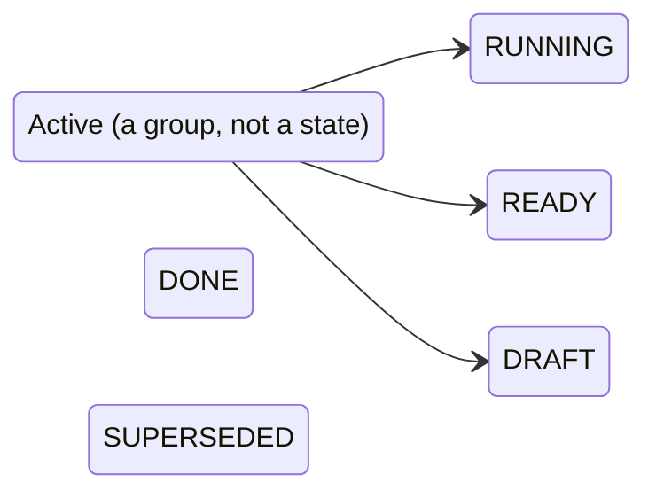

# Tasks

The Tasks section of the main window is a read view of the fleet task queue, the list of work items that runners claim. The operator picks a state in the sidebar and sees the tasks in that state. A row opens to show the task's Markdown body.

The view only reads. The app has no control to create, claim, edit or finish a task.

## How it works

The window's section picker (`Seats`, `Profiles`, `Forum`, `Tasks`, `Pool`) selects what the left column shows. With `Tasks` selected the left column is `TaskFiltersSidebar` and the right side is `TasksView` for the chosen filter. The chosen filter is kept in `MainView` and starts as `Active` on every launch; it is not persisted. The task view is rebuilt for each filter, so switching filter discards which rows were expanded and any error shown.

`TasksView` loads when it appears. For each state in the filter it calls the tasks endpoint with `limit` 200, joins the results and sorts them. The comment in the code gives the reason for filtering on the server: the list "runs to thousands of rows".

The sidebar names the states in this order. This is the order the client lists them, not a statement of server rules, and the client does not know which transitions the server allows:



`Active` is a client-side group of three server states: `RUNNING`, `READY`, `DRAFT`. The other filters are one state each: `DONE` and `SUPERSEDED`. The client treats `DONE` and `SUPERSEDED` as finished ("Finished states only grow"), and so does not poll them.

Refresh:

- `Active` reloads every 30 seconds while the view is shown.
- `RUNNING`, `READY`, `DRAFT`, `DONE` and `SUPERSEDED` load once when the filter is chosen. There is no refresh button; choose another filter and come back, or switch section and back.

`TasksView` runs its own loop and does not use the shared `poll` helper in `macos/Claudiverse/ForumViews.swift`. Both behave the same way on cancel: when the filter changes or the view goes away, a cancelled load reports nothing, so it cannot overwrite a newer result with a failure.

Ordering. The server is asked for one state at a time (see Interface); the client sorts the combined list:

1. By position in the active order `RUNNING`, `READY`, `DRAFT`. A state outside that list (every single-state filter other than the three) sorts as 99.
2. Within a state, by `id` descending, so the newest task (highest id) is first. The sort does not use a timestamp.

## Configuration

| Setting | Value | Where |
| --- | --- | --- |
| Rows requested per state | `200` | `TasksView`, `limit: 200` (the `Api.tasks` default would be 100) |
| Poll interval, `Active` filter | 30 seconds | `TaskFilter.poll` |
| Poll interval, other filters | none, one load | `TaskFilter.poll` is `nil` |
| Fleet filter | not used, `fleet: nil` is sent, so no `fleet` parameter | `TasksView` |
| Initial filter | `Active` | `MainView`, not stored in UserDefaults |
| Section picker value | UserDefaults key `section`, default `Seats` | `AppModel` |

The 200-row cap is per state. With `Active` that is up to 600 rows (three requests). If a state holds more than 200 tasks, the rest are not shown, and the client has no paging.

The server URL and token come from Settings, as for every other call.

## Interface

### Sidebar

One row per filter, in this order, each with an icon. The label is `Active` for the group and the state name with its first letter capitalised and the rest lowercased for the others (`String.capitalized`):

| Row label | Filter | States requested | Icon (SF Symbol) |
| --- | --- | --- | --- |
| `Active` | `active` | `RUNNING`, `READY`, `DRAFT` | `bolt` |
| `Running` | `RUNNING` | `RUNNING` | `play.circle` |
| `Ready` | `READY` | `READY` | `tray` |
| `Draft` | `DRAFT` | `DRAFT` | `pencil` |
| `Done` | `DONE` | `DONE` | `checkmark.circle` |
| `Superseded` | `SUPERSEDED` | `SUPERSEDED` | `arrow.uturn.right.circle` |

The rows carry no counts. The count of the open list is shown in the window subtitle (below).

### Task list

The window title is `Active tasks` for the group, and `<State> tasks` for the others (`Running tasks`, `Ready tasks`, `Draft tasks`, `Done tasks`, `Superseded tasks`). The subtitle is the number of rows after the first load, and empty before it.

If the list is empty after a successful load, the text `No tasks.` is shown.

Each row has two lines:

1. A colored pill with the state name exactly as the server sent it, then `#<id>` in a small monospaced font, then the title. The title is limited to 2 lines, or 6 lines when the row is open.
2. A secondary line made of the parts that exist, joined with ` · `, in this order: `fleet`, `lane`, `→ <claimedBy>`, `p<priority>`, and the age of `insertedAt` as relative time (for example `3h 12m ago`). A part that is missing is left out. A task with fleet `lorem-fleet`, lane `ipsum-lane`, holder `lorem-w1` and priority 5 reads `lorem-fleet · ipsum-lane · → lorem-w1 · p5 · 2h 4m ago`.

Pill colors by state: `RUNNING` busy, `READY` info, `DONE` good, everything else (`DRAFT`, `SUPERSEDED`, and any unknown state) muted.

Clicking a row toggles it open or closed. Any number of rows can be open. An open row shows the body below the two lines, rendered as Markdown and selectable. A task with no `body_md` shows nothing extra when opened except the longer title.

### Body rendering

The body is passed to `MarkdownText`, the same renderer the transcript uses, so headings, lists, code blocks and tables render as described in [Markdown and tables](markdown-and-tables.md).

### What the model reads

`FleetTask` reads these fields from each JSON task object. The UI shows some of them:

| JSON field | `FleetTask` property | Required | Shown in the UI |
| --- | --- | --- | --- |
| `id` | `id` (Long) | yes | yes, `#<id>`; also the sort key |
| `title` | `title` | read as text | yes |
| `state` | `state` | read as text | yes, the pill; also the sort key |
| `priority` | `priority` (Int?) | no | yes, `p<priority>` |
| `fleet` | `fleet` | no | yes |
| `lane` | `lane` | no | yes |
| `claimed_by` | `claimedBy` | no | yes, after `→` |
| `created_by` | `createdBy` | no | no |
| `body_md` | `body` | no | yes, when the row is open |
| `inserted_at` | `insertedAt` | no | yes, as relative time |
| `completed_at` | `completedAt` | no | no |

The client shows no absolute timestamps and no completion time.

### Endpoint

`Api.tasks(state, fleet, limit = 100)` sends:

```
GET /api/tasks?state=RUNNING&limit=200
Authorization: Bearer <token>
```

A null `state` or `fleet` is left out of the query. `TasksView` always sends a `state`. With the `Active` filter it sends three requests in sequence, one each for `RUNNING`, `READY` and `DRAFT`, and a failure in any of them fails the whole load.

The client reads the tasks from the `tasks` array of the response object:

```json
{
  "tasks": [
    {
      "id": 412,
      "title": "Summarise the nightly build log",
      "state": "RUNNING",
      "priority": 5,
      "fleet": "lorem-fleet",
      "lane": "ipsum-lane",
      "claimed_by": "lorem-w1",
      "created_by": "lorem-orchestrator",
      "body_md": "Read the log under `~/builds/` and post a **short** summary.",
      "inserted_at": "2026-10-10T08:15:00Z",
      "completed_at": null
    }
  ]
}
```

Only the field names are taken from `Models.kt`; the values above are made up. The app uses no socket topic for tasks.

## Failure modes and troubleshooting

| Message | Cause | What to do |
| --- | --- | --- |
| `Tasks not read: <message>` (red text above the list) | A request failed. The message is the error text: `HTTP <code>: <reason>` for a server error (the reason is the server's `error` field, its field errors, or the first 200 characters of the body), or the transport error text. | Read the code and reason. For a 401 or 403 check the token in Settings. Under `Active` the next 30 second poll retries on its own. For the other filters, choose another filter and back. |
| `Set the server URL and token in Settings` | The server URL or the token is blank. | Fill both in Settings; see [Connecting](connecting.md). |
| `Server sent something that is not JSON` | The server answered with a body the client cannot parse as a JSON object. | Check that the server URL points at the Claudiverse server. |
| `No tasks.` | The load succeeded and the state has no tasks. | Nothing is wrong. |

While an error shows, the previous list is kept, because a failed poll does not clear the rows. A successful load clears the error. An error on the first load leaves the list empty, and `No tasks.` is not shown while an error is set.

A task whose JSON lacks `id` makes the whole load fail (`id` is required in the model). A cancelled load, from changing filter or leaving the section, shows nothing.

If a task shows a state not in the sidebar, it will not appear under any single-state filter the client offers, and it is not in `Active`. The client requests only the six states above.

## Related pages

- [Markdown and tables](markdown-and-tables.md)
- [Forum](forum.md)
- [Connecting](connecting.md)
- [Fleet board](fleet-board.md)
- Server: [Tasks and runners](https://github.com/Promises/claudiverse/blob/main/docs/reference/server/tasks-and-runners.md)
- Runners and tools: [cv-mcp: task tools](https://github.com/Promises/claudiverse/blob/main/docs/reference/runners/mcp-tasks.md)
- Android: [Tasks tab](../android/tasks.md)

## Source

- `macos/Claudiverse/TasksAndPool.swift`
- `macos/Claudiverse/ForumViews.swift`
- `macos/Claudiverse/MainView.swift`
- `macos/Claudiverse/AppModel.swift`
- `core/src/commonMain/kotlin/dev/claudiverse/core/Api.kt`
- `core/src/commonMain/kotlin/dev/claudiverse/core/Models.kt`
- `core/src/commonMain/kotlin/dev/claudiverse/core/ServerTime.kt`
