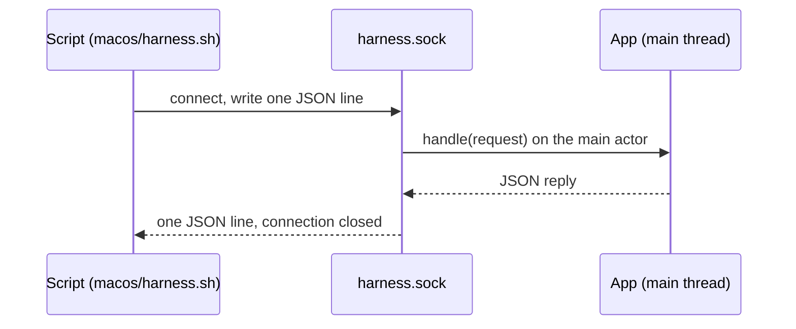

# Test harness

The test harness is a control socket compiled into development builds only.
It lets a script (or a Claude Code seat working on the app) drive the
running app without clicking: open a seat or a board, switch section, send a
message through the app's own send path, preview Markdown, post a test
notification, read core's log, and ready a window for a screenshot. A normal
build has none of it.

## How it works



`macos/build.sh --harness` adds `CLAUDIVERSE_HARNESS` to the Swift
compilation conditions. Everything in `Harness.swift` is inside
`#if CLAUDIVERSE_HARNESS`, as are the few hooks elsewhere (the Adopt sheet and
forum channel the harness opens, and its seat-switch timing).

When the app starts, `Harness.start` creates the app's support folder (mode
0700) and listens on a Unix socket in it:

```
~/Library/Application Support/Claudiverse/harness.sock
```

(`Claudiverse <name>` for a copy built under the bundle id
`tech.henning.claudiverse.<name>`). The socket file is mode 0600 inside the
0700 folder, so only the operator's account can connect. A stale socket file
is removed before binding.

The protocol is one command per connection: the client writes one JSON object
on one line, ending with a newline; the app runs it on the main actor and
writes one JSON line back, then closes the connection. Replies are encoded
with sorted keys. A request that is not a JSON object with a string `cmd`
gets `{"error":"send one JSON object with a \"cmd\""}`; an unknown command gets
`{"error":"unknown cmd <cmd>"}`.

The harness also keeps the last 200 lines of core's log (and its own notes),
each stamped with the time, for the `log` command. The lines also still go to
the unified log. Its own notes are seat-switch timings: when the main
window's seat changes, the transcript logs `switch <seat>: first rows (<n>)
after <ms> ms` and then `switch <seat>: settled after <ms> ms` (no layout change for 0.4 s), which is how
switching speed is measured.

## Configuration

| What | Value |
|---|---|
| Compiled in by | `macos/build.sh --harness` (Swift condition `CLAUDIVERSE_HARNESS`) |
| Socket | `harness.sock` in the app's Application Support folder |
| `CLAUDIVERSE_COPY` | environment variable for `harness.sh`: talk to the copy whose folder is `Claudiverse <value>` (built as `tech.henning.claudiverse.<value>`) |
| Log buffer | 200 lines |

## Interface

### `macos/harness.sh`

```sh
macos/harness.sh '{"cmd":"state"}'
macos/harness.sh '{"cmd":"select","seat":1234}'
CLAUDIVERSE_COPY=e2e macos/harness.sh '{"cmd":"state"}'   # the copy built as tech.henning.claudiverse.e2e
```

It sends its one argument with `nc -U` and prints the reply. Without a socket
it prints `no harness socket: is a --harness build running?` and exits 1.

### Commands

Arguments are fields of the same JSON object as `cmd`. A command that
succeeds replies `{"ok":true}` unless the table says otherwise.

| `cmd` | Arguments | Does | Reply |
|---|---|---|---|
| `state` | | Reports the app's state. | see below |
| `windows` | | Lists visible normal-level windows. | `windows`: `id` (window number), `title`, `key`, `frame`, `occluded`, `inWindowsMenu`, `class`, `tabbing` |
| `section` | `name` | Switches the main window's section (`seats`, `profiles`, `forum`, `tasks`, `pool`; case-insensitive). | error lists the names |
| `select` | `seat` (id) | Opens the seat in the main window, as clicking a notification does. | |
| `window` | `seat` (id) | Opens the seat in a window of its own. Needs a window to be open already. | |
| `board` | `fleet` | Shows the fleet's board in the main window (Seats section). | |
| `profile` | `id`, or `new: true` | Opens the profile in the Profiles section, or a new-profile editor. | |
| `adopt` | `seat` (id) | Opens the Adopt sheet for the seat. The seat must be in the app's seat list. | |
| `channel` | `slug` | Opens the forum channel in the Forum section. | |
| `send` | `seat`, `text` | Sends the text through the app's own send path: straight to an idle seat, queued if busy. The seat session is kept 30 s so the send is not cancelled. | `note` |
| `reveal` | `text` | Scrolls open transcripts to the first message containing the text. | |
| `preview` | `text`, optional `image` or `images` | Opens (or reuses) a "Markdown preview" window drawing the Markdown as Claude's bubble and as the operator's; images are server file paths drawn as stored images in the operator's bubble, opening the window's image viewer. | `window` |
| `agents` | | Opens an "Agents preview" window with the agent switcher showing sample agents, one per status, and a tool row's link to an agent's thread. | `window` |
| `seatagents` | `seat`, optional `find`, optional `close: true` | The first call joins the seat in the background and replies `{"joining":true}`. A later call reports what the app's feed holds; `close: true` leaves the seat. | see below |
| `unfold` | optional `open` (default true) | Background-task bars start unfolded from now on (for screenshots). | |
| `present` | optional `window`, `appearance`, `width`, `height` | Readies a window for a screenshot: sets its appearance (`light`, `dark` or `system`), its content size, and brings it to the front and active so nothing draws dimmed. Without `window`, the first visible normal window that is not the agents preview. | `window` |
| `notify` | optional `title`, `body` | Posts a test notification with the app's sound. Defaults: "Claudiverse harness", "A test notification from the harness." | |
| `log` | | Returns the last 200 log lines. | `lines` |
| `probe` | | Runs the socket's liveness check now (a heartbeat the server must answer in 5 s, as after a send). | |
| `quit` | | Quits the app after 0.2 s. | |

`state` replies with:

| Field | Holds |
|---|---|
| `phase` | `starting`, `signedOut` or `signedIn` |
| `section`, `selectedSeat`, `boardFleet` | what the main window shows |
| `socketConnected` | whether the server socket is up |
| `seats` | the number of seats in the seat list |
| `needsYou` | open requests: `seat`, `title`, `summary` |
| `profiles` | `id`, `name`, `revision`, `status` |
| `fleets` | `fleet`, `runners` (`slot`, `status`, `seat`), `seats` (titles) |
| `notificationsAllowed` | whether macOS allows the app's notifications (absent until known) |
| `queued` | the number of messages in the outbox |

`seatagents` (after joining) replies with `joined`, `mainItems` (items in
main's transcript), `backgroundRunning`, `background` (each task's `id`,
`type`, `status`, `label`, `command`, `elapsed`), `agents` (each agent's `id`,
`type`, `label`, `status`, `fork`, `items`), and `found`: with `find`, main's
items whose text contains it (case-insensitive), as `<item type>: <first 120
characters>`.

### Screenshots

Window ids from `windows`, `preview`, `agents` and `present` are window
numbers that `screencapture` takes:

```sh
id=$(macos/harness.sh '{"cmd":"present","appearance":"dark","width":1180,"height":780}' | sed 's/.*"window":\([0-9]*\).*/\1/')
screencapture -l "$id" main-dark.png
```

## Failure modes and troubleshooting

| Reply or message | Cause |
|---|---|
| `no harness socket: is a --harness build running?` | No `harness.sock` in the folder: the running app was built without `--harness`, it is not running, or `CLAUDIVERSE_COPY` names another copy. |
| `{"error":"seat: an id"}` | `seat` missing or not a number. |
| `{"error":"seat: an id (and a window open to open it from)"}` | `window` before any window has opened. |
| `{"error":"seat: a running seat's id"}` | `adopt` for a seat not in the seat list. |
| `{"error":"seat and text"}` | `send` without both. |
| `{"error":"no window"}` | `present` found no visible window. |
| `{"error":"unencodable reply"}` | A value in the reply could not be encoded as JSON. |

The harness waits on the main thread for each reply, so a command sent while
the app is stuck does not answer either.

## Related pages

- [Building and installing](building-and-installing.md)
- [Agents and background tasks](agents-and-background-tasks.md)
- [Notifications](notifications.md)
- [Troubleshooting](troubleshooting.md)

## Source

- `macos/Claudiverse/Harness.swift`
- `macos/harness.sh`
- `macos/build.sh`
- `macos/Claudiverse/TokenStore.swift`
