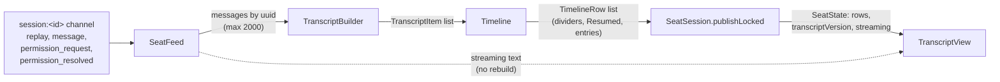

# Transcript

The transcript is the conversation of one seat, drawn in the seat view: the
operator's messages on the right, Claude's on the left, tool calls as folded
rows, and time dividers between. It is built from the raw messages Claude Code
writes, mirrored by the server to the app. The app does not read a transcript
from a REST endpoint. It joins the seat's socket channel, receives a replay of
the recent messages, and then every new message as it happens.

The work is split in two. The shared Kotlin core turns messages into a list of
rows (`SeatFeed`, `TranscriptBuilder`, `Timeline`). The SwiftUI app draws the
rows (`TranscriptView`). The core keeps the logic and the Mac app keeps only the drawing.

## How it works



### Joining the channel

`SeatSession` (one per open seat) creates the channel `session:<seatId>` with
the join payload `{"role": "observer"}` and joins it. An observer reads the
seat and does not take it over. A rejoin (after a dropped socket) makes the
server replay again, and the feed replaces its state with the new replay.

Events on the channel are fed, one at a time and under a lock, to `SeatFeed`.
The event `session_ended` is handled before it: it sets the notice "Session
ended" and nothing else.

### SeatFeed

`SeatFeed.onEvent(event, payload)` returns what changed: `NONE`, `STREAMING`
or `TRANSCRIPT`. `SeatSession` publishes a new state for `TRANSCRIPT`, and
only updates the `streaming` text for `STREAMING`.

| Event | What the feed does | Change |
|---|---|---|
| `replay` | Clears messages, agent rows and agents, then loads `messages` (agent rows go to the agent store), `agent_messages`, the `agents` snapshot and `background_tasks`. Clears `streaming`. | `TRANSCRIPT` |
| `message` with `type` `stream_event` | On `message_start` clears `streaming`; on `content_block_delta` with a `text_delta` appends its `text`. Other stream events are ignored. | `STREAMING` if the text changed, else `NONE` |
| `message` with `type` `background_tasks` | Replaces the background task list with `tasks`. | `TRANSCRIPT` |
| `message` of an agent (an agent state type, or any message with an `agent_id`) | Goes to that agent's own thread, never to main's. | `TRANSCRIPT` if something shown changed |
| `message` that is noise (`stream_event`, `progress`, `set_in_progress_tool_use_ids`, `stream_request_start`) | Dropped. | `NONE` |
| any other `message` | Kept in the message map. An `assistant` message also clears `streaming`: the finished reply replaces the live text. | `TRANSCRIPT` |
| `permission_request` | Stored by `request_id`. | `TRANSCRIPT` |
| `permission_resolved` | Marks the `request_id` as resolved. | `TRANSCRIPT` |
| anything else | Ignored. | `NONE` |

Messages are kept in arrival order in a map keyed by `uuid`. A message that
arrives twice (once in the replay and again live when a join races a
broadcast, or mirrored twice) replaces its earlier copy instead of being
appended. A message with no `uuid` is keyed by its `request_id`
(`req:<id>`) or, failing that, by its full JSON. Only the newest
`MAX_MESSAGES` = 2000 messages are kept, per thread; older ones are dropped.

The agents' threads, the agent list and the background task bar come from the
same feed; see [Agents and background tasks](agents-and-background-tasks.md).

Streaming text is the text of the reply being written now. It is shown as a
grey bubble at the bottom of the transcript and disappears when the finished
`assistant` message arrives. The Mac seat view coalesces states that only
change the streaming text: it draws at most one every 0.15 s
(`streamInterval`), and always draws the last one.

### A resumed seat

When the server replays a resumed seat, the payload carries `earlier_count`:
the first that many replayed messages are the earlier rows of the
conversation the seat continues. The feed remembers their ids so the timeline
can mark where the resumed seat took over (see below).

### TranscriptBuilder

`TranscriptBuilder.build` is a pure function of the message list, so a replay
and a live stream give the same result. It produces these items:

| Item | Made from | Notes |
|---|---|---|
| `UserText` | `user` message whose content is a string, or text and image blocks | Images pasted with the text go in the same bubble; `[Image #n]` placeholders in the text are removed when images exist. |
| `UserText` (injected) | `attachment` of type `queued_command` with no `commandMode` or `prompt` | Text injected into the seat (the composer, a send). Labelled "injected". |
| `AssistantText` | `text` block of an `assistant` message | Blank text is skipped. |
| `Thinking` | `thinking` block | Blank thinking is skipped. |
| `ToolUse` | `tool_use` block | The matching `tool_result` (found by `tool_use_id`, from any later `user` message) fills in `result`, the error flag and any images. |
| `Question` | `tool_use` named `AskUserQuestion` | `answer` is the tool result text; unanswered until the result exists. |
| `Permission` | `control_request` with subtype `can_use_tool` | Pending unless answered. |
| `Event` | A `user` turn Claude Code made itself, a `queued_command` with another `commandMode`, or an `isMeta` user message | Collapsed. A system turn is one with `promptSource` `system`, or text starting `<task-notification>`; its label is `origin.kind`, else `system` or `task-notification`. An `isMeta` message is labelled "Tool result". |
| `TurnEnd` | `result` message | Text such as "Turn complete · 4.2 s · 3 steps" ("Turn failed" when `is_error`; the duration and steps only when the message has `duration_ms` and `num_turns`). |
| `Note` | `compact`, or `system` with subtype `compact_boundary` | Text "Context compacted". |

A permission request is shown as answered when any of these holds: the feed
saw `permission_resolved` for it or the operator answered it from the app; the
log has a `control_response` for it; its tool call already has a result; or a
turn ended (`result` or `turn_complete`) after it was asked, since a seat
cannot finish a turn while it waits. A live `permission_request` event whose
request is not in the logged messages is added at the end as an extra item.
The cards are on [Questions and permissions](questions-and-permissions.md).

A tool call's collapsed row shows its name and a one-line summary: the first
non-blank of the input fields `command`, `file_path`, `pattern`, `path`,
`url`, `query`, `description`, `prompt`, `content`; else the first input key
and value; else the tool name. Only the first line is kept, cut at 200
characters. Item keys are `<message key>.<block index>`, made unique with a
`#n` suffix on a collision (the list needs unique ids).

In an agent's thread, a user row is the agent's prompt, not the operator's,
so it becomes an `Event` labelled "prompt" (or "fork started" with the
summary "Forked from main's conversation" for a fork).

### Timeline

`Timeline.rows` turns the items into rows of three kinds:

- `Entry`: an item and its time. The time is the message's `timestamp`; an
  item whose message has none takes the last known time before it.
- `Divider`: drawn above an entry when its message time is more than
  `GAP_MS` = 15 minutes (15 * 60 * 1000 ms) after the previous timed entry,
  when it falls on a different calendar day (in the system time zone), or
  when it is the first timed entry.
- `Resumed`: for a resumed seat, one line after the last item that came from
  the earlier rows; at the end when the resumed seat has not said anything
  yet.

Divider labels are English and upper case: today the time (`13:41`), the
previous six days the weekday (`FRI AT 21:53`), earlier in this year the date
(`1 OCT AT 09:12`), otherwise the date with the year.

A resume registers a new seat; the old, stopped one continues the same
conversation. The seat list hides those superseded rows (`withoutSuperseded`)
so the conversation is not listed twice. The new seat's transcript starts
with the old conversation, then the `RESUMED` line. See
[Seat list](seat-list.md).

### Drawing

`TranscriptView` takes the rows, the `transcriptVersion`, the streaming text
and the session.

**Follow the bottom.** The view opens at the bottom and keeps there while new
rows and streaming text arrive. Scrolling by hand (trackpad, wheel or
scroller) stops that; when the scroll ends the view follows again only if it
ended within 24 points of the bottom. Growth below the view is not counted as
scrolling away.

**Paging.** Only the newest `pageSize` = 25 rows are drawn at first. A button
"Show earlier messages (N)" (N is the rows not drawn) adds one page, keeping
the row that was first in view where it was. Scrolling up so the button
appears loads the next page without a click, but only after a manual scroll,
so opening a seat does not load more. The first drawn row is pinned by key,
so new rows append instead of sliding the window. While following, the start
moves up to a page from the end once more than four pages (100 rows) are
drawn, so a seat followed for hours does not grow without bound.

**Version-gated redraw.** The rows view is `Equatable` and equal while
`transcriptVersion` and the count of drawn rows are unchanged. The version
changes with every rebuilt transcript and not with streaming text, so a busy
seat does not redraw and re-parse every row per fragment.

**Rows.**

- A `Divider` is a small grey label; `Resumed` is a rule with "RESUMED" in the
  accent colour.
- An entry shows its time in a capsule above its top-left corner while the
  pointer is over it (`HoverTime`); the same label is in the context menu.
  There is no click handler on a row, so its text can be selected.
- The right-click menu has "Copy", which copies the item's text as written (a
  reply's Markdown source, a tool call's name and summary, input and result,
  a question and answer). Items with no text have no Copy.
- The operator's messages are bubbles on the right in the user colour, with
  the corner nearest the speaker squared. Claude's replies are on the left.
  Bubbles hug short messages and leave a 60-point margin on the far side.
  Text is rendered as Markdown ([Markdown and tables](markdown-and-tables.md));
  images in a message or tool result are thumbnails ([Images](images.md)).
- A thinking item is a lighter bubble with a dashed edge, labelled "Thinking".
  The text is trimmed. It shows six lines (`shownLines`); when it is longer
  than 600 characters or has more than six lines, a "Show more" link opens it
  and "Show less" folds it again.
- A tool call is a `Disclosure` row (a collapsed row with an icon, the tool
  name and the summary). Opened, it shows the input and the result in code
  blocks (monospaced, scrolling sideways, at most 360 points high). A tool
  that returned an error shows a warning icon and a red tint. Images the
  tool returned are shown under the row, not folded. A tool call that
  spawned an agent shows a link "Open <type>'s thread".
- An `Event` is a `Disclosure` with a bolt icon, the label and the summary;
  opened, it shows the full text in monospace.
- `TurnEnd` and `Note` are small centred grey lines (the note in italics).
- `Question` and `Permission` items are cards.

### Show as Text

The toolbar button "Show as Text" (tooltip: "The conversation as one text, to
select and copy across messages") opens a sheet with the thread now shown
(main's, or the selected agent's) as one document. `conversationText` writes
each item under a heading: `You` or `Injected`, `Claude`, `Thinking`, `Tool`,
`Question`, `Permission`, or an event's label (`Event` if blank); turn-end and
note lines have no heading. Items are joined by a blank line. The sheet title
is the thread's label (the seat's label, else `Seat <id>`), it holds a
selectable text view, and has the buttons "Copy All" and "Done". The text is
built when the button is pressed and does not update while the sheet is open.

## Configuration

Nothing here is a setting. The constants:

| Constant | Value | Where |
|---|---|---|
| `SeatFeed.MAX_MESSAGES` | 2000 messages per thread | `SeatFeed.kt` |
| `Timeline.GAP_MS` | 15 minutes | `Timeline.kt` |
| `TranscriptView.pageSize` | 25 rows | `TranscriptView.swift` |
| Rows drawn before the start moves up | more than 4 pages | `TranscriptView.swift` |
| Bottom tolerance for "at the bottom" | 24 points | `TranscriptView.swift` |
| Streaming redraw interval | 0.15 s | `SeatDetailView.swift` |
| Thinking lines shown folded | 6 (or over 600 characters) | `TranscriptView.swift` |
| Tool summary length | 200 characters | `Transcript.kt` |
| Code block max height | 360 points | `TranscriptView.swift` |

The replay size and what the server includes in it are the server's.

## Interface

- Socket topic `session:<seatId>`, join payload `{"role": "observer"}`.
- Events read: `replay` (fields `messages`, `earlier_count`,
  `agent_messages`, `agents`, `background_tasks`), `message`,
  `permission_request` (`request_id`, `tool_name`, `display_name`,
  `description`, `title`, `input`, `agent_id`), `permission_resolved`
  (`request_id`), `session_ended`.
- Message fields the builder reads: `type`, `uuid`, `timestamp`,
  `message.content`, `isMeta`, `promptSource`, `origin.kind`, `attachment`,
  `request_id`, `request`, `response.request_id`, `duration_ms`, `num_turns`,
  `is_error`, `effort`.
- The latest assistant message's `effort` becomes the seat state's `effort`.
- Seat view toolbar: "Show as Text". In the transcript: "Show earlier
  messages (N)", "Show more" / "Show less", the disclosure rows, the context
  menu "Copy".

A replay message of a tool result, as the builder reads it:

```json
{"type": "user", "uuid": "u-2", "timestamp": "2026-10-10T09:12:03Z",
 "message": {"content": [
   {"type": "tool_result", "tool_use_id": "toolu_1", "content": "ok", "is_error": false}]}}
```

It attaches to the `tool_use` block with `"id": "toolu_1"` and is not shown as
a row of its own.

## Failure modes and troubleshooting

- **The transcript is empty.** The channel has not joined, or the server sent
  no replay. The seat state carries `joined`, `joinError` and `socketConnected`
  ([Seat view](seat-view.md)). A rejoin replays again.
- **Old messages are missing.** The feed keeps 2000 messages per thread, and
  the replay is the server's buffer. Neither is a full history.
- **"Show earlier messages (N)" is there but nothing loads.** Click it, or
  scroll up by hand; it does not load by itself while the seat is opening.
- **No time on a row.** The message had no parseable `timestamp`; the row
  uses the last known time, or none at all before the first timed message.
  Hover shows the time only when there is one.
- **A permission still looks pending after the terminal answered it.** It is
  closed once its tool call has a result or the turn ends; until then the
  card stays.
- **An image shows "Image not loaded: ..."**: see [Images](images.md).
- **"Session ended"** is the notice shown when the server sends
  `session_ended`.

## Related pages

- [Seat view](seat-view.md)
- [Markdown and tables](markdown-and-tables.md)
- [Images](images.md)
- [Agents and background tasks](agents-and-background-tasks.md)
- [Questions and permissions](questions-and-permissions.md)
- [Seat list](seat-list.md)
- [Core library](core-library.md)
- Server: [HTTP mirror, inbox long-poll and liveness](https://github.com/Promises/claudiverse/blob/main/docs/reference/server/mirror-inbox-liveness.md)
- Mod: [Mirroring](https://github.com/Promises/claudiverse/blob/main/docs/reference/services/mod/mirroring.md)
- Web panel: [The seat view](https://github.com/Promises/claudiverse/blob/main/docs/reference/services/web/seat-view.md)
- Android: [Seat view](../android/seat-view.md)

## Source

- `macos/Claudiverse/TranscriptView.swift`
- `macos/Claudiverse/SeatDetailView.swift`
- `core/src/commonMain/kotlin/dev/claudiverse/core/SeatFeed.kt`
- `core/src/commonMain/kotlin/dev/claudiverse/core/Transcript.kt`
- `core/src/commonMain/kotlin/dev/claudiverse/core/Timeline.kt`
- `core/src/commonMain/kotlin/dev/claudiverse/core/SeatSession.kt`
- `core/src/commonMain/kotlin/dev/claudiverse/core/SeatList.kt`
