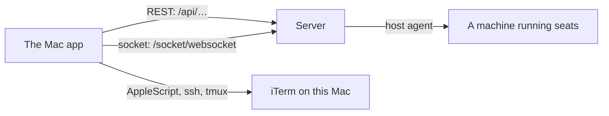

# Troubleshooting

Start here when the Mac app shows an error, or something you expect is
missing. Problems are listed by symptom, each with what causes it and the page
that explains it in full. Messages are quoted as the app shows them. The
Configuration section says where the app logs and where it keeps its files.

## How it works

Most problems fall into one of four places:



- **The connection**: the server URL, the token, the network or VPN.
- **The socket**: live updates. REST calls can work while the socket is down;
  the app then shows `offline` and stops updating live.
- **A machine's host agent**: starting, stopping, adopting and folder
  changes are the machine's decision, relayed by the server.
- **This Mac**: notifications, iTerm control, the token file.

## Configuration

### Logs

The app and its core log to the unified log under the subsystem
`tech.henning.claudiverse`, category `app`. The socket logs why it dropped
(`socket lost (…)`), feeds log failed reads (`fleets not read: …`,
`profiles not read: …`, `human requests not read: …`), and the app logs
token and notification problems.

```sh
log stream --level info --predicate 'subsystem == "tech.henning.claudiverse"'
```

A build with the [test harness](test-harness.md) also returns the last 200
core log lines with `macos/harness.sh '{"cmd":"log"}'`.

### Where the app keeps things

| What | Where |
|---|---|
| Token | `~/Library/Application Support/Claudiverse/token` (0600) |
| Pasted images | `~/Library/Application Support/Claudiverse/Pasted/` |
| Harness socket (harness builds) | `~/Library/Application Support/Claudiverse/harness.sock` |
| Notification sound | `~/Library/Sounds/Claudiverse Poke.caf` |
| Preferences | `UserDefaults` of `tech.henning.claudiverse`: `serverURL`, `section`, `selectedSeat`, `drafts`, `outbox`, `board2.<fleet>`, `ssh.<machine>` |

To start over on this Mac: sign out in Settings › Account (this revokes the
token), quit, and delete the folder and the preferences
(`defaults delete tech.henning.claudiverse`). Drafts and queued messages go
with them.

## Interface

### Signing in and staying connected

| Symptom | Cause and fix | Page |
|---|---|---|
| `Wrong email or password.` | HTTP 401 at sign-in. | [Connecting](connecting.md) |
| `Too many attempts. Try again in N s.` | The server rate-limits sign-in. Wait; nothing retries by itself. | [Connecting](connecting.md) |
| `Could not sign in: …` | Connection refused or timed out, a bad URL (`Not a valid server URL: …`), or a reply that is not JSON. Check the address and that the server is reachable (LAN or VPN). | [Connecting](connecting.md) |
| Back on the sign-in screen after a launch | The stored token was revoked (the server answered 401). Sign in again. | [Connecting](connecting.md) |
| Menu bar says `offline`; the seat subtitle says `offline` | The socket is down. It reconnects by itself with backoff (1 to 30 s). | [Core library](core-library.md) |
| The seat list shows an error row | The latest `GET /api/sessions` failed; it retries every 5 s. | [Seat list](seat-list.md) |
| `Only a super token can list tokens.` | Settings › Tokens with a token that is not super scope. | [Settings](settings.md) |

### Seats

| Symptom | Cause and fix | Page |
|---|---|---|
| A message shows as queued and never sends | Queued messages go out only while the app runs, the seat is `running` and reports `idle`, one per seat per idle. A seat that ended never drains: remove the message, or use **Send now**. | [Seat view](seat-view.md) |
| `Not connected — … not sent` | An answer, decline, permission or interrupt needs the socket; it is down. | [Seat view](seat-view.md) |
| `Not stopped: …`, `Not resumed: …` | The machine refused, is offline (`did not answer (offline?)`), or is rate-limited. | [Seat view](seat-view.md) |
| A permission card stays pending after it was answered in the terminal | It closes when its tool call has a result or the turn ends. | [Questions and permissions](questions-and-permissions.md) |
| The transcript misses older messages | The feed keeps at most 2000 messages per thread, and the replay is what the server sends. | [Transcript](transcript.md) |
| `Image not loaded: …` | The stored image could not be fetched or decoded. | [Images](images.md) |
| `File not sent: …` | An upload failed; nothing was sent. The draft was already cleared, so attach the file again. | [Images](images.md) |
| A stopped seat is missing from the list | **Running only** is on in the Filters menu, or the stopped row is superseded by its resumed seat. | [Seat list](seat-list.md) |

### Opening a seat's terminal

| Message | Fix | Page |
|---|---|---|
| `Set how to reach <machine> over ssh in Settings › Machines.` | Set the ssh target for that machine. | [Settings](settings.md) |
| `No tmux session "<title>" on this Mac: …` | The seat was started in a terminal of its own; there is nothing to attach to. | [Seat view](seat-view.md) |
| `iTerm did not open: …` | Allow Claudiverse to control iTerm in System Settings › Privacy & Security › Automation. macOS asks again after each rebuild. | [Seat view](seat-view.md) |

### Starting, adopting and profiles

| Symptom | Cause and fix | Page |
|---|---|---|
| The spawn banner says `no answer from <host>` | No outcome within 120 s. The seat may still have started; check the seat list. | [New seat](new-seat.md) |
| `This machine allows no folders yet. …` | Add an allowed folder in Settings › Machines, or in the machine's host agent config. | [New seat](new-seat.md) |
| Add folder: `<machine> refused: it does not allow folders to be added remotely.` | The machine's host agent config needs `"allow_remote_roots": true`. | [Settings](settings.md) |
| Adopt is disabled | Its help text gives the reason (no agent, a worker seat, no process found, …). | [Adopt](adopt.md) |
| A profile shows `started, but never registered` | The seat is up on its machine but never registered, often waiting at a prompt in its terminal. Open the terminal, or Stop. | [Profiles](profiles.md) |
| `Not saved yet: see below.` | Someone else saved the profile meanwhile; the fields both changed are listed. Choose, then save again. | [Profiles](profiles.md) |
| `Not renamed: this server can't rename profiles yet (it needs an update).` | The server is older than the rename endpoint. | [Profiles](profiles.md) |

### Notifications

| Symptom | Cause and fix | Page |
|---|---|---|
| `Notifications are off for Claudiverse: seats asking for you will not alert you.` | Click **Open Notification Settings** and allow them. | [Notifications](notifications.md) |
| Notifications play the default sound | `poke.caf` is not in the repository, so builds from it have no poke sound. | [Notifications](notifications.md) |
| Every open request is notified again after a launch | The "skip requests open at launch" rule is spent on the core's initial empty list (a known bug). | [Notifications](notifications.md) |

### Building

| Symptom | Cause and fix | Page |
|---|---|---|
| `xcodegen: command not found` | `brew install xcodegen`. | [Building and installing](building-and-installing.md) |
| `xcodebuild test` finds no project | Generate it first: run `macos/build.sh` once. | [Building and installing](building-and-installing.md) |
| `no harness socket: is a --harness build running?` | The running app was built without `--harness`. | [Test harness](test-harness.md) |

## Failure modes and troubleshooting

When none of the above fits: watch the log while you repeat the action,
and read the message the app shows next to the control. REST failures carry
the server's own words, formatted `HTTP <status>: <reason>`.

## Related pages

- [Connecting](connecting.md)
- [Seat view](seat-view.md)
- [Notifications](notifications.md)
- [Building and installing](building-and-installing.md)
- [Core library](core-library.md)
- Android: [Settings, permissions and troubleshooting](../android/settings-and-troubleshooting.md)

## Source

- `macos/Claudiverse/AppModel.swift`
- `macos/Claudiverse/TokenStore.swift`
- `macos/Claudiverse/Notifier.swift`
- `core/src/commonMain/kotlin/dev/claudiverse/core/CoreLog.kt`
- `core/src/commonMain/kotlin/dev/claudiverse/core/Api.kt`
- `core/src/commonMain/kotlin/dev/claudiverse/core/PhoenixSocket.kt`
