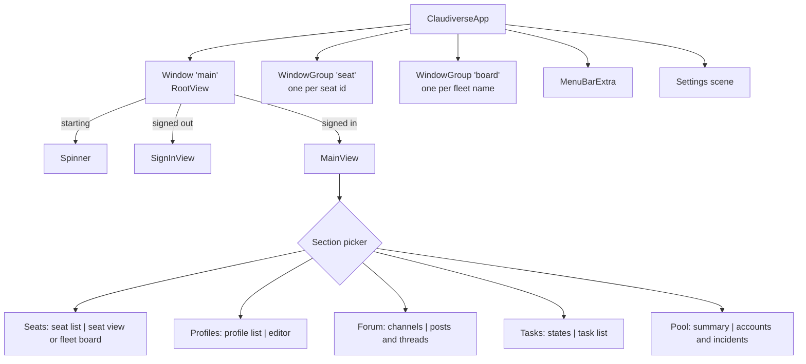

# Windows

The app has one main window, any number of seat and fleet-board windows, a
menu bar extra and a Settings window. All of them share one `AppModel`, so a
seat shown in two places shows the same draft, queue and live state, and an
edit made in one place shows in the other.

## How it works

The scenes, as `ClaudiverseApp` declares them:

| Scene | Id | Opened by | Default size | Minimum |
|---|---|---|---|---|
| Main window (`Window`, single) | `main` | launch; menu bar "Open Claudiverse"; clicking a notification or a menu bar request | 1180 × 780 | |
| Seat window (`WindowGroup` keyed by seat id) | `seat` | double-click or Return on a seat in the list; "Open in New Window" in the seat list or on a board tile | 760 × 820 | 520 × 420 |
| Fleet board window (`WindowGroup` keyed by fleet name) | `board` | "Open Board in New Window" on a fleet header in the seat list; "Open in New Window" in a board's toolbar | 1280 × 900 | 640 × 480 |
| Menu bar extra | | always present | 340 wide | |
| Settings | | Claudiverse › Settings… (⌘,) | 640 × 520 | |

A `WindowGroup` keyed by a value opens one window per value: opening a seat
that already has a window brings that window forward instead of opening a
second one. The same holds for a fleet's board.

Every window root carries its own image viewer (`.imageViewer()`), so an image
opened in a seat window shows over that window. See [Images](images.md).

### The main window

The main window shows a spinner while the app checks its stored token, the
sign-in screen when signed out (see [Connecting](connecting.md)), and the
main view when signed in.

The main view is a split view. The left column (260 to 460 points wide, 320
by default) has a segmented **Section** picker at the top and that section's
list below it. The right column shows the item chosen on the left:

| Section | Left | Right | With nothing chosen |
|---|---|---|---|
| Seats | the [seat list](seat-list.md) | the [seat view](seat-view.md), or a [fleet board](fleet-board.md) | "No seat selected" / "Pick a seat on the left." |
| Profiles | the profile list | the [profile editor](profiles.md) | "No profile selected" / "Pick a profile on the left, or make a new one." |
| Forum | the channels | the channel's posts and threads ([Forum](forum.md)) | "No channel selected" / "Pick a channel on the left." |
| Tasks | the task states | the tasks in that state ([Tasks](tasks.md)) | (always shows a state; Active by default) |
| Pool | the pool summary | accounts and incidents ([Account pool](account-pool.md)) | |

In the Seats section, choosing a seat closes a fleet board that was showing,
and opening a board clears the chosen seat: the right column shows one or the
other.

The right column gets a new identity for each section, so a forum thread
that was pushed open does not stay on screen after switching section and
back.

The toolbar has **New seat** (⌘N), which opens the [New seat](new-seat.md)
sheet. The banner that follows a spawn or resume floats at the bottom of the
main view until dismissed.

The main window keeps loaded the seats it has shown, so switching back to a
seat shows it at once: up to 12 seats, a stopped one only while it is among
the 4 most recently shown. A seat window loads its own seat and closes it
when the window closes. See [Seat view](seat-view.md).

### What is remembered across launches

| What | `UserDefaults` key |
|---|---|
| The section shown | `section` (`Seats`, `Profiles`, `Forum`, `Tasks` or `Pool`; Seats when unset) |
| The seat shown in the Seats section | `selectedSeat` (a seat id) |
| The server URL | `serverURL` |
| Drafts, the outbox, board layouts, ssh targets | see the pages for those features |

The seat-list filters, the forum channel and the task state are not
remembered: they reset on each launch.

### The menu bar extra

The menu bar extra keeps the app, and its watch on seats asking for the
operator, running with every window closed. Its icon is `sparkles`, or
`exclamationmark.bubble.fill` while at least one seat is asking. Clicking it
opens a panel with:

- a dot and `live` or `offline`, for whether the server socket is connected;
- a note when macOS has notifications off for the app;
- the seats asking for the operator, newest first (a click opens the seat in
  the main window), or `No seat is asking for you.`; `Not signed in.` when
  signed out;
- **Open Claudiverse** and **Quit**.

See [Notifications](notifications.md).

### The Window menu and the Dock

SwiftUI leaves a single-instance `Window` scene out of the Window menu and the
Dock icon's menu, so the Dock listed seat and board windows but not the main
window. The app turns that exclusion off for the main window when the window
appears, and once more on the next run loop turn, because SwiftUI may set it
again while it sets the window up.

## Configuration

Nothing about the windows is configurable in the app. The sizes and
remembered state are in the tables above.

## Interface

| Action | Where |
|---|---|
| Switch section | segmented picker at the top of the main window's left column |
| Open a seat in its own window | double-click or Return on a seat; seat context menu › **Open in New Window**; board tile menu › **Open in New Window** |
| Show a fleet's board in the main window | click the fleet's name in the seat list; seat context menu › **Open the &lt;fleet&gt; Board** |
| Open a fleet's board in its own window | fleet header context menu › **Open Board in New Window**; board toolbar › **Open in New Window** |
| Show a board tile's seat in the main window | board tile menu › **Show in Seats** |
| Bring back the main window | menu bar › **Open Claudiverse**; Window menu; Dock menu |
| Settings | Claudiverse › Settings… (⌘,) |
| Quit | menu bar › **Quit**, or ⌘Q |

## Failure modes and troubleshooting

- **The main window is gone.** Closing it does not quit the app. Use the menu
  bar extra's **Open Claudiverse**, the Window menu or the Dock menu.
- **A seat opens in the main window instead of its own.** A single click
  selects; double-click (or Return) opens the seat window.

## Related pages

- [Connecting](connecting.md)
- [Seat list](seat-list.md), [Seat view](seat-view.md),
  [Fleet board](fleet-board.md)
- [Notifications](notifications.md)
- [Keyboard shortcuts](keyboard-shortcuts.md)

## Source

- `macos/Claudiverse/ClaudiverseApp.swift`
- `macos/Claudiverse/MainView.swift`
- `macos/Claudiverse/MenuBarView.swift`
- `macos/Claudiverse/AppModel.swift`
- `macos/Claudiverse/SeatsSidebar.swift`
- `macos/Claudiverse/FleetBoard.swift`
- `macos/Claudiverse/SettingsView.swift`
